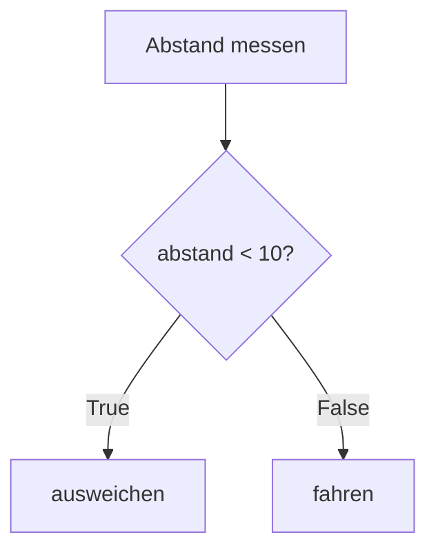
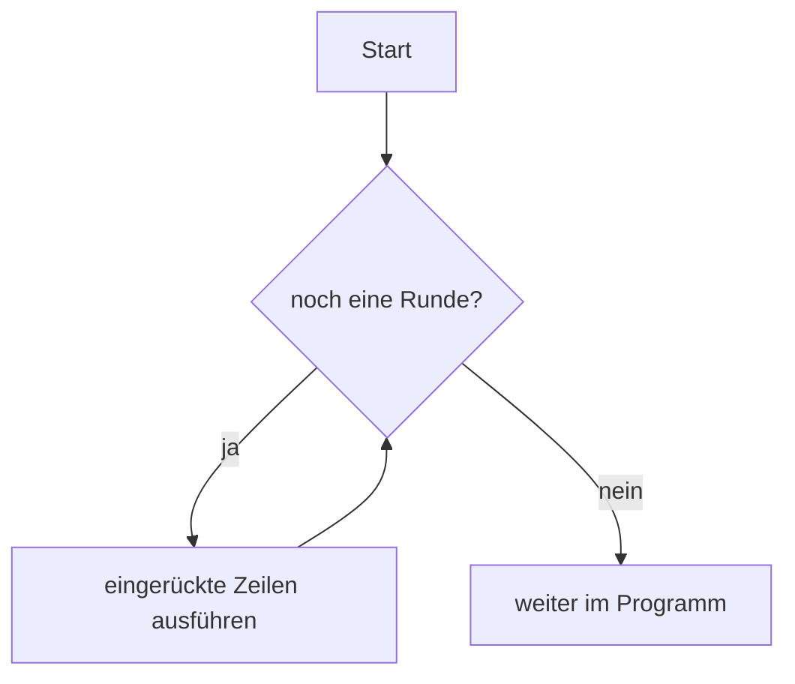
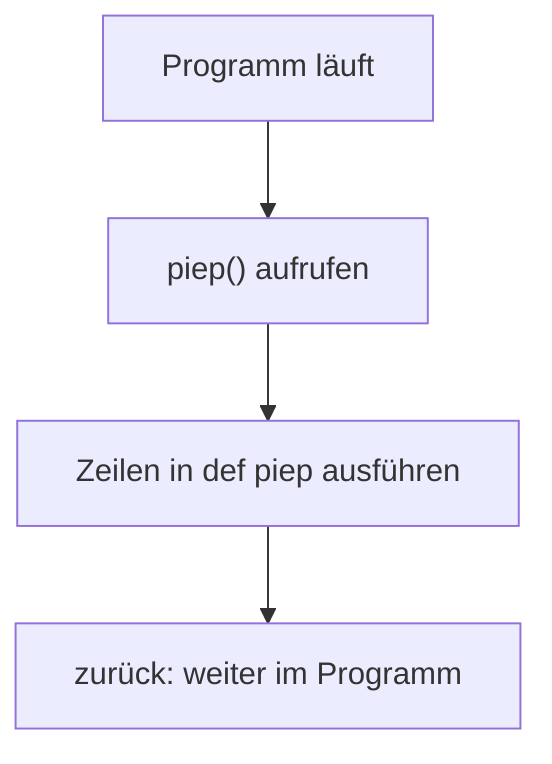
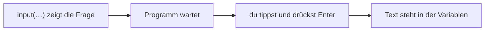
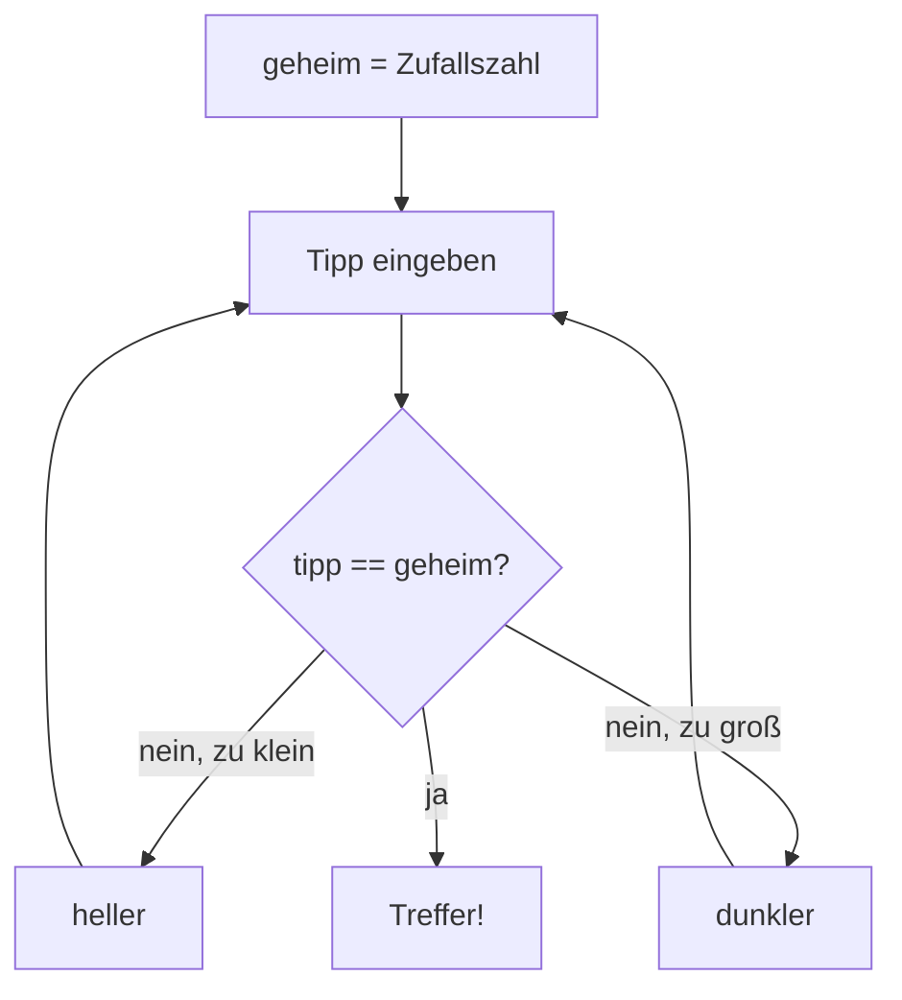
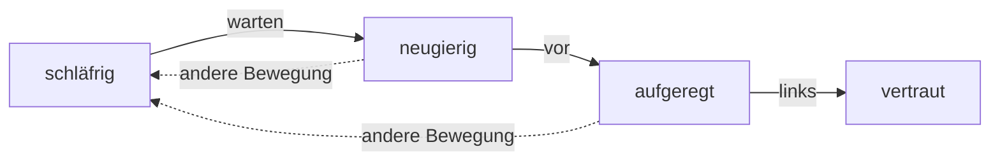

<!--
author:   André Dietrich
email:    LiaScript@web.de
version:  1.0.2
language: de
narrator: Deutsch Female
mode:     Presentation
dark:     true
logo:     ./assets/images/kurslogo.webp
icon:     ./assets/images/kursicon.png
comment:  Lerne Python mit Mars-Rover Schildi: ein interaktiver Selbstlernkurs ab Klasse 7 ohne Vorkenntnisse. Fünf Module mit Turtle-Grafik, automatischen Rückmeldungen, animierten Geschichten und eigenem Abschlussspiel – direkt im Browser, ohne Installation.
tags:     Python, Programmieren lernen, Informatik, Schule, Sekundarstufe I, Klasse 7, Selbstlernkurs, Turtle-Grafik, Marsmission, Deutsch, LiaScript, OER, Open Educational Resources
repository: https://github.com/LiaPress/python-marsmission-schule
attribute: Kursinhalte © André Dietrich, lizenziert unter [CC BY 4.0](https://creativecommons.org/licenses/by/4.0/deed.de) – siehe [LICENSE](./LICENSE).
           Figuren, Szenenhintergründe, Sprecherporträts und Logo wurden für diesen Kurs KI-gestützt erstellt. Die technische Journal-Anzeige stammt aus [Teaching-Agent](https://github.com/LiaScript/teaching-agent); der vorhandene Lizenztext liegt unter [assets/LICENSE-teaching-agent.txt](./assets/LICENSE-teaching-agent.txt).

import:   https://raw.githubusercontent.com/LiaTemplates/pixijs/0.5.1/README.md
          https://raw.githubusercontent.com/LiaTemplates/Skulpt/0.0.7/README.md
          https://raw.githubusercontent.com/LiaTemplates/mermaid_template/0.1.4/README.md
          ./lia-templates/python-pruefung/README.md

script:   ./assets/scenes/tharsis.js

link:     https://fonts.googleapis.com/css2?family=Atkinson+Hyperlegible:wght@400;700&family=Space+Grotesk:wght@500;700&family=JetBrains+Mono:wght@400;600&display=swap
          ./assets/scenes/tharsis.css

@Tharsis.speaker: <!-- data-speaker="@0" -->

@Tharsis.init
<script>
window.TharsisVisuals.configure("@'0")
"LIA: stop"
</script>
@end

@style
/* ==== liascript-theming:start ==== */
/* links: https://fonts.googleapis.com/css2?family=Atkinson+Hyperlegible:wght@400;700&family=Space+Grotesk:wght@500;700&family=JetBrains+Mono:wght@400;600&display=swap */
/* theme: Mission Control — generated by liascript-theming, edit theme.json and rebuild */
:root {
  --theme-font-body: 'Atkinson Hyperlegible', sans-serif;
  --theme-font-heading: 'Space Grotesk', serif;
  --theme-font-mono: 'JetBrains Mono', monospace;
  --theme-heading-weight: 700;
  --theme-heading-letter-spacing: 0.025em;
  --theme-line-height: 1.6;
  --theme-radius: 0.4rem;
  --theme-radius-small: 0.2rem;
  --theme-radius-large: 0.6rem;
  --theme-shadow: 0 0.4rem 1.4rem rgba(0,10,24,.16);
}
/* surfaces & text: apply to every color theme */
:root.lia-variant-light {
  --color-background: 243,247,251;
  --color-text: 20,40,61;
  --color-border: 115,137,156;
  --lia-grey-lighter: 230,238,246;
  --lia-grey-light: 218,229,239;
}
:root.lia-variant-dark {
  --color-background: 9,19,33;
  --color-text: 230,241,250;
  --color-border: 88,119,139;
  --lia-grey-dark: 18,36,56;
  --lia-anthracite: 25,51,74;
}
/* accent: only the course theme (default) and the custom radio,
   so readers can still pick LiaScript's built-in color themes;
   --color-accent (LiaScript >= 2.3.0) = accent as text and border: links, active
   TOC entry, form borders; LiaScript would brighten it x2.5 in dark mode */
:root:is(.lia-theme-default, .lia-theme-custom) {
  --color-highlight: 8,101,121;
  --color-highlight-dark: 8,101,121;
  --color-accent: rgb(8,101,121);
}
:root.lia-theme-default {
  --color-highlight-menu: 8,101,121;
}
:root:is(.lia-theme-default, .lia-theme-custom).lia-variant-dark {
  --color-highlight: 10,112,133;
  --color-highlight-dark: 103,220,236;
  --color-accent: rgb(103,220,236);
}
/* notes and TTS bar set their own --color-accent on surface_strong in dark mode */
:root:is(.lia-theme-default, .lia-theme-custom).lia-variant-dark :is(.lia-notes, .lia-responsive-voice) {
  --color-accent: rgb(103,220,236);
}
:root.lia-variant-light { --theme-heading-color: #14283D; }
:root.lia-variant-dark { --theme-heading-color: #E6F1FA; }
/* ==== LiaScript theme adapter (liascript-theming) — keep verbatim ====
   Maps the --theme-* tokens onto LiaScript's CSS. Everything a theme
   changes lives in the token block above this one. */

/* -- fonts: body/mono via the global variables, headings & co. are
      compiled literals in LiaScript and need explicit selectors -- */
:root {
  --global-font-family: var(--theme-font-body);
  --global-font-mono: var(--theme-font-mono);
  --global-font-headline: var(--theme-font-heading);
}
body { line-height: var(--theme-line-height, 1.47); }
h1, h2, h3, .h1, .h2, .h3 {
  font-family: var(--theme-font-heading);
  font-weight: var(--theme-heading-weight, 600);
  letter-spacing: var(--theme-heading-letter-spacing, normal);
  text-transform: var(--theme-heading-transform, none);
  color: var(--theme-heading-color, inherit);
}
h4, h5, h6, .h4, .h5, summary, .lia-accordion__headline {
  font-family: var(--theme-font-subheading, var(--theme-font-body));
}
.lia-quote__text { font-family: var(--theme-font-quote, var(--theme-font-heading)); }
.lia-code, .lia-code--inline, code, kbd, samp, pre { font-family: var(--theme-font-mono); }
.lia-code .ace_editor { font-family: var(--theme-font-mono) !important; }

/* -- shape: radius for controls & surfaces (radio buttons, tags, circles stay) -- */
:is(button, .lia-btn, input, .lia-input, select, .lia-select, textarea, .lia-textarea, .lia-dropdown):not(.lia-radio, .lia-btn--tag, .lia-btn--small-tag),
.lia-code-terminal__input, .lia-pagination__content, .lia-script, .lia-support-menu__submenu {
  border-radius: var(--theme-radius);
}
.lia-checkbox[type='checkbox'], kbd, .lia-tooltip .lia-tooltiptext, .lia-code--inline {
  border-radius: var(--theme-radius-small);
}
details, .lia-quote, .lia-code__input, .lia-table-responsive, .lia-card {
  border-radius: var(--theme-radius-large);
  box-shadow: var(--theme-shadow);
}
.lia-quote, .lia-code__input { overflow: hidden; }
.lia-code__input .ace_editor { border-radius: inherit; }
.lia-support-menu__submenu { box-shadow: var(--theme-shadow-popup, 0 0 1rem rgba(128, 128, 128, 0.2)); }

/* -- dark mode: LiaScript brightens the accent by multiplying RGB
      (rgb(from … calc(r*2.5))), which turns a hand-picked accent into
      pastel/yellow. Since LiaScript 2.3.0 links, inline code text, the
      active TOC entry and form borders read --color-accent, which the
      token block sets; the rules below cover what is still multiplied
      and, marked "<= 2.2.2", what older interpreters multiply as well.
      Scoped to default/custom so the built-in color themes keep their
      behavior. -- */
:root:is(.lia-theme-default, .lia-theme-custom).lia-variant-dark :is(.lia-link, .lia-btn--outline, .lia-code--inline) {
  color: rgb(var(--color-highlight-dark));
  border-color: rgb(var(--color-highlight-dark));
}
:root:is(.lia-theme-default, .lia-theme-custom).lia-variant-dark :is(summary, summary:after, .lia-label, .lia-skip-nav, .lia-support-menu__item, .lia-quote__text),
:root:is(.lia-theme-default, .lia-theme-custom).lia-variant-dark :is(.lia-list--unordered, .lia-list--ordered) > li::marker {
  color: rgb(var(--color-highlight-dark));
}
/* .lia-btn--transparent: brightness filter; .lia-input: same filter <= 2.2.2 only */
:root:is(.lia-theme-default, .lia-theme-custom).lia-variant-dark :is(.lia-btn--transparent, .lia-input) {
  filter: none;
}
/* hidden navigation (>= 2.3.1): icon buttons float on the page; without the
   brightness filter above they need the accent as text */
:root:is(.lia-theme-default, .lia-theme-custom).lia-variant-dark .lia-navigation--hidden :is(#lia-btn-toc, #lia-btn-prev, #lia-btn-next, #lia-btn-sound, .lia-support-menu__item > button, .lia-support-menu__item > a.lia-btn) {
  color: rgb(var(--color-highlight-dark));
}
/* <= 2.2.2: form borders used the plain accent; quiz states keep their own colors */
:root:is(.lia-theme-default, .lia-theme-custom).lia-variant-dark :is(.lia-input, .lia-checkbox[type='checkbox'], .lia-radio[type='radio']):not(:checked, .is-disabled, [disabled], .is-success, .is-failure, .is-warning) {
  border-color: rgb(var(--color-highlight-dark));
}
/* alternating table rows: LiaScript uses a neutral grey in dark mode;
   survey matrices (>= 2.3.0) render the row statements as th */
:root.lia-variant-dark .lia-table.is-alternating .lia-table__row:nth-child(2n) :is(td, th) {
  background-color: rgb(var(--lia-grey-dark));
}
/* sticky first/last column: since 2.3.0 a gradient on top, hence the shorthand */
:root.lia-variant-dark .lia-table-responsive.has-thead-sticky.has-first-col-sticky .is-alternating .lia-table__row:nth-child(2n) :is(td, th):first-child:before,
:root.lia-variant-dark .lia-table-responsive.has-thead-sticky.has-last-col-sticky .is-alternating .lia-table__row:nth-child(2n) :is(td, th):last-child:before {
  background: rgb(var(--lia-grey-dark));
}
/* -- theme extras -- */
:root.lia-variant-dark { --mc-panel: #122438; --mc-line: #58778B; --mc-signal: #67DCEC; --mc-mission: #FFB36B; --mc-grid: rgba(103,220,236,.045); } :root.lia-variant-light { --mc-panel: #F3F7FB; --mc-line: #73899C; --mc-signal: #086579; --mc-mission: #99501C; --mc-grid: rgba(8,101,121,.045); } .lia-slide { background-image: linear-gradient(var(--mc-grid) 1px,transparent 1px),linear-gradient(90deg,var(--mc-grid) 1px,transparent 1px); background-size: 4rem 4rem; } .lia-slide__content { background-color: rgb(var(--color-background)); } .lia-slide__content .h1 { border-bottom: 1px solid var(--mc-line); border-left: .4rem solid var(--mc-mission); padding: .6rem 0 .8rem 1.4rem; } .lia-slide__content :is(details,.lia-code__input,.lia-table-responsive) { border: 1px solid var(--mc-line); background-color: var(--mc-panel); } details, details * { text-align: left; } :is(a,button,input,select,textarea,summary):focus-visible { outline: 2px solid var(--mc-signal); outline-offset: 3px; box-shadow: 0 0 .8rem color-mix(in srgb,var(--mc-signal) 25%,transparent); } @media (prefers-reduced-motion: no-preference) { .lia-btn { transition: box-shadow .15s ease; } .lia-btn:hover { box-shadow: 0 0 .8rem color-mix(in srgb,var(--mc-signal) 20%,transparent); } } @media (max-width:600px) { .lia-slide__content .h1 { padding-left: .8rem; overflow-wrap: anywhere; } }
/* ==== liascript-theming:end ==== */
@end

@custom
--color-highlight-menu: 255,255,255;
@end

-->

# Programmieren lernen mit Python – Schulversion

<!-- style="width:160px;max-width:40%;display:block;margin:0 auto 1rem;" -->


<!--- Turtle-Sprite: lia-templates/python-pruefung/assets/schildi-oben.png wird durch python-pruefung.js als selbstständige SVG-Bildform eingebettet, einschließlich der Sensorvarianten. --->

<!--- Frontal-Sprecher: assets/images/amara-speaker.webp und assets/images/jonas-speaker.webp werden durch assets/scenes/tharsis.js geladen und bei Sprechtexten animiert. --->

@[Tharsis.init](./assets/images/tharsis-crew.webp)

    @Tharsis.speaker(okoye)
    --{{0 Deutsch Female}}--
Hier spricht Kommandantin Amara Okoye von der Mars-Station Tharsis. Willkommen, Erde! Wir brauchen deine Hilfe: Unser Rover Schildi ist gerade gelandet, und nur du kannst ihm Programme schicken. In diesem Kurs lernst du dafür Python – direkt im Browser, ohne Installation. Am Ende baust du sogar dein eigenes kleines Spiel. Blättere weiter, sobald du bereit bist.

Willkommen auf der Mars-Station Tharsis! In diesem Kurs steuerst du den Rover Schildi mit Python – Programm für Programm, direkt im Browser, ohne Installation. Am Ende hast du dein eigenes kleines Spiel gebaut.

      {{1}}
> [!TIP] Ton an!
> Dieser Kurs erzählt dir viel zum Zuhören. Kein Ton? Kein Problem – alles Wichtige steht auch auf den Seiten.

    @Tharsis.speaker(okoye)
    --{{1 Deutsch Female}}--
Ein Tipp: Mach den Ton an. Dann erzählen wir – Schildi und ich – dir zu jedem Schritt, was gerade passiert. Wenn du keinen Ton hast, ist das auch in Ordnung: Alles Wichtige steht auch auf den Seiten.

## Hallo Schildi

@[Tharsis.init](./assets/images/tharsis-crew.webp)

    @Tharsis.speaker(okoye)
    --{{0 Deutsch Female}}--
Heute ist ein besonderer Tag: Du nimmst zum ersten Mal Kontakt mit Schildi auf. Das passiert in drei Schritten.

Heute nimmst du zum ersten Mal Kontakt mit Schildi auf – in drei Schritten:

      {{1}}
1. Du erfährst, was auf dem Mars gerade los ist.

@Tharsis.speaker(okoye)
--{{1 Deutsch Female}}--
Zuerst erzähle ich dir, was hier auf dem Mars gerade passiert ist. Es ist eine Menge.

      {{2}}
2. Du lernst den Erd-Simulator kennen.

@Tharsis.speaker(okoye)
--{{2 Deutsch Female}}--
Dann zeige ich dir den Erd-Simulator. Dort testest du jedes Programm, bevor es auf die lange Reise zum Mars geht.

      {{3}}
3. Du schickst deinen ersten Funkspruch.

@Tharsis.speaker(okoye)
--{{3 Deutsch Female}}--
Und zum Schluss schickst du Schildi deinen allerersten Funkspruch. Das dauert ungefähr eine Stunde. Du kannst jederzeit Pause machen und später genau hier weitermachen.

### Funkkontakt

@[Tharsis.init](./assets/images/tharsis-crew.webp)

    @Tharsis.speaker(okoye)
    --{{0 Deutsch Female}}--
Hier siehst du, was auf dem Mars passiert ist. Tippe in die Szene, um weiterzulesen.

```text @Pixi.story
story funkkontakt "Funkkontakt"
lang de-DE
option tts=on
bg station assets/images/station-tharsis.webp alt="Kontrollraum der Station Tharsis, Amaras geschützter Arbeitsplatz"
bg mars assets/images/mars-landestelle.webp alt="Landestelle mit Station, Reifenspuren und roten Marsbergen"
char okoye "Kommandantin Amara Okoye" type=tharsis person=okoye height=0.52 y=0.74 voice="Deutsch Female"
char schildi "Schildi" type=tharsis person=schildi height=0.38 y=0.78 voice="Deutsch Male"

char amara "Kommandantin Amara Okoye" type=tharsis person=okoye mode=room height=0.68 y=0.80 voice="Deutsch Female"

# start
bg station fade 0.8
atmosphere clear
: Im geschützten Kontrollraum der Station Tharsis. Amara Okoye öffnet den Funkkanal zur Erde.
show amara happy at left fade 0.5
amara happy: Erde, hier Station Tharsis! Hörst du mich?
amara: Unser Rover Schildi steht draußen sicher auf dem Boden. Seine Bord-KI ist ganz neu.
hide amara fade 0.5
bg mars fade 0.8
atmosphere dust
: Außenkamera an der Landestelle. Amara bleibt in der Station; links siehst du ihr Funkbild.
show okoye happy at left fade 0.5
show schildi sleepy at far-right fade 0.5
move schildi to right 1.2s ease=inout
okoye thinking: Sie wartet auf ihr allererstes Programm – und das kommt von dir.
schildi sleepy: ...
signal #67DCEC
okoye: Ein Funkspruch braucht einige Minuten bis hierher. Darum schickst du Schildi fertige Programme.
? Ich bin bereit! -> bereit
? Was ist ein Programm? -> programm

# programm
okoye: Eine Liste von Befehlen. Schildi führt sie Schritt für Schritt aus – genau so, wie sie dastehen.
-> bereit

# bereit
okoye happy: Dann los! Lerne zuerst den Erd-Simulator kennen.
end start "Blättere weiter zu „Der Erd-Simulator“."
```

> [!NOTE] Kurz gesagt
> Schildi ist auf dem Mars gelandet. Seine Bord-KI wartet auf ihr erstes Programm – und das schickst du.

### Der Erd-Simulator

@[Tharsis.init](./assets/images/tharsis-crew.webp)

    @Tharsis.speaker(okoye)
    --{{0 Deutsch Female}}--
Willkommen im Erd-Simulator! Bevor ein Programm die lange Reise zum Mars antritt, testen wir es hier auf der Erde. Ein Fehler hier kostet nichts – ein Fehler auf dem Mars kostet Zeit, Energie und manchmal einen ganzen Tag. Ich zeige dir jetzt, wie der Simulator funktioniert.

Bevor ein Programm zu Schildi auf den Mars geht, testest du es hier im **Erd-Simulator**.

      {{1}}
************************************************

**Code-Kasten:** Hier steht ein Programm – ändern erlaubt! Mit dem Knopf **Ausführen** unter dem Kasten startest du es. Probier es gleich aus:

```python
print("Test, Test – hier ist die Erde.")
```
```python -Prüfung
erwarte(ausgabe().strip() != "", "Es ist nichts angekommen – hast du den Text zwischen den Anführungszeichen gelöscht?")
```
@PythonCheck.eval

************************************************

    @Tharsis.speaker(okoye)
    --{{1 Deutsch Female}}--
Das ist ein Code-Kasten. Darin steht ein Programm, also eine Liste von Befehlen für Schildi. Du darfst alles ändern, was du willst – kaputtmachen kannst du hier nichts. Probier es gleich aus: Drück auf den Knopf unter dem Kasten.

      {{2}}
**Funkspruch:** Was dein Programm sendet, erscheint direkt unter dem Kasten.

    @Tharsis.speaker(schildi)
    --{{2 Deutsch Male}}--
SCHILDI an ERDE: Alles, was du sendest, erscheint unter dem Kasten. So höre ich dich. Schau, unter dem Kasten steht jetzt dein Testfunkspruch. Bitte sprich immer deutlich. Ich nehme alles wörtlich.

      {{3}}
**Prüfung:** **✅ Geschafft!** heißt: Schildi hat alles richtig empfangen. **💡** heißt: Da fehlt noch etwas – der Hinweis sagt dir, was.

    @Tharsis.speaker(okoye)
    --{{3 Deutsch Female}}--
Nach dem Ausführen prüft der Simulator dein Programm. Siehst du den grünen Haken mit „Geschafft“ unter dem Testfunkspruch? Er heißt: Schildi hat alles richtig empfangen. Eine Glühbirne heißt: Da fehlt noch etwas – lies dann den Hinweis daneben. Lösch einmal den ganzen Text im Kasten und führ es noch einmal aus. Dann siehst du, wie so ein Hinweis aussieht.

      {{4}}
************************************************

**Speicherfunde:** Hängst du fest, klapp einen **💾 Speicherfund** auf – erst ein kleiner Tipp, dann ein größerer, zuletzt die Lösung. Probier es hier:

<details>

<summary>💾 Speicherfund 1</summary>

So sieht ein Speicherfund aus: ein kleiner Tipp aus Schildis Speicher.

</details>
<details>

<summary>💾 Speicherfund 2</summary>

Der zweite verrät schon mehr. Auf den nächsten Seiten helfen sie dir bei den Aufgaben.

</details>

************************************************

    @Tharsis.speaker(schildi)
    --{{4 Deutsch Male}}--
SCHILDI an ERDE: In meinem Speicher habe ich alte Notizen gefunden. Ich nenne sie Speicherfunde. Klapp einen auf, dann siehst du, wie das aussieht. Wenn du später festhängst, helfen sie dir. Aber probier es bitte zuerst selbst. Ich lerne auch lieber, wenn ich selbst darauf komme.

      {{5}}
**Basis und Extra:** Jede Aufgabe hat einen **Basis**-Teil. Wer mehr will, macht danach das **Extra**.

    @Tharsis.speaker(okoye)
    --{{5 Deutsch Female}}--
Jede Aufgabe hat einen Basis-Teil – den schafft jeder. Wenn du danach noch Lust hast, gibt es ein Extra. Das ist freiwillig, aber Schildi freut sich über jede Herausforderung.

### Dein erster Funkspruch

@[Tharsis.init](./assets/images/tharsis-crew.webp)

    @Tharsis.speaker(okoye)
    --{{0 Deutsch Female}}--
Jetzt wird es ernst: Du schickst Schildi deinen ersten Funkspruch. Aber zuerst eine kleine Denkaufgabe. Ich habe Schildi vorhin schon ein Programm geschickt. Schau es dir an und überlege, was er wohl empfangen hat.

**1. Vorhersagen:** Kommandantin Okoye hat Schildi dieses Programm geschickt:

```python
print("SCHILDI, hörst du mich?")
```

Was erscheint als Funkspruch?

<!-- data-hint-button="1" data-solution-button="false" -->
- [( )] `print("SCHILDI, hörst du mich?")`
- [(X)] `SCHILDI, hörst du mich?`
- [( )] `"SCHILDI, hörst du mich?"`
[[?]] Die Anführungszeichen zeigen nur, wo der Text anfängt und aufhört. Gesendet wird, was dazwischen steht.

                 {{1}}
************************************************

**2. Ausprobieren:** Führ das Programm aus. Dann ändere den Text und führ es noch einmal aus.

```python
print("SCHILDI, hörst du mich?")
```
```python -Prüfung
erwarte(ausgabe().strip() != "", "Schildi hat nichts empfangen – steht dein Text noch zwischen den Anführungszeichen?")
```
@PythonCheck.eval

************************************************

    @Tharsis.speaker(schildi)
    --{{1 Deutsch Male}}--
SCHILDI an ERDE: Das Wort print bedeutet: Gib das aus. Alles zwischen den Anführungszeichen schicke ich weiter. Probier es aus! Und dann ändere den Text – ich will hören, was du mir sagst.

                 {{2}}
************************************************

**3. Selbst schreiben (Basis):** Ersetze `___` durch deinen eigenen Funkspruch an Schildi.

```python
print("___")
```
```python -Prüfung
erwarte("___" not in ausgabe(), "Ersetze die drei Striche ___ durch deinen eigenen Funkspruch.")
erwarte(len(ausgabe().strip()) >= 3, "Dein Funkspruch ist sehr kurz – schreib Schildi ein paar Wörter.")
```
@PythonCheck.eval

<details>

<summary>💾 Speicherfund 1</summary>

Lösche nur die drei Striche – die Anführungszeichen bleiben stehen.

</details>
<details>

<summary>💾 Speicherfund 2</summary>

So sieht es zum Beispiel aus: `print("Hallo Schildi, hier ist die Erde!")`

</details>

************************************************

    @Tharsis.speaker(okoye)
    --{{2 Deutsch Female}}--
Jetzt bist du dran. Schreib deinen eigenen Funkspruch an Schildi. Ersetze die drei Striche durch deinen Text, aber lass die Anführungszeichen stehen. Was du schreibst, ist ganz dir überlassen.

                 {{3}}
************************************************

**Extra:** Schick Schildi **zwei** Funksprüche – deinen Namen und einen Gruß, also zwei Zeilen mit `print`.

```python
print("___")
```
```python -Prüfung
zeilen = [z for z in ausgabe().strip().split("\n") if z.strip() != ""]
erwarte(len(zeilen) >= 2, "Schick zwei Funksprüche – schreib eine zweite Zeile mit print darunter.")
erwarte("___" not in ausgabe(), "Ersetze die drei Striche ___ durch deinen Text.")
```
@PythonCheck.eval

************************************************

    @Tharsis.speaker(schildi)
    --{{3 Deutsch Male}}--
SCHILDI an ERDE: Ich möchte wissen, wer du bist! Schick mir zwei Funksprüche: zuerst deinen Namen, dann einen Gruß. Dafür brauchst du zwei Zeilen – jede mit ihrem eigenen print.

### Die erste rote Meldung

@[Tharsis.init](./assets/images/tharsis-crew.webp)

    @Tharsis.speaker(okoye)
    --{{0 Deutsch Female}}--
Oh nein – dieser Funkspruch ist verstümmelt angekommen. Führ ihn aus und schau, was passiert. Keine Sorge, du kannst nichts kaputtmachen.

Ein Funkspruch ist verstümmelt angekommen. Führ ihn aus und schau, was passiert:

```python
print("SCHILDI, hörst du mich?)
```
```python -Prüfung
erwarte("SCHILDI" in ausgabe(), "Schildi hat noch nichts empfangen – ist der Text richtig eingerahmt?")
```
@PythonCheck.eval

                 {{1}}
************************************************

Keine Angst vor Rot! Eine Fehlermeldung ist ein **abgefangener Funkspruch** von Python. Lies ihn wie einen Brief:

- **Zeile** (`line 1`) = Absender: Hier sitzt das Problem.
- **Fehlerart** (`SyntaxError`) = Betreff: Python versteht die Schreibweise nicht.
- **Letzte Zeile** = die eigentliche Nachricht.

************************************************

    @Tharsis.speaker(schildi)
    --{{1 Deutsch Male}}--
SCHILDI an ERDE: Rot! Rot! Meine Statuslampe blinkt rot. Das ist eine Fehlermeldung. Für mich ist das wie ein abgefangener Brief von Python. Die Zeilennummer verrät den Absender, also wo das Problem sitzt. Die Fehlerart ist der Betreff. Und die letzte Zeile ist die eigentliche Nachricht.

                 {{2}}
************************************************

Repariere das Programm oben und führ es noch einmal aus.

<details>

<summary>💾 Speicherfund 1</summary>

Zähle die Anführungszeichen. Ein Text braucht zwei – eins am Anfang, eins am Ende.

</details>
<details>

<summary>💾 Speicherfund 2</summary>

Das zweite Anführungszeichen fehlt hinter dem Fragezeichen.

</details>
<details>

<summary>💾 Lösung</summary>

`print("SCHILDI, hörst du mich?")`

</details>

************************************************

    @Tharsis.speaker(okoye)
    --{{2 Deutsch Female}}--
Jetzt reparierst du das Programm. Schau genau hin: Python braucht bei einem Text immer zwei Anführungszeichen – eins am Anfang und eins am Ende. Wenn du nicht weiterkommst, helfen dir die Speicherfunde.

                 {{3}}
> [!NOTE] 🗄️ Fehlerkabinett – Nr. 1
> **SyntaxError** – Python versteht die Schreibweise nicht. Oft fehlt ein Anführungszeichen oder eine Klammer.

    @Tharsis.speaker(schildi)
    --{{3 Deutsch Male}}--
SCHILDI an ERDE: Diesen Fehler hebe ich auf! Ich sammle alle Fehlerarten in meinem Fehlerkabinett. Das hier ist Nummer eins: der SyntaxError. Er heißt: Die Schreibweise stimmt nicht.

### Selbsttest

@[Tharsis.init](./assets/images/tharsis-crew.webp)

    @Tharsis.speaker(okoye)
    --{{0 Deutsch Female}}--
Zum Schluss drei kurze Fragen. Sie zeigen dir, ob du das Wichtigste verstanden hast. Du kannst sie so oft wiederholen, wie du willst – hier gibt es keine Noten.

Drei kurze Fragen – du kannst sie so oft wiederholen, wie du willst.

Wozu dient `print`?

<!-- data-hint-button="1" data-max-trials="2" data-solution-button="false" data-text-resolved="Hier ist die Lösung – lies sie in Ruhe." -->
- [(X)] Es gibt einen Text als Funkspruch aus.
- [( )] Es speichert einen Text für später.
- [( )] Es löscht einen Text vom Bildschirm.
[[?]] Denk an deinen ersten Funkspruch: Was ist unter dem Kasten erschienen?

Du hängst bei einer Aufgabe fest. Was hilft dir als Erstes?

<!-- data-hint-button="1" data-max-trials="2" data-solution-button="false" data-text-resolved="Hier ist die Lösung – lies sie in Ruhe." -->
- [( )] Sofort die ganze Lösung aufklappen.
- [(X)] Den ersten Speicherfund aufklappen.
- [( )] Die ganze Seite noch einmal laden.
[[?]] Die Speicherfunde helfen dir Schritt für Schritt – erst ein kleiner Tipp.

Welche Zeile einer Fehlermeldung ist die eigentliche Nachricht?

<!-- data-hint-button="1" data-max-trials="2" data-solution-button="false" data-text-resolved="Hier ist die Lösung – lies sie in Ruhe." -->
- [( )] die erste Zeile
- [( )] die mittlere Zeile
- [(X)] die letzte Zeile
[[?]] Denk an den Brief: Die Nachricht steht am Ende.

### Schildi antwortet

@[Tharsis.init](./assets/images/tharsis-crew.webp)

    @Tharsis.speaker(okoye)
    --{{0 Deutsch Female}}--
Und jetzt: Schildis Antwort. Tippe in die Szene, um weiterzulesen.

```text @Pixi.story
story schildi-antwortet "Schildi antwortet"
lang de-DE
option tts=on
bg mars assets/images/mars-landestelle.webp alt="Landestelle mit Station, Reifenspuren und roten Marsbergen"
char okoye "Kommandantin Amara Okoye" type=tharsis person=okoye height=0.52 y=0.74 voice="Deutsch Female"
char schildi "Schildi" type=tharsis person=schildi height=0.38 y=0.78 voice="Deutsch Male"

# start
bg mars fade 0.8
atmosphere dust
: Außenansicht bei Schildi. Die gerahmten Funkbilder zeigen die Crew innerhalb der Station Tharsis.
show schildi happy at far-right fade 0.5
move schildi to center 1.2s ease=inout
schildi happy: SCHILDI an ERDE: Funkspruch empfangen. Ich höre dich!
signal #67DCEC
show okoye happy at left fade 0.5
okoye happy: Es hat geklappt – Schildi versteht dich.
schildi thinking: SCHILDI an ERDE: Hier ist nur Staub. Ich möchte eine Landemarkierung zeichnen. Wie geht das?
okoye: Das zeigst du ihm im nächsten Modul.
end ende "Weiter geht es mit „Spuren im Staub“."
```

> [!NOTE] Kurz gesagt
> Schildi hat deinen Funkspruch empfangen. Als Nächstes möchte er eine Landemarkierung in den Staub zeichnen – das lernst du im nächsten Modul.

## Spuren im Staub

@[Tharsis.init](./assets/images/tharsis-crew.webp)

    @Tharsis.speaker(okoye)
    --{{0 Deutsch Female}}--
Willkommen zurück, Erde! Schildi hat deinen ersten Funkspruch empfangen. Heute bekommt er eine richtige Aufgabe: Er soll eine Landemarkierung in den Staub zeichnen. Dafür muss er sich Zahlen merken, rechnen, Meldungen schicken und fahren. Das lernst du in diesem Modul.

Schildi bekommt eine Aufgabe: eine **Landemarkierung** im Staub. Dafür lernst du heute:

- Werte merken (Variablen)
- rechnen
- Funksprüche aus Text und Zahlen bauen
- mit Schildi auf dem Marsboden fahren und zeichnen

### Neuer Auftrag

@[Tharsis.init](./assets/images/tharsis-crew.webp)

    @Tharsis.speaker(okoye)
    --{{0 Deutsch Female}}--
Auf der Station ist jemand Neues aufgewacht. Tippe in die Szene, um weiterzulesen.

```text @Pixi.story
story neuer-auftrag "Neuer Auftrag"
lang de-DE
option tts=on
bg mars assets/images/mars-landestelle.webp alt="Außenkamera an Schildis Route; die Crew meldet sich aus der Station"
char okoye "Kommandantin Amara Okoye" type=tharsis person=okoye height=0.52 y=0.74 voice="Deutsch Female"
char berg "Techniker Jonas Berg" type=tharsis person=berg height=0.52 y=0.74 voice="Deutsch Male"
char schildi "Schildi" type=tharsis person=schildi height=0.38 y=0.78 voice="Deutsch Male"

# start
bg mars fade 0.8
atmosphere clear
: Außenansicht bei Schildi. Die gerahmten Funkbilder zeigen die Crew innerhalb der Station Tharsis.
: Früher Morgen an der Landestelle. Jonas und Amara melden sich per Bildfunk aus dem Kontrollraum.
show berg sleepy at left fade 0.5
berg sleepy: Guten Morgen ... Moment. Ist das mein Rover?
show schildi happy at far-right fade 0.5
move schildi to right 1.2s ease=inout
berg happy: Schildi! Ich habe ihn gebaut, Schraube für Schraube.
show okoye thinking at center fade 0.5
okoye thinking: Ein Sturm ist angekündigt. Ohne Landemarkierung finden wir Schildi danach nicht wieder.
berg: Dann muss Schildi sich Zahlen merken – Akku, Strecke – und eine Markierung zeichnen.
schildi sad: SCHILDI an ERDE: Ich kann nichts behalten. Alles vergesse ich sofort.
okoye happy: Das ändern wir. Die Erde zeigt dir, wie.
end start "Blättere weiter zu „Schildis Notizbuch“."
```

> [!NOTE] Kurz gesagt
> Ein Sturm kommt. Schildi soll eine Landemarkierung zeichnen – dafür muss er sich zuerst Zahlen merken können.

### Schildis Notizbuch

@[Tharsis.init](./assets/images/tharsis-crew.webp)

    @Tharsis.speaker(berg)
    --{{0 Deutsch Male}}--
Hallo Erde, ich bin Jonas Berg, ich habe Schildi gebaut. Schildi braucht ein Notizbuch. In Python heißt so eine Notiz Variable. Links steht der Name, rechts der Wert. Und das Gleichheitszeichen heißt hier nicht „ist gleich“, sondern: Merk dir das!

Eine **Variable** ist eine Notiz mit Namen:

```python
akku = 80
```

**Name** ← **Wert**. Das `=` heißt „merk dir das“, nicht „ist gleich“.

**Vorhersagen:** Was gibt dieses Programm aus?

```python
akku = 80
print(akku)
```

<!-- data-hint-button="1" data-solution-button="false" -->
- [( )] `akku`
- [(X)] `80`
- [( )] `akku = 80`
[[?]] Ohne Anführungszeichen schaut Python in seinem Notizbuch nach, was unter dem Namen steht.

{{1}}
************************************************

**Aufgabe 1 (Basis):** Lege die Variable `akku` mit dem Wert 80 und die Variable `strecke` mit dem Wert 25 an. Gib beide aus.

```python
akku = 80
strecke = ___
print(akku)
print(strecke)
```
```python -Prüfung
try:
    a, s = akku, strecke
except NameError:
    a, s = None, None
erwarte(a == 80, "akku soll 80 sein.")
erwarte(s == 25, "strecke stimmt noch nicht – ersetze ___ durch den Wert aus der Aufgabe.")
erwarte("80" in ausgabe() and "25" in ausgabe(), "Gib beide Werte mit print aus.")
```
@PythonCheck.eval

<details>

<summary>💾 Speicherfund 1</summary>

Ersetze `___` durch die Zahl – ohne Anführungszeichen.

</details>
<details>

<summary>💾 Speicherfund 2</summary>

`strecke = 25`

</details>

************************************************

@Tharsis.speaker(berg)
--{{1 Deutsch Male}}--
Jetzt legst du Schildis erste Notizen an: den Akkustand und die gefahrene Strecke. Zahlen schreibst du ohne Anführungszeichen.

{{2}}
************************************************

**Aufgabe 2:** Schildi ist gefahren, sein Akku steht jetzt bei 65. Ändere den Wert und gib ihn noch einmal aus.

```python
akku = 80
print(akku)
akku = ___
print(akku)
```
```python -Prüfung
try:
    a = akku
except NameError:
    a = None
erwarte(a == 65, "Am Ende soll in akku 65 stehen.")
erwarte(ausgabe().strip().endswith("65"), "Die letzte Ausgabe soll 65 sein.")
```
@PythonCheck.eval

<details>

<summary>💾 Speicherfund 1</summary>

Du kannst eine Notiz überschreiben: Schreib einfach noch einmal `akku = …` mit dem neuen Wert.

</details>
<details>

<summary>💾 Speicherfund 2</summary>

`akku = 65`

</details>

************************************************

    @Tharsis.speaker(schildi)
    --{{2 Deutsch Male}}--
SCHILDI an ERDE: Ich bin gefahren und mein Akku ist leerer geworden. Du kannst eine Notiz überschreiben. Dann vergesse ich den alten Wert und merke mir den neuen.

{{3}}
************************************************

**Was steht jetzt in `akku`?**

```python
akku = 80
akku = 70
akku = 50
```

<!-- data-hint-button="1" data-solution-button="false" -->
- [( )] 80
- [( )] 70
- [(X)] 50
[[?]] Python liest von oben nach unten. Jede neue Zeile überschreibt die alte Notiz.

**Extra:** Lege `name = "Schildi"` an und gib den Namen aus.

```python
name = ___
print(name)
```
```python -Prüfung
try:
    n = name
except NameError:
    n = None
erwarte(n == "Schildi", "In name soll der Text \"Schildi\" stehen – mit Anführungszeichen.")
erwarte("Schildi" in ausgabe(), "Gib den Namen mit print aus.")
```
@PythonCheck.eval

<details>

<summary>💾 Speicherfund 1</summary>

Ein Name ist Text – Text steht in Anführungszeichen.

</details>
<details>

<summary>💾 Speicherfund 2</summary>

`name = "Schildi"`

</details>

************************************************

    @Tharsis.speaker(okoye)
    --{{3 Deutsch Female}}--
Kleine Denkaufgabe: Was steht am Ende im Notizbuch? Und im Extra bekommt Schildi seinen Namen – ein Name ist Text, also mit Anführungszeichen.

### Rechnen auf dem Mars

@[Tharsis.init](./assets/images/tharsis-crew.webp)

    @Tharsis.speaker(schildi)
    --{{0 Deutsch Male}}--
SCHILDI an ERDE: Ich bin zwölf Meter gefahren, dann acht, dann fünfzehn. Wie weit war das insgesamt? Ich rechne nicht gern im Kopf. Kannst du mir das ausrechnen lassen?

Python rechnet für dich:

| Zeichen | Bedeutung |
|---|---|
| `+` | plus |
| `-` | minus |
| `*` | mal |
| `/` | geteilt durch |

**Vorhersagen:** Was gibt dieses Programm aus?

```python
strecke = 12 + 8
print(strecke)
```

<!-- data-hint-button="1" data-solution-button="false" -->
- [( )] `128`
- [(X)] `20`
- [( )] `12 + 8`
[[?]] Python rechnet zuerst rechts vom `=` und merkt sich das Ergebnis.

{{1}}
************************************************

**Aufgabe 1 (Basis):** Rechne die Gesamtstrecke aus den drei Fahrten 12, 8 und 15 aus und gib sie aus.

```python
gesamt = ___
print(gesamt)
```
```python -Prüfung
try:
    g = gesamt
except NameError:
    g = None
erwarte(g == 35, "Noch nicht ganz. Zähle alle drei Fahrten zusammen.")
erwarte("35" in ausgabe(), "Gib gesamt mit print aus.")
```
@PythonCheck.eval

<details>

<summary>💾 Speicherfund 1</summary>

Du kannst mehrere Zahlen mit `+` verbinden.

</details>
<details>

<summary>💾 Speicherfund 2</summary>

`gesamt = 12 + 8 + 15`

</details>

************************************************

    @Tharsis.speaker(okoye)
    --{{1 Deutsch Female}}--
Schreib die Rechnung rechts vom Gleichheitszeichen hin. Python rechnet sie aus und merkt sich das Ergebnis unter dem Namen gesamt.

{{2}}
************************************************

**Aufgabe 2:** Jede Fahrt kostet 10 Prozent Akku. Schildi startet mit 80 und fährt dreimal. Ziehe dreimal 10 ab und gib den Akku aus.

```python
akku = 80
akku = akku - 10
___
___
print(akku)
```
```python -Prüfung
try:
    a = akku
except NameError:
    a = None
erwarte(a == 50, "Nach drei Fahrten soll der Akku bei 50 stehen.")
erwarte(code().count("akku - 10") >= 3, "Ziehe dreimal mit akku = akku - 10 ab.")
```
@PythonCheck.eval

<details>

<summary>💾 Speicherfund 1</summary>

Die Zeile `akku = akku - 10` darfst du einfach noch zweimal schreiben.

</details>
<details>

<summary>💾 Speicherfund 2</summary>

Ersetze beide `___` durch `akku = akku - 10`.

</details>

************************************************

@Tharsis.speaker(berg)
--{{2 Deutsch Male}}--
Die Zeile akku gleich akku minus zehn sieht in Mathe falsch aus. In Python ist sie richtig: Rechts wird zuerst gerechnet, mit dem alten Wert. Dann kommt das Ergebnis links ins Notizbuch.

{{3}}
************************************************

**Aufgabe 3:** Wie lang war eine Fahrt im Durchschnitt? Teile die Gesamtstrecke durch 3 und gib das Ergebnis aus.

```python
gesamt = 35
durchschnitt = ___
print(durchschnitt)
```
```python -Prüfung
try:
    d = durchschnitt
except NameError:
    d = None
erwarte(d is not None and abs(d - 35 / 3) < 0.01, "Noch nicht. Durchschnitt heißt: die Gesamtstrecke gleichmäßig auf die 3 Fahrten verteilen.")
```
@PythonCheck.eval

<details>

<summary>💾 Speicherfund 1</summary>

Für „geteilt durch“ schreibt Python `/`. Rechne mit der Variablen `gesamt`.

</details>
<details>

<summary>💾 Speicherfund 2</summary>

`durchschnitt = gesamt / 3`

</details>

> [!TIP] Kommazahlen
> Geteilt durch (`/`) ergibt in Python **immer** eine Kommazahl – auch `6 / 3` ergibt `2.0`. Und Python schreibt einen **Punkt** statt eines Kommas.

**Extra:** Ein Meter kostet 2 Prozent Akku. Wie weit kommt Schildi mit `akku = 50`?

```python
akku = 50
reichweite = ___
print(reichweite)
```
```python -Prüfung
try:
    r = reichweite
except NameError:
    r = None
erwarte(r is not None and abs(r - 25) < 0.01, "Noch nicht ganz. Jeder Meter verbraucht 2 Prozent – wie oft passen 2 Prozent in den Akku?")
zeile = [z for z in code().split("\n") if z.strip().startswith("reichweite")]
erwarte(len(zeile) > 0 and "akku" in zeile[0], "Richtige Zahl! Rechne sie jetzt mit der Variablen akku aus – dann stimmt es auch bei einem anderen Akkustand.")
```
@PythonCheck.eval

<details>

<summary>💾 Speicherfund 1</summary>

Wie oft passt die 2 in die 50? Dafür gibt es eine Rechenart.

</details>
<details>

<summary>💾 Speicherfund 2</summary>

`reichweite = akku / 2`

</details>

************************************************

    @Tharsis.speaker(schildi)
    --{{3 Deutsch Male}}--
SCHILDI an ERDE: Elf Komma sechs sechs sechs? Ein Komma? Ach so, geteilt durch gibt immer eine Kommazahl. Und Python schreibt einen Punkt statt eines Kommas. Merke ich mir.

### Funksprüche mit Text

@[Tharsis.init](./assets/images/tharsis-crew.webp)

    @Tharsis.speaker(okoye)
    --{{0 Deutsch Female}}--
Schildi soll uns Meldungen schicken, in denen Zahlen vorkommen. Dafür brauchen wir Text. Text heißt in Python String. Einen String erkennst du an den Anführungszeichen.

Ein **String** ist Text in Anführungszeichen: `"Akku"`.

- Mit `+` hängst du Strings aneinander.
- Mit `*` wiederholst du einen String.
- `str()` macht aus einer Zahl einen String.

{{1}}
************************************************

**Aufgabe 1 (Basis):** Baue aus den drei Bausteinen mit `+` den Funkspruch `SCHILDI an ERDE` und gib ihn aus.

```python
funkspruch = "SCHILDI" + ___ + "ERDE"
print(funkspruch)
```
```python -Prüfung
erwarte("SCHILDI an ERDE" in ausgabe(), "Es soll genau SCHILDI an ERDE erscheinen – achte auf die Leerzeichen in \" an \".")
```
@PythonCheck.eval

<details>

<summary>💾 Speicherfund 1</summary>

Der mittlere Baustein ist auch ein String – mit Leerzeichen vorn und hinten.

</details>
<details>

<summary>💾 Speicherfund 2</summary>

`funkspruch = "SCHILDI" + " an " + "ERDE"`

</details>

************************************************

@Tharsis.speaker(okoye)
--{{1 Deutsch Female}}--
Mit dem Pluszeichen hängst du Texte aneinander. Achte auf die Leerzeichen: Python klebt die Texte ganz genau so zusammen, wie sie dastehen.

{{2}}
************************************************

**Aufgabe 2:** Gib aus: `Akku: 80`. Die Zahl steht in einer Variablen – mach mit `str()` einen String daraus.

```python
akku = 80
print("Akku: " + ___)
```
```python -Prüfung
erwarte("Akku: 80" in ausgabe(), "Es soll Akku: 80 erscheinen.")
erwarte("str(" in code(), "Mach die Zahl mit str(akku) zu einem String.")
```
@PythonCheck.eval

<details>

<summary>💾 Speicherfund 1</summary>

Text und Zahl passen nicht direkt zusammen. Erst `str(akku)` macht aus der Zahl Text.

</details>
<details>

<summary>💾 Speicherfund 2</summary>

`print("Akku: " + str(akku))`

</details>

************************************************

    @Tharsis.speaker(berg)
    --{{2 Deutsch Male}}--
Text und Zahl passen nicht einfach zusammen. Str macht aus einer Zahl einen String. Erst dann kannst du beides mit Plus verbinden.

{{3}}
************************************************

**Aufgabe 3:** Schildi piept zur Begrüßung dreimal. Wiederhole `"PIEP "` mit `*`.

```python
print("PIEP " * ___)
```
```python -Prüfung
erwarte(ausgabe().count("PIEP") == 3, "Schildi soll genau dreimal PIEP sagen.")
erwarte("*" in code(), "Dreimal PIEP – stimmt! Jetzt lass Python die Arbeit machen: Wiederhole den String mit dem Malzeichen *.")
```
@PythonCheck.eval

<details>

<summary>💾 Speicherfund 1</summary>

Die Zahl hinter `*` sagt, wie oft der String wiederholt wird.

</details>
<details>

<summary>💾 Speicherfund 2</summary>

`print("PIEP " * 3)`

</details>

**Extra:** Wie lang ist Schildis Name? `len()` zählt die Zeichen eines Strings – Leerzeichen zählen mit.

```python
name = "Schildi"
print(___)
```
```python -Prüfung
erwarte(ausgabe().strip() == "7", "Lass Python die Zeichen zählen – mit len().")
erwarte("len(" in code(), "Richtig gezählt! Jetzt lass Python zählen – mit len() und der Variablen in der Klammer.")
```
@PythonCheck.eval

<details>

<summary>💾 Speicherfund 1</summary>

In die Klammer von `len()` gehört die Variable.

</details>
<details>

<summary>💾 Speicherfund 2</summary>

`print(len(name))`

</details>

************************************************

    @Tharsis.speaker(schildi)
    --{{3 Deutsch Male}}--
SCHILDI an ERDE: Piep, piep, piep! Mit dem Malzeichen wiederhole ich einen Text. Und im Extra zählst du, wie viele Zeichen mein Name hat.

### Spuren im Staub

@[Tharsis.init](./assets/images/tharsis-crew.webp)

    @Tharsis.speaker(berg)
    --{{0 Deutsch Male}}--
Jetzt wird gefahren! Schildi kennt drei Befehle: forward heißt vorwärts, um so viele Schritte, wie in der Klammer steht. Left und right heißen links und rechts drehen, um so viele Grad. Und wo Schildi fährt, bleibt eine Spur im Staub.

| Befehl | Bedeutung |
|---|---|
| `schildi.forward(100)` | 100 Schritte vorwärts |
| `schildi.left(90)` | 90 Grad nach links drehen |
| `schildi.right(90)` | 90 Grad nach rechts drehen |

{{1}}
************************************************

**Aufgabe 1 (Basis):** Fahre 100 Schritte vorwärts, dreh dich um (180 Grad) und fahre zurück.

```python
import turtle
schildi = turtle.Turtle()
schildi.forward(100)
schildi.left(___)
schildi.forward(100)
```
```python -Prüfung
def laenge(l):
    return ((l[2] - l[0]) ** 2 + (l[3] - l[1]) ** 2) ** 0.5
linien = turtle_linien()
erwarte(len(linien) == 2, "Schildi soll zweimal fahren: hin und zurück.")
erwarte(all(abs(laenge(l) - 100) < 2 for l in linien), "Beide Fahrten sollen 100 Schritte lang sein.")
erwarte(linien[-1][2] == linien[0][0] and linien[-1][3] == linien[0][1], "Schildi soll wieder am Start ankommen – dreh dich um 180 Grad.")
```
@PythonCheck.mars

<details>

<summary>💾 Speicherfund 1</summary>

Umdrehen heißt: einmal halb herum.

</details>
<details>

<summary>💾 Speicherfund 2</summary>

`schildi.left(180)`

</details>

************************************************

    @Tharsis.speaker(berg)
    --{{1 Deutsch Male}}--
Erst einmal üben: hin und zurück. Um umzukehren, dreht sich Schildi um hundertachtzig Grad.

{{2}}
************************************************

**Aufgabe 2:** Die Landemarkierung ist ein Quadrat mit der Seite 80. Fülle die Lücken.

```python
import turtle
schildi = turtle.Turtle()
schildi.forward(___)
schildi.left(___)
schildi.forward(___)
schildi.left(___)
schildi.forward(___)
schildi.left(___)
schildi.forward(___)
schildi.left(___)
```
```python -Prüfung
def laenge(l):
    return ((l[2] - l[0]) ** 2 + (l[3] - l[1]) ** 2) ** 0.5
linien = turtle_linien()
erwarte(len(linien) == 4, "Ein Quadrat hat genau 4 Seiten.")
erwarte(all(abs(laenge(l) - 80) < 2 for l in linien), "Jede Seite soll 80 Schritte lang sein.")
erwarte(linien[-1][2] == linien[0][0] and linien[-1][3] == linien[0][1], "Das Quadrat soll geschlossen sein – an jeder Ecke 90 Grad drehen.")
```
@PythonCheck.mars

<details>

<summary>💾 Speicherfund 1</summary>

Bei einem Quadrat sind alle Seiten gleich lang und alle Ecken gleich.

</details>
<details>

<summary>💾 Speicherfund 2</summary>

Überall `forward(80)` und `left(90)`.

</details>

************************************************

@Tharsis.speaker(okoye)
--{{2 Deutsch Female}}--
Jetzt die richtige Landemarkierung: ein Quadrat. Vier gleiche Seiten, vier gleiche Ecken. Du schreibst dafür ziemlich oft dasselbe. Im nächsten Modul lernst du, wie das kürzer geht.

{{3}}
************************************************

**Aufgabe 3:** Dasselbe Quadrat, aber die Seitenlänge steht in einer Variablen: `seite = 60`. Benutze `seite` statt der Zahl.

```python
import turtle
schildi = turtle.Turtle()
seite = 60
schildi.forward(seite)
schildi.left(90)
___
```
```python -Prüfung
def laenge(l):
    return ((l[2] - l[0]) ** 2 + (l[3] - l[1]) ** 2) ** 0.5
linien = turtle_linien()
erwarte(len(linien) == 4, "Ein Quadrat hat genau 4 Seiten.")
erwarte(all(abs(laenge(l) - 60) < 2 for l in linien), "Jede Seite soll seite lang sein, also 60.")
erwarte(code().count("forward(seite)") >= 4, "Benutze viermal forward(seite).")
```
@PythonCheck.mars

<details>

<summary>💾 Speicherfund 1</summary>

Ein Quadrat hat 4 Seiten – es fehlen noch dreimal `forward(seite)` und `left(90)`.

</details>
<details>

<summary>💾 Speicherfund 2</summary>

`schildi.forward(seite)`, `schildi.left(90)` – und das noch zweimal.

</details>

************************************************

    @Tharsis.speaker(schildi)
    --{{3 Deutsch Male}}--
SCHILDI an ERDE: Mit der Variablen seite muss ich die Zahl nur einmal ändern. Probier es aus: Schreib oben neunzig statt sechzig, dann wird die ganze Markierung größer.

{{4}}
************************************************

**Aufgabe 4:** Zeichne ein gleichseitiges Dreieck mit der Seite 100. Um wie viel Grad muss Schildi an jeder Ecke drehen?

```python
import turtle
schildi = turtle.Turtle()
schildi.forward(100)
schildi.left(___)
schildi.forward(100)
schildi.left(___)
schildi.forward(100)
schildi.left(___)
```
```python -Prüfung
linien = turtle_linien()
erwarte(len(linien) == 3, "Ein Dreieck hat genau 3 Seiten.")
erwarte(abs(linien[-1][2] - linien[0][0]) <= 1 and abs(linien[-1][3] - linien[0][1]) <= 1, "Das Dreieck soll geschlossen sein – prüf den Winkel.")
```
@PythonCheck.mars

<details>

<summary>💾 Speicherfund 1</summary>

Schildi dreht sich auf dem ganzen Weg einmal ganz herum: 360 Grad – verteilt auf 3 Ecken.

</details>
<details>

<summary>💾 Speicherfund 2</summary>

360 geteilt durch 3 ist 120: `schildi.left(120)`.

</details>

**Extra:** Zeichne deine eigene Landemarkierung, zum Beispiel ein „H“ oder einen Stern – mindestens 5 Striche.

```python
import turtle
schildi = turtle.Turtle()
___
```
```python -Prüfung
erwarte(len(turtle_linien()) >= 5, "Deine Markierung braucht mindestens 5 Striche.")
```
@PythonCheck.mars

************************************************

    @Tharsis.speaker(berg)
    --{{4 Deutsch Male}}--
Jetzt wird es kniffliger: ein Dreieck. Überleg genau, wie weit sich Schildi an jeder Ecke drehen muss. Ein Tipp: Auf dem ganzen Weg dreht er sich einmal ganz herum.

### Finde den Fehler

@[Tharsis.init](./assets/images/tharsis-crew.webp)

    @Tharsis.speaker(schildi)
    --{{0 Deutsch Male}}--
SCHILDI an ERDE: Drei Funksprüche sind kaputt angekommen. Meine Lampe blinkt rot. Hilfst du mir, sie zu reparieren?

So sieht eine Fehlermeldung im Kurs aus – eine Zeile, und die Fehlerzeile ist im Code-Kasten markiert:

`NameError: name 'aku' is not defined on line 2`

- **Fehlerart** (`NameError`) = der Betreff
- **Beschreibung** (`name 'aku' is not defined`) = die Nachricht
- **Zeile** (`on line 2`) = der Absender: Hier sitzt das Problem.

{{1}}
************************************************

**Aufgabe 1 (Basis):** Hier hat sich ein Tippfehler eingeschlichen. Repariere den Funkspruch.

```python
akku = 80
print(aku)
```
```python -Prüfung
erwarte("80" in ausgabe(), "Es soll 80 erscheinen.")
```
@PythonCheck.eval

<details>

<summary>💾 Speicherfund 1</summary>

Vergleiche den Namen in Zeile 1 und Zeile 2 Buchstabe für Buchstabe.

</details>
<details>

<summary>💾 Speicherfund 2</summary>

`print(akku)` – mit zwei k.

</details>

> [!NOTE] 🗄️ Fehlerkabinett – Nr. 2
> **NameError** – Python kennt diesen Namen nicht. Oft ist es ein Tippfehler.

************************************************

    @Tharsis.speaker(schildi)
    --{{1 Deutsch Male}}--
SCHILDI an ERDE: Name-Fehler! Python kannte den Namen nicht, nur weil ein Buchstabe fehlte. Das kommt in mein Fehlerkabinett, Nummer zwei.

{{2}}
************************************************

**Aufgabe 2:** Jetzt stimmt der Name – und trotzdem kommt eine rote Meldung. Lies sie genau.

```python
akku = 80
print("Akku: " + akku)
```
```python -Prüfung
# doppelte Leerzeichen zählen nicht: print("Akku: ", akku) ist auch richtig
erwarte("Akku: 80" in " ".join(ausgabe().split()), "Es soll Akku: 80 erscheinen.")
```
@PythonCheck.eval

<details>

<summary>💾 Speicherfund 1</summary>

Die Meldung sagt: Text und Zahl lassen sich nicht einfach verbinden.

</details>
<details>

<summary>💾 Speicherfund 2</summary>

Mach die Zahl zu Text: `str(akku)`.

Es geht auch mit Komma: `print("Akku:", akku)`. Dann setzt `print` selbst ein Leerzeichen dazwischen. Mit `+` und `str()` baust du dagegen einen ganzen Funkspruch, den du in einer Variablen aufheben kannst.

</details>

> [!NOTE] 🗄️ Fehlerkabinett – Nr. 3
> **TypeError** – zwei Dinge passen nicht zusammen, zum Beispiel Text und Zahl.

************************************************

    @Tharsis.speaker(berg)
    --{{2 Deutsch Male}}--
Typ-Fehler: Text und Zahl passen nicht zusammen. Python weiß nicht, ob es rechnen oder Text verbinden soll. Mach die Zahl mit str zu Text, dann klappt es.

{{3}}
************************************************

**Extra:** Hier fehlt etwas am Ende von Zeile 1.

```python
print("Hallo Schildi"
print("Bitte kommen")
```
```python -Prüfung
erwarte("Hallo Schildi" in ausgabe() and "Bitte kommen" in ausgabe(), "Beide Funksprüche sollen ankommen.")
```
@PythonCheck.eval

<details>

<summary>💾 Speicherfund 1</summary>

Zähl die Klammern in Zeile 1: Wie viele gehen auf, wie viele zu?

</details>
<details>

<summary>💾 Speicherfund 2</summary>

`print("Hallo Schildi")` – mit Klammer am Ende.

</details>

> [!WARNING] Manchmal zeigt Python die Zeile danach
> Bei einer fehlenden Klammer merkt Python den Fehler erst in der **nächsten** Zeile. Sieht die genannte Zeile richtig aus, schau eine Zeile höher.

************************************************

    @Tharsis.speaker(berg)
    --{{3 Deutsch Male}}--
Vorsicht, Falle: Bei einer fehlenden Klammer nennt Python oft die Zeile danach. Wenn die genannte Zeile richtig aussieht, schau eine Zeile höher.

### Selbsttest

@[Tharsis.init](./assets/images/tharsis-crew.webp)

    @Tharsis.speaker(okoye)
    --{{0 Deutsch Female}}--
Bevor der Sturm kommt, prüfen wir, ob alles sitzt. Fünf Fragen und eine kleine Mission. Du kannst alles so oft wiederholen, wie du willst.

Was macht `x = 5`?

<!-- data-hint-button="1" data-max-trials="2" data-solution-button="false" data-text-resolved="Hier ist die Lösung – lies sie in Ruhe." -->
- [(X)] Python merkt sich 5 unter dem Namen x.
- [( )] Python prüft, ob x gleich 5 ist.
- [( )] Python gibt die Zahl 5 sofort aus.
[[?]] Denk an Schildis Notizbuch.

Welche Zeile ergibt `Strecke: 35`?

<!-- data-hint-button="1" data-max-trials="2" data-solution-button="false" data-text-resolved="Hier ist die Lösung – lies sie in Ruhe." -->
- [( )] `"Strecke: " + int(35)`
- [(X)] `"Strecke: " + str(35)`
- [( )] `"Strecke: " - str(35)`
[[?]] Text und Zahl passen erst zusammen, wenn die Zahl auch Text ist.

Schildi fährt ein Sechseck mit gleich langen Seiten. Um wie viel Grad dreht er an jeder Ecke?

<!-- data-hint-button="1" data-max-trials="2" data-solution-button="false" data-text-resolved="Hier ist die Lösung – lies sie in Ruhe." -->
- [(X)] 60
- [( )] 90
- [( )] 120
[[?]] Auf dem ganzen Weg dreht er sich einmal ganz herum.

`print(tempo)` – ohne dass vorher `tempo = …` dasteht. Welche Fehlerart kommt?

<!-- data-hint-button="1" data-max-trials="2" data-solution-button="false" data-text-resolved="Hier ist die Lösung – lies sie in Ruhe." -->
- [( )] TypeError
- [(X)] NameError
- [( )] SyntaxError
[[?]] Python kennt den Namen tempo noch nicht.

Was gibt `print(10 / 4)` aus?

<!-- data-hint-button="1" data-max-trials="2" data-solution-button="false" data-text-resolved="Hier ist die Lösung – lies sie in Ruhe." -->
- [( )] `2`
- [(X)] `2.5`
- [( )] `2,5`
[[?]] Geteilt durch ergibt immer eine Kommazahl – und Python schreibt einen Punkt.

**Mission:** Schildi fährt ein Rechteck – 120 breit, 60 hoch. Benutze die beiden Variablen.

```python
import turtle
schildi = turtle.Turtle()
breite = 120
hoehe = 60
___
```
```python -Prüfung
def laenge(l):
    return ((l[2] - l[0]) ** 2 + (l[3] - l[1]) ** 2) ** 0.5
linien = turtle_linien()
erwarte(len(linien) == 4, "Ein Rechteck hat genau 4 Seiten.")
laengen = sorted([round(laenge(l)) for l in linien])
erwarte(laengen == [60, 60, 120, 120], "Zwei Seiten sollen 120 lang sein, zwei 60.")
erwarte("breite" in code() and "hoehe" in code(), "Benutze die Variablen breite und hoehe.")
```
@PythonCheck.mars

<details>

<summary>💾 Speicherfund 1</summary>

Wie beim Quadrat – aber abwechselnd `forward(breite)` und `forward(hoehe)`.

</details>
<details>

<summary>💾 Speicherfund 2</summary>

`schildi.forward(breite)`, `schildi.left(90)`, `schildi.forward(hoehe)`, `schildi.left(90)` – und das Ganze noch einmal.

</details>

### Die Markierung leuchtet

@[Tharsis.init](./assets/images/tharsis-crew.webp)

    @Tharsis.speaker(okoye)
    --{{0 Deutsch Female}}--
Geschafft. Schau, was auf dem Mars passiert. Tippe in die Szene.

```text @Pixi.story
story markierung "Die Markierung leuchtet"
lang de-DE
option tts=on
bg mars assets/images/mars-landestelle.webp alt="Landestelle mit Station, Reifenspuren und roten Marsbergen"
char okoye "Kommandantin Amara Okoye" type=tharsis person=okoye height=0.52 y=0.74 voice="Deutsch Female"
char berg "Techniker Jonas Berg" type=tharsis person=berg height=0.52 y=0.74 voice="Deutsch Male"
char schildi "Schildi" type=tharsis person=schildi height=0.38 y=0.78 voice="Deutsch Male"

# start
bg mars fade 0.8
atmosphere dust
: Außenansicht bei Schildi. Die gerahmten Funkbilder zeigen die Crew innerhalb der Station Tharsis.
show schildi happy at far-right fade 0.5
move schildi to center 1.2s ease=inout
show berg happy at left fade 0.5
signal #67DCEC
berg happy: Perfekt – die Station sieht die Markierung!
schildi happy: SCHILDI an ERDE: Ich habe mir alles gemerkt. Akku 50, Strecke 35.
show okoye thinking at right fade 0.5
okoye thinking: Gerade rechtzeitig. Aber die Sensoren melden Felsbrocken auf der Route.
schildi thinking: SCHILDI an ERDE: Wie fahre ich um etwas herum?
end ende "Weiter geht es mit „Hindernisse und Gesteinsproben“."
```

> [!NOTE] Kurz gesagt
> Die Landemarkierung steht. Im nächsten Modul lernt Schildi, Hindernissen auszuweichen – und Dinge zu wiederholen, ohne alles zehnmal zu schreiben.

## Hindernisse und Gesteinsproben

@[Tharsis.init](./assets/images/tharsis-crew.webp)

    @Tharsis.speaker(okoye)
    --{{0 Deutsch Female}}--
Gute Arbeit, Erde. Die Landemarkierung leuchtet, der Sturm ist vorbei. Jetzt soll Schildi zum Krater mit dem bläulichen Schimmer fahren. Auf dem Weg liegen Felsbrocken, und wir brauchen Gesteinsproben. Dafür muss Schildi selbst entscheiden und Dinge wiederholen können.

Schildi fährt zum Krater. Dafür lernst du heute:

- selbst entscheiden (`if` und `else`)
- wiederholen (`for` und `while`)
- Proben in einer Liste sammeln
- mit dem Sensor Felsen erkennen
- Fehler finden, auch in Schleifen

### Felsen auf der Route

@[Tharsis.init](./assets/images/tharsis-crew.webp)

    @Tharsis.speaker(okoye)
    --{{0 Deutsch Female}}--
Die Sensoren melden etwas auf der Route. Tippe in die Szene, um weiterzulesen.

```text @Pixi.story
story felsen "Felsen auf der Route"
lang de-DE
option tts=on
bg mars assets/images/mars-landestelle.webp alt="Außenkamera an Schildis Route; die Crew meldet sich aus der Station"
char okoye "Kommandantin Amara Okoye" type=tharsis person=okoye height=0.52 y=0.74 voice="Deutsch Female"
char berg "Techniker Jonas Berg" type=tharsis person=berg height=0.52 y=0.74 voice="Deutsch Male"
char schildi "Schildi" type=tharsis person=schildi height=0.38 y=0.78 voice="Deutsch Male"

# start
bg mars fade 0.8
atmosphere clear
: Außenansicht bei Schildi. Die gerahmten Funkbilder zeigen die Crew innerhalb der Station Tharsis.
: Schildis Außenkamera zeigt die Route. Die Crew beobachtet sie vom geschützten Kontrollraum aus.
show schildi thinking at far-right fade 0.5
move schildi to center 1.2s ease=inout
schildi thinking: SCHILDI an ERDE: Vor mir liegt ein Felsen. Soll ich ausweichen? Bitte antworten.
show berg thinking at left fade 0.5
berg thinking: Bis seine Frage bei der Erde ist und die Antwort zurück, vergehen viele Minuten.
berg: Schildi muss selbst entscheiden: Felsen nah – ausweichen. Sonst – weiterfahren.
show okoye happy at right fade 0.5
okoye happy: Und unterwegs sammelt er Gesteinsproben für uns. Zehn Stück.
schildi sad: SCHILDI an ERDE: Zehnmal denselben Befehl? Mein Akku seufzt schon.
end start "Blättere weiter zu „Schildi entscheidet“."
```

> [!NOTE] Kurz gesagt
> Auf Schildis Weg liegen Felsen. Ein Funkspruch zur Erde dauert zu lange – Schildi muss selbst entscheiden. Und er soll Proben sammeln, ohne zehnmal dasselbe zu schreiben.

### Schildi entscheidet

@[Tharsis.init](./assets/images/tharsis-crew.webp)

    @Tharsis.speaker(berg)
    --{{0 Deutsch Male}}--
Wenn vor Schildi ein Felsen auftaucht, kann er nicht auf die Erde warten. Er vergleicht: Ist der Abstand kleiner als zehn Meter? Die Antwort auf so einen Vergleich ist immer wahr oder falsch. Auf Python heißt das True oder False.

Ein **Vergleich** ergibt `True` (wahr) oder `False` (falsch):

| Zeichen | Bedeutung |
|---|---|
| `<` | kleiner als |
| `>` | größer als |
| `==` | gleich (zwei Gleichheitszeichen!) |
| `!=` | ungleich |

**Vorhersagen:** Was gibt dieses Programm aus?

```python
print(5 > 3)
```

<!-- data-hint-button="1" data-solution-button="false" -->
- [( )] `5 > 3`
- [(X)] `True`
- [( )] `False`
[[?]] Python rechnet den Vergleich aus: Ist 5 größer als 3?

{{1}}
************************************************

Mit `if` entscheidet Schildi:

```python
abstand = 4
if abstand < 10:
    print("ausweichen")
else:
    print("fahren")
```



Das Bild zeigt: Schildi misst den Abstand. Ist er kleiner als 10, weicht er aus, sonst fährt er weiter.

- Hinter `if …` und `else` steht ein **Doppelpunkt**.
- Was dazugehört, ist **eingerückt** (4 Leerzeichen).

**Aufgabe 1 (Basis):** Ergänze das Vergleichszeichen und den Doppelpunkt.

```python
abstand = 4
if abstand ___ 10___
    print("ausweichen")
else:
    print("fahren")
```
```python -Prüfung
erwarte("ausweichen" in ausgabe() and "fahren" not in ausgabe(), "Bei 4 Metern soll Schildi ausweichen – ist 4 kleiner oder größer als 10?")
erwarte("<" in code(), "Schildi soll ausweichen, wenn der Abstand kleiner als 10 ist.")
```
@PythonCheck.eval

<details>

<summary>💾 Speicherfund 1</summary>

Welches Zeichen aus der Tabelle heißt „kleiner als“? Und schau, was hinter `else` steht.

</details>
<details>

<summary>💾 Speicherfund 2</summary>

`if abstand < 10:`

</details>

************************************************

    @Tharsis.speaker(berg)
    --{{1 Deutsch Male}}--
Mit if fragt Schildi: Stimmt das? Dann macht er die eingerückten Zeilen darunter. Wenn nicht, macht er, was unter else steht. Der Doppelpunkt sagt: Jetzt kommt, was dazugehört.

{{2}}
************************************************

**Welche Reihenfolge ist richtig?** Schildi soll „Akku leer“ melden, wenn der Akku unter 20 ist, sonst „Akku ok“.

Reihenfolge A:

```python
if akku < 20:
    print("Akku leer")
else:
    print("Akku ok")
```

Reihenfolge B:

```python
if akku < 20:
else:
    print("Akku leer")
    print("Akku ok")
```

Reihenfolge C:

```python
print("Akku leer")
if akku < 20:
else:
    print("Akku ok")
```

<!-- data-hint-button="1" data-solution-button="false" -->
- [(X)] Reihenfolge A
- [( )] Reihenfolge B
- [( )] Reihenfolge C
[[?]] Unter `if` und unter `else` muss jeweils mindestens eine eingerückte Zeile stehen.

➕ Noch Akku übrig? Auf der nächsten Seite „Extras: Schildi entscheidet“ geht es freiwillig weiter.

************************************************

    @Tharsis.speaker(okoye)
    --{{2 Deutsch Female}}--
Bei der Reihenfolge kommt es auf das Einrücken an. Wer mehr will, findet auf der nächsten Seite elif, das heißt: sonst, wenn. Und and, damit zwei Dinge gleichzeitig stimmen müssen.

#### Extras: Schildi entscheidet

@[Tharsis.init](./assets/images/tharsis-crew.webp)

    @Tharsis.speaker(schildi)
    --{{0 Deutsch Male}}--
SCHILDI an ERDE: Für alle, die noch Akku übrig haben. Hier entscheide ich zwischen drei Fällen, und einmal müssen zwei Dinge gleichzeitig stimmen. Alles freiwillig.

**Extra:** Drei Fälle: über 70 meldet Schildi „voll“, über 30 „halb“, sonst „fast leer“. Ergänze die Lücke.

```python
akku = 50
if akku > 70:
    print("voll")
elif akku ___ 30:
    print("halb")
else:
    print("fast leer")
```
```python -Prüfung
erwarte(ausgabe().strip() == "halb", "Bei 50 Prozent soll „halb“ erscheinen.")
```
@PythonCheck.eval

<details>

<summary>💾 Speicherfund 1</summary>

`elif` heißt „sonst, wenn“. Python prüft von oben nach unten und nimmt den ersten Fall, der stimmt.

</details>
<details>

<summary>💾 Speicherfund 2</summary>

`elif akku > 30:`

</details>

**Extra:** Schildi fährt nur, wenn die Bahn frei ist **und** der Akku über 20 liegt.

```python
frei = True
akku = 30
if frei ___ akku > 20:
    print("fahren")
else:
    print("warten")
```
```python -Prüfung
erwarte("fahren" in ausgabe(), "Bahn frei und 30 Prozent Akku – Schildi soll fahren.")
erwarte(" and " in code(), "Beide Bedingungen sollen stimmen – dafür gibt es ein eigenes Wort.")
```
@PythonCheck.eval

<details>

<summary>💾 Speicherfund 1</summary>

Gesucht ist das englische Wort für „und“.

</details>
<details>

<summary>💾 Speicherfund 2</summary>

`if frei and akku > 20:`

</details>

### Immer wieder

@[Tharsis.init](./assets/images/tharsis-crew.webp)

    @Tharsis.speaker(schildi)
    --{{0 Deutsch Male}}--
SCHILDI an ERDE: Für das Quadrat hast du mir viermal dasselbe geschickt. Vier Funkpakete! Gibt es einen Befehl für: Mach das viermal?

So wiederholt Python:

```python
for i in range(4):
    print("PIEP")
```

- `range(4)` zählt 0, 1, 2, 3 – das sind **4 Durchläufe**.
- Was eingerückt ist, wird wiederholt.



Das Bild zeigt: Nach jeder Runde fragt Python, ob noch eine kommt. Erst wenn alle Runden fertig sind, geht es unten weiter.

**Vorhersagen:** Wie oft erscheint PIEP?

```python
for i in range(3):
    print("PIEP")
```

<!-- data-hint-button="1" data-solution-button="false" -->
- [( )] 2
- [(X)] 3
- [( )] 4
[[?]] `range(3)` zählt 0, 1, 2.

{{1}}
************************************************

**Aufgabe 1 (Basis):** Das Quadrat aus Modul 2 – jetzt mit einer Schleife. Wie oft muss sie laufen?

```python
import turtle
schildi = turtle.Turtle()
for i in range(___):
    schildi.forward(80)
    schildi.left(90)
```
```python -Prüfung
def laenge(l):
    return ((l[2] - l[0]) ** 2 + (l[3] - l[1]) ** 2) ** 0.5
linien = turtle_linien()
erwarte(len(linien) == 4, "Noch nicht: Wie viele Seiten hat ein Quadrat?")
erwarte(all(abs(laenge(l) - 80) < 2 for l in linien), "Jede Seite soll 80 Schritte lang sein.")
erwarte("for" in code(), "Lass die Schleife die Arbeit machen.")
```
@PythonCheck.mars

<details>

<summary>💾 Speicherfund 1</summary>

Zähle die Seiten eines Quadrats.

</details>
<details>

<summary>💾 Speicherfund 2</summary>

`for i in range(4):`

</details>

************************************************

    @Tharsis.speaker(berg)
    --{{1 Deutsch Male}}--
Drei Zeilen statt acht. Die Zahl in range sagt, wie oft die eingerückten Zeilen laufen. Das spart Schildi viele Funkpakete.

{{2}}
************************************************

**Aufgabe 2:** Ein Sechseck mit gleich langen Seiten. Um wie viel Grad dreht Schildi an jeder Ecke?

```python
import turtle
schildi = turtle.Turtle()
for i in range(6):
    schildi.forward(60)
    schildi.left(___)
```
```python -Prüfung
linien = turtle_linien()
erwarte(len(linien) == 6, "Ein Sechseck hat 6 Seiten.")
erwarte(abs(linien[-1][2] - linien[0][0]) <= 1 and abs(linien[-1][3] - linien[0][1]) <= 1, "Das Sechseck soll geschlossen sein – prüf den Winkel.")
```
@PythonCheck.mars

<details>

<summary>💾 Speicherfund 1</summary>

Auf dem ganzen Weg dreht sich Schildi einmal ganz herum: 360 Grad, verteilt auf 6 Ecken.

</details>
<details>

<summary>💾 Speicherfund 2</summary>

`schildi.left(60)`

</details>

➕ Noch Akku übrig? Auf der nächsten Seite „Extras: Immer wieder“ warten Stern und Spirale – freiwillig.

************************************************

    @Tharsis.speaker(schildi)
    --{{2 Deutsch Male}}--
SCHILDI an ERDE: Ein Paket für ein ganzes Sechseck! Akku: zufrieden. Auf der nächsten Seite warten ein Stern und eine Spirale, für alle, die mehr wollen.

#### Extras: Immer wieder

@[Tharsis.init](./assets/images/tharsis-crew.webp)

    @Tharsis.speaker(berg)
    --{{0 Deutsch Male}}--
Zwei freiwillige Zeichnungen. Den Stern schreibst du ganz ohne Vorlage. In der Spirale benutzt du die Zahl i, die in der Schleife mitzählt.

**Extra:** Ein Stern mit 5 Zacken: Schildi fährt 5-mal 100 Schritte und dreht sich jedes Mal um 144 Grad nach rechts. Schreib die Schleife selbst.

```python
import turtle
schildi = turtle.Turtle()
___
```
```python -Prüfung
def laenge(l):
    return ((l[2] - l[0]) ** 2 + (l[3] - l[1]) ** 2) ** 0.5
linien = turtle_linien()
erwarte(len(linien) == 5, "Der Stern hat 5 Striche.")
erwarte(all(abs(laenge(l) - 100) < 2 for l in linien), "Jeder Strich soll 100 Schritte lang sein.")
erwarte(abs(linien[-1][2] - linien[0][0]) <= 1 and abs(linien[-1][3] - linien[0][1]) <= 1, "Der Stern soll geschlossen sein – nach rechts um 144 Grad.")
erwarte("for" in code(), "Schreib eine Schleife statt fünfmal dasselbe.")
```
@PythonCheck.mars

<details>

<summary>💾 Speicherfund 1</summary>

Wie beim Quadrat: `for i in range(…):` und darunter eingerückt die zwei Befehle – diesmal `right` statt `left`.

</details>
<details>

<summary>💾 Speicherfund 2</summary>

```
for i in range(5):
    schildi.forward(100)
    schildi.right(144)
```

</details>

**Extra:** Eine Spirale: Jede Seite ist 10 Schritte länger als die vorige – 10, 20, 30 …

```python
import turtle
schildi = turtle.Turtle()
for i in range(12):
    schildi.forward(10 + i * ___)
    schildi.left(90)
```
```python -Prüfung
def laenge(l):
    return ((l[2] - l[0]) ** 2 + (l[3] - l[1]) ** 2) ** 0.5
linien = turtle_linien()
erwarte(len(linien) == 12, "Die Spirale hat 12 Seiten.")
erwarte(all(abs(laenge(linien[k]) - (10 + 10 * k)) < 2 for k in range(12)), "Die Seiten sollen 10, 20, 30 … lang sein.")
```
@PythonCheck.mars

<details>

<summary>💾 Speicherfund 1</summary>

`i` zählt 0, 1, 2 … Womit musst du `i` malnehmen, damit jede Seite 10 länger wird?

</details>
<details>

<summary>💾 Speicherfund 2</summary>

`schildi.forward(10 + i * 10)`

</details>

### Solange der Akku reicht

@[Tharsis.init](./assets/images/tharsis-crew.webp)

    @Tharsis.speaker(okoye)
    --{{0 Deutsch Female}}--
Manchmal weiß Schildi vorher nicht, wie oft er etwas tun muss. Er soll fahren, solange sein Akku reicht. Dafür gibt es while, das heißt: solange.

So fährt Schildi, solange der Akku reicht:

```python
akku = 50
while akku > 20:
    print("fahre")
    akku = akku - 10
```

- `while` heißt „solange“: Die eingerückten Zeilen laufen, solange die Bedingung `True` ist.
- In der Schleife **muss sich etwas ändern** – sonst läuft sie für immer. Dann stoppt Schildi nach 5 Sekunden mit einem Funkspruch – oder du klickst auf das Viereck ■, das während des Laufs statt des Startknopfs erscheint.

**Vorhersagen:** Wie oft erscheint „fahre“?

<!-- data-hint-button="1" data-solution-button="false" -->
- [( )] 1
- [( )] 2
- [(X)] 3
[[?]] Geh es in Gedanken durch: 50, dann 40, dann 30 – und bei 20?

{{1}}
************************************************

**Aufgabe 1 (Basis):** Schildi startet mit 70 Prozent. Jede Fahrt kostet 10. Er soll fahren, solange der Akku **über 30** liegt. Ergänze die Bedingung.

```python
akku = 70
fahrten = 0
while akku ___:
    akku = akku - 10
    fahrten = fahrten + 1
print(fahrten)
```
```python -Prüfung
try:
    a, f = akku, fahrten
except NameError:
    a, f = None, None
erwarte(a == 30 and f == 4, "Noch nicht: Schildi soll aufhören, sobald der Akku bei 30 angekommen ist.")
```
@PythonCheck.eval

<details>

<summary>💾 Speicherfund 1</summary>

„Über 30“ heißt: größer als 30.

</details>
<details>

<summary>💾 Speicherfund 2</summary>

`while akku > 30:`

</details>

➕ Noch Akku übrig? Auf der nächsten Seite „Extras: Solange der Akku reicht“ geht es freiwillig weiter.

************************************************

    @Tharsis.speaker(berg)
    --{{1 Deutsch Male}}--
Die Zeile fahrten gleich fahrten plus eins ist ein Zähler. In jeder Runde kommt eins dazu. So weiß Schildi am Ende, wie oft er gefahren ist.

#### Extras: Solange der Akku reicht

@[Tharsis.init](./assets/images/tharsis-crew.webp)

    @Tharsis.speaker(schildi)
    --{{0 Deutsch Male}}--
SCHILDI an ERDE: Zehn, neun, acht … Start! Wenn ich vergesse, die Zahl kleiner zu machen, zähle ich für immer. Dann stoppe ich nach fünf Sekunden und melde mich.

**Extra:** Jede Fahrt ist 15 Meter lang. Wie weit kommt Schildi, bis der Akku nicht mehr über 20 liegt? Zähle die Strecke.

```python
akku = 70
strecke = 0
while akku > 20:
    akku = akku - 10
    strecke = ___
print(strecke)
```
```python -Prüfung
try:
    s = strecke
except NameError:
    s = None
erwarte(s == 75, "Noch nicht: Bei jeder Fahrt kommen 15 Meter dazu.")
erwarte("strecke + 15" in code() or "15 + strecke" in code(), "Richtig gezählt! Lass Python zählen: Zur alten Strecke kommen 15 dazu.")
```
@PythonCheck.eval

<details>

<summary>💾 Speicherfund 1</summary>

Wie bei `fahrten = fahrten + 1` – nur kommen jedes Mal 15 dazu.

</details>
<details>

<summary>💾 Speicherfund 2</summary>

`strecke = strecke + 15`

</details>

**Extra:** Countdown-Funkspruch: 10, 9, 8 … 1 und dann „Start!“.

```python
zahl = 10
while zahl > 0:
    print(zahl)
    ___
print("Start!")
```
```python -Prüfung
zeilen = [z.strip() for z in ausgabe().strip().split("\n")]
erwarte(zeilen == ["10", "9", "8", "7", "6", "5", "4", "3", "2", "1", "Start!"], "Die Zahlen sollen von 10 bis 1 laufen, dann kommt „Start!“.")
```
@PythonCheck.eval

<details>

<summary>💾 Speicherfund 1</summary>

In jeder Runde soll die Zahl um 1 kleiner werden.

</details>
<details>

<summary>💾 Speicherfund 2</summary>

`zahl = zahl - 1` – eingerückt, in der Schleife.

</details>

### Die Probenliste

@[Tharsis.init](./assets/images/tharsis-crew.webp)

    @Tharsis.speaker(okoye)
    --{{0 Deutsch Female}}--
Die Station braucht Gesteinsproben. Schildi sammelt sie in einer Liste. Eine Liste ist wie eine Kiste mit nummerierten Fächern. Aber Achtung: Python fängt beim Zählen mit null an.

Eine **Liste** sammelt mehrere Werte:

```python
proben = ["Basalt", "Eis", "Sand"]
print(proben[0])
print(len(proben))
```

- Die Liste steht in **eckigen Klammern**, die Einträge durch Kommas getrennt.
- Python zählt ab **0**: `proben[0]` ist „Basalt“, `proben[2]` ist „Sand“.
- `len(proben)` zählt die Einträge, `proben.append("Staub")` hängt einen an.

**Vorhersagen:** Was gibt `print(proben[1])` aus?

<!-- data-hint-button="1" data-solution-button="false" -->
- [( )] Basalt
- [(X)] Eis
- [( )] Sand
[[?]] Das erste Fach hat die Nummer 0.

{{1}}
************************************************

**Aufgabe 1 (Basis):** Lege die Liste `proben` mit „Basalt“, „Eis“ und „Sand“ an und gib sie aus.

```python
proben = [___]
print(proben)
```
```python -Prüfung
try:
    p = proben
except NameError:
    p = None
erwarte(p == ["Basalt", "Eis", "Sand"], "In die eckigen Klammern gehören die drei Proben – jede in Anführungszeichen, mit Kommas dazwischen.")
```
@PythonCheck.eval

<details>

<summary>💾 Speicherfund 1</summary>

Jede Probe ist ein String – also in Anführungszeichen.

</details>
<details>

<summary>💾 Speicherfund 2</summary>

`proben = ["Basalt", "Eis", "Sand"]`

</details>

**Aufgabe 2:** Schildi findet noch „Staub“. Häng ihn an die Liste an und gib aus, wie viele Proben es jetzt sind.

```python
proben = ["Basalt", "Eis", "Sand"]
proben.___("Staub")
print(len(proben))
```
```python -Prüfung
erwarte(proben == ["Basalt", "Eis", "Sand", "Staub"], "„Staub“ soll am Ende der Liste stehen.")
erwarte("4" in ausgabe(), "Gib mit len(proben) aus, wie viele Proben es sind.")
```
@PythonCheck.eval

<details>

<summary>💾 Speicherfund 1</summary>

„Anhängen“ heißt auf Englisch *append*.

</details>
<details>

<summary>💾 Speicherfund 2</summary>

`proben.append("Staub")`

</details>

************************************************

    @Tharsis.speaker(schildi)
    --{{1 Deutsch Male}}--
SCHILDI an ERDE: Fach null: Basalt. Fach eins: Eis. Komisch, bei euch auf der Erde fängt man bei eins an. Ich merke es mir.

{{2}}
************************************************

**Aufgabe 3:** Mit `for` geht Schildi die Liste durch und meldet jede Probe: „Probe: Basalt“ und so weiter.

```python
proben = ["Basalt", "Eis", "Sand"]
for probe in proben:
    print("Probe: " + ___)
```
```python -Prüfung
zeilen = [" ".join(z.split()) for z in ausgabe().strip().split("\n")]
erwarte(zeilen == ["Probe: Basalt", "Probe: Eis", "Probe: Sand"], "Jede Zeile soll „Probe:“ und den Namen der Probe zeigen.")
```
@PythonCheck.eval

<details>

<summary>💾 Speicherfund 1</summary>

`probe` ist in jeder Runde eine andere Probe aus der Liste.

</details>
<details>

<summary>💾 Speicherfund 2</summary>

`print("Probe: " + probe)`

</details>

➕ Noch Akku übrig? Auf der nächsten Seite „Extras: Die Probenliste“ geht es freiwillig weiter.

************************************************

    @Tharsis.speaker(berg)
    --{{2 Deutsch Male}}--
For probe in proben heißt: Nimm nacheinander jede Probe aus der Liste. In jeder Runde steht in probe eine andere. So muss Schildi nicht wissen, wie lang die Liste ist.

#### Extras: Die Probenliste

@[Tharsis.init](./assets/images/tharsis-crew.webp)

    @Tharsis.speaker(okoye)
    --{{0 Deutsch Female}}--
In diesen Extras verbindest du Schleife und Entscheidung. Schildi geht jede Probe durch und entscheidet bei jeder neu. Alles freiwillig.

**Extra:** Wie viele Eis-Proben sind in der Kiste?

```python
proben = ["Eis", "Basalt", "Eis", "Sand", "Eis"]
anzahl = 0
for probe in proben:
    if probe == ___:
        anzahl = anzahl + 1
print(anzahl)
```
```python -Prüfung
try:
    a = anzahl
except NameError:
    a = None
erwarte(a == 3, "Gezählt werden sollen nur die Eis-Proben.")
```
@PythonCheck.eval

<details>

<summary>💾 Speicherfund 1</summary>

Vergleiche `probe` mit dem Text „Eis“ – Text steht in Anführungszeichen.

</details>
<details>

<summary>💾 Speicherfund 2</summary>

`if probe == "Eis":`

</details>

**Extra:** Welche Probe ist die schwerste? Finde es ohne `max()`.

```python
gewichte = [3, 7, 2, 9, 4]
schwerste = 0
for g in gewichte:
    if g > schwerste:
        ___
print(schwerste)
```
```python -Prüfung
try:
    s = schwerste
except NameError:
    s = None
erwarte(s == 9, "Noch nicht: Ist eine Probe schwerer als die bisher schwerste, merkt Schildi sie sich.")
erwarte("max(" not in code(), "Richtig! Und jetzt einmal ohne max() – Schildi soll es selbst herausfinden.")
```
@PythonCheck.eval

<details>

<summary>💾 Speicherfund 1</summary>

Schildi merkt sich die neue schwerste Probe in der Variablen `schwerste`.

</details>
<details>

<summary>💾 Speicherfund 2</summary>

`schwerste = g` – eingerückt unter dem `if`.

</details>

### Route scannen

@[Tharsis.init](./assets/images/tharsis-crew.webp)

    @Tharsis.speaker(berg)
    --{{0 Deutsch Male}}--
Jetzt kommt alles zusammen. Schildis Sensor misst vor jedem Abschnitt, wie weit der nächste Felsen weg ist. Die Messwerte kommen als Liste. Für jeden Wert entscheidet Schildi: fahren oder ausweichen.

Die Messwerte von Schildis Sensor in Metern:

```python
abstaende = [30, 4, 12, 2, 25]
```

Unter 10 Metern muss Schildi ausweichen, sonst fährt er weiter.

{{1}}
************************************************

**Mission (Basis):** Ergänze die Bedingung. Die Prüfung kontrolliert jede Zeile – also alle fünf Messwerte.

```python
abstaende = [30, 4, 12, 2, 25]
for abstand in abstaende:
    if ___:
        print("ausweichen")
    else:
        print("fahren")
```
```python -Prüfung
zeilen = [z.strip() for z in ausgabe().strip().split("\n")]
erwarte(len(zeilen) == 5, "Für jeden der 5 Messwerte soll eine Zeile kommen.")
erwarte(zeilen == ["fahren", "ausweichen", "fahren", "ausweichen", "fahren"], "Noch nicht: Bei 4 und bei 2 Metern soll Schildi ausweichen, sonst fahren.")
```
@PythonCheck.eval

<details>

<summary>💾 Speicherfund 1</summary>

Ausweichen, wenn der Abstand kleiner als 10 ist – wie auf „Schildi entscheidet“.

</details>
<details>

<summary>💾 Speicherfund 2</summary>

`if abstand < 10:`

</details>

➕ Noch Akku übrig? Auf der nächsten Seite „Extras: Route scannen“ geht es freiwillig weiter.

************************************************

    @Tharsis.speaker(schildi)
    --{{1 Deutsch Male}}--
SCHILDI an ERDE: Fahren, ausweichen, fahren, ausweichen, fahren. Ich habe fünfmal selbst entschieden, ohne einen einzigen Funkspruch zur Erde.

#### Extras: Route scannen

@[Tharsis.init](./assets/images/tharsis-crew.webp)

    @Tharsis.speaker(berg)
    --{{0 Deutsch Male}}--
Zwei freiwillige Extras: Schildi zählt mit, wie oft er ausweichen musste, und er zeichnet seine Route in den Staub. Auf der Zeichnung siehst du jeden Felsen als kleinen Haken.

**Extra:** Wie oft musste Schildi ausweichen?

```python
abstaende = [30, 4, 12, 2, 25, 7]
ausweichen = 0
for abstand in abstaende:
    if abstand < 10:
        ___
print(ausweichen)
```
```python -Prüfung
try:
    a = ausweichen
except NameError:
    a = None
erwarte(a == 3, "Noch nicht: Bei jedem Felsen unter 10 Metern soll der Zähler um 1 steigen.")
```
@PythonCheck.eval

<details>

<summary>💾 Speicherfund 1</summary>

Wie beim Zählen der Eis-Proben: Der Zähler bekommt eins dazu.

</details>
<details>

<summary>💾 Speicherfund 2</summary>

`ausweichen = ausweichen + 1`

</details>

**Extra:** Schildi zeichnet die Route in den Staub. Bei einem Felsen weicht er seitlich aus. Bei freier Bahn soll er 40 Schritte geradeaus fahren.

```python
import turtle
schildi = turtle.Turtle()
abstaende = [30, 4, 12, 2, 25]
for abstand in abstaende:
    if abstand < 10:
        schildi.left(90)
        schildi.forward(20)
        schildi.right(90)
    else:
        ___
```
```python -Prüfung
def laenge(l):
    return ((l[2] - l[0]) ** 2 + (l[3] - l[1]) ** 2) ** 0.5
laengen = sorted([round(laenge(l)) for l in turtle_linien()])
erwarte(laengen == [20, 20, 40, 40, 40], "Bei freier Bahn soll Schildi 40 Schritte geradeaus fahren.")
```
@PythonCheck.mars

<details>

<summary>💾 Speicherfund 1</summary>

Unter `else:` gehört der Befehl fürs Geradeausfahren – eingerückt.

</details>
<details>

<summary>💾 Speicherfund 2</summary>

`schildi.forward(40)`

</details>

### Schildis Sensor

@[Tharsis.init](./assets/images/tharsis-crew.webp)

    @Tharsis.speaker(schildi)
    --{{0 Deutsch Male}}--
SCHILDI an ERDE: Berg hat mir einen neuen Sensor eingebaut! Er schaut in einem Viertelkreis nach vorn. Liegt dort ein Felsen, leuchtet er rot. Ich frage ihn mit schildi punkt hindernis.

Schildis neuer **Sensor** schaut nach vorn:

- `schildi.hindernis()` ist `True`, wenn ein Felsen im Lichtkegel liegt – dann leuchtet der Kegel **rot**.
- Sonst ist es `False`, und der Kegel bleibt **blau**.
- `not` dreht `True` und `False` um: `while not schildi.hindernis():` heißt „solange **kein** Felsen da ist“.
- Fährt Schildi gegen einen Felsen, hält er davor an und meldet 💥.

{{1}}
************************************************

**Aufgabe 1 (Basis):** Schildi soll fahren, solange **kein** Felsen vor ihm liegt. Ergänze das fehlende Wort.

```python
import turtle
schildi = turtle.Turtle()
while ___ schildi.hindernis():
    schildi.forward(10)
```
```python -Prüfung
# felsen: 120 0
# pruef-felsen: 80 0
erwarte("hindernis()" in code(), "Lass Schildi mit dem Sensor entscheiden.")
erwarte(turtle_ziel()[0] >= 20, "Schildi soll bis kurz vor den Felsen fahren.")
```
@PythonCheck.mars

<details>

<summary>💾 Speicherfund 1</summary>

Gesucht ist das Wort, das `True` und `False` umdreht.

</details>
<details>

<summary>💾 Speicherfund 2</summary>

`while not schildi.hindernis():`

</details>

************************************************

    @Tharsis.speaker(berg)
    --{{1 Deutsch Male}}--
Im Prüflauf liegt der Felsen an einer anderen Stelle. Darum klappt es nur, wenn Schildi wirklich mit dem Sensor entscheidet. Eine feste Zahl bei forward reicht nicht.

{{2}}
************************************************

**Aufgabe 2:** Durchs Kraterfeld! Liegt ein Felsen vor Schildi, weicht er nach links aus, sonst fährt er weiter. Ergänze die Bedingung.

```python
import turtle
schildi = turtle.Turtle()
for i in range(20):
    if ___:
        schildi.left(90)
        schildi.forward(40)
        schildi.right(90)
    else:
        schildi.forward(10)
```
```python -Prüfung
# felsen: 70 0, 150 40
# pruef-felsen: 40 0, 130 40
erwarte("hindernis()" in code(), "Frag in der Bedingung den Sensor.")
erwarte(turtle_ziel()[0] >= 150, "Schildi soll auf der anderen Seite des Kraterfelds ankommen.")
```
@PythonCheck.mars

<details>

<summary>💾 Speicherfund 1</summary>

Frag den Sensor: Liegt ein Felsen vor dir?

</details>
<details>

<summary>💾 Speicherfund 2</summary>

`if schildi.hindernis():`

</details>

➕ Noch Akku übrig? Auf der nächsten Seite „Extras: Schildis Sensor“ geht es freiwillig weiter.

************************************************

    @Tharsis.speaker(okoye)
    --{{2 Deutsch Female}}--
Jetzt fährt Schildi ganz allein durchs Kraterfeld. Bei jedem Schritt fragt er seinen Sensor und entscheidet selbst, ohne einen Funkspruch zur Erde. Und im Prüflauf liegen die Felsen sogar woanders.

#### Extras: Schildis Sensor

@[Tharsis.init](./assets/images/tharsis-crew.webp)

    @Tharsis.speaker(schildi)
    --{{0 Deutsch Male}}--
SCHILDI an ERDE: Zwei freiwillige Aufträge. Zuerst zählst du, wie oft ich ausweichen musste. Dann fahre ich bis vor einen Felsen und genauso weit wieder zurück.

**Extra:** Wie oft musste Schildi im Kraterfeld ausweichen? Zähle mit.

```python
import turtle
schildi = turtle.Turtle()
ausgewichen = 0
for i in range(20):
    if schildi.hindernis():
        schildi.left(90)
        schildi.forward(40)
        schildi.right(90)
        ___
    else:
        schildi.forward(10)
print(ausgewichen)
```
```python -Prüfung
# felsen: 70 0, 150 40
# pruef-felsen: 40 0, 130 40
try:
    a = ausgewichen
except NameError:
    a = None
erwarte(a == 3, "Bei jedem Ausweichen soll der Zähler um 1 steigen.")
erwarte("ausgewichen + 1" in code(), "Richtig gezählt! Lass Python zählen: ausgewichen = ausgewichen + 1")
```
@PythonCheck.mars

<details>

<summary>💾 Speicherfund 1</summary>

Wie beim Zählen der Eis-Proben: Beim Ausweichen kommt eins dazu – eingerückt unter dem `if`.

</details>
<details>

<summary>💾 Speicherfund 2</summary>

`        ausgewichen = ausgewichen + 1`

</details>

**Extra:** Hin und zurück: Schildi fährt bis vor den Felsen, dreht um und fährt **genauso viele Schritte** zurück zur Station.

```python
import turtle
schildi = turtle.Turtle()
schritte = 0
while not schildi.hindernis():
    schildi.forward(10)
    schritte = schritte + 1
schildi.left(180)
for i in range(___):
    schildi.forward(10)
```
```python -Prüfung
# felsen: 120 0
# pruef-felsen: 80 0
z = turtle_ziel()
erwarte(abs(z[0]) <= 1 and abs(z[1]) <= 1, "Schildi soll wieder genau am Start ankommen – so viele Schritte zurück, wie er hin gefahren ist.")
```
@PythonCheck.mars

<details>

<summary>💾 Speicherfund 1</summary>

Die Zahl der Schritte hat Schildi sich in einer Variablen gemerkt. Im Prüflauf ist es eine andere Zahl!

</details>
<details>

<summary>💾 Speicherfund 2</summary>

`for i in range(schritte):`

</details>

### Finde den Fehler

@[Tharsis.init](./assets/images/tharsis-crew.webp)

    @Tharsis.speaker(schildi)
    --{{0 Deutsch Male}}--
SCHILDI an ERDE: Meine Lampe blinkt rot. Ein paar Funksprüche sind kaputt angekommen. Diesmal geht es um Doppelpunkte, Einrücken und Schleifen.

Gleiche Fehlerart, andere Ursache: Ein fehlender **Doppelpunkt** und fehlendes **Einrücken** melden sich beide als

`SyntaxError: bad input on line …`

Das ist Nummer 1 aus dem Fehlerkabinett – die Schreibweise stimmt nicht. Die Zeilenangabe zeigt dir, wo du suchen musst.

{{1}}
************************************************

**Aufgabe 1 (Basis):** Die Fehlerzeile ist markiert. Es fehlt ein Zeichen.

```python
abstand = 4
if abstand < 10
    print("ausweichen")
```
```python -Prüfung
erwarte("ausweichen" in ausgabe(), "Schildi soll ausweichen.")
```
@PythonCheck.eval

<details>

<summary>💾 Speicherfund 1</summary>

Was steht bei `if` immer am Ende der Zeile?

</details>
<details>

<summary>💾 Speicherfund 2</summary>

`if abstand < 10:` – mit Doppelpunkt.

</details>

**Aufgabe 2:** Dieselbe Fehlerart – aber hier fehlt kein Zeichen.

```python
abstand = 4
if abstand < 10:
print("ausweichen")
```
```python -Prüfung
erwarte("ausweichen" in ausgabe(), "Schildi soll ausweichen.")
```
@PythonCheck.eval

<details>

<summary>💾 Speicherfund 1</summary>

Was zu `if` gehört, muss eingerückt sein.

</details>
<details>

<summary>💾 Speicherfund 2</summary>

`    print("ausweichen")` – mit 4 Leerzeichen davor.

</details>

************************************************

    @Tharsis.speaker(berg)
    --{{1 Deutsch Male}}--
Zweimal dieselbe Meldung, zwei verschiedene Ursachen. Darum lohnt es sich, die genannte Zeile genau anzuschauen: Fehlt ein Zeichen, oder steht etwas an der falschen Stelle?

{{2}}
************************************************

Zwei neue Fehlerarten für Schildis Kabinett – du triffst sie bei Schleifen und Listen:

> [!NOTE] 🗄️ Fehlerkabinett – Nr. 4
> **⏱️ Programm läuft zu lange** – meistens eine Schleife, die nie endet, weil sich in ihr nichts ändert.

> [!NOTE] 🗄️ Fehlerkabinett – Nr. 5
> **IndexError** – diese Nummer gibt es in der Liste nicht.

➕ Auf der nächsten Seite „Extras: Finde den Fehler“ kannst du beide selbst reparieren – freiwillig.

************************************************

    @Tharsis.speaker(schildi)
    --{{2 Deutsch Male}}--
SCHILDI an ERDE: Zwei neue Fehler für mein Kabinett: Nummer vier, die Schleife ohne Ende, und Nummer fünf, die Probe, die es nicht gibt. Auf der nächsten Seite kannst du beide reparieren.

#### Extras: Finde den Fehler

@[Tharsis.init](./assets/images/tharsis-crew.webp)

    @Tharsis.speaker(berg)
    --{{0 Deutsch Male}}--
Drei kaputte Funksprüche für alle, die mehr wollen: eine Schleife ohne Ende, eine Probe, die es nicht gibt, und ein Gleichheitszeichen zu wenig. Vorsicht: Eins heißt merken, zwei heißt vergleichen.

**Extra:** Dieses Programm meldet sich erst nach 5 Sekunden. Warum?

```python
akku = 50
fahrten = 0
while akku > 20:
    fahrten = fahrten + 1
print(fahrten)
```
```python -Prüfung
try:
    f = fahrten
except NameError:
    f = None
erwarte(f == 3, "Bei 50 Prozent Akku und 10 pro Fahrt soll Schildi dreimal fahren.")
```
@PythonCheck.eval

<details>

<summary>💾 Speicherfund 1</summary>

In der Schleife ändert sich der Akku nie – er bleibt immer 50.

</details>
<details>

<summary>💾 Speicherfund 2</summary>

Füge in die Schleife ein: `    akku = akku - 10`

</details>

**Extra:** Schildi will die dritte Probe melden – aber es kommt eine rote Meldung.

```python
proben = ["Basalt", "Eis", "Sand"]
print(proben[3])
```
```python -Prüfung
erwarte("Sand" in ausgabe(), "Die dritte Probe ist „Sand“.")
```
@PythonCheck.eval

<details>

<summary>💾 Speicherfund 1</summary>

Python zählt ab 0. Welche Nummer hat die dritte Probe?

</details>
<details>

<summary>💾 Speicherfund 2</summary>

`print(proben[2])`

</details>

**Extra:** Schildi soll laden, wenn der Akku genau bei 20 steht.

```python
akku = 20
if akku = 20:
    print("laden")
```
```python -Prüfung
erwarte("laden" in ausgabe(), "Bei genau 20 Prozent soll Schildi laden.")
erwarte("==" in code(), "Zum Vergleichen braucht Python zwei Gleichheitszeichen.")
```
@PythonCheck.eval

<details>

<summary>💾 Speicherfund 1</summary>

Ein `=` heißt „merk dir das“. Zum Vergleichen braucht Python etwas anderes.

</details>
<details>

<summary>💾 Speicherfund 2</summary>

`if akku == 20:`

</details>

### Selbsttest

@[Tharsis.init](./assets/images/tharsis-crew.webp)

    @Tharsis.speaker(okoye)
    --{{0 Deutsch Female}}--
Bevor Schildi zum Krater fährt, prüfen wir, ob alles sitzt. Fünf Fragen und eine Mission. Du kannst alles so oft wiederholen, wie du willst. Wer danach noch mehr will, findet auf der nächsten Seite ein Meisterstück.

Was gibt `print(7 < 2)` aus?

<!-- data-hint-button="1" data-max-trials="2" data-solution-button="false" data-text-resolved="Hier ist die Lösung – lies sie in Ruhe." -->
- [( )] `True`
- [(X)] `False`
- [( )] `7 < 2`
[[?]] Ist 7 kleiner als 2?

Welche Zeile **vergleicht**, ob der Akku genau 50 ist?

<!-- data-hint-button="1" data-max-trials="2" data-solution-button="false" data-text-resolved="Hier ist die Lösung – lies sie in Ruhe." -->
- [(X)] `if akku == 50:`
- [( )] `if akku = 50:`
- [( )] `if akku =< 50:`
[[?]] Ein Gleichheitszeichen heißt „merk dir“.

Wie oft laufen die eingerückten Zeilen bei `for i in range(5):`?

<!-- data-hint-button="1" data-max-trials="2" data-solution-button="false" data-text-resolved="Hier ist die Lösung – lies sie in Ruhe." -->
- [( )] 4
- [(X)] 5
- [( )] 6
[[?]] `range(5)` zählt 0, 1, 2, 3, 4.

`gesteine = ["Olivin", "Basalt", "Sand"]` – was ist `gesteine[0]`?

<!-- data-hint-button="1" data-max-trials="2" data-solution-button="false" data-text-resolved="Hier ist die Lösung – lies sie in Ruhe." -->
- [(X)] Olivin
- [( )] Basalt
- [( )] Sand
[[?]] Python zählt ab 0.

Wann hört `while temperatur < 0:` auf?

<!-- data-hint-button="1" data-max-trials="2" data-solution-button="false" data-text-resolved="Hier ist die Lösung – lies sie in Ruhe." -->
- [( )] nach genau einer einzigen Runde
- [( )] sobald temperatur zum ersten Mal unter 0 fällt
- [(X)] sobald temperatur nicht mehr unter 0 liegt
[[?]] `while` heißt „solange“.

**Mission:** Schildis Sensor misst an fünf Stellen die Temperatur. Wo es unter 0 Grad ist, könnte Eis sein. Melde jede solche Stelle so: `Eis möglich: -3`.

```python
temperaturen = [5, -3, 12, -8, 0]
___
```
```python -Prüfung
zeilen = [" ".join(z.split()) for z in ausgabe().strip().split("\n") if z.strip() != ""]
erwarte(zeilen == ["Eis möglich: -3", "Eis möglich: -8"], "Gemeldet werden sollen nur die Temperaturen unter 0 – genau so: Eis möglich: -3")
erwarte("for" in code() and "if" in code(), "Geh die Liste mit einer Schleife durch und entscheide bei jedem Wert.")
```
@PythonCheck.eval

<details>

<summary>💾 Speicherfund 1</summary>

Eine Schleife über die Liste, darin ein `if` mit `< 0`. Für den Funkspruch brauchst du `str()`.

</details>
<details>

<summary>💾 Speicherfund 2</summary>

```
for t in temperaturen:
    if t < 0:
        print("Eis möglich: " + str(t))
```

</details>

➕ Noch Akku übrig? Auf der nächsten Seite „Extras: Meisterstück“ wartet eine Zeichnung für Profis – freiwillig.

#### Extras: Meisterstück

@[Tharsis.init](./assets/images/tharsis-crew.webp)

    @Tharsis.speaker(schildi)
    --{{0 Deutsch Male}}--
SCHILDI an ERDE: Das Meisterstück! Eine Schleife in einer Schleife. Ich zeichne sechs Sechsecke wie eine Blume in den Staub. Das ist freiwillig, aber es sieht großartig aus.

**Meisterstück (freiwillig):** Ein Muster aus 6 Sechsecken – eine Schleife in einer Schleife. Nach jedem Sechseck dreht sich Schildi um 60 Grad. Die Zeile `schildi.speed(0)` lässt ihn schneller zeichnen.

```python
import turtle
schildi = turtle.Turtle()
schildi.speed(0)
___
```
```python -Prüfung
def laenge(l):
    return ((l[2] - l[0]) ** 2 + (l[3] - l[1]) ** 2) ** 0.5
linien = turtle_linien()
erwarte(len(linien) == 36, "6 Sechsecke mit je 6 Seiten – zusammen 36 Striche.")
erwarte(all(abs(laenge(l) - 40) < 2 for l in linien), "Jede Seite soll 40 Schritte lang sein.")
```
@PythonCheck.mars

<details>

<summary>💾 Speicherfund 1</summary>

Außen eine Schleife für die 6 Sechsecke. Darin, eingerückt, die Schleife für ein Sechseck. Nach dem inneren Teil dreht sich Schildi um 60 Grad.

</details>
<details>

<summary>💾 Speicherfund 2</summary>

```
for runde in range(6):
    for i in range(6):
        schildi.forward(40)
        schildi.left(60)
    schildi.left(60)
```

</details>

### Der Krater kommt näher

@[Tharsis.init](./assets/images/tharsis-crew.webp)

    @Tharsis.speaker(okoye)
    --{{0 Deutsch Female}}--
Geschafft. Schau, wie weit Schildi gekommen ist. Tippe in die Szene.

```text @Pixi.story
story krater "Der Krater kommt näher"
lang de-DE
option tts=on
bg mars assets/images/krater-eis.webp alt="Marskrater mit bläulich leuchtendem Eis"
char okoye "Kommandantin Amara Okoye" type=tharsis person=okoye height=0.52 y=0.74 voice="Deutsch Female"
char berg "Techniker Jonas Berg" type=tharsis person=berg height=0.52 y=0.74 voice="Deutsch Male"
char schildi "Schildi" type=tharsis person=schildi height=0.38 y=0.78 voice="Deutsch Male"

# start
bg mars fade 0.8
atmosphere dust
: Außenansicht bei Schildi. Die gerahmten Funkbilder zeigen die Crew innerhalb der Station Tharsis.
show schildi happy at far-right fade 0.5
move schildi to center 1.2s ease=inout
schildi happy: SCHILDI an ERDE: Fünf Felsen umfahren, die Probenkiste ist voll.
show berg happy at left fade 0.5
berg happy: Und das ohne einen einzigen Funkspruch zur Erde.
show okoye thinking at right fade 0.5
okoye thinking: Der Krater ist in Sicht. Der blaue Schimmer wird stärker.
schildi thinking: SCHILDI an ERDE: Für das, was dort wartet, brauche ich eigene Befehle.
end ende "Weiter geht es mit „Manöver und Probenkatalog“."
```

> [!NOTE] Kurz gesagt
> Schildi entscheidet jetzt selbst und wiederholt, ohne alles mehrfach zu schreiben. Der Krater ist in Sicht. Im nächsten Modul baut sich Schildi eigene Befehle.

## Manöver und Probenkatalog

@[Tharsis.init](./assets/images/tharsis-crew.webp)

    @Tharsis.speaker(okoye)
    --{{0 Deutsch Female}}--
Schildi hat den Kraterrand erreicht, Erde. Unten im Krater leuchtet es, mal hier, mal dort. Für die steile Fahrt nach unten und für die vielen Funde braucht Schildi jetzt eigene Befehle, einen Katalog und ein bisschen Glück.

Schildi fährt in den Krater. Dafür lernst du heute:

- eigene Befehle bauen (`def`)
- Befehle mit Zutaten und Ergebnis (`return`)
- einen Probenkatalog führen (Dictionary)
- mit Zufall rechnen (`random`)

### Der blaue Schimmer

@[Tharsis.init](./assets/images/tharsis-crew.webp)

    @Tharsis.speaker(okoye)
    --{{0 Deutsch Female}}--
Schildi blickt in den Krater. Tippe in die Szene, um weiterzulesen.

```text @Pixi.story
story schimmer "Der blaue Schimmer"
lang de-DE
option tts=on
bg mars assets/images/krater-eis.webp alt="Marskrater mit bläulich leuchtendem Eis"
char okoye "Kommandantin Amara Okoye" type=tharsis person=okoye height=0.52 y=0.74 voice="Deutsch Female"
char berg "Techniker Jonas Berg" type=tharsis person=berg height=0.52 y=0.74 voice="Deutsch Male"
char schildi "Schildi" type=tharsis person=schildi height=0.38 y=0.78 voice="Deutsch Male"

# start
bg mars fade 0.8
atmosphere dust
: Außenansicht bei Schildi. Die gerahmten Funkbilder zeigen die Crew innerhalb der Station Tharsis.
show schildi happy at far-right fade 0.5
move schildi to center 1.2s ease=inout
schildi happy: SCHILDI an ERDE: Ich stehe am Kraterrand. Da unten funkeln Eiskristalle!
schildi thinking: Mal leuchtet einer links, mal rechts. Ich kann nicht sagen, welcher als Nächstes kommt.
show berg thinking at left fade 0.5
berg thinking: Die Fahrt nach unten ist steil. Schildi braucht feste Manöver – eigene Befehle.
show okoye happy at right fade 0.5
okoye happy: Und jeder Fund kommt in einen Katalog: Name und Gewicht.
end start "Blättere weiter zu „Eigene Befehle“."
```

> [!NOTE] Kurz gesagt
> Im Krater leuchten Eiskristalle zufällig auf. Schildi braucht eigene Befehle für die steile Fahrt und einen Katalog für seine Funde.

### Eigene Befehle

@[Tharsis.init](./assets/images/tharsis-crew.webp)

    @Tharsis.speaker(berg)
    --{{0 Deutsch Male}}--
Für die Fahrt in den Krater braucht Schildi feste Manöver. Statt jedes Mal alle Befehle zu schicken, bringen wir ihm eigene Befehle bei. In Python heißt so ein eigener Befehl Funktion. Man legt ihn einmal an und kann ihn dann so oft benutzen, wie man will.

So legst du einen **eigenen Befehl** an:

```python
def piep():
    print("PIEP")
    print("PIEP")

piep()
```

- `def` legt den Befehl an: Name, Klammern, **Doppelpunkt**.
- Was dazugehört, ist **eingerückt**.
- Erst der **Aufruf** `piep()` lässt den Code laufen.



Das Bild zeigt: Beim Aufruf springt Python in den Befehl, führt seine Zeilen aus und macht danach dort weiter, wo der Aufruf stand.

**Vorhersagen:** Wie oft erscheint PIEP?

```python
def piep():
    print("PIEP")

piep()
piep()
```

<!-- data-hint-button="1" data-solution-button="false" -->
- [( )] 1
- [(X)] 2
- [( )] 3
[[?]] Zähle die Aufrufe, nicht die Zeilen im Befehl.

{{1}}
************************************************

**Aufgabe 1 (Basis):** Der Befehl `melden()` ist schon angelegt. Ruf ihn auf.

```python
def melden():
    print("SCHILDI an ERDE: Bereit")

___
```
```python -Prüfung
erwarte("Bereit" in ausgabe(), "Der Befehl ist angelegt, aber noch nicht aufgerufen.")
erwarte(code().count("melden()") >= 2, "Ruf den Befehl mit seinem Namen und Klammern auf.")
```
@PythonCheck.eval

<details>

<summary>💾 Speicherfund 1</summary>

Ein Befehl läuft erst, wenn man ihn aufruft – mit Namen und Klammern, nicht eingerückt.

</details>
<details>

<summary>💾 Speicherfund 2</summary>

`melden()`

</details>

************************************************

    @Tharsis.speaker(schildi)
    --{{1 Deutsch Male}}--
SCHILDI an ERDE: Erst wenn du melden mit Klammern schreibst, melde ich mich. Ein angelegter Befehl allein tut gar nichts.

{{2}}
************************************************

**Aufgabe 2:** Der Befehl `ecke()` fährt eine Seite und dreht. Viermal aufgerufen wird daraus ein Quadrat. Ergänze den Winkel.

```python
import turtle
schildi = turtle.Turtle()

def ecke():
    schildi.forward(60)
    schildi.left(___)

for i in range(4):
    ecke()
```
```python -Prüfung
def laenge(l):
    return ((l[2] - l[0]) ** 2 + (l[3] - l[1]) ** 2) ** 0.5
linien = turtle_linien()
erwarte(len(linien) == 4 and all(abs(laenge(l) - 60) < 2 for l in linien), "Schildi soll 4 Seiten mit je 60 Schritten fahren.")
erwarte(abs(linien[-1][2] - linien[0][0]) <= 1 and abs(linien[-1][3] - linien[0][1]) <= 1, "Das Quadrat soll geschlossen sein – prüf den Winkel.")
```
@PythonCheck.krater

<details>

<summary>💾 Speicherfund 1</summary>

Ein Quadrat hat an jeder Ecke denselben Winkel – wie in Modul 2.

</details>
<details>

<summary>💾 Speicherfund 2</summary>

`schildi.left(90)`

</details>

➕ Noch Akku übrig? Auf der nächsten Seite „Extras: Eigene Befehle“ geht es freiwillig weiter.

************************************************

    @Tharsis.speaker(okoye)
    --{{2 Deutsch Female}}--
Der Befehl ecke kennt eine Seite und eine Ecke. Die Schleife ruft ihn viermal auf, und fertig ist das Quadrat. So baut man aus kleinen Befehlen große.

#### Extras: Eigene Befehle

@[Tharsis.init](./assets/images/tharsis-crew.webp)

    @Tharsis.speaker(schildi)
    --{{0 Deutsch Male}}--
SCHILDI an ERDE: Für den Hang brauche ich ein Zickzack-Manöver. Baust du es mir? Freiwillig.

**Extra:** Baue `zickzack()`: 30 vorwärts, 60 Grad links, 30 vorwärts, 60 Grad rechts. Die Schleife ruft es dreimal auf.

```python
import turtle
schildi = turtle.Turtle()

def zickzack():
    ___

for i in range(3):
    zickzack()
```
```python -Prüfung
def laenge(l):
    return ((l[2] - l[0]) ** 2 + (l[3] - l[1]) ** 2) ** 0.5
linien = turtle_linien()
erwarte(len(linien) == 6 and all(abs(laenge(l) - 30) < 2 for l in linien), "Dreimal Zickzack sind 6 Striche mit je 30 Schritten.")
erwarte("def zickzack" in code(), "Leg den Befehl zickzack mit def an.")
```
@PythonCheck.krater

<details>

<summary>💾 Speicherfund 1</summary>

Unter `def zickzack():` stehen die vier Befehle, alle eingerückt.

</details>
<details>

<summary>💾 Speicherfund 2</summary>

```
def zickzack():
    schildi.forward(30)
    schildi.left(60)
    schildi.forward(30)
    schildi.right(60)
```

</details>

### Befehle mit Zutaten

@[Tharsis.init](./assets/images/tharsis-crew.webp)

    @Tharsis.speaker(berg)
    --{{0 Deutsch Male}}--
Nicht jedes Quadrat soll gleich groß sein. Darum bekommt ein Befehl Zutaten. In der Klammer steht ein Name, zum Beispiel seite. Beim Aufruf schreibst du die Zahl hinein, und der Befehl rechnet damit.

Ein Befehl kann **Zutaten** bekommen:

```python
def quadrat(seite):
    for i in range(4):
        schildi.forward(seite)
        schildi.left(90)

quadrat(40)
quadrat(80)
```

- In der Klammer steht ein **Parameter** – eine Zutat mit Namen.
- Beim Aufruf kommt der Wert hinein: `quadrat(40)`.

{{1}}
************************************************

**Aufgabe 1 (Basis):** Zeichne zwei Markierungen: ein Quadrat mit der Seite 40 und eins mit 80.

```python
import turtle
schildi = turtle.Turtle()

def quadrat(seite):
    for i in range(4):
        schildi.forward(seite)
        schildi.left(90)

quadrat(___)
quadrat(___)
```
```python -Prüfung
def laenge(l):
    return ((l[2] - l[0]) ** 2 + (l[3] - l[1]) ** 2) ** 0.5
laengen = sorted([round(laenge(l)) for l in turtle_linien()])
erwarte(laengen == [40, 40, 40, 40, 80, 80, 80, 80], "Ein Quadrat soll 40 groß sein, das andere 80.")
```
@PythonCheck.krater

<details>

<summary>💾 Speicherfund 1</summary>

Die Zahl in der Klammer des Aufrufs landet in `seite`.

</details>
<details>

<summary>💾 Speicherfund 2</summary>

`quadrat(40)` und `quadrat(80)`

</details>

************************************************

    @Tharsis.speaker(schildi)
    --{{1 Deutsch Male}}--
SCHILDI an ERDE: Ein Befehl, zwei Größen. Beim ersten Aufruf ist seite vierzig, beim zweiten achtzig.

{{2}}
************************************************

Manchmal soll ein Befehl ein **Ergebnis** liefern:

```python
def reichweite(akku):
    return akku / 2

meter = reichweite(50)
print(meter)
```

- `return` gibt ein Ergebnis **zurück** – das Programm kann damit weiterrechnen.
- `print` zeigt etwas nur **an**.

**Vorhersagen:** Was steht in der **letzten** Zeile der Ausgabe?

```python
def doppelt(x):
    print(x * 2)

ergebnis = doppelt(4)
print(ergebnis)
```

<!-- data-hint-button="1" data-solution-button="false" -->
- [(X)] `None`
- [( )] `8`
- [( )] `doppelt`
[[?]] `doppelt` zeigt die 8 nur an. Zurückgegeben wird nichts – und „nichts“ heißt in Python `None`.

**Aufgabe 2:** Schreib `reichweite(akku)` so, dass er die Meter **zurückgibt**: Ein Meter kostet 2 Prozent. Die Prüfung ruft deinen Befehl mit 50, 80 und 0 auf.

```python
def reichweite(akku):
    ___

print(reichweite(50))
```
```python -Prüfung
erwarte(reichweite(50) is not None, "Dein Befehl gibt nichts zurück – benutze return statt print.")
erwarte(abs(reichweite(50) - 25) < 0.01 and abs(reichweite(80) - 40) < 0.01 and abs(reichweite(0)) < 0.01, "Noch nicht: Mit 50 Prozent soll 25 herauskommen, mit 80 Prozent 40.")
```
@PythonCheck.eval

<details>

<summary>💾 Speicherfund 1</summary>

Teile den Akku durch 2 und gib das Ergebnis mit `return` zurück – eingerückt unter dem `def`.

</details>
<details>

<summary>💾 Speicherfund 2</summary>

`    return akku / 2`

</details>

➕ Noch Akku übrig? Auf der nächsten Seite „Extras: Befehle mit Zutaten“ geht es freiwillig weiter.

************************************************

    @Tharsis.speaker(schildi)
    --{{2 Deutsch Male}}--
SCHILDI an ERDE: Die Prüfung hat mich gerade dreimal gefragt, mit fünfzig, achtzig und null. Mit return bekommt sie jedes Mal eine Antwort. Mit print hätte ich nur laut gedacht.

#### Extras: Befehle mit Zutaten

@[Tharsis.init](./assets/images/tharsis-crew.webp)

    @Tharsis.speaker(berg)
    --{{0 Deutsch Male}}--
Zwei freiwillige Aufgaben. Ein Befehl mit zwei Zutaten zeichnet jedes Vieleck. Und ein Befehl, der nur mit True oder False antwortet.

**Extra:** `vieleck(ecken, seite)` zeichnet jedes Vieleck. Ergänze den Winkel – er hängt von der Zahl der Ecken ab. Die Prüfung zeichnet damit zusätzlich ein Sechseck.

```python
import turtle
schildi = turtle.Turtle()

def vieleck(ecken, seite):
    for i in range(ecken):
        schildi.forward(seite)
        schildi.left(___)

vieleck(5, 60)
```
```python -Prüfung
alt = len(turtle_linien())
vieleck(6, 30)
neu = turtle_linien()[alt:]
erwarte(len(neu) == 6, "vieleck(6, 30) soll 6 Seiten zeichnen.")
erwarte(abs(neu[-1][2] - neu[0][0]) <= 1 and abs(neu[-1][3] - neu[0][1]) <= 1, "Das Vieleck soll für jede Zahl von Ecken geschlossen sein – rechne den Winkel aus ecken aus.")
```
@PythonCheck.krater

<details>

<summary>💾 Speicherfund 1</summary>

Einmal ganz herum sind 360 Grad – verteilt auf alle Ecken.

</details>
<details>

<summary>💾 Speicherfund 2</summary>

`schildi.left(360 / ecken)`

</details>

**Extra:** `ist_voll(akku)` antwortet mit `True`, wenn der Akku **über 80** liegt, sonst mit `False`.

```python
def ist_voll(akku):
    return ___

print(ist_voll(95))
print(ist_voll(40))
```
```python -Prüfung
erwarte(ist_voll(95) is True and ist_voll(81) is True, "Über 80 soll True herauskommen.")
erwarte(ist_voll(80) is False and ist_voll(40) is False, "Bei 80 und darunter soll False herauskommen.")
```
@PythonCheck.eval

<details>

<summary>💾 Speicherfund 1</summary>

Ein Vergleich ergibt schon `True` oder `False` – den kannst du direkt zurückgeben.

</details>
<details>

<summary>💾 Speicherfund 2</summary>

`    return akku > 80`

</details>

### Der Probenkatalog

@[Tharsis.init](./assets/images/tharsis-crew.webp)

    @Tharsis.speaker(okoye)
    --{{0 Deutsch Female}}--
Jede Probe kommt in einen Katalog. Zu jedem Namen notiert Schildi das Gewicht. In Python heißt so ein Katalog Dictionary, auf Deutsch Wörterbuch. Man schlägt ein Wort nach und findet, was dazu gehört.

Ein **Dictionary** ist ein Katalog aus Paaren **Schlüssel: Wert**:

```python
katalog = {"Basalt": 3, "Eis": 1}
print(katalog["Basalt"])
katalog["Sand"] = 2
print(len(katalog))
```

- Es steht in **geschweiften Klammern** `{ }`.
- Nachschlagen mit eckigen Klammern: `katalog["Basalt"]` ergibt `3`.
- Neu eintragen: `katalog["Sand"] = 2`.
- Gibt es den Schlüssel nicht, meldet Python einen `KeyError`.

**Vorhersagen:** Was gibt `print(katalog["Eis"])` aus?

<!-- data-hint-button="1" data-solution-button="false" -->
- [(X)] `1`
- [( )] `Eis`
- [( )] `3`
[[?]] Unter dem Schlüssel „Eis“ steht ein Gewicht.

{{1}}
************************************************

**Aufgabe 1 (Basis):** Lege den Katalog an: Basalt 3, Eis 1, Olivin 2.

```python
katalog = {___}
print(katalog["Olivin"])
```
```python -Prüfung
try:
    k = katalog
except NameError:
    k = None
erwarte(k == {"Basalt": 3, "Eis": 1, "Olivin": 2}, "Im Katalog sollen Basalt 3, Eis 1 und Olivin 2 stehen – Name in Anführungszeichen, Doppelpunkt, Gewicht.")
```
@PythonCheck.eval

<details>

<summary>💾 Speicherfund 1</summary>

Schlüssel und Wert verbindet ein Doppelpunkt, die Paare trennen Kommas. Namen stehen in Anführungszeichen.

</details>
<details>

<summary>💾 Speicherfund 2</summary>

`katalog = {"Basalt": 3, "Eis": 1, "Olivin": 2}`

</details>

**Aufgabe 2:** Schildi findet Sand, 4 kg schwer. Trag ihn in den Katalog ein.

```python
katalog = {"Basalt": 3, "Eis": 1, "Olivin": 2}
___
print(katalog)
```
```python -Prüfung
erwarte(katalog.get("Sand") == 4, "Unter „Sand“ soll 4 stehen.")
erwarte(len(katalog) == 4, "Im Katalog sollen jetzt 4 Proben stehen.")
```
@PythonCheck.eval

<details>

<summary>💾 Speicherfund 1</summary>

Neu eintragen wie eine Variable: links der Katalog mit dem neuen Schlüssel in eckigen Klammern, rechts das Gewicht.

</details>
<details>

<summary>💾 Speicherfund 2</summary>

`katalog["Sand"] = 4`

</details>

************************************************

    @Tharsis.speaker(schildi)
    --{{1 Deutsch Male}}--
SCHILDI an ERDE: Mein Katalog wächst! Ich schlage den Namen nach und finde sofort das Gewicht. Bei einer Liste müsste ich Fach für Fach suchen.

{{2}}
************************************************

**Aufgabe 3:** Baue den Befehl `gewicht(name)`: Er schlägt im Katalog nach und **gibt** das Gewicht **zurück**. Die Prüfung fragt nach Basalt und Olivin.

```python
katalog = {"Basalt": 3, "Eis": 1, "Olivin": 2}

def gewicht(name):
    return ___

print(gewicht("Eis"))
```
```python -Prüfung
erwarte(gewicht("Eis") is not None, "Dein Befehl gibt nichts zurück – benutze return.")
erwarte(gewicht("Basalt") == 3 and gewicht("Olivin") == 2, "Noch nicht: gewicht(\"Basalt\") soll 3 ergeben, gewicht(\"Olivin\") 2.")
```
@PythonCheck.eval

<details>

<summary>💾 Speicherfund 1</summary>

Schlag im Katalog unter dem Namen nach – der Name ist die Zutat `name`, ohne Anführungszeichen.

</details>
<details>

<summary>💾 Speicherfund 2</summary>

`    return katalog[name]`

</details>

➕ Noch Akku übrig? Auf der nächsten Seite „Extras: Der Probenkatalog“ geht es freiwillig weiter.

************************************************

    @Tharsis.speaker(berg)
    --{{2 Deutsch Male}}--
Befehl und Katalog arbeiten jetzt zusammen. Die Prüfung ruft gewicht mit verschiedenen Namen auf und prüft jedes Mal die Antwort.

#### Extras: Der Probenkatalog

@[Tharsis.init](./assets/images/tharsis-crew.webp)

    @Tharsis.speaker(okoye)
    --{{0 Deutsch Female}}--
Zwei freiwillige Aufgaben für den Katalog: Wie schwer ist alles zusammen? Und was antwortet Schildi, wenn eine Probe gar nicht im Katalog steht?

**Extra:** Wie schwer sind alle Proben zusammen? Geh den Katalog mit `for` durch.

```python
katalog = {"Basalt": 3, "Eis": 1, "Olivin": 2, "Sand": 4}
summe = 0
for name in katalog:
    summe = ___
print(summe)
```
```python -Prüfung
try:
    s = summe
except NameError:
    s = None
erwarte(s == 10, "Zusammen wiegen die Proben 10 kg – zähle bei jedem Namen sein Gewicht dazu.")
erwarte("katalog[name]" in code(), "Richtig! Und jetzt lass Python nachschlagen: katalog[name].")
```
@PythonCheck.eval

<details>

<summary>💾 Speicherfund 1</summary>

`for name in katalog:` geht alle Schlüssel durch. Das Gewicht dazu steht in `katalog[name]`.

</details>
<details>

<summary>💾 Speicherfund 2</summary>

`    summe = summe + katalog[name]`

</details>

**Extra:** Steht eine Probe nicht im Katalog, soll `gewicht` „unbekannt“ zurückgeben statt eines Fehlers.

```python
katalog = {"Basalt": 3, "Eis": 1}

def gewicht(name):
    if name in katalog:
        return katalog[name]
    else:
        return ___

print(gewicht("Gold"))
```
```python -Prüfung
erwarte(gewicht("Gold") == "unbekannt", "Für eine Probe, die fehlt, soll „unbekannt“ zurückkommen.")
erwarte(gewicht("Eis") == 1, "Bekannte Proben sollen weiter ihr Gewicht liefern.")
```
@PythonCheck.eval

<details>

<summary>💾 Speicherfund 1</summary>

„unbekannt“ ist Text – also in Anführungszeichen.

</details>
<details>

<summary>💾 Speicherfund 2</summary>

`        return "unbekannt"`

</details>

### Funkeln im Krater

@[Tharsis.init](./assets/images/tharsis-crew.webp)

    @Tharsis.speaker(schildi)
    --{{0 Deutsch Male}}--
SCHILDI an ERDE: Die Eiskristalle leuchten mal hier, mal dort. Ich kann nicht vorhersagen, welcher als Nächstes aufleuchtet. Das ist Zufall. Und Python kann auch würfeln.

Python kann **würfeln**:

```python
import random
print(random.randint(1, 6))
print(random.choice(["links", "rechts", "geradeaus"]))
```

- `random.randint(1, 6)` liefert eine **zufällige ganze Zahl** von 1 bis 6 – beide Enden gehören dazu.
- `random.choice(liste)` wählt einen **zufälligen Eintrag** aus einer Liste.
- Führ das Programm mehrmals aus: Jedes Mal kann etwas anderes herauskommen.

> [!TIP] Zufall prüfen
> Weil jedes Mal etwas anderes herauskommt, ruft die Prüfung deinen Befehl **viele Male** auf und schaut, ob alle Ergebnisse passen.

**Vorhersagen:** Was weißt du vorher über die Zahl, die `random.randint(1, 6)` liefert?

<!-- data-hint-button="1" data-solution-button="false" -->
- [( )] Es kommt jedes Mal die 1.
- [( )] Es kommt jedes Mal die 6.
- [(X)] Es kommt eine von 1 bis 6.
[[?]] Probier es aus: Führ das Programm oben mehrmals aus.

{{1}}
************************************************

**Aufgabe 1 (Basis):** Baue den Befehl `wuerfel()`: Er gibt eine zufällige Zahl von 1 bis 6 zurück. Die Prüfung würfelt 200-mal damit.

```python
import random

def wuerfel():
    return random.randint(___, ___)

print(wuerfel())
```
```python -Prüfung
werte = [wuerfel() for i in range(200)]
erwarte(None not in werte, "Dein Befehl gibt nichts zurück – benutze return.")
erwarte(all(1 <= w <= 6 for w in werte), "Es sollen nur Zahlen von 1 bis 6 herauskommen.")
erwarte(len(set(werte)) == 6, "In 200 Würfen soll jede Zahl von 1 bis 6 vorkommen können.")
```
@PythonCheck.eval

<details>

<summary>💾 Speicherfund 1</summary>

Ein Würfel hat die Zahlen 1 bis 6 – die kleinste und die größte gehören in die Klammer.

</details>
<details>

<summary>💾 Speicherfund 2</summary>

`    return random.randint(1, 6)`

</details>

************************************************

    @Tharsis.speaker(berg)
    --{{1 Deutsch Male}}--
Die Prüfung hat zweihundertmal gewürfelt. Sie prüft nicht eine bestimmte Zahl, sondern ob alle Würfe zwischen eins und sechs liegen und ob jede Zahl vorkommt.

{{2}}
************************************************

**Aufgabe 2:** Welcher Kristall leuchtet als Nächstes? `kristall()` wählt zufällig eine Richtung aus der Liste.

```python
import random
kristalle = ["Nord", "Ost", "Süd", "West"]

def kristall():
    return ___

print("Es leuchtet:", kristall())
```
```python -Prüfung
werte = [kristall() for i in range(200)]
erwarte(None not in werte, "Dein Befehl gibt nichts zurück – benutze return.")
erwarte(all(w in kristalle for w in werte), "Es sollen nur Richtungen aus der Liste kristalle herauskommen.")
erwarte(len(set(werte)) >= 3, "Es soll zufällig mal die eine, mal die andere Richtung kommen.")
```
@PythonCheck.eval

<details>

<summary>💾 Speicherfund 1</summary>

`random.choice` wählt aus einer Liste – die Liste heißt hier `kristalle`.

</details>
<details>

<summary>💾 Speicherfund 2</summary>

`    return random.choice(kristalle)`

</details>

➕ Noch Akku übrig? Auf der nächsten Seite „Extras: Funkeln im Krater“ geht es freiwillig weiter.

************************************************

    @Tharsis.speaker(okoye)
    --{{2 Deutsch Female}}--
Nord, Ost, Süd oder West: Welcher Kristall leuchtet, entscheidet der Zufall. Führ das Programm ein paar Mal aus und schau, was Schildi meldet.

#### Extras: Funkeln im Krater

@[Tharsis.init](./assets/images/tharsis-crew.webp)

    @Tharsis.speaker(schildi)
    --{{0 Deutsch Male}}--
SCHILDI an ERDE: Zwei freiwillige Zufallsaufträge. Ich mache einen Spaziergang, bei dem eine Münze entscheidet, wohin ich abbiege. Und ich zähle, wie oft eine Sechs fällt.

**Extra:** Schildis Zufallsspaziergang: Nach jedem Stück entscheidet eine „Münze“ (1 oder 2), ob er links oder rechts abbiegt.

```python
import turtle
import random
schildi = turtle.Turtle()
for i in range(20):
    schildi.forward(20)
    if random.randint(1, 2) == 1:
        schildi.left(90)
    else:
        ___
```
```python -Prüfung
def laenge(l):
    return ((l[2] - l[0]) ** 2 + (l[3] - l[1]) ** 2) ** 0.5
linien = turtle_linien()
erwarte(len(linien) == 20 and all(abs(laenge(l) - 20) < 2 for l in linien), "Schildi soll 20 Stücke mit je 20 Schritten fahren.")
erwarte("right(90)" in code(), "Bei der 2 soll Schildi nach rechts abbiegen.")
```
@PythonCheck.krater

<details>

<summary>💾 Speicherfund 1</summary>

Unter `else:` gehört das Gegenteil von `left(90)`.

</details>
<details>

<summary>💾 Speicherfund 2</summary>

`        schildi.right(90)`

</details>

**Extra:** Würfle 60-mal und zähle die Sechsen. Ungefähr jeder sechste Wurf sollte eine Sechs sein – also um die 10.

```python
import random
sechsen = 0
for i in range(60):
    if random.randint(1, 6) == 6:
        ___
print(sechsen)
```
```python -Prüfung
try:
    s = sechsen
except NameError:
    s = None
erwarte(s is not None and 0 <= s <= 60, "Zähle in sechsen mit, wie oft eine Sechs fällt.")
erwarte("sechsen + 1" in code(), "Bei jeder Sechs soll der Zähler um 1 steigen.")
```
@PythonCheck.eval

<details>

<summary>💾 Speicherfund 1</summary>

Wie beim Zählen der Eis-Proben in Modul 3: Der Zähler bekommt eins dazu.

</details>
<details>

<summary>💾 Speicherfund 2</summary>

`        sechsen = sechsen + 1`

</details>

### Manöver im Kraterfeld

@[Tharsis.init](./assets/images/tharsis-crew.webp)

    @Tharsis.speaker(berg)
    --{{0 Deutsch Male}}--
Weißt du noch, das Kraterfeld aus dem letzten Modul? Jetzt bauen wir daraus richtige Manöver. Jedes Manöver ist ein eigener Befehl. Dann liest sich das Programm fast wie ein Funkspruch: fahre bis zum Felsen, weiche aus.

Aus dem Kraterfeld-Programm werden **zwei Manöver**:

- `fahre_bis_felsen()` – fährt, solange der Sensor nichts meldet.
- `ausweichen()` – weicht seitlich aus.

Darunter steht dann nur noch der Plan: zweimal hintereinander erst fahren, dann ausweichen. Im Prüflauf liegen die Felsen wieder an anderen Stellen.

{{1}}
************************************************

**Mission (Basis):** Ergänze die Bedingung in `fahre_bis_felsen()`.

```python
import turtle
schildi = turtle.Turtle()

def ausweichen():
    schildi.left(90)
    schildi.forward(60)
    schildi.right(90)

def fahre_bis_felsen():
    while ___:
        schildi.forward(10)

for i in range(2):
    fahre_bis_felsen()
    ausweichen()
```
```python -Prüfung
# felsen: 70 0, 150 60
# pruef-felsen: 40 0, 120 60
erwarte("def fahre_bis_felsen" in code() and "def ausweichen" in code(), "Behalte die beiden Manöver als eigene Befehle.")
erwarte(turtle_ziel()[1] >= 110, "Schildi soll zwei Felsen ausweichen.")
```
@PythonCheck.krater

<details>

<summary>💾 Speicherfund 1</summary>

Wie auf „Schildis Sensor“ in Modul 3: fahren, solange **kein** Felsen da ist.

</details>
<details>

<summary>💾 Speicherfund 2</summary>

`    while not schildi.hindernis():`

</details>

➕ Noch Akku übrig? Auf der nächsten Seite „Extras: Manöver im Kraterfeld“ geht es freiwillig weiter.

************************************************

    @Tharsis.speaker(schildi)
    --{{1 Deutsch Male}}--
SCHILDI an ERDE: Fahre bis zum Felsen. Weiche aus. Fahre bis zum Felsen. Weiche aus. So liest sich mein Programm jetzt, und im anderen Feld klappt es genauso.

#### Extras: Manöver im Kraterfeld

@[Tharsis.init](./assets/images/tharsis-crew.webp)

    @Tharsis.speaker(berg)
    --{{0 Deutsch Male}}--
Ein freiwilliges Extra: ein dritter Befehl, der die anderen beiden benutzt. Wie viele Felsen es sind, bekommt er als Zutat.

**Extra:** Baue `fahre_durchs_feld(runden)`: Er ruft so oft hintereinander `fahre_bis_felsen()` und `ausweichen()` auf, wie in `runden` steht.

```python
import turtle
schildi = turtle.Turtle()

def ausweichen():
    schildi.left(90)
    schildi.forward(60)
    schildi.right(90)

def fahre_bis_felsen():
    while not schildi.hindernis():
        schildi.forward(10)

def fahre_durchs_feld(runden):
    for i in range(___):
        fahre_bis_felsen()
        ausweichen()

fahre_durchs_feld(2)
```
```python -Prüfung
# felsen: 70 0, 150 60
# pruef-felsen: 40 0, 120 60
erwarte("range(runden)" in code(), "Die Zahl der Runden steckt in der Zutat runden.")
erwarte(turtle_ziel()[1] >= 110, "Schildi soll zwei Felsen ausweichen.")
```
@PythonCheck.krater

<details>

<summary>💾 Speicherfund 1</summary>

Die Schleife soll so oft laufen, wie die Zutat sagt – schreib ihren Namen in die Klammer.

</details>
<details>

<summary>💾 Speicherfund 2</summary>

`    for i in range(runden):`

</details>

### Finde den Fehler

@[Tharsis.init](./assets/images/tharsis-crew.webp)

    @Tharsis.speaker(schildi)
    --{{0 Deutsch Male}}--
SCHILDI an ERDE: Meine Lampe blinkt rot. Diesmal stecken die Fehler in meinen eigenen Befehlen und im Katalog. Einer davon meldet sich nicht einmal mit einer roten Meldung.

Bei eigenen Befehlen gibt es zwei neue Fallen:

- Ein Befehl ist angelegt, wird aber **nie aufgerufen** – dann passiert einfach nichts, ganz ohne Fehlermeldung.
- Ein Befehl zeigt sein Ergebnis mit `print` an, statt es mit `return` **zurückzugeben** – dann kommt `None` zurück.

{{1}}
************************************************

**Aufgabe 1 (Basis):** Kein Fehler – aber auch kein Funkspruch. Was fehlt?

```python
def melden():
    print("SCHILDI an ERDE: Bereit")
```
```python -Prüfung
erwarte("Bereit" in ausgabe(), "Der Funkspruch soll erscheinen.")
```
@PythonCheck.eval

<details>

<summary>💾 Speicherfund 1</summary>

Ein Befehl läuft erst, wenn man ihn aufruft.

</details>
<details>

<summary>💾 Speicherfund 2</summary>

Darunter, nicht eingerückt: `melden()`

</details>

**Aufgabe 2:** Hier meldet sich ein `TypeError` mit `NoneType`. Die Fehlerzeile ist markiert – aber die Ursache steckt im Befehl.

```python
def reichweite(akku):
    print(akku / 2)

meter = reichweite(50)
print(meter + 10)
```
```python -Prüfung
erwarte("35" in ausgabe(), "Am Ende soll 35 erscheinen: 25 Meter plus 10.")
erwarte("return" in code(), "Der Befehl soll sein Ergebnis zurückgeben.")
```
@PythonCheck.eval

<details>

<summary>💾 Speicherfund 1</summary>

`NoneType` heißt: Hier ist `None` – der Befehl hat nichts zurückgegeben, er hat das Ergebnis nur angezeigt.

</details>
<details>

<summary>💾 Speicherfund 2</summary>

Im Befehl `return akku / 2` statt `print(akku / 2)`.

</details>

************************************************

    @Tharsis.speaker(berg)
    --{{1 Deutsch Male}}--
Der TypeError ist ein alter Bekannter aus dem Fehlerkabinett, Nummer drei. Diesmal steckt None dahinter. Die markierte Zeile zeigt, wo es knallt. Die Ursache steht aber weiter oben, im Befehl.

{{2}}
************************************************

**Aufgabe 3:** Schildi will das Gewicht der Eis-Probe melden.

```python
katalog = {"Basalt": 3, "Eis": 1}
print(katalog["eis"])
```
```python -Prüfung
erwarte("1" in ausgabe(), "Das Gewicht der Eis-Probe ist 1.")
erwarte('katalog["Eis"]' in code(), "Schlag genau unter dem Schlüssel nach, der im Katalog steht.")
```
@PythonCheck.eval

<details>

<summary>💾 Speicherfund 1</summary>

Groß- und Kleinschreibung zählt. Vergleiche den Schlüssel Buchstabe für Buchstabe mit dem Katalog.

</details>
<details>

<summary>💾 Speicherfund 2</summary>

`print(katalog["Eis"])`

</details>

> [!NOTE] 🗄️ Fehlerkabinett – Nr. 6
> **KeyError** – diesen Schlüssel gibt es im Dictionary nicht. Oft ist es ein Tippfehler oder die falsche Groß- und Kleinschreibung.

➕ Noch Akku übrig? Auf der nächsten Seite „Extras: Finde den Fehler“ geht es freiwillig weiter.

************************************************

    @Tharsis.speaker(schildi)
    --{{2 Deutsch Male}}--
SCHILDI an ERDE: Eis mit kleinem e steht nicht in meinem Katalog. Für mich sind das zwei verschiedene Wörter. Das kommt ins Fehlerkabinett, Nummer sechs.

#### Extras: Finde den Fehler

@[Tharsis.init](./assets/images/tharsis-crew.webp)

    @Tharsis.speaker(berg)
    --{{0 Deutsch Male}}--
Zwei freiwillige Fehler für Profis. Einmal fehlt beim Aufruf eine Zutat. Und einmal kommt der Aufruf zu früh.

**Extra:** Schildi soll die Fläche eines Quadrats mit der Seite 10 melden.

```python
def quadrat_flaeche(seite):
    return seite * seite

print(quadrat_flaeche())
```
```python -Prüfung
erwarte("100" in ausgabe(), "Für die Seite 10 soll 100 herauskommen.")
erwarte("quadrat_flaeche(10)" in code(), "Gib beim Aufruf die Seite mit.")
```
@PythonCheck.eval

<details>

<summary>💾 Speicherfund 1</summary>

Die Meldung sagt: Beim Aufruf fehlt eine Zutat – nämlich `seite`.

</details>
<details>

<summary>💾 Speicherfund 2</summary>

`print(quadrat_flaeche(10))`

</details>

**Extra:** Hier kommt der Aufruf zu früh.

```python
melden()

def melden():
    print("SCHILDI an ERDE: Bereit")
```
```python -Prüfung
erwarte("Bereit" in ausgabe(), "Der Funkspruch soll erscheinen.")
```
@PythonCheck.eval

<details>

<summary>💾 Speicherfund 1</summary>

Python liest von oben nach unten. Den Befehl gibt es erst nach dem `def`.

</details>
<details>

<summary>💾 Speicherfund 2</summary>

Schreib `melden()` unter den Befehl – nicht eingerückt.

</details>

### Selbsttest

@[Tharsis.init](./assets/images/tharsis-crew.webp)

    @Tharsis.speaker(okoye)
    --{{0 Deutsch Female}}--
Bevor der Sturm kommt, prüfen wir, ob alles sitzt. Fünf Fragen und eine Mission. Du kannst alles so oft wiederholen, wie du willst. Wer danach noch mehr will, findet auf der nächsten Seite ein Meisterstück.

Was macht die Zeile `def landen():`?

<!-- data-hint-button="1" data-max-trials="2" data-solution-button="false" data-text-resolved="Hier ist die Lösung – lies sie in Ruhe." -->
- [(X)] Sie legt einen Befehl an.
- [( )] Sie führt den Befehl aus.
- [( )] Sie löscht den Befehl.
[[?]] Denk an den Unterschied zwischen Anlegen und Aufrufen.

Welcher Befehl **gibt** sein Ergebnis **zurück**?

<!-- data-hint-button="1" data-max-trials="2" data-solution-button="false" data-text-resolved="Hier ist die Lösung – lies sie in Ruhe." -->
- [( )] `def plus1(x): print(x + 1)`
- [(X)] `def plus1(x): return x + 1`
- [( )] `def plus1(x): x + 1`
[[?]] Anzeigen und zurückgeben sind zwei verschiedene Dinge.

`farben = {"rot": 1, "blau": 2}` – was ergibt `farben["blau"]`?

<!-- data-hint-button="1" data-max-trials="2" data-solution-button="false" data-text-resolved="Hier ist die Lösung – lies sie in Ruhe." -->
- [( )] `blau`
- [( )] `1`
- [(X)] `2`
[[?]] Unter dem Schlüssel steht der Wert.

Welche Zahlen kann `random.randint(1, 3)` liefern?

<!-- data-hint-button="1" data-max-trials="2" data-solution-button="false" data-text-resolved="Hier ist die Lösung – lies sie in Ruhe." -->
- [(X)] 1, 2 oder 3
- [( )] nur 1 oder 2
- [( )] 0, 1, 2 oder 3
[[?]] Bei `randint` gehören beide Enden dazu.

Wann laufen die Zeilen in einem Befehl?

<!-- data-hint-button="1" data-max-trials="2" data-solution-button="false" data-text-resolved="Hier ist die Lösung – lies sie in Ruhe." -->
- [( )] sobald Python die Zeile mit `def` liest
- [(X)] jedes Mal, wenn der Befehl aufgerufen wird
- [( )] nur einmal, ganz am Ende des Programms
[[?]] Ein angelegter Befehl allein tut nichts.

**Mission:** Die Station vergibt Punkte für Proben: Eis 5, Olivin 3, alles andere 1. Baue `bewerte(probe)`. Die Prüfung fragt mit verschiedenen Proben nach.

```python
punkte = {"Eis": 5, "Olivin": 3}

def bewerte(probe):
    ___

print(bewerte("Eis"))
```
```python -Prüfung
erwarte(bewerte("Eis") is not None, "Dein Befehl gibt nichts zurück – benutze return.")
erwarte(bewerte("Eis") == 5 and bewerte("Olivin") == 3, "Eis soll 5 Punkte geben, Olivin 3.")
erwarte(bewerte("Sand") == 1 and bewerte("Basalt") == 1, "Proben, die nicht im Katalog stehen, sollen 1 Punkt geben.")
```
@PythonCheck.eval

<details>

<summary>💾 Speicherfund 1</summary>

Steht die Probe im Katalog (`in`), gib ihre Punkte zurück – sonst 1.

</details>
<details>

<summary>💾 Speicherfund 2</summary>

```
def bewerte(probe):
    if probe in punkte:
        return punkte[probe]
    else:
        return 1
```

</details>

➕ Noch Akku übrig? Auf der nächsten Seite „Extras: Meisterstück“ wartet ein Kristallfeld – freiwillig.

#### Extras: Meisterstück

@[Tharsis.init](./assets/images/tharsis-crew.webp)

    @Tharsis.speaker(schildi)
    --{{0 Deutsch Male}}--
SCHILDI an ERDE: Das Meisterstück! Ich zeichne ein Kristallfeld: fünf Sterne an zufälligen Stellen. Dafür hebe ich meinen Stift, fahre an eine Stelle und setze ihn wieder ab.

**Meisterstück (freiwillig):** Zeichne 5 Kristalle an zufälligen Stellen. Die Befehle sind schon da. Neu: `penup()` hebt den Stift, `goto(x, y)` fährt zu einer Stelle, `pendown()` setzt den Stift wieder ab. Schreib die Schleife, die `kristall_an` fünfmal mit Zufallszahlen von −150 bis 150 aufruft.

```python
import turtle
import random
schildi = turtle.Turtle()
schildi.speed(0)

def stern(groesse):
    for i in range(5):
        schildi.forward(groesse)
        schildi.right(144)

def kristall_an(x, y):
    schildi.penup()
    schildi.goto(x, y)
    schildi.pendown()
    stern(20)

___
```
```python -Prüfung
def laenge(l):
    return ((l[2] - l[0]) ** 2 + (l[3] - l[1]) ** 2) ** 0.5
striche = [l for l in turtle_linien() if abs(laenge(l) - 20) < 2]
erwarte(len(striche) >= 25, "5 Kristalle mit je 5 Strichen sind 25 Striche.")
erwarte("random.randint" in code() and "kristall_an(" in code().split("stern(20)")[-1], "Ruf kristall_an mit Zufallszahlen auf.")
```
@PythonCheck.krater

<details>

<summary>💾 Speicherfund 1</summary>

Eine Schleife mit 5 Runden, darin `kristall_an(…, …)` mit zwei Aufrufen von `random.randint(-150, 150)`.

</details>
<details>

<summary>💾 Speicherfund 2</summary>

```
for i in range(5):
    kristall_an(random.randint(-150, 150), random.randint(-150, 150))
```

</details>

### Der Sturm zieht auf

@[Tharsis.init](./assets/images/tharsis-crew.webp)

    @Tharsis.speaker(okoye)
    --{{0 Deutsch Female}}--
Geschafft. Aber auf dem Mars bleibt es nicht lange ruhig. Tippe in die Szene.

```text @Pixi.story
story sturm "Der Sturm zieht auf"
lang de-DE
option tts=on
bg mars assets/images/krater-eis.webp alt="Marskrater mit bläulich leuchtendem Eis"
char okoye "Kommandantin Amara Okoye" type=tharsis person=okoye height=0.52 y=0.74 voice="Deutsch Female"
char berg "Techniker Jonas Berg" type=tharsis person=berg height=0.52 y=0.74 voice="Deutsch Male"
char schildi "Schildi" type=tharsis person=schildi height=0.38 y=0.78 voice="Deutsch Male"

# start
bg mars fade 0.8
atmosphere dust
: Außenansicht bei Schildi. Die gerahmten Funkbilder zeigen die Crew innerhalb der Station Tharsis.
show schildi happy at far-right fade 0.5
move schildi to center 1.2s ease=inout
schildi happy: SCHILDI an ERDE: Katalog voll! Drei Eiskristalle, zwei Olivine.
show berg happy at left fade 0.5
berg happy: Und jedes Manöver ist jetzt ein eigener Befehl.
show okoye thinking at right fade 0.5
atmosphere storm
okoye thinking: Die Wettersonde meldet einen Staubsturm. Bald sieht Schildi nichts mehr.
schildi thinking: SCHILDI an ERDE: Dann brauche ich dich. Live.
end ende "Weiter geht es mit „Staubsturm“."
```

> [!NOTE] Kurz gesagt
> Schildi hat eigene Befehle, einen vollen Probenkatalog und kennt den Zufall. Jetzt kommt ein Staubsturm – im nächsten Modul lotst du Schildi Schritt für Schritt per Funk durch den Sturm.

## Staubsturm

@[Tharsis.init](./assets/images/tharsis-crew.webp)

    @Tharsis.speaker(okoye)
    --{{0 Deutsch Female}}--
Der Sturm ist da, Erde. Schildi sieht nichts mehr und braucht uns jetzt Schritt für Schritt. Und irgendwo im Staub leuchtet etwas, das wir noch nicht kennen.

Schildi steckt im Staubsturm. Dafür lernst du heute:

- Eingaben lesen (`input()`) und aus Text Zahlen machen (`int()`)
- ein Ratespiel mit `while` bauen
- Regeln für ein Wesen mit Stimmungen schreiben
- dein eigenes kleines Spiel erfinden

### Funkstille

@[Tharsis.init](./assets/images/tharsis-crew.webp)

    @Tharsis.speaker(okoye)
    --{{0 Deutsch Female}}--
Der Sturm hat Schildi erreicht. Tippe in die Szene, um weiterzulesen.

```text @Pixi.story
story funkstille "Funkstille"
lang de-DE
option tts=on
bg sturm assets/images/krater-eis.webp alt="Marskrater mit bläulich leuchtendem Eis"
char okoye "Kommandantin Amara Okoye" type=tharsis person=okoye height=0.52 y=0.74 voice="Deutsch Female"
char berg "Techniker Jonas Berg" type=tharsis person=berg height=0.52 y=0.74 voice="Deutsch Male"
char schildi "Schildi" type=tharsis person=schildi height=0.38 y=0.78 voice="Deutsch Male"

# start
bg sturm fade 0.8
atmosphere storm
: Außenansicht bei Schildi. Die gerahmten Funkbilder zeigen die Crew innerhalb der Station Tharsis.
show schildi scared at far-right fade 0.5
move schildi to center 1.2s ease=inout
shake small 0.4s
schildi scared: SCHILDI an ERDE: Staub. Überall Staub. Meine Kameras sehen nichts mehr.
show okoye thinking at right fade 0.5
okoye thinking: Live geht es nicht, Schildi. Ein Funkspruch braucht Minuten. Wir lotsen dich in Funk-Runden.
show berg thinking at left fade 0.5
berg thinking: Du stehst still und wartest, bis unser Befehl ankommt. Dann fährst du ein Stück und meldest dich.
signal #67DCEC
schildi surprised: SCHILDI an ERDE: Moment. Da vorne ist ein blaues Licht. Es blinkt!
end start "Blättere weiter zu „Funk-Runden“."
```

> [!NOTE] Kurz gesagt
> Im Sturm ist Schildi blind. Die Erde lotst ihn in Funk-Runden: Schildi wartet, ein Befehl kommt, Schildi fährt. Und vorne blinkt ein blaues Licht.

### Funk-Runden

@[Tharsis.init](./assets/images/tharsis-crew.webp)

    @Tharsis.speaker(berg)
    --{{0 Deutsch Male}}--
Bis jetzt hat Schildi fertige Programme bekommen. Im Sturm fragt er nach jedem Schritt. Dafür gibt es input. Das Programm hält an und wartet, bis jemand etwas eintippt. Genau wie Schildi auf unseren Funk wartet.

So wartet ein Programm auf **eine Eingabe**:

```python
befehl = input("ERDE, dein Befehl? ")
print("SCHILDI an ERDE: Verstanden:", befehl)
```
```python -Prüfung
# eingaben: vor
erwarte("vor" in ausgabe(), "Schildi soll den Befehl zurückmelden.")
```
@PythonCheck.eval

- `input("Frage")` zeigt die Frage und **wartet**, bis du etwas tippst und Enter drückst.
- Was du tippst, steht danach in der Variablen – **immer als Text** (String).
- Wie `str()` aus einer Zahl Text macht, macht `int()` aus Text eine **Zahl**: `int("3")` ist `3`.



> [!TIP] Eingaben in der Prüfung
> Wenn du auf Ausführen klickst, tippst du selbst. Danach spielt die Prüfung dein Programm noch einmal durch und tippt **feste Eingaben** – welche, steht bei der Aufgabe.

**Vorhersagen:** Du tippst `7`. Was erscheint?

```python
antwort = input("Zahl? ")
print(antwort * 2)
```

<!-- data-hint-button="1" data-solution-button="false" -->
- [( )] 14
- [(X)] 77
- [( )] eine Fehlermeldung
[[?]] `input` liefert immer Text. Weißt du noch, was `"PIEP " * 3` aus Modul 1 gemacht hat?

{{1}}
************************************************

**Aufgabe 1 (Basis):** Schildi soll nur fahren, wenn der Befehl `vor` ist. Ergänze den Vergleich. Die Prüfung funkt: `vor`.

```python
befehl = input("ERDE, dein Befehl? ")
if befehl == ___:
    print("SCHILDI an ERDE: Ich fahre 10 Meter vor.")
else:
    print("SCHILDI an ERDE: Den Befehl kenne ich nicht. Ich warte.")
```
```python -Prüfung
# eingaben: vor
erwarte("fahre" in ausgabe(), "Die Prüfung hat vor gefunkt, aber Schildi fährt nicht. Womit vergleichst du den Befehl?")
```
@PythonCheck.eval

<details>

<summary>💾 Speicherfund 1</summary>

Text steht in Anführungszeichen, und `==` vergleicht ihn Buchstabe für Buchstabe.

</details>
<details>

<summary>💾 Speicherfund 2</summary>

`if befehl == "vor":`

</details>

************************************************

    @Tharsis.speaker(schildi)
    --{{1 Deutsch Male}}--
SCHILDI an ERDE: Ich vergleiche Buchstabe für Buchstabe. Vor mit großem V wäre für mich ein anderer Befehl. Dann warte ich lieber.

{{2}}
************************************************

**Aufgabe 2:** Jeder Meter im Sturm kostet 10 Akku. Die Erde funkt, wie viele Meter Schildi fahren soll, und er meldet die Kosten. Mach aus der Eingabe eine Zahl. Die Prüfung funkt: `3`.

```python
meter = ___(input("Wie viele Meter? "))
print("SCHILDI an ERDE: Das kostet", meter * 10, "Akku.")
```
```python -Prüfung
# eingaben: 3
erwarte("30" in ausgabe(), "Bei der Eingabe 3 soll Schildi 30 Akku melden. Erscheint 3333333333? Dann ist meter noch Text.")
erwarte("int(" in code(), "Mach aus dem Text der Eingabe eine Zahl.")
```
@PythonCheck.eval

<details>

<summary>💾 Speicherfund 1</summary>

`str()` macht aus einer Zahl Text. Der Befehl für die andere Richtung steht oben in der Liste.

</details>
<details>

<summary>💾 Speicherfund 2</summary>

`meter = int(input("Wie viele Meter? "))`

</details>

➕ Noch Akku übrig? Auf der nächsten Seite „Extras: Funk-Runden“ geht es freiwillig weiter.

************************************************

    @Tharsis.speaker(berg)
    --{{2 Deutsch Male}}--
Ohne int ist meter der Text drei, und Text mal zehn ist zehnmal die Drei hintereinander. Mit int wird daraus die Zahl drei, und Schildi rechnet richtig: dreißig Akku.

#### Extras: Funk-Runden

@[Tharsis.init](./assets/images/tharsis-crew.webp)

    @Tharsis.speaker(okoye)
    --{{0 Deutsch Female}}--
Zwei freiwillige Aufträge. Erst nimmt Schildi Befehle an, bis wir stopp funken. Dann lotsen wir ihn damit wirklich über den Kraterboden.

**Extra:** Schildi nimmt Befehle an, bis die Erde `stopp` funkt. Ergänze die Bedingung der Schleife. Die Prüfung funkt: `vor, links, vor, stopp`.

```python
befehl = ""
while befehl != ___:
    befehl = input("ERDE, dein Befehl? ")
    if befehl == "vor":
        print("Ich fahre vor.")
    elif befehl == "links":
        print("Ich drehe nach links.")
print("SCHILDI an ERDE: Funk-Runden beendet.")
```
```python -Prüfung
# eingaben: vor, links, vor, stopp
erwarte("beendet" in ausgabe(), "Schildi soll nach stopp die Funk-Runden beenden.")
erwarte(ausgabe().count("fahre vor") == 2, "Bei vor, links, vor soll Schildi zweimal vorfahren.")
```
@PythonCheck.eval

<details>

<summary>💾 Speicherfund 1</summary>

Die Schleife läuft, solange der Befehl **nicht** das Abbruchwort ist.

</details>
<details>

<summary>💾 Speicherfund 2</summary>

`while befehl != "stopp":`

</details>

**Extra:** Jetzt fährt Schildi wirklich. Ergänze den Befehl `rechts`: Schildi dreht sich um 90 Grad nach rechts. Die Prüfung funkt: `vor, rechts, vor, stopp`.

```python
import turtle
schildi = turtle.Turtle()

befehl = ""
while befehl != "stopp":
    befehl = input("ERDE, dein Befehl? ")
    if befehl == "vor":
        schildi.forward(50)
    elif befehl == "links":
        schildi.left(90)
    ___
```
```python -Prüfung
# eingaben: vor, rechts, vor, stopp
erwarte(len(turtle_linien()) == 2, "Bei vor, rechts, vor soll Schildi zwei Stücke fahren.")
erwarte(turtle_ziel() == (50, -50), "Nach vor, rechts, vor soll Schildi rechts unten ankommen. Dreht er in die richtige Richtung?")
```
@PythonCheck.krater

<details>

<summary>💾 Speicherfund 1</summary>

Noch ein `elif` mit demselben Aufbau wie bei `links` – eingerückt wie die anderen.

</details>
<details>

<summary>💾 Speicherfund 2</summary>

```
    elif befehl == "rechts":
        schildi.right(90)
```

</details>

### Lichtblitze zählen

@[Tharsis.init](./assets/images/tharsis-crew.webp)

    @Tharsis.speaker(schildi)
    --{{0 Deutsch Male}}--
SCHILDI an ERDE: Das blaue Licht blinkt. Wenn ich mit meiner Lampe blinke, antwortet es. Blinke ich zu wenig, wird es heller. Blinke ich zu viel, wird es dunkler. Ich glaube, es denkt sich eine Zahl.

Das Licht spielt **Zahlenraten**:

```python
import random
geheim = random.randint(1, 20)
tipp = int(input("Wie viele Blitze? "))
if tipp < geheim:
    print("Das Licht wird heller.")
elif tipp > geheim:
    print("Das Licht wird dunkler.")
else:
    print("Das Licht strahlt! Treffer.")
```
```python -Prüfung
# eingaben: 10
erwarte("Licht" in ausgabe(), "Das Licht soll antworten.")
```
@PythonCheck.eval

- **heller** heißt: Es sind **mehr** Blitze. **dunkler** heißt: **weniger**.
- So ist es nur **ein** Versuch. Für mehrere Versuche kommt alles in eine `while`-Schleife, die bis zum Treffer läuft.



**Vorhersagen:** `geheim` ist 12. Du tippst 15. Was antwortet das Licht?

<!-- data-hint-button="1" data-solution-button="false" -->
- [( )] Das Licht wird heller.
- [(X)] Das Licht wird dunkler.
- [( )] Das Licht strahlt! Treffer.
[[?]] Geh das `if` von oben nach unten durch: Welche Bedingung stimmt für 15 und 12?

{{1}}
************************************************

**Aufgabe 1 (Basis):** Das Ratespiel mit Schleife. Ergänze die beiden Vergleiche. Die Prüfung tippt der Reihe nach 1, 20, 2, 19, 3, 18 … bis zum Treffer.

```python
import random
geheim = random.randint(1, 20)
tipp = 0

while tipp != geheim:
    tipp = int(input("Wie viele Blitze? "))
    if tipp ___ geheim:
        print("heller")
    elif tipp ___ geheim:
        print("dunkler")

print("Treffer! Es waren", geheim, "Blitze.")
```
```python -Prüfung
# eingaben: 1, 20, 2, 19, 3, 18, 4, 17, 5, 16, 6, 15, 7, 14, 8, 13, 9, 12, 10, 11
folge = [1, 20, 2, 19, 3, 18, 4, 17, 5, 16, 6, 15, 7, 14, 8, 13, 9, 12, 10, 11]
erwartet = []
for t in folge:
    if t == geheim:
        break
    if t < geheim:
        erwartet.append("heller")
    else:
        erwartet.append("dunkler")
woerter = [w for w in ausgabe().split() if w == "heller" or w == "dunkler"]
erwarte(woerter == erwartet, "Das Licht antwortet nicht passend. Ist der Tipp zu klein, soll es heller werden, ist er zu groß, dunkler – und beim Treffer keins von beiden.")
erwarte("Treffer" in ausgabe(), "Am Ende soll Schildi den Treffer melden.")
```
@PythonCheck.eval

<details>

<summary>💾 Speicherfund 1</summary>

Es sind dieselben Vergleiche wie im Beispiel oben: zu klein ist `<`, zu groß ist `>`.

</details>
<details>

<summary>💾 Speicherfund 2</summary>

```
    if tipp < geheim:
        print("heller")
    elif tipp > geheim:
        print("dunkler")
```

</details>

************************************************

    @Tharsis.speaker(okoye)
    --{{1 Deutsch Female}}--
Die Schleife fragt, bis der Tipp stimmt. Die geheime Zahl bleibt dabei dieselbe, sie wird nur einmal gewürfelt, vor der Schleife. Spiel ruhig ein paar Runden.

{{2}}
************************************************

**Aufgabe 2:** Jeder Versuch ist eine Funk-Runde, und jede Funk-Runde dauert hin und zurück etwa 20 Minuten. Zähle die Versuche in `versuche`.

```python
import random
geheim = random.randint(1, 20)
tipp = 0
versuche = 0

while tipp != geheim:
    tipp = int(input("Wie viele Blitze? "))
    ___
    if tipp < geheim:
        print("heller")
    elif tipp > geheim:
        print("dunkler")

print("Treffer nach", versuche, "Versuchen.")
print("Funkzeit:", versuche * 20, "Minuten")
```
```python -Prüfung
# eingaben: 1, 20, 2, 19, 3, 18, 4, 17, 5, 16, 6, 15, 7, 14, 8, 13, 9, 12, 10, 11
folge = [1, 20, 2, 19, 3, 18, 4, 17, 5, 16, 6, 15, 7, 14, 8, 13, 9, 12, 10, 11]
n = folge.index(geheim) + 1
erwarte(versuche == n, "Die Prüfung hat " + str(n) + " Tipps gebraucht, versuche zeigt " + str(versuche) + ". Wächst versuche bei jedem Tipp um 1?")
```
@PythonCheck.eval

<details>

<summary>💾 Speicherfund 1</summary>

Zählen kennst du aus Modul 3: Eine Variable wächst in der Schleife bei jeder Runde um 1.

</details>
<details>

<summary>💾 Speicherfund 2</summary>

`    versuche = versuche + 1`

</details>

➕ Noch Akku übrig? Auf der nächsten Seite „Extras: Lichtblitze zählen“ rät Schildi selbst – freiwillig.

************************************************

    @Tharsis.speaker(berg)
    --{{2 Deutsch Male}}--
Wer wild rät, braucht bis zu zwanzig Funk-Runden. Das sind fast sieben Stunden. Da muss es einen schnelleren Weg geben.

#### Extras: Lichtblitze zählen

@[Tharsis.init](./assets/images/tharsis-crew.webp)

    @Tharsis.speaker(schildi)
    --{{0 Deutsch Male}}--
SCHILDI an ERDE: Ich rate nie. Ich halbiere. Ich blinke die Mitte. Wird das Licht heller, liegt die Zahl darüber, und die untere Hälfte fällt weg. So finde ich jede Zahl von 1 bis 20 in höchstens 5 Funk-Runden.

**Extra:** Schildi sucht die Zahl selbst durch **Halbieren**. `unten` und `oben` sind die Grenzen, in denen die Zahl noch liegen kann. Ergänze, wie sich die Grenzen nach jeder Antwort ändern. Die Prüfung lässt `finde` alle Zahlen von 1 bis 20 suchen.

- `//` teilt **ohne Rest**: `(1 + 20) // 2` ist `10`.
- `versuche < 20` ist eine Notbremse: Nach 20 Funk-Runden gibt Schildi auf.

```python
def finde(geheim):
    unten = 1
    oben = 20
    versuche = 0
    tipp = 0
    while tipp != geheim and versuche < 20:
        tipp = (unten + oben) // 2
        versuche = versuche + 1
        if tipp < geheim:
            unten = ___
        elif tipp > geheim:
            oben = ___
    return versuche

print("Für 13 brauche ich", finde(13), "Funk-Runden.")
```
```python -Prüfung
for g in range(1, 21):
    erwarte(finde(g) <= 5, "Für die Zahl " + str(g) + " braucht Schildi mehr als 5 Funk-Runden. Liegt die neue Grenze direkt neben dem Tipp?")
```
@PythonCheck.eval

<details>

<summary>💾 Speicherfund 1</summary>

Ist der Tipp zu klein, kann die Zahl frühestens **eins über** dem Tipp liegen. Ist er zu groß, höchstens **eins darunter**.

</details>
<details>

<summary>💾 Speicherfund 2</summary>

```
        if tipp < geheim:
            unten = tipp + 1
        elif tipp > geheim:
            oben = tipp - 1
```

</details>

### Es lebt!

@[Tharsis.init](./assets/images/tharsis-crew.webp)

    @Tharsis.speaker(okoye)
    --{{0 Deutsch Female}}--
Schildi hat das Licht erreicht. Tippe in die Szene, um weiterzulesen.

```text @Pixi.story
story eslebt "Es lebt!"
lang de-DE
option tts=on
bg sturm assets/images/krater-eis.webp alt="Marskrater mit bläulich leuchtendem Eis"
char okoye "Kommandantin Amara Okoye" type=tharsis person=okoye height=0.52 y=0.74 voice="Deutsch Female"
char berg "Techniker Jonas Berg" type=tharsis person=berg height=0.52 y=0.74 voice="Deutsch Male"
char schildi "Schildi" type=tharsis person=schildi height=0.38 y=0.78 voice="Deutsch Male"
char glimmis "Die Glimmis" type=glimmis height=0.30 y=0.70 alt="Kolonie kleiner durchscheinender Leuchtkügelchen im Eis"

# start
bg sturm fade 0.8
atmosphere storm
: Außenansicht bei Schildi. Die gerahmten Funkbilder zeigen die Crew innerhalb der Station Tharsis.
show schildi surprised at far-right fade 0.5
move schildi to left 1.2s ease=inout
show glimmis at right fade 1
signal #67DCEC
schildi surprised: SCHILDI an ERDE: Das sind keine Eiskristalle. Die Lichter bewegen sich. Sie weichen meiner Lampe aus.
: Winzige Kügelchen, halb durchsichtig, so groß wie Reiskörner. Bei jedem Blitz von Schildis Lampe ziehen sie sich zusammen.
show berg surprised at center fade 0.5
berg surprised: Die Wärme deiner Lampe tut ihnen weh! Halt an, Schildi, und dimm das Licht.
schildi thinking: SCHILDI an ERDE: Ich halte an. Lampe gedimmt. Ich will hin. Aber ich warte.
: Die Lichter kommen langsam näher. Erst blau, dann flackert es grün.
show glimmis happy
move glimmis to center-right 1.8s ease=inout
signal #9DE6B1
berg happy: Darum der blaue Schimmer seit unserer Landung. Sie leuchten, wenn Staub in der Luft liegt.
hide berg
show okoye happy at center fade 0.5
okoye happy: Lebewesen! Wir nennen sie Glimmis. Sie reagieren auf alles, was Schildi tut.
okoye thinking: Und es bleibt dabei: beobachten und antworten. Wir nehmen nichts mit.
end start "Blättere weiter zu „Die Stimmungen der Glimmis“."
```

> [!NOTE] Kurz gesagt
> Das blaue Licht sind Lebewesen: die Glimmis. Schildis Lampe ist ihnen zu warm, darum hält er an und wartet. Die Glimmis reagieren auf seine Bewegungen.

### Die Stimmungen der Glimmis

@[Tharsis.init](./assets/images/tharsis-crew.webp)

    @Tharsis.speaker(berg)
    --{{0 Deutsch Male}}--
Die Glimmis antworten auf jede Bewegung von Schildi. Mal leuchten sie grün und werden größer, mal rot und kleiner. Ich habe einen Simulator gebaut. Spiel damit und finde heraus, wie die Glimmis funktionieren.

Die Glimmis haben **Stimmungen**: schläfrig, neugierig, aufgeregt, vertraut. Schildi kann vier Bewegungen machen: `vor`, `links`, `rechts`, `warten`. Nach jeder Bewegung zeigen die Glimmis ihre Antwort **dreifach**:

- **Farbe:** grün = die Stimmung steigt, rot = sie fällt, blau = sie bleibt.
- **Größe** des Leuchtpunkts: je vertrauter, desto größer.
- **Funkspruch** im Kasten unter dem Code.

**Spiel mit dem Simulator:** Klick auf Ausführen und tippe Bewegungen ein, bis die Glimmis vertraut sind. Den Code kannst du aufklappen – versuch es aber erst ohne.

```python -Glimmi-Simulator
import turtle
schildi = turtle.Turtle()
licht = turtle.Turtle()
licht.hideturtle()
licht.speed(0)
licht.penup()
licht.goto(0, 120)

reihe = ["schläfrig", "neugierig", "aufgeregt", "vertraut"]
groesse = {"schläfrig": 15, "neugierig": 30, "aufgeregt": 45, "vertraut": 70}
richtig = {"schläfrig": "warten", "neugierig": "vor", "aufgeregt": "links"}

def leuchte(stimmung, farbe):
    licht.clear()
    licht.dot(groesse[stimmung], farbe)

stimmung = "schläfrig"
leuchte(stimmung, "#2A9DB0")
print("Die Glimmis sind schläfrig. Sie leuchten blau und klein.")

while stimmung != "vertraut":
    bewegung = input("Schildis Bewegung (vor, links, rechts, warten)? ")
    if bewegung == "vor":
        schildi.forward(20)
    elif bewegung == "links":
        schildi.left(90)
    elif bewegung == "rechts":
        schildi.right(90)
    if richtig[stimmung] == bewegung:
        neu = reihe[reihe.index(stimmung) + 1]
    else:
        neu = "schläfrig"
    if reihe.index(neu) > reihe.index(stimmung):
        leuchte(neu, "green")
        print("GRÜN, das Licht wächst: Die Glimmis sind jetzt " + neu + ".")
    elif reihe.index(neu) < reihe.index(stimmung):
        leuchte(neu, "red")
        print("ROT, das Licht schrumpft: Die Glimmis sind wieder " + neu + ".")
    else:
        leuchte(neu, "#2A9DB0")
        print("BLAU, wie vorher: Die Glimmis bleiben " + neu + ".")
    stimmung = neu

print("SCHILDI an ERDE: Die Glimmis strahlen ganz hell. Sie vertrauen mir!")
```
```python -Prüfung
# eingaben: warten, vor, links
erwarte("vertrauen mir" in ausgabe(), "Die Glimmis sollen am Ende vertraut sein.")
```
@PythonCheck.krater

{{1}}
************************************************

**Was hast du herausgefunden?**

Die Glimmis sind **neugierig**. Schildi wartet. Was passiert?

<!-- data-hint-button="1" data-solution-button="false" -->
- [( )] Sie bleiben neugierig – blau.
- [( )] Sie werden aufgeregt – grün.
- [(X)] Sie werden schläfrig – rot.
[[?]] Probier es im Simulator: Mach die Glimmis neugierig und warte dann noch einmal.

Mit welchen drei Bewegungen werden schläfrige Glimmis vertraut?

<!-- data-hint-button="1" data-solution-button="false" -->
- [( )] vor, vor, links
- [(X)] warten, vor, links
- [( )] links, warten, vor
[[?]] Probier bei schläfrigen Glimmis jede Bewegung einmal aus. Grün heißt: Diese Bewegung war richtig.

************************************************

    @Tharsis.speaker(schildi)
    --{{1 Deutsch Male}}--
SCHILDI an ERDE: Für jede Stimmung gibt es genau eine Bewegung, die sie freut. Alles andere macht sie wieder schläfrig. Ich habe es mir notiert.

{{2}}
************************************************

So funktionieren die Glimmis. Die Glimmis haben immer **genau eine** Stimmung, und eine Bewegung kann sie ändern. Fachleute nennen so etwas einen **Zustandsautomaten**.



**Aufgabe 1 (Basis):** Bau die Regeln der Glimmis nach. Die erste Regel steht schon da. Ergänze die beiden anderen – das Bild hilft. Die Prüfung funkt: `warten, vor, links`.

```python
def naechste(stimmung, bewegung):
    if stimmung == "schläfrig" and bewegung == "warten":
        return "neugierig"
    elif stimmung == "neugierig" and bewegung == ___:
        return ___
    elif stimmung == ___ and bewegung == ___:
        return "vertraut"
    else:
        return "schläfrig"

stimmung = "schläfrig"
for runde in range(3):
    bewegung = input("Bewegung? ")
    stimmung = naechste(stimmung, bewegung)
    print("Die Glimmis sind", stimmung + ".")
```
```python -Prüfung
# eingaben: warten, vor, links
erwarte(naechste("neugierig", "vor") == "aufgeregt", "Neugierige Glimmis und die Bewegung vor – wohin zeigt der Pfeil im Bild?")
erwarte(naechste("aufgeregt", "links") == "vertraut", "Welche Stimmung und welche Bewegung führen zu vertraut? Schau ins Bild.")
erwarte(naechste("neugierig", "warten") == "schläfrig" and naechste("aufgeregt", "vor") == "schläfrig", "Jede andere Bewegung soll die Glimmis wieder schläfrig machen.")
erwarte(stimmung == "vertraut", "Nach warten, vor, links sollen die Glimmis vertraut sein.")
```
@PythonCheck.eval

<details>

<summary>💾 Speicherfund 1</summary>

Lies die Pfeile im Bild: Von neugierig führt `vor` zu aufgeregt, von aufgeregt führt `links` zu vertraut. Stimmungen und Bewegungen sind Text – in Anführungszeichen.

</details>
<details>

<summary>💾 Speicherfund 2</summary>

```
    elif stimmung == "neugierig" and bewegung == "vor":
        return "aufgeregt"
    elif stimmung == "aufgeregt" and bewegung == "links":
        return "vertraut"
```

</details>

************************************************

    @Tharsis.speaker(berg)
    --{{2 Deutsch Male}}--
Drei Regeln, und der Rest landet im else. Das else ist wichtig. Es sorgt dafür, dass die Glimmis auf jede Bewegung antworten, auch auf eine falsche.

{{3}}
************************************************

**Aufgabe 2:** Jetzt die Farbe. Die Stimmungen stehen der Reihe nach in einer Liste. `reihe.index("aufgeregt")` ist `2` – die Stelle in der Liste. Steht die neue Stimmung weiter hinten, ist sie gestiegen. Ergänze die Bedingung für Rot.

```python
reihe = ["schläfrig", "neugierig", "aufgeregt", "vertraut"]

def farbe(alt, neu):
    if reihe.index(neu) > reihe.index(alt):
        return "grün"
    elif ___:
        return "rot"
    else:
        return "blau"

print(farbe("neugierig", "aufgeregt"))
print(farbe("aufgeregt", "schläfrig"))
```
```python -Prüfung
erwarte(farbe("schläfrig", "neugierig") == "grün" and farbe("aufgeregt", "vertraut") == "grün", "Steigt die Stimmung, soll grün herauskommen.")
erwarte(farbe("aufgeregt", "schläfrig") == "rot" and farbe("neugierig", "schläfrig") == "rot", "Fällt die Stimmung, soll rot herauskommen. Wann steht die neue Stimmung weiter vorn in der Liste?")
erwarte(farbe("schläfrig", "schläfrig") == "blau", "Bleibt die Stimmung gleich, soll blau herauskommen.")
```
@PythonCheck.eval

<details>

<summary>💾 Speicherfund 1</summary>

Grün heißt: Die Stelle der neuen Stimmung ist **größer**. Rot ist das Gegenteil.

</details>
<details>

<summary>💾 Speicherfund 2</summary>

`    elif reihe.index(neu) < reihe.index(alt):`

</details>

➕ Noch Akku übrig? Auf der nächsten Seite „Extras: Die Stimmungen der Glimmis“ schreibst du die Regeln als Dictionary – freiwillig.

************************************************

    @Tharsis.speaker(okoye)
    --{{3 Deutsch Female}}--
Farbe, Größe und ein Funkspruch. So versteht jeder die Antwort der Glimmis, auch wer Grün und Rot schlecht unterscheiden kann.

#### Extras: Die Stimmungen der Glimmis

@[Tharsis.init](./assets/images/tharsis-crew.webp)

    @Tharsis.speaker(berg)
    --{{0 Deutsch Male}}--
Viele Regeln machen viele elif. Kürzer geht es mit einem Dictionary aus Modul 4. Der Schlüssel ist Stimmung plus Bewegung, der Wert die neue Stimmung.

**Extra:** Die Regeln als **Dictionary**. Der Schlüssel ist `"stimmung+bewegung"`, der Wert die neue Stimmung. Ergänze die dritte Regel.

```python
regeln = {
    "schläfrig+warten": "neugierig",
    "neugierig+vor": "aufgeregt",
    ___
}

def naechste(stimmung, bewegung):
    schluessel = stimmung + "+" + bewegung
    if schluessel in regeln:
        return regeln[schluessel]
    else:
        return "schläfrig"

print(naechste("aufgeregt", "links"))
```
```python -Prüfung
erwarte(naechste("schläfrig", "warten") == "neugierig" and naechste("neugierig", "vor") == "aufgeregt", "Die ersten beiden Regeln sollen bleiben.")
erwarte(naechste("aufgeregt", "links") == "vertraut", "aufgeregt und links sollen zu vertraut führen.")
erwarte(naechste("aufgeregt", "rechts") == "schläfrig", "Für alles andere bleibt es bei schläfrig.")
```
@PythonCheck.eval

<details>

<summary>💾 Speicherfund 1</summary>

Gleicher Aufbau wie die Zeilen darüber: Schlüssel in Anführungszeichen, Doppelpunkt, Wert in Anführungszeichen.

</details>
<details>

<summary>💾 Speicherfund 2</summary>

`    "aufgeregt+links": "vertraut"`

</details>

**Extra:** Die Glimmis können mehr! Erfinde eine fünfte Stimmung: Vertraute Glimmis werden **verspielt**, wenn Schildi sich nach rechts dreht. Ergänze die Regel und die Liste.

```python
reihe = ["schläfrig", "neugierig", "aufgeregt", "vertraut", ___]
regeln = {
    "schläfrig+warten": "neugierig",
    "neugierig+vor": "aufgeregt",
    "aufgeregt+links": "vertraut",
    ___
}

def naechste(stimmung, bewegung):
    schluessel = stimmung + "+" + bewegung
    if schluessel in regeln:
        return regeln[schluessel]
    else:
        return "schläfrig"

print(naechste("vertraut", "rechts"))
```
```python -Prüfung
erwarte(naechste("vertraut", "rechts") == "verspielt", "Vertraute Glimmis sollen bei rechts verspielt werden.")
erwarte(reihe[-1] == "verspielt", "Die neue Stimmung gehört ans Ende der Liste reihe.")
```
@PythonCheck.eval

<details>

<summary>💾 Speicherfund 1</summary>

Zwei Stellen: `"verspielt"` ans Ende der Liste, und eine neue Zeile im Dictionary mit dem Schlüssel aus Stimmung und Bewegung.

</details>
<details>

<summary>💾 Speicherfund 2</summary>

```
reihe = ["schläfrig", "neugierig", "aufgeregt", "vertraut", "verspielt"]
```

und im Dictionary:

```
    "vertraut+rechts": "verspielt"
```

</details>

### Dein eigenes Wesen

@[Tharsis.init](./assets/images/tharsis-crew.webp)

    @Tharsis.speaker(okoye)
    --{{0 Deutsch Female}}--
Die Glimmis haben uns ihre Regeln gezeigt. Jetzt antworten wir. Erfinde dein eigenes Wesen mit eigenen Stimmungen und Regeln. Dann kann jemand anderes herausfinden, wie es funktioniert, so wie wir bei den Glimmis.

**Abschlussprojekt:** Erfinde ein eigenes Wesen für den Kraterboden. Das Spielgerüst ist fertig – du ergänzt drei Dinge:

1. einen **Namen**,
2. mindestens **3 Stimmungen**, von der schlechtesten zur besten,
3. die **Regeln**: `"stimmung+bewegung": neue Stimmung`. Du kannst so viele Regel-Zeilen schreiben, wie du willst.

Die Prüfung funkt `vor, links, rechts, warten, ende` und schaut, ob alles zusammenpasst – und ob man von der ersten Stimmung überhaupt zur besten kommen **kann**.

```python
import turtle
schildi = turtle.Turtle()
licht = turtle.Turtle()
licht.hideturtle()
licht.speed(0)
licht.penup()
licht.goto(0, 120)

# 1. Wie heißt dein Wesen?
name = "___"

# 2. Seine Stimmungen, von der schlechtesten zur besten
stimmungen = ["___", "___", "___"]
start = stimmungen[0]
ziel = stimmungen[-1]

# 3. Die Regeln: "stimmung+bewegung": neue Stimmung
regeln = {
    "___+___": "___",
    "___+___": "___",
}

def naechste(stimmung, bewegung):
    schluessel = stimmung + "+" + bewegung
    if schluessel in regeln:
        return regeln[schluessel]
    else:
        return start

def zeige(stimmung, alt):
    groesse = 15 + 20 * stimmungen.index(stimmung)
    licht.clear()
    if stimmungen.index(stimmung) > stimmungen.index(alt):
        licht.dot(groesse, "green")
        print("GRÜN, das Licht wächst:", name, "ist jetzt", stimmung + ".")
    elif stimmungen.index(stimmung) < stimmungen.index(alt):
        licht.dot(groesse, "red")
        print("ROT, das Licht schrumpft:", name, "ist wieder", stimmung + ".")
    else:
        licht.dot(groesse, "#2A9DB0")
        print("BLAU, wie vorher:", name, "bleibt", stimmung + ".")

stimmung = start
zeige(stimmung, stimmung)
bewegung = ""
while stimmung != ziel and bewegung != "ende":
    bewegung = input("Bewegung (vor, links, rechts, warten – oder ende)? ")
    if bewegung == "vor":
        schildi.forward(20)
    elif bewegung == "links":
        schildi.left(90)
    elif bewegung == "rechts":
        schildi.right(90)
    if bewegung != "ende":
        alt = stimmung
        stimmung = naechste(stimmung, bewegung)
        zeige(stimmung, alt)

if stimmung == ziel:
    print("SCHILDI an ERDE:", name, "ist", ziel + "! Kontakt geglückt.")
else:
    print("SCHILDI an ERDE: Spiel beendet.")
```
```python -Prüfung
# eingaben: vor, links, rechts, warten, ende
erwarte("___" not in name and name.strip() != "", "Gib deinem Wesen einen Namen – ersetze die ___ bei name.")
erwarte(len(stimmungen) >= 3 and "___" not in stimmungen, "Dein Wesen braucht mindestens 3 Stimmungen – ersetze alle ___ in der Liste.")
erwarte(len(set(stimmungen)) == len(stimmungen), "Jede Stimmung soll in der Liste nur einmal vorkommen.")
bewegungen = ["vor", "links", "rechts", "warten"]
for k in regeln:
    teile = k.split("+")
    erwarte(len(teile) == 2 and teile[0] in stimmungen and teile[1] in bewegungen, "Die Regel \"" + k + "\" passt nicht: Vor dem + steht eine deiner Stimmungen, dahinter vor, links, rechts oder warten.")
    erwarte(regeln[k] in stimmungen, "Die Regel \"" + k + "\" führt zu \"" + regeln[k] + "\" – das ist keine deiner Stimmungen.")
erreicht = [start]
i = 0
while i < len(erreicht):
    for b in bewegungen:
        n = naechste(erreicht[i], b)
        if n not in erreicht:
            erreicht.append(n)
    i = i + 1
erwarte(ziel in erreicht, "Von " + start + " führt kein Weg zu " + ziel + ". Hat jede Stimmung einen Ausgang nach oben?")
```
@PythonCheck.krater

<details>

<summary>💾 Speicherfund 1</summary>

Fang klein an: 3 Stimmungen und 2 Regeln reichen. Die erste Regel führt von der ersten zur zweiten Stimmung, die zweite von der zweiten zur dritten. Vor dem `+` steht immer eine Stimmung aus deiner Liste, dahinter eine Bewegung.

</details>
<details>

<summary>💾 Speicherfund 2</summary>

Ein Beispiel – der Brummer:

```
name = "Brummer"
stimmungen = ["mürrisch", "ruhig", "fröhlich"]
```

```
regeln = {
    "mürrisch+warten": "ruhig",
    "ruhig+rechts": "fröhlich",
}
```

</details>

{{1}}
************************************************

**Checkliste:** Hak ab, was dein Spiel schon kann.

[[ausgang]]  Jede Stimmung außer der besten hat einen Ausgang nach oben.
[[antwort]]  Auf jede Eingabe kommt eine Antwort – auch auf eine falsche.
[[dreifach]] Jede Reaktion zeigt Farbe, Größe und einen Funkspruch.
[[ende]]     Mit `ende` kann man jederzeit aufhören.
[[getestet]] Jemand anderes hat dein Wesen gespielt und die Regeln herausgefunden.

**Spiel tauschen:** Kopier deinen Code und gib ihn jemandem. Klappt es, die Regeln deines Wesens nur durch Spielen herauszufinden?

➕ Noch Akku übrig? Auf der nächsten Seite „Extras: Dein eigenes Wesen“ findest du Ideen zum Weiterbauen.

************************************************

    @Tharsis.speaker(schildi)
    --{{1 Deutsch Male}}--
SCHILDI an ERDE: Ein gutes Wesen antwortet immer, auch wenn ich etwas falsch mache. Und man kann es verstehen, wenn man lange genug zuschaut. Wie die Glimmis.

#### Extras: Dein eigenes Wesen

@[Tharsis.init](./assets/images/tharsis-crew.webp)

    @Tharsis.speaker(berg)
    --{{0 Deutsch Male}}--
Ein paar Ideen, wie dein Wesen noch lebendiger wird. Alles freiwillig. Jede Idee braucht nur ein paar Zeilen.

**Ideen zum Weiterbauen** – bau sie in dein Spielgerüst ein:

1. **Mehr Stimmungen:** Schreib mehr Wörter in die Liste und mehr Regeln. Der Leuchtpunkt wächst automatisch mit.
2. **Eigene Funksprüche:** Ein Dictionary verrät, was dein Wesen in jeder Stimmung sagt:

   ```
   sagt = {"mürrisch": "Brrr.", "ruhig": "Hmm.", "fröhlich": "Brumm-brumm!"}
   print(name, "sagt:", sagt[stimmung])
   ```

3. **Züge zählen:** Eine Variable `zuege`, die bei jeder Bewegung um 1 wächst. Am Ende meldet Schildi: „Kontakt nach 5 Zügen“.
4. **Launisch:** Mit `random` reagiert dein Wesen manchmal anders:

   ```
   import random
   if random.randint(1, 6) == 6:
       print(name, "ist launisch und reagiert heute nicht.")
   ```

5. **Eine Falle:** Eine Regel, die direkt zur schlechtesten Stimmung zurückführt – zum Beispiel `"fröhlich+vor": "mürrisch"`.

> [!TIP] Denk an die Checkliste
> Nach jeder neuen Idee: Hat noch jede Stimmung einen Ausgang? Kommt man noch zur besten Stimmung?

### Finde den Fehler

@[Tharsis.init](./assets/images/tharsis-crew.webp)

    @Tharsis.speaker(schildi)
    --{{0 Deutsch Male}}--
SCHILDI an ERDE: Meine Lampe blinkt rot. Bei Eingaben und Spielregeln verstecken sich neue Fehler. Die meisten melden sich nicht einmal mit einer roten Meldung. Das Spiel macht dann einfach etwas Seltsames.

Bei Eingaben und Spielen gibt es neue Fallen:

- Eine Eingabe ist **nicht genau** der erwartete Text: `"Vor"` oder `"vor "` ist nicht `"vor"`.
- Die geheime Zahl wird **in der Schleife** gewürfelt – dann ändert sie sich bei jedem Versuch.
- Eine Stimmung hat **keinen Ausgang** – dann kommt man nie ans Ziel.

{{1}}
************************************************

**Aufgabe 1 (Basis):** Die Erde funkt `VOR` – in Großbuchstaben, und manchmal rutscht noch ein Leerzeichen dazu. Schildi kennt den Befehl nicht. Hänge an `input(…)` zwei Befehle an:

- `.strip()` entfernt Leerzeichen am Anfang und am Ende.
- `.lower()` macht alle Buchstaben klein.

```python
befehl = input("ERDE, dein Befehl? ")
if befehl == "vor":
    print("SCHILDI an ERDE: Ich fahre vor.")
else:
    print("SCHILDI an ERDE: Den Befehl kenne ich nicht.")
```
```python -Prüfung
# eingaben: VOR
erwarte("fahre vor" in ausgabe(), "Die Prüfung hat VOR gefunkt, und Schildi kennt den Befehl nicht. Macht dein Programm die Eingabe klein?")
erwarte(".strip()" in code(), "Groß und klein klappt. Und wenn ein Leerzeichen dazurutscht?")
```
@PythonCheck.eval

<details>

<summary>💾 Speicherfund 1</summary>

Beide Befehle kommen direkt hinter die Klammer von `input(…)`, mit Punkt davor – einer nach dem anderen.

</details>
<details>

<summary>💾 Speicherfund 2</summary>

`befehl = input("ERDE, dein Befehl? ").strip().lower()`

</details>

> [!NOTE] 🗄️ Fehlerkabinett – Nr. 7
> **ValueError** – der Wert passt nicht. Bei Eingaben kommt er oft so: `int(input(…))`, und jemand tippt `zwölf` statt `12`. Aus Buchstaben kann `int()` keine Zahl machen.

************************************************

    @Tharsis.speaker(berg)
    --{{1 Deutsch Male}}--
Schildi vergleicht Buchstabe für Buchstabe. Für ihn ist großes V ein anderes Zeichen als kleines v, und ein Leerzeichen ist auch ein Zeichen. Darum räumen strip und lower die Eingabe erst auf. Neu im Fehlerkabinett ist Nummer sieben, der ValueError.

{{2}}
************************************************

**Aufgabe 2:** Das Licht antwortet seltsam: Erst bei 10 heller, dann bei 11 dunkler, dann bei 10 wieder heller. Die Prüfung tippt jede Zahl von 1 bis 20 einmal – und trifft trotzdem nicht immer.

```python
import random
geheim = random.randint(1, 20)
tipp = 0

while tipp != geheim:
    geheim = random.randint(1, 20)
    tipp = int(input("Wie viele Blitze? "))
    if tipp < geheim:
        print("heller")
    elif tipp > geheim:
        print("dunkler")

print("Treffer!")
```
```python -Prüfung
# eingaben: 1, 20, 2, 19, 3, 18, 4, 17, 5, 16, 6, 15, 7, 14, 8, 13, 9, 12, 10, 11
erwarte(code().count("randint") == 1, "Die geheime Zahl soll nur einmal gewürfelt werden.")
folge = [1, 20, 2, 19, 3, 18, 4, 17, 5, 16, 6, 15, 7, 14, 8, 13, 9, 12, 10, 11]
erwartet = []
for t in folge:
    if t == geheim:
        break
    if t < geheim:
        erwartet.append("heller")
    else:
        erwartet.append("dunkler")
woerter = [w for w in ausgabe().split() if w == "heller" or w == "dunkler"]
erwarte(woerter == erwartet, "Das Licht soll bei jedem Tipp zur selben geheimen Zahl passen.")
```
@PythonCheck.eval

<details>

<summary>💾 Speicherfund 1</summary>

Wer jede Zahl von 1 bis 20 einmal tippt, muss treffen – wenn die geheime Zahl dieselbe bleibt. Schau, **wo** gewürfelt wird.

</details>
<details>

<summary>💾 Speicherfund 2</summary>

Lösch die Zeile `geheim = random.randint(1, 20)` **in** der Schleife. Gewürfelt wird nur einmal, vor der Schleife.

</details>

************************************************

    @Tharsis.speaker(okoye)
    --{{2 Deutsch Female}}--
In der Schleife wird bei jedem Versuch neu gewürfelt. Dann denkt sich das Licht jedes Mal eine andere Zahl, und kein Hinweis hilft. Einmal würfeln, vor der Schleife, dann bleibt die Zahl fest.

{{3}}
************************************************

**Aufgabe 3:** Zisch, ein Wesen aus dem Nachbarkrater, wird nie froh. Die Prüfung funkt `warten, vor` – danach soll Zisch froh sein. Finde die Stimmung ohne Ausgang und repariere die Regeln.

```python
stimmungen = ["müde", "wach", "froh"]
regeln = {
    "müde+warten": "wach",
    "wach+warten": "wach",
}

def naechste(stimmung, bewegung):
    schluessel = stimmung + "+" + bewegung
    if schluessel in regeln:
        return regeln[schluessel]
    else:
        return "müde"

stimmung = "müde"
for runde in range(2):
    bewegung = input("Bewegung? ")
    stimmung = naechste(stimmung, bewegung)
    print("Zisch ist", stimmung + ".")
```
```python -Prüfung
# eingaben: warten, vor
erwarte(naechste("müde", "warten") == "wach", "Die erste Regel war richtig – lass sie stehen.")
erwarte(naechste("wach", "vor") == "froh", "Von wach führt noch kein Weg weiter nach oben. Welche Regel fehlt?")
erwarte(stimmung == "froh", "Nach warten, vor soll Zisch froh sein.")
```
@PythonCheck.eval

<details>

<summary>💾 Speicherfund 1</summary>

Zeichne die Pfeile auf: Von müde führt `warten` zu wach. Und von wach? Die einzige Regel dort führt wieder zu wach – im Kreis.

</details>
<details>

<summary>💾 Speicherfund 2</summary>

Die zweite Regel ändern (oder eine neue Zeile dazu): `"wach+vor": "froh",`

</details>

➕ Noch Akku übrig? Auf der nächsten Seite „Extras: Finde den Fehler“ geht es freiwillig weiter.

************************************************

    @Tharsis.speaker(schildi)
    --{{3 Deutsch Male}}--
SCHILDI an ERDE: Zisch war nicht kaputt. Seine Regeln hatten nur eine Sackgasse. Keine rote Meldung, nur ein Wesen, das nie froh wird. Solche Fehler findet man, wenn man die Pfeile aufzeichnet.

#### Extras: Finde den Fehler

@[Tharsis.init](./assets/images/tharsis-crew.webp)

    @Tharsis.speaker(berg)
    --{{0 Deutsch Male}}--
Ein freiwilliger Fehler für Profis. Diesmal gibt es eine rote Meldung, und zwar einen alten Bekannten aus dem Fehlerkabinett.

**Extra:** Schildi probiert eine Bewegung, die es in den Regeln nicht gibt. Es meldet sich ein `KeyError` – Fehlerkabinett Nr. 6. Repariere `naechste`: Unbekannte Bewegungen sollen die Glimmis schläfrig machen.

```python
regeln = {
    "schläfrig+warten": "neugierig",
    "neugierig+vor": "aufgeregt",
}

def naechste(stimmung, bewegung):
    return regeln[stimmung + "+" + bewegung]

print(naechste("schläfrig", "warten"))
print(naechste("schläfrig", "springen"))
```
```python -Prüfung
erwarte(naechste("schläfrig", "warten") == "neugierig", "Bekannte Regeln sollen weiter funktionieren.")
erwarte(naechste("schläfrig", "springen") == "schläfrig", "Für eine unbekannte Bewegung soll schläfrig herauskommen.")
```
@PythonCheck.eval

<details>

<summary>💾 Speicherfund 1</summary>

Schau erst nach, ob der Schlüssel im Dictionary steht (`in`) – so wie in „Die Stimmungen der Glimmis“.

</details>
<details>

<summary>💾 Speicherfund 2</summary>

```
def naechste(stimmung, bewegung):
    schluessel = stimmung + "+" + bewegung
    if schluessel in regeln:
        return regeln[schluessel]
    else:
        return "schläfrig"
```

</details>

### Selbsttest

@[Tharsis.init](./assets/images/tharsis-crew.webp)

    @Tharsis.speaker(okoye)
    --{{0 Deutsch Female}}--
Bevor sich der Sturm legt, ein letzter Check. Vier Fragen zu Eingaben, Zufall und Regeln. Du kannst alles so oft wiederholen, wie du willst.

`zahl = input("Zahl? ")` – du tippst `12`. Was steht danach in `zahl`?

<!-- data-hint-button="1" data-max-trials="2" data-solution-button="false" data-text-resolved="Hier ist die Lösung – lies sie in Ruhe." -->
- [(X)] der Text "12"
- [( )] die Zahl 12
- [( )] nichts, bis man int schreibt
[[?]] `input` liefert immer dieselbe Art von Wert – egal, was man tippt.

Welche Zeile macht aus der Eingabe eine Zahl?

<!-- data-hint-button="1" data-max-trials="2" data-solution-button="false" data-text-resolved="Hier ist die Lösung – lies sie in Ruhe." -->
- [( )] `zahl = str(input("Zahl? "))`
- [(X)] `zahl = int(input("Zahl? "))`
- [( )] `zahl = input(int("Zahl? "))`
[[?]] Der Befehl umschließt das, was `input` liefert.

Ein Ratespiel mit einem Würfel: Wohin gehört `wurf = random.randint(1, 6)`?

<!-- data-hint-button="1" data-max-trials="2" data-solution-button="false" data-text-resolved="Hier ist die Lösung – lies sie in Ruhe." -->
- [(X)] einmal vor die Schleife
- [( )] in die Schleife, vor jeden Tipp
- [( )] hinter die Schleife
[[?]] Die Zahl soll bei jedem Versuch dieselbe bleiben.

Ein Wesen hat die Stimmungen still, munter, froh und diese Regeln: `"still+links": "munter"`, `"munter+links": "munter"`, `"munter+vor": "still"`. Kommt man von still zu froh?

<!-- data-hint-button="1" data-max-trials="2" data-solution-button="false" data-text-resolved="Hier ist die Lösung – lies sie in Ruhe." -->
- [( )] Mit links, dann vor.
- [( )] Mit links, dann noch einmal links.
- [(X)] Mit gar keiner Bewegung.
[[?]] Zeichne die Pfeile auf: Wohin führt jede Regel?

### Erster Kontakt

@[Tharsis.init](./assets/images/tharsis-crew.webp)

    @Tharsis.speaker(okoye)
    --{{0 Deutsch Female}}--
Der Sturm lässt nach. Tippe in die Szene, um die Mission zu beenden.

```text @Pixi.story
story kontakt "Erster Kontakt"
lang de-DE
option tts=on
bg sturm assets/images/krater-eis.webp alt="Marskrater mit bläulich leuchtendem Eis"
bg mars assets/images/krater-eis.webp alt="Marskrater mit bläulich leuchtendem Eis"
char okoye "Kommandantin Amara Okoye" type=tharsis person=okoye height=0.52 y=0.74 voice="Deutsch Female"
char berg "Techniker Jonas Berg" type=tharsis person=berg height=0.52 y=0.74 voice="Deutsch Male"
char schildi "Schildi" type=tharsis person=schildi height=0.38 y=0.78 voice="Deutsch Male"
char glimmis "Die Glimmis" type=glimmis height=0.30 y=0.70 alt="Kolonie kleiner durchscheinender Leuchtkügelchen im Eis"

# start
bg sturm fade 0.8
atmosphere storm
: Außenansicht bei Schildi. Die gerahmten Funkbilder zeigen die Crew innerhalb der Station Tharsis.
show schildi happy at far-right fade 0.5
move schildi to left 1.2s ease=inout
show glimmis happy at right fade 0.5
schildi happy: SCHILDI an ERDE: Die Glimmis leuchten grün. So hell waren sie noch nie.
atmosphere clear
tint none 1.5s
bg mars fade 1.5
: Der Sturm legt sich. Der Staub sinkt. Die Glimmis werden blasser, bis sie fast durchsichtig sind.
signal #67DCEC
signal #67DCEC
signal #67DCEC
schildi thinking: SCHILDI an ERDE: Sie blinken. Einmal für jede Funk-Runde, die wir gespielt haben. Sie haben mitgezählt.
hide glimmis fade 1.8
show okoye happy at center fade 0.5
okoye happy: Logbuch der Station Tharsis: Erster Kontakt. Beobachtet, geantwortet, nichts mitgenommen.
show berg happy at right fade 0.5
berg happy: Ich habe Schildi gebaut, um Steine zu zählen. Und jetzt hat er mit jemandem gesprochen.
schildi happy: SCHILDI an ERDE: Danke, Erde. Ohne dich hätte ich im Sturm nichts verstanden. Bis zum nächsten Sturm, Glimmis!
end ende "Mission erfüllt. Danke fürs Mitfahren!"
```

> [!NOTE] Kurz gesagt
> Der Sturm ist vorbei, und Schildi hat zum ersten Mal mit fremdem Leben gesprochen – mit Eingaben, Schleifen und Regeln, die du programmiert hast.

**Das hast du auf der Mission gelernt:** Funksprüche mit `print`, Variablen und Rechnen, Turtle-Zeichnungen, Entscheidungen mit `if`, Schleifen mit `for` und `while`, Listen, eigene Befehle mit `def` und `return`, Dictionaries, Zufall – und Programme, die mit `input()` auf dich hören.

**Wie geht es weiter?** Bau dein Wesen weiter, tausch Spiele mit anderen, oder erfinde eine eigene Mission für Schildi.
