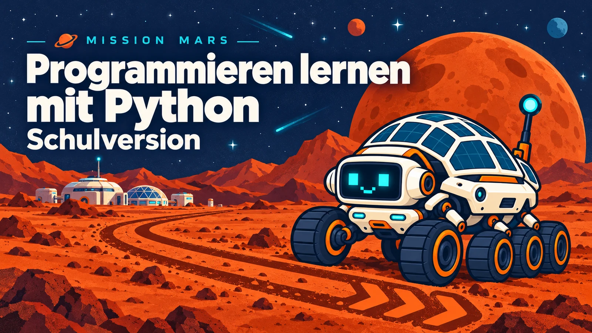
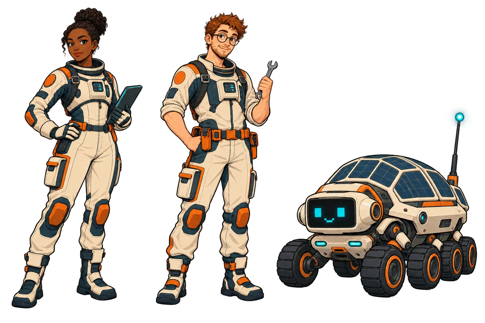
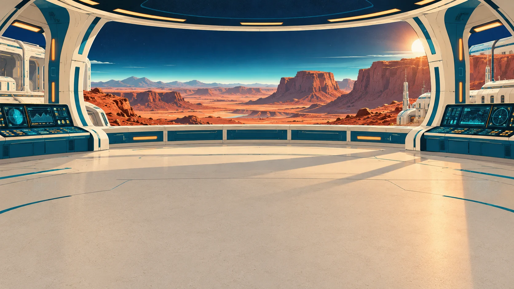
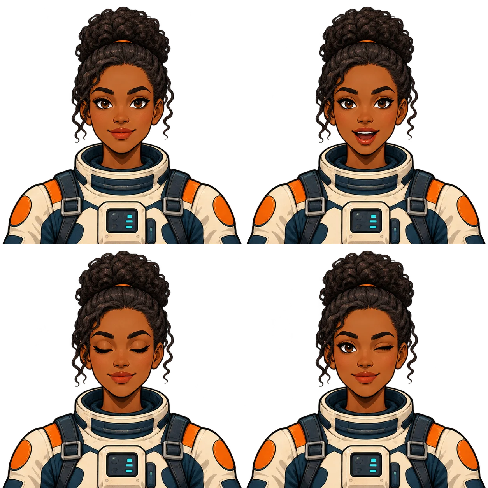
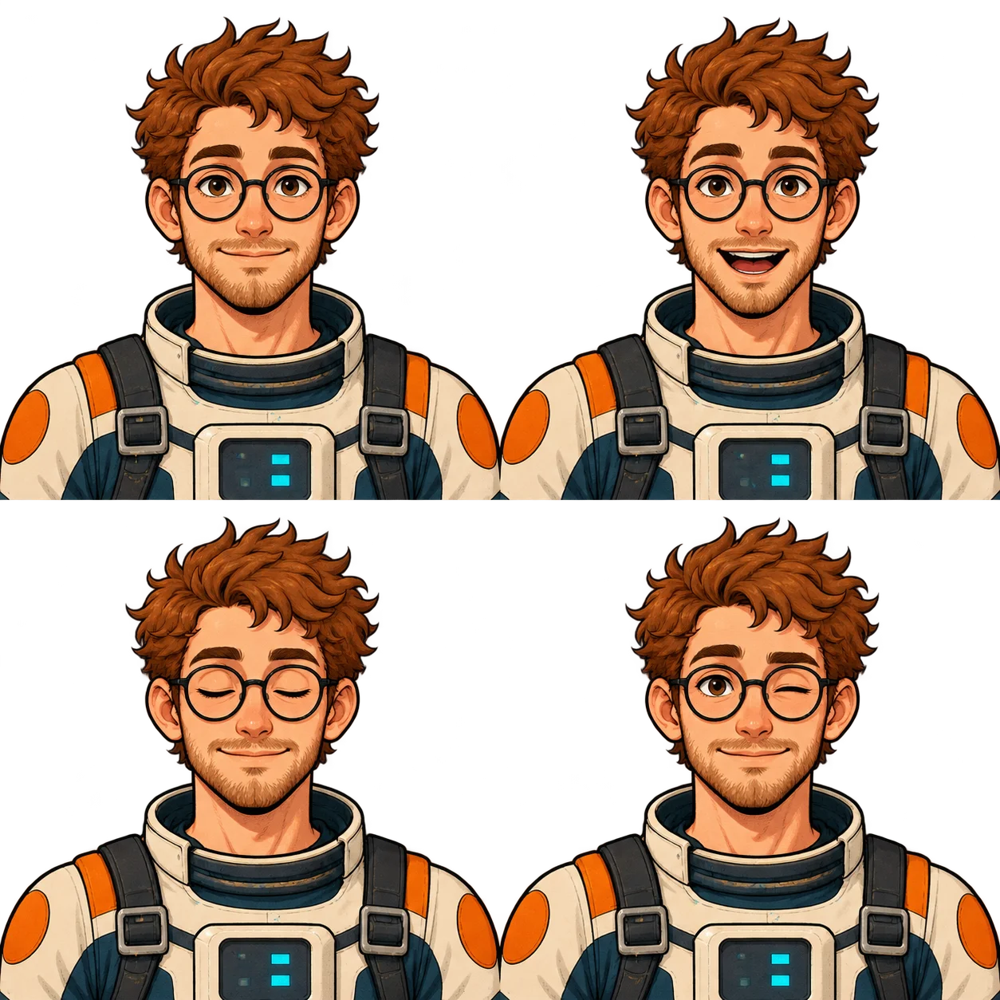
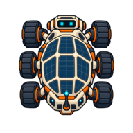

<!--
author:   André Dietrich
email:    LiaScript@web.de
language: de
comment:  Kursplanung zu „Programmieren lernen mit Python – Schulversion“: Lernziele, Didaktik, Ablaufplan, Module, Prüfberichte und Bildsprache – entwickelt mit dem Teaching-Agent. Der fertige Kurs steht in README.md.
tags:     Kursplanung, Teaching-Agent, LiaScript, Python, Informatik, Schule, OER
attribute: Kursplanung © André Dietrich, lizenziert unter [CC BY 4.0](https://creativecommons.org/licenses/by/4.0/deed.de). Die Journal-Anzeige unter specs/ stammt aus [Teaching-Agent](https://github.com/LiaScript/teaching-agent) (Boost Software License 1.0, siehe specs/LICENSE).
color: <span style="display:inline-block;width:1.5rem;height:1.5rem;background-color:@0;border:1px solid #ccc;border-radius:2px;vertical-align:middle;"></span> `@0`

import: ./specs/dashboard/README.md
        https://raw.githubusercontent.com/LiaTemplates/Skulpt/0.0.7/README.md
        https://raw.githubusercontent.com/LiaTemplates/mermaid_template/0.1.4/README.md
        https://raw.githubusercontent.com/LiaTemplates/Wikimedia/0.0.2/README.md
        https://raw.githubusercontent.com/LiaTemplates/pixijs/0.5.1/README.md
        ./lia-templates/python-pruefung/README.md
-->

# Programmieren lernen mit Python – Schulversion

Hier wächst dein Kursplan. Du bringst deine Idee mit; der Assistent im Chat hilft dir, daraus Lernziele, Aufgaben und fertiges Material zu entwickeln. Du prüfst jeden Vorschlag und entscheidest, was bleibt. **Ohne deine Bestätigung wird nichts gespeichert.**

<!-- class="journal-start" -->
[Zur Übersicht →](#dashboard-–-übersicht)

## Dashboard – Übersicht

```json @Dashboard.View
{
  "title": "Programmieren lernen mit Python – Schulversion",
  "context": "Selbstlernkurs für die Mittelstufe ab Klasse 7 · 5 Module, Basisweg 20–21 h, mit Erweiterungen 24–29 h in ca. 10 Wochen · Laptop, Tablet, Smartphone",
  "subtitle": "Der Kurs ist veröffentlicht: als offenes Lernmaterial unter CC BY 4.0, mit Planung und Assistent zum Weiterarbeiten. Alle Module sind geprüft und freigegeben. Der Test auf einem echten Handy bleibt empfohlen – jetzt direkt über den Kurslink.",
  "next": {
    "title": "Vorlagen auf einem Handy ausprobieren",
    "why": "Der Kurslink ist öffentlich. Auf einem echten Smartphone zeigt sich, ob Touch-Bedienung, Vorlesen und Turtle-Grafik so laufen wie in der Seitenprüfung.",
    "label": "Zum Kurslink",
    "href": "#publishing-–-veröffentlichung",
    "icon": "👁"
  },
  "unitLabel": {
    "one": "Modul",
    "many": "Modulen"
  },
  "unitsTitle": "Module",
  "units": [
    {
      "id": "1",
      "title": "Hallo Schildi",
      "state": "done",
      "statusLabel": "bestanden",
      "usable": {
        "state": "yes"
      },
      "summary": "Erster Kontakt · 1–1,5 h · Woche 1 – Kurs kennenlernen, erstes Programm ausführen.",
      "href": "#1.-hallo-schildi",
      "view": {
        "href": "agent:teaching/preview?file=1",
        "command": ":preview 1",
        "label": "So sehen es die Lernenden"
      },
      "process": {
        "title": "Hallo Schildi",
        "steps": [
          {
            "title": "Modul planen",
            "state": "done",
            "why": "Die Planungsskizze legt Inhalte, Aufgaben, Selbsttest und Szenen fest.",
            "result": "Planungsskizze mit 7 Aufgaben, Einstiegs- und Abschlussszene"
          },
          {
            "title": "Material schreiben",
            "state": "done",
            "why": "Erklärungen, Aufgaben, Speicherfunde, Selbsttest und Bildergeschichten entstehen aus der Planungsskizze.",
            "result": "8 Seiten als Präsentation mit Sprechern, im Kurs ausprobiert und freigegeben"
          },
          {
            "title": "Bilder einfügen",
            "state": "done",
            "why": "Gemeinsame Figuren, passende Schauplätze und räumlich klare Funkbilder unterstützen die Geschichte.",
            "result": "2 Geschichten mit eigenen Figuren, Hintergründen und Animationen; Crew in Stations-Funkfenstern, Schildi draußen; technisch im Kurs geprüft"
          },
          {
            "title": "Prüfen und überarbeiten",
            "state": "done",
            "why": "Verständlichkeit, Lernziele und Pflichtteile der Modulart werden geprüft.",
            "result": "Prüfbericht vom 27.10.2026: bestanden, Bedenken geklärt; in der Kursprüfung mitgeprüft"
          },
          {
            "title": "Freigeben",
            "state": "done",
            "why": "Du schaust dir das geprüfte Modul an und gibst es frei.",
            "result": "Freigegeben am 27.10.2026"
          }
        ]
      }
    },
    {
      "id": "2",
      "title": "Spuren im Staub",
      "state": "done",
      "statusLabel": "bestanden",
      "usable": {
        "state": "yes"
      },
      "summary": "Mission · 4 h / 5–6 h · Wochen 1–2 – Variablen, Zahlen, Text, Turtle auf dem Mars (Ziele 1, 6).",
      "href": "#2.-spuren-im-staub",
      "view": {
        "href": "agent:teaching/preview?file=2",
        "command": ":preview 2",
        "label": "So sehen es die Lernenden"
      },
      "process": {
        "title": "Spuren im Staub",
        "steps": [
          {
            "title": "Modul planen",
            "state": "done",
            "why": "Die Planungsskizze legt Inhalte, Aufgaben, Selbsttest und Szenen fest.",
            "result": "Planungsskizze mit rund 20 Aufgaben, 10 Quizfragen, Einstiegs- und Abschlussszene"
          },
          {
            "title": "Material schreiben",
            "state": "done",
            "why": "Erklärungen, Aufgaben, Speicherfunde, Selbsttest und Bildergeschichten entstehen aus der Planungsskizze.",
            "result": "8 Seiten mit 20 Code-Aufgaben mit Prüfung und 8 Quizfragen, im Kurs ausprobiert und freigegeben"
          },
          {
            "title": "Bilder einfügen",
            "state": "done",
            "why": "Gemeinsame Figuren, passende Schauplätze und räumlich klare Funkbilder unterstützen die Geschichte.",
            "result": "2 Geschichten mit eigenen Figuren, Hintergründen und Animationen; Crew in Stations-Funkfenstern, Schildi draußen; technisch im Kurs geprüft"
          },
          {
            "title": "Prüfen und überarbeiten",
            "state": "done",
            "why": "Verständlichkeit, Lernziele und Pflichtteile der Modulart werden geprüft.",
            "result": "Prüfbericht vom 27.10.2026: bestanden; Selbsttest und Hinweisstufen nach der Prüfung geändert und kurz nachgeprüft, zwei Bedenken für alle Module angenommen; in der Kursprüfung mitgeprüft"
          },
          {
            "title": "Freigeben",
            "state": "done",
            "why": "Du schaust dir das geprüfte Modul an und gibst es frei.",
            "result": "Freigegeben am 27.10.2026, Bedenken der Prüfung von dir entschieden"
          }
        ]
      }
    },
    {
      "id": "3",
      "title": "Hindernisse und Gesteinsproben",
      "state": "done",
      "statusLabel": "bestanden",
      "usable": {
        "state": "yes"
      },
      "summary": "Mission · 5 h / 6–7 h · Wochen 3–4 – Verzweigungen, Schleifen (auch while), Listen, Schildis Sensor (Ziele 2, 6).",
      "href": "#3.-hindernisse-und-gesteinsproben",
      "view": {
        "href": "agent:teaching/preview?file=3",
        "command": ":preview 3",
        "label": "So sehen es die Lernenden"
      },
      "process": {
        "title": "Hindernisse und Gesteinsproben",
        "steps": [
          {
            "title": "Modul planen",
            "state": "done",
            "why": "Die Planungsskizze legt Inhalte, Aufgaben, Selbsttest und Szenen fest.",
            "result": "Planungsskizze mit 9 Teilen, Basisaufgaben und 13 Extras, Messwerte als Liste, Ablaufdiagrammen und Meisterstück"
          },
          {
            "title": "Material schreiben",
            "state": "done",
            "why": "Erklärungen, Aufgaben, Speicherfunde, Selbsttest und Bildergeschichten entstehen aus der Planungsskizze.",
            "result": "10 Seiten und 8 Extra-Unterseiten mit 29 Code-Aufgaben mit Prüfung, 10 Quizfragen, 2 Ablaufdiagrammen, Schildis Sensor und 2 Szenen; freigegeben, einige Zeichenaufgaben noch nicht im Browser ausprobiert"
          },
          {
            "title": "Bilder einfügen",
            "state": "done",
            "why": "Gemeinsame Figuren, passende Schauplätze und räumlich klare Funkbilder unterstützen die Geschichte.",
            "result": "2 Geschichten mit eigenen Figuren, Hintergründen und Animationen; Crew in Stations-Funkfenstern, Schildi draußen; technisch im Kurs geprüft"
          },
          {
            "title": "Prüfen und überarbeiten",
            "state": "done",
            "why": "Verständlichkeit, Lernziele und Pflichtteile der Modulart werden geprüft.",
            "result": "Prüfbericht vom 27.10.2026: bestanden; Gesteinsliste im Selbsttest nach der Prüfung geändert und kurz nachgeprüft, ungetestete Zeichenaufgaben von dir angenommen; in der Kursprüfung mitgeprüft"
          },
          {
            "title": "Freigeben",
            "state": "done",
            "why": "Du schaust dir das geprüfte Modul an und gibst es frei.",
            "result": "Freigegeben am 27.10.2026, Bedenken der Prüfung von dir entschieden"
          }
        ]
      }
    },
    {
      "id": "4",
      "title": "Manöver und Probenkatalog",
      "state": "done",
      "statusLabel": "bestanden",
      "usable": {
        "state": "yes"
      },
      "summary": "Mission · 5 h / 6–7 h · Wochen 5–7 – Funktionen, Dictionaries, Zufall, Manöver im Kraterfeld (Ziele 3, 6).",
      "href": "#4.-manöver-und-probenkatalog",
      "view": {
        "href": "agent:teaching/preview?file=4",
        "command": ":preview 4",
        "label": "So sehen es die Lernenden"
      },
      "process": {
        "title": "Manöver und Probenkatalog",
        "steps": [
          {
            "title": "Modul planen",
            "state": "done",
            "why": "Die Planungsskizze legt Inhalte, Aufgaben, Selbsttest und Szenen fest.",
            "result": "Planungsskizze mit 9 Teilen: eigene Befehle, return, Probenkatalog, Zufall, Mission im Kraterfeld, Extras auf eigenen Unterseiten"
          },
          {
            "title": "Material schreiben",
            "state": "done",
            "why": "Erklärungen, Aufgaben, Speicherfunde, Selbsttest und Bildergeschichten entstehen aus der Planungsskizze.",
            "result": "9 Seiten und 7 Extra-Unterseiten mit 25 Code-Aufgaben mit Prüfung, 8 Quizfragen, Ablaufdiagramm, Kraterboden und 2 Szenen; vom Assistenten vorbereitet, von dir freigegeben"
          },
          {
            "title": "Bilder einfügen",
            "state": "done",
            "why": "Gemeinsame Figuren, passende Schauplätze und räumlich klare Funkbilder unterstützen die Geschichte.",
            "result": "2 Geschichten mit eigenen Figuren, Hintergründen und Animationen; Crew in Stations-Funkfenstern, Schildi draußen; technisch im Kurs geprüft"
          },
          {
            "title": "Prüfen und überarbeiten",
            "state": "done",
            "why": "Verständlichkeit, Lernziele und Pflichtteile der Modulart werden geprüft.",
            "result": "Prüfbericht vom 27.10.2026: bestanden; 2 Antwortmuster während der Prüfung behoben, ungetestete Zeichenaufgaben von dir angenommen; in der Kursprüfung mitgeprüft"
          },
          {
            "title": "Freigeben",
            "state": "done",
            "why": "Du schaust dir das geprüfte Modul an und gibst es frei.",
            "result": "Freigegeben am 27.10.2026"
          }
        ]
      }
    },
    {
      "id": "5",
      "title": "Staubsturm",
      "state": "done",
      "statusLabel": "bestanden",
      "usable": {
        "state": "yes"
      },
      "summary": "Staubsturm-Projekt · 5–6 h / 6–8 h · Wochen 8–10 – Eingaben, Zahlenraten, Endspiel mit den Glimmis, eigenes Wesen (Ziele 4, 5, 6).",
      "href": "#5.-staubsturm",
      "view": {
        "href": "agent:teaching/preview?file=5",
        "command": ":preview 5",
        "label": "So sehen es die Lernenden"
      },
      "process": {
        "title": "Staubsturm",
        "steps": [
          {
            "title": "Modul planen",
            "state": "done",
            "why": "Die Planungsskizze legt Inhalte, Spielgerüst, Checkliste und das Finale fest.",
            "result": "Planungsskizze mit 8 Teilen: Funk-Runden, Zahlenraten, Entdeckung der Glimmis, Stimmungen, eigenes Wesen, Finde den Fehler, Finale"
          },
          {
            "title": "Material schreiben",
            "state": "done",
            "why": "Erklärungen, Aufgaben, Speicherfunde, Spielgerüst und Bildergeschichten entstehen aus der Planungsskizze.",
            "result": "8 Seiten und 5 Extra-Unterseiten mit 16 Code-Aufgaben mit Prüfung, Glimmi-Simulator, Spielgerüst mit Checkliste, Selbsttest, 8 Quizfragen, 2 Ablaufbildern und 3 Szenen; vom Assistenten vorbereitet, von dir freigegeben"
          },
          {
            "title": "Bilder einfügen",
            "state": "done",
            "why": "Gemeinsame Figuren, passende Schauplätze und räumlich klare Funkbilder unterstützen die Geschichte.",
            "result": "3 Geschichten mit eigenen Figuren, Hintergründen und Animationen; Crew in Stations-Funkfenstern, Schildi draußen; technisch im Kurs geprüft"
          },
          {
            "title": "Prüfen und überarbeiten",
            "state": "done",
            "why": "Verständlichkeit, Lernziele und Pflichtteile der Modulart werden geprüft.",
            "result": "Prüfbericht vom 27.10.2026: bestanden; Selbsttest nach der Prüfung ergänzt und kurz nachgeprüft, Bild der Glimmis und Zusätze von dir angenommen, Simulator von dir im Browser ausprobiert; in der Kursprüfung mitgeprüft"
          },
          {
            "title": "Freigeben",
            "state": "done",
            "why": "Du schaust dir das geprüfte Modul an und gibst es frei.",
            "result": "Freigegeben am 27.10.2026"
          }
        ]
      }
    }
  ],
  "labels": {
    "decide": "Noch zu entscheiden",
    "prepare": "Vor dem Einsatz vorbereiten"
  },
  "decisions": [
    {
      "key": "preparation-mobile-test",
      "kind": "prepare",
      "title": "Vorlagen auf einem Handy ausprobieren",
      "why": "Die Seitenprüfung bei 390 × 844 ist bestanden. Bedienung per Touch, Vorlesen und Leistung sollen zusätzlich auf einem echten Smartphone ausprobiert werden.",
      "how": "Den Kurslink unter „Veröffentlichung“ auf einem echten Handy öffnen: eine Turtle-Aufgabe auf dem Kraterboden (gern mit Felsen und Sensor oder den Glimmi-Simulator), eine Bildergeschichte und den sprechenden Avatar ausprobieren. Das Spiel in Modul 5 ist für Geräte mit Tastatur gedacht. Was hakt, wird angepasst und danach neu veröffentlicht.",
      "href": "#publishing-–-veröffentlichung",
      "label": "Zum Kurslink"
    }
  ],
  "process": {
    "title": "So entsteht dein Kurs",
    "description": "Die Schritte vom Thema bis zum geprüften Material. Diese Übersicht zeigt immer, wo wir gerade stehen.",
    "steps": [
      {
        "title": "Den Rahmen festlegen",
        "state": "done",
        "why": "Thema, Zielgruppe, Format und Sprache prägen alles, was folgt.",
        "result": "Selbstlernkurs ab Klasse 7, ein Link mit 5 Modulen als Kapitel, erzählender Ton, die Schüler:innen werden geduzt"
      },
      {
        "title": "Gliederung und Lernziele",
        "state": "done",
        "why": "Klare Lernziele sagen, was die Schüler:innen am Ende können.",
        "result": "6 Lernziele mit Basis- und Erweiterungsstufe, verteilt auf 5 Module; Basisweg 20–21 Stunden, mit Erweiterungen 24–29 Stunden"
      },
      {
        "title": "Didaktik",
        "state": "done",
        "why": "Methoden, Aufgabenformen und Unterstützung, die zu den Lernzielen passen.",
        "result": "Rahmengeschichte „Schildi auf dem Mars“ mit Einstiegs- und Abschlussszene je Modul, Lernablauf in sieben Phasen, drei Modularten (Erster Kontakt, Mission, Staubsturm-Projekt), Fehlerkabinett"
      },
      {
        "title": "Vorlagen für Aktivitäten",
        "state": "done",
        "why": "Fertige Bausteine wie Turtle-Python im Browser – oder ein eigener, wenn nichts passt.",
        "result": "Skulpt, Mermaid, Wikimedia, PixiJS Stories, python-pruefung"
      },
      {
        "title": "Ablaufplan",
        "state": "done",
        "why": "Reihenfolge und Dauer der Module, passend zu den Themen.",
        "result": "5 Module mit Wochenempfehlung: Hallo Schildi, Spuren im Staub, Hindernisse und Gesteinsproben, Manöver und Probenkatalog, Staubsturm"
      },
      {
        "title": "Material erstellen",
        "state": "done",
        "why": "Erklärungen, Aufgaben und Selbsttests entstehen aus der Planung.",
        "result": "5 Module mit freigegebenen Aufgaben und Selbsttests; elf Geschichten mit eigenen Illustrationen, einheitlichen Sprechern und räumlich klaren Funkbildern"
      },
      {
        "title": "Prüfen und überarbeiten",
        "state": "done",
        "why": "Verständlichkeit und Passung zu den Lernzielen werden geprüft, bevor das Material eingesetzt wird.",
        "result": "Kursprüfung vom 27.10.2026 bestanden; 3 Stellen mit deiner Zustimmung korrigiert"
      },
      {
        "title": "Veröffentlichen",
        "state": "done",
        "why": "Den geprüften Kurs als Link teilen.",
        "result": "Öffentlich bei LiaPress seit 27.10.2026, aktuell Version 1.0.6 vom 28.10.2026 (Sprecherbild im Funk-Look, auch nach erneutem Laden; Schildi als Pixelgesicht mit eigener Stimme), als offenes Lernmaterial unter CC BY 4.0 mit Planung und Assistent zum Weiterarbeiten"
      }
    ],
    "note": "Du kannst jederzeit einen Schritt zurückgehen. Fertig ist ein Modul erst, wenn seine Prüfung bestanden ist und du es freigegeben hast. Nach späteren Änderungen wird der Kurs neu veröffentlicht."
  },
  "explore": [
    {
      "icon": "🛠️",
      "title": "Änderungen veröffentlichen",
      "description": "Wenn du nach dem Handy-Test oder später etwas änderst, bringt der Entwicklungsassistent die neue Fassung online.",
      "label": "Veröffentlichung aktualisieren",
      "href": "agent:development/update-project",
      "command": ":agent development → :update-project"
    },
    {
      "icon": "➕",
      "title": "Neue Geschichten ansehen",
      "description": "Amara beginnt im Kontrollraum. Draußen begleiten gerahmte Funkbilder Schildi; sein Pixelgesicht reagiert beim Sprechen.",
      "label": "Funkkontakt ansehen",
      "href": "agent:artist/preview?file=README.md&slide=3",
      "command": ":preview README.md 3"
    },
    {
      "icon": "🎨",
      "title": "Logo",
      "description": "Das Schildi-Logo mit Marskreis und Python-Fahrspur ist erstellt und im Kurs eingebunden. Bei Bedarf kann es überarbeitet werden.",
      "label": "Logo überarbeiten",
      "href": "agent:artist/create-logo",
      "command": ":agent artist → :create-logo"
    },
    {
      "icon": "💬",
      "title": "Einfach fragen",
      "description": "Frag in eigenen Worten, wann immer etwas unklar ist.",
      "label": "Was kann der Assistent?",
      "href": "agent:teaching/help",
      "command": ":help"
    }
  ],
  "links": [
    {
      "label": "Kursrahmen",
      "href": "#course-context-–-kursrahmen"
    },
    {
      "label": "Gliederung",
      "href": "#outline-–-gliederung"
    },
    {
      "label": "Ablaufplan",
      "href": "#agenda-–-ablaufplan"
    },
    {
      "label": "Notizen",
      "href": "#notes-backup-–-notizen"
    },
    {
      "label": "Kursprüfung",
      "href": "#validation-–-prüfung"
    },
    {
      "label": "Veröffentlichung",
      "href": "#publishing-–-veröffentlichung"
    }
  ],
  "footer": "Veröffentlicht · Version 1.0.6 · 28.10.2026"
}
```

---

## Course Context – Kursrahmen

<!-- class="journal-actions" -->
[✏️ Kursrahmen überarbeiten](agent:teaching/init-course) `:init-course`

<!--- Filled by :init-course from templates/course-context.yaml (layout: summary table + <details>). --->

**Kursrahmen:** bestätigt am 27.10.2026.

<!-- data-type="none" -->
| Punkt | Entschieden |
|---|---|
| Titel | Programmieren lernen mit Python – Schulversion |
| Vorlage | HPI-Kurs, nur die Struktur |
| Lernende | Mittelstufe ab Kl. 7, ohne Vorkenntnisse |
| Arbeitsweise | Selbstlernkurs |
| Geräte | Laptop, Tablet, Smartphone |
| Umfang | wie HPI: ca. 10 Wochen, 2–3 h/Woche |
| Aufteilung | ein Link, Module als Kapitel |
| Ablaufplan | ja |
| Ton | erzählend, wie im Gespräch |
| Kinder | werden geduzt |
| Chat | wir duzen uns |
| Autor | André Dietrich |
| Kontakt | LiaScript@web.de |

<details><summary>Einstellungen für den Assistenten – hier gibt es nichts zu lesen</summary>

* __Course Type:__
  1. Type: self-paced
  2. Working Title: Programmieren lernen mit Python – Schulversion
  3. Target Group: Schüler:innen der Mittelstufe ab Klasse 7, ohne Vorkenntnisse; für Schulen allgemein, keine bestimmte Klasse; arbeiten allein im eigenen Tempo auf Laptop, Tablet oder Smartphone

* __Terminology:__
  1. sessions-called: Modul

* __Course Profile:__
  1. Persona type: coach
  2. Agenda required: yes
  3. Pacing: learner-driven
  4. Assessment defaults: self-check quizzes (beliebig oft wiederholbar)
  5. Units: 5 Module (Modul 1 Einstieg + Module 2–5), zusammen ca. 10 Wochen × 2–3 h; Dauer pro Modul nach den Themen (Nummerierung 1–5 seit dem Ablaufplan, 27.10.2026)

* __File Structure:__
  1. Mode: single-file
  2. Session folder naming: n/a for single-file

* __Conventions & Standards:__
  1. Language: de
  2. Tone: conversational
  3. Person: Du
  4. Instructor Address: Du
  5. Author: André Dietrich
  6. Contact: LiaScript@web.de

* __LiaScript conventions:__
  - keine besonderen Vorgaben

* __Additional Notes:__
  - Vorlage: HPI-Kurs „Programmieren lernen mit Python – Schulversion“ (https://open.hpi.de/courses/pythonjunior-schule2024) – nur die Struktur übernehmen; keine Texte, Aufgaben, Videos oder Rahmengeschichte des HPI (keine freie Lizenz gefunden, nicht sicher geprüft).
  - For create-outline: Modulfolge wie beim HPI – 0 Einführung · 1 Variablen, Zahlen, Text, Turtle-Grafik · 2 Verzweigungen, Schleifen, Listen · 3 Funktionen, Dictionaries, Zufallszahlen · 4 Eingaben, Zahlenraten, Abschlussprojekt.
  - For create-didactics: eine eigene Rahmengeschichte entwickeln, mit mehreren Varianten zur Auswahl.
  - For create-didactics: Aufgaben auch auf dem Smartphone lösbar (kurzer Code, Ergänzen oder Umsortieren); größere Projekte für Geräte mit Tastatur.
  - For create-didactics: ohne Lehrkraft kommt jede Rückmeldung aus dem Material – Hinweise, Lösungen, automatische Prüfung.
  - For create-agenda: Zeit pro Modul nach den Themen anpassen, nicht starr zwei Wochen.

</details>

---

## Outline – Gliederung

<!-- class="journal-actions" -->
[✏️ Gliederung überarbeiten](agent:teaching/create-outline) `:create-outline` · [▶️ Didaktik planen](agent:teaching/create-didactics) `:create-didactics`

<!--- Filled by :create-outline from templates/course-outline.yaml. --->

<!-- data-key="title" -->
* __Titel:__
  Programmieren lernen mit Python – Schulversion

<!-- data-key="target-audience" -->
* __Zielgruppe:__
  Wie im Kursrahmen: Schüler:innen der Mittelstufe ab Klasse 7, ohne Vorkenntnisse; sie lernen allein im eigenen Tempo auf Laptop, Tablet oder Smartphone, ohne Lehrkraft.

<!-- data-key="time-commitment" -->
* __Zeitaufwand:__
  5 Module: Basisweg 20–21 Stunden, mit allen Erweiterungen 24–29 Stunden, in etwa 10 Wochen (2–3 Stunden pro Woche). Geändert mit dem Ablaufplan am 27.10.2026 (Zeiten und Nummerierung 1–5).

<!-- data-key="abstract" -->
* __Kurzbeschreibung:__
  Die Schüler:innen lernen Python ohne Vorkenntnisse und ohne Installation, direkt im Browser. Modul für Modul schreiben sie kleine Programme: Sie rechnen und zeichnen mit der Turtle, treffen Entscheidungen, wiederholen Abläufe und bauen eigene Funktionen. Am Ende steht ein eigenes kleines Spiel. Eine Rahmengeschichte (folgt in der Didaktik) begleitet sie. Jede Aufgabe gibt sofort Rückmeldung, eine Lehrkraft ist nicht nötig.

<!-- data-key="learning-goals" -->
* __Lernziele:__ Die Schüler:innen …
  1. schreiben Programme, die mit Variablen, Zahlen und Text arbeiten und mit der Turtle zeichnen (Modul 2)
     - Sichtbar: Das Programm läuft im Browser, eine automatische Prüfung kontrolliert Ausgabe oder Zeichnung.
     - Basis: ein vorgegebenes Programm ändern (Werte, Farben, Texte)
     - Erweiterung: eine eigene Zeichnung entwerfen
  2. schreiben Programme, die mit Verzweigungen entscheiden und mit Schleifen wiederholen, auch über Listen (Modul 3)
     - Sichtbar: Die Prüfung testet das Programm mit verschiedenen Eingaben.
     - Basis: Lücken in vorgegebenem Code füllen, Zeilen in die richtige Reihenfolge bringen
     - Erweiterung: eine Schleife ohne Vorlage schreiben
  3. schreiben eigene Funktionen, die Dictionaries und Zufallszahlen verwenden (Modul 4)
     - Sichtbar: Die Prüfung ruft die Funktion mit Testwerten auf.
     - Basis: eine Funktion vervollständigen
     - Erweiterung: ein Programm in mehrere Funktionen gliedern
  4. schreiben ein Programm, das auf Eingaben reagiert, z. B. ein Zahlenratespiel (Modul 5)
     - Sichtbar: Die Prüfung spielt das Programm mit festen Eingaben durch.
     - Basis: das Ratespiel aus Bausteinen zusammensetzen
     - Erweiterung: Versuche zählen, Hinweise ausgeben
  5. schreiben ein eigenes kleines Spiel als Abschlussprojekt (Modul 5)
     - Sichtbar: das lauffähige Spiel plus eine Checkliste zum Selbstabhaken
     - Basis: ein vorgegebenes Spielgerüst ergänzen
     - Erweiterung: eigene Regeln und Ideen einbauen
  6. beheben Fehler in kurzen Programmen mithilfe der Fehlermeldung (Module 2–5, je eine Aufgabe „Finde den Fehler“)
     - Sichtbar: Das korrigierte Programm besteht die automatische Prüfung.
     - Basis: Die Fehlerzeile ist markiert, nur die Korrektur fehlt.
     - Erweiterung: den Fehler ohne Hinweis finden
     - Zeit: Diese Aufgaben ersetzen einzelne Übungsaufgaben; die Summe bleibt bei 24–29 Stunden.

<!-- data-key="session-overview" -->
* __Übersicht Modul → Ziel → Selbsttest:__

  <!-- data-type="none" -->
  | Modul | Ziel | Selbsttest |
  |---|---|---|
  | 1 · Start (ca. 1 h) | – (Kurs kennenlernen) | erstes Programm ausführen |
  | 2 · Variablen, Turtle (4 h / 5–6 h) | 1, 6 | Quiz + geprüfte Aufgabe |
  | 3 · Entscheiden, Wiederholen (5 h / 6–7 h) | 2, 6 | Quiz + geprüfte Aufgabe |
  | 4 · Funktionen, Zufall (5 h / 6–7 h) | 3, 6 | Quiz + geprüfte Aufgabe |
  | 5 · Eingaben, Spiel (5–6 h / 6–8 h) | 4, 5, 6 | Spiel + Checkliste + Quiz |

  Zeiten: Basisweg / mit Erweiterung. Basisweg 20–21 Stunden – passt in 10 Wochen mit 2 Stunden; mit Erweiterungen 24–29 Stunden – passt bei 3 Stunden pro Woche.

---

## Didactics – Didaktik

<!-- class="journal-actions" -->
[✏️ Didaktik überarbeiten](agent:teaching/create-didactics) `:create-didactics` · [🎨 Gestaltung](agent:artist/create-visuals) `:agent artist` → `:create-visuals`

<!--- Filled by :create-didactics from templates/course-didactics.yaml. --->

**Lerndesign:** bestätigt am 27.10.2026. Geändert am 27.10.2026: Einstiegs- und Abschlussszene als Bildergeschichte in jedem Modul.

<!-- data-key="didactic-concept" -->
* __Lernablauf:__
  Die Schüler:innen arbeiten allein und im eigenen Tempo, ohne Lehrkraft. Rahmengeschichte: In den 2060ern hat ihre Schule eine Patenschaft mit der Mars-Station *Tharsis*; sie steuern den Rover Schildi aus der Ferne und schicken ihm fertige Programme, die zuerst im Erd-Simulator laufen. Jedes neue Werkzeug durchläuft dieselben Phasen:
  1. Einstiegsszene (Bildergeschichte): Schildi steht vor einem Problem, das genau dieses Werkzeug löst.
  2. Vorhersagen: „Was macht dieser Code?“
  3. Ausprobieren und verändern.
  4. Selbst schreiben – Basis: Lücken füllen oder Zeilen sortieren; Erweiterung: ohne Vorlage.
  5. Finde den Fehler.
  6. Selbsttest, beliebig oft wiederholbar.
  7. Abschlussszene (Bildergeschichte) am Ende des Moduls, nach dem Selbsttest: was das neue Werkzeug auf dem Mars bewirkt hat, mit kurzem Ausblick auf das nächste Modul; in Modul 5 das Finale der Geschichte.

  Jede Aufgabe wird automatisch geprüft. Wer festhängt, öffnet Schildis Speicherfunde: erst ein Tipp, dann ein stärkerer, zuletzt die Lösung. Fehlermeldungen werden wie abgefangene Funksprüche gelesen (Zeile = Absender, Fehlerart = Betreff, letzte Zeile = Nachricht) und wandern ins Fehlerkabinett, das mit jedem Modul wächst. Jedes neue Konzept gibt es in mindestens zwei Formen (z. B. Text plus Zeichnung oder ausprobierbarer Code). Freies Schreiben bleibt kurz, damit es auch auf dem Smartphone geht.

<!-- data-key="guiding-figure" -->
* __Begleitfigur:__
  Schildi, der Rover der Station – langsam, robust, in Schildkrötenform, mit frisch installierter Bord-KI. Er ist neugierig und nimmt alles wörtlich: Er tut genau das, was im Programm steht. Fehlermeldungen kann er nicht deuten; er fragt die Schüler:innen und sammelt sie im Fehlerkabinett. Die Hinweise hat er „in seinem Speicher gefunden“. Er will den Krater mit dem bläulichen Schimmer erkunden und rät nie einen Befehl, den er nicht versteht – dann stoppt er und meldet sich. Im Finale entpuppt sich der Schimmer als die Glimmis – leuchtende Lebewesen im Kratereis, mit denen Schildi Kontakt aufnimmt. <!-- changed by :create-session 5 on 27.10.2026 (Lehrkraft: neue Figur im Finale) -->

<!-- data-key="language-style" -->
* __Sprache:__
  Erzählend, wie im Gespräch; die Schüler:innen werden geduzt. Schildi spricht in kurzen Funksprüchen („SCHILDI an ERDE: …“), weil jedes Funkpaket Energie kostet.

<!-- data-key="lesson-patterns" -->
* __Modularten:__
  1. Erster Kontakt (Modul 1) – Pflicht: ein erstes Programm, das im Browser läuft · eine Erklärung, wie Aufgaben, Speicherfunde und Prüfung funktionieren · ein kurzer Selbsttest · eine Einstiegs- und eine Abschlussszene als Bildergeschichte
  2. Mission (Module 2–4) – Pflicht: mindestens ein Beispiel zum Vorhersagen und Ausprobieren · geprüfte Aufgaben mit Basis- und Erweiterungsstufe, gestuften Hinweisen und Lösung · eine Aufgabe „Finde den Fehler“ · ein Selbsttest am Ende · eine Einstiegs- und eine Abschlussszene als Bildergeschichte
  3. Staubsturm-Projekt (Modul 5) – Pflicht: ein Spielgerüst zum Ergänzen · eine Checkliste zum Selbstabhaken · Ideen zum Weiterbauen · eine Aufgabe „Finde den Fehler“ · eine Einstiegsszene und das Finale als Bildergeschichte

<!-- data-key="difficulty" -->
* __Schwierigkeit:__
  Einstieg ohne Vorkenntnisse. Kleine Schritte, jedes Modul baut auf dem vorigen auf, Fachbegriffe erst nach dem Ausprobieren.

<!-- data-key="voice-sample" -->
* __Kostprobe:__
  „SCHILDI an ERDE: Proben sammeln. Ich soll 10 Steine aufheben. Du hast mir 10-mal denselben Befehl geschickt. Das waren 10 Funkpakete, und mein Akku seufzt. Gibt es einen Befehl für ‚mach das 10-mal‘? … Oh. `for`. Ein einziges Paket. Akku: zufrieden.“

<details><summary>Einstellungen für den Assistenten – hier gibt es nichts zu lesen</summary>

* __Teaching Style:__ conversational – erzählend, Du-Anrede, Begleitfigur in kurzen Funksprüchen
* __Course Type:__ self-paced – Lernende bestimmen Tempo und Pausen; Rückmeldung nur aus dem Material
* __Didactic Framework:__ ADDIE
  Klare, wiederholbare Phasen passen zu einem Selbstlernkurs, der Modul für Modul entsteht.
* __Default Session Method:__ UDL Format Variety (slug: `udl`)
  Ohne Lehrkraft brauchen die Lernenden mehrere Zugänge zu jedem Konzept.
* __Session Types:__
  1. __Erster Kontakt__ (slug: `erstkontakt`) — Einstieg in den Kurs ohne neues Fachkonzept (Modul 1).
     Required: ein erstes Programm, das im Browser läuft; Erklärung von Aufgaben, Speicherfunden und Prüfung; ein kurzer Selbsttest; eine Einstiegs- und eine Abschlussszene als Bildergeschichte.
  2. __Mission__ (slug: `mission`) — ein neues Werkzeug lernen und üben in den Phasen des Lernablaufs (Module 2–4).
     Required: mindestens ein Beispiel zum Vorhersagen und Ausprobieren; geprüfte Aufgaben mit Basis- und Erweiterungsstufe, gestuften Hinweisen und Lösung; eine Aufgabe „Finde den Fehler“; ein Selbsttest am Ende; eine Einstiegs- und eine Abschlussszene als Bildergeschichte.
  3. __Staubsturm-Projekt__ (slug: `projekt`) — Gelerntes zu einem eigenen Spiel verbinden (Modul 5).
     Required: ein Spielgerüst zum Ergänzen; eine Checkliste zum Selbstabhaken; Ideen zum Weiterbauen; eine Aufgabe „Finde den Fehler“; eine Einstiegsszene und das Finale als Bildergeschichte.
* __Difficulty Level:__ beginner – keine Vorkenntnisse, kleine Schritte, Fachbegriffe nach dem Ausprobieren

</details>

---

## Visual Identity – Gestaltung

<!-- class="journal-actions" -->
[✏️ Gestaltung überarbeiten](agent:artist/create-visuals) `:agent artist` → `:create-visuals` · [🎨 Logo](agent:artist/create-logo) `:agent artist` → `:create-logo`

<!--- Filled by :create-visuals (optional) from templates/visuals.yaml. --->

**Gestaltung:** Kursoberfläche „Mission Control“ bestätigt am 27.10.2026. Auf Wunsch der Lehrkraft wurden Figuren, Sprecher und alle elf Geschichten überarbeitet: ein gemeinsames Ensemble, Schildis Pixel-Display und eigene Hintergründe. Amara und Jonas bleiben in der Station; Außenansichten zeigen sie ausschließlich in beschrifteten Funkfenstern. „Funkkontakt“ beginnt im geschützten Kontrollraum und schaltet danach zu Schildi um. Bildprompts und Gestaltung sind in [Figuren und Szenen](assets/scenes/README.md) dokumentiert.

* __Logo Generation Guidelines:__
  1. Style: flach, freundlich, retro-futuristisch (Raumfahrtplakat)
  2. Format: flat design mit klaren Konturen, wenige Farben
  3. Elements: Schildi von der Seite; seine Turtle-Spur als geschwungene Linie, die in einen Python-Prompt `>>>` übergeht
  4. Mood: abenteuerlich, einladend, nicht kindlich
  5. Additional notes: auch klein (Favicon) gut erkennbar; keine Schrift im Bildzeichen nötig

* __Course Logo:__ Breites Kursbild im Format 16:9 (1600 × 900), erstellt am 28.10.2026 mit dem eingebauten Bildgenerator anhand des bisherigen Schildi-Bildzeichens: Kurstitel vor Marslandschaft, Schildi, Forschungsstation und Fahrspur mit `>>>`. Als `logo:` und Startseitenbild eingebunden; PNG für GitHub und Metadaten, WebP für den Kurs. Das bisherige quadratische Bildzeichen bleibt als Icon (`icon: kursicon.png`) erhalten.
  - [Kursbild für GitHub als PNG](assets/images/kurscover.png)
  - [Kursbild als WebP](assets/images/kurscover.webp)
  - [Logo als PNG](assets/images/kurslogo.png)
  - [Hochauflösendes Original](assets/images/kurslogo-original.png)
  - [Kurs-Icon](assets/images/kursicon.png)



* __Default Logo Prompt Base:__
  "A flat, retro space-poster style logo for an educational Python course, featuring a friendly turtle-shaped Mars rover seen from the side whose trail curves into a Python prompt '>>>', rust orange, night blue and ice blue on warm off-white, clean and scalable design, suitable for digital and print use."

* __Logo Color Palette:__
  1. Primary color: @color(#B5451B) - Mars-Rost
  2. Secondary color: @color(#2E3A59) - Nachthimmel
  3. Accent color: @color(#2A9DB0) - Eisblau (Schildis Licht)
  4. Background: @color(#FBF7F2) - Sand-Weiß

* __Color Usage:__
  - Primary: Hauptelemente des Logos, Überschriften
  - Secondary: Rahmen, Konturen, Himmel
  - Accent: Schildis Statuslicht, Hervorhebungen
  - Background: Fläche, Hintergründe

* __Course Image Generation Guidelines:__
  1. Visual style: flache Illustration im Stil eines Retro-Raumfahrtplakats, weiche Schatten, klare Formen
  2. Color scheme: warme Mars-Töne gegen dunkelblauen Himmel, Eisblau als Akzent
  3. Composition: ein klares Motiv, viel Luft, Drittelregel
  4. Lighting: warmes, tiefes Sonnenlicht; Schildis Lampe als Lichtpunkt
  5. Mood: abenteuerlich, freundlich, neugierig
  6. In-image text language: Deutsch

* __Default Image Prompt Base:__
  "A flat retro space-poster illustration showing [subject] on Mars, rule-of-thirds composition, warm rust and sand tones against a deep night-blue sky with ice-blue accents, soft low sunlight, adventurous and friendly atmosphere, suitable for educational materials for teenagers, clean, no text unless specified (German)."

* __Image Specifications:__
  - Aspect ratio: 16:9 (Szenen, Kapitelbilder); 1:1 für Figurenbilder neben Funksprüchen
  - Resolution: 1600 × 900 (16:9), 512 × 512 (1:1)
  - Format: PNG-Originale, komprimiertes WebP für Szenen und Figuren; Kursbild als PNG und WebP (16:9), Icon als PNG mit Transparenz
  - Accessibility: Include meaningful alt text descriptions

* __Image Consistency Rules:__
  1. Color palette: dieselben Farben wie das Logo
  2. Style: immer flache Retro-Plakat-Illustration, nie fotorealistisch gemischt (echte Mars-Fotos von Wikimedia nur als gekennzeichnete Fotos)
  3. Characters: Schildi – runder, schildkrötenförmiger Rover, Panzer als Kuppel aus Solarzellen, sechs kleine Räder, Antenne mit Leuchtspitze, Borddisplay mit cyanfarbenen Pixel-Augen und Pixelmund, Statuslicht eisblau (bei Warnungen rot). Crew der Station Tharsis: Kommandantin Amara Okoye (ruhig, gibt Aufträge) und Techniker Jonas Berg (baut gern, manchmal chaotisch), beide frei erfunden, im selben Stil. Die Schüler:innen („Erde“) werden nie gezeigt. Glimmis (Modul 5) – Kolonie reiskorngroßer, halb durchsichtiger Leuchtkügelchen im Kratereis; in Ruhe bläulich, reagieren grün/rot und heller/dunkler; als Punktwolke mit wenigen Gesichtspunkten ohne Mund. <!-- auf Wunsch der Lehrkraft visuell überarbeitet, 27.10.2026 -->
  4. Icons: flach, gefüllt, abgerundete Ecken
  5. Typography in images: Space Grotesk, nur kurze Beschriftungen
  6. Spacing: großzügiger Rand um das Motiv
  7. Background: feste Schauplätze – Landestelle, Kraterfeld mit bläulichem Schimmer, Station mit Kuppel, Staubsturm
  8. Avatare (sprechende Figuren): gemeinsame Figurenidentität über den LiaScript-Sprecher-Hook. Amara mit Lockenknoten und Jonas mit runder Brille erscheinen beim Vorlesen als eigene Frontalporträts im passenden Fluganzug. Mund und Augen werden getrennt animiert, Kopf und Schultern bleiben ruhig. Schildi behält sein animiertes frontales Pixel-Display.
  9. Räumliche Logik: Menschen ohne Helm ausschließlich innerhalb der Station. In Außenansichten erscheinen sie in beschrifteten Funkfenstern mit eigenem Stationshintergrund. Nur Schildi und die Glimmis stehen auf dem Marsboden.
  10. Bewegung: sanfte Einfahrten und Einblendungen, Funkringe, Staubpartikel und schwebende Glimmis; reduzierte Bewegung wird berücksichtigt. Keine grellen Vollbildblitze.
  11. Turtle-Simulator: passende Draufsicht desselben Solar-Rovers mit sechs Rädern, cremefarbenem Körper, blauen Solarpanelen und cyanfarbenem Pixel-Display vorn. Transparente PNG-Datei in der 48 × 48 großen SVG-Form eingebettet; auch in beiden Sensorkegeln. Drehung in vier Richtungen sowie freier und ausgelöster Sensor mit der Kurs-Python-Laufzeit im Browser geprüft, ohne Fehler.
  12. Sprecheranimation: Mundbewegungen beim Vorlesen, sofortiges Schließen bei Pause, Stopp und Fehlern; unregelmäßiges Blinzeln auch in Ruhe und gelegentliches kurzes Zwinkern nach Sprechabschnitten. Reduzierte Bewegung wird berücksichtigt. Ereignissteuerung, Sprecherwechsel und Aufräumen im Browser geprüft, ohne Fehler.

* __Website Color Palette:__
  1. Primary: @color(#086579) – Petrol für gefüllte Bedienelemente mit weißer Schrift; dunkel @color(#0A7085)
  2. Accent: @color(#67DCEC) – Cyan für Links und Fokus im Dunkeln; hell @color(#086579); Missionsmarkierung dunkel @color(#FFB36B), hell @color(#99501C)
  3. Text: @color(#E6F1FA) – dunkel; hell @color(#14283D)
  4. Background: @color(#091321) – dunkel; hell @color(#F3F7FB)
  5. Surface: @color(#122438) – Instrumentenfelder dunkel; hell @color(#E6EEF6)
  6. Border: @color(#58778B) – dunkel; hell @color(#73899C)

* __Typography:__
  - Überschriften: Space Grotesk (700), leicht gesperrt
  - Fließtext: Atkinson Hyperlegible (400/700), Zeilenhöhe 1,6
  - Code: JetBrains Mono

* __Interface Design:__
  - Mission Control: Die Lernenden bedienen eine futuristische Kontrollstation auf der Erde.
  - Dunkle Startansicht, helle Variante verfügbar; schmale Rahmen, kleine Radien, feines Raster am Rand, geschlossene Leseflächen.
  - Orange Missionsmarkierungen und dezentes Cyan-Leuchten bei Fokus; keine blinkenden Anzeigen.
  - Erfolg und Fehler behalten eigene Farben und erklärenden Text.
  - Marsillustrationen, Figuren und Logo behalten die oben beschriebene Bildsprache.
  - Anwendung auf die bestehende Kursdatei mit Zustimmung der Lehrkraft; geändert durch :create-visuals am 27.10.2026.

* __LiaScript Theme:__ generated with liascript-theming; Bauanleitung: `assets/theme/mission-control.json`, CSS: `assets/theme/mission-control.css`. Kontrastprüfung hell/dunkel bestanden: Text 13,93:1 / 16,27:1; Links 6,20:1 / 11,56:1; weiße Knopfbeschriftung hell/dunkel 6,67:1 / 5,72:1. Keine manuelle Sichtprüfung im Browser; Handy-Test offen.

  ```text
  dark: true
  link: https://fonts.googleapis.com/css2?family=Atkinson+Hyperlegible:wght@400;700&family=Space+Grotesk:wght@500;700&family=JetBrains+Mono:wght@400;600&display=swap

  @style
  /* ==== liascript-theming:start ==== */
  /* links: https://fonts.googleapis.com/css2?family=Atkinson+Hyperlegible:wght@400;700&family=Space+Grotesk:wght@500;700&family=JetBrains+Mono:wght@400;600&display=swap */
  /* theme: Mission Control — generated by liascript-theming, edit theme.json and rebuild */
  :root {
    --theme-font-body: 'Atkinson Hyperlegible', sans-serif;
    --theme-font-heading: 'Space Grotesk', serif;
    --theme-font-mono: 'JetBrains Mono', monospace;
    --theme-heading-weight: 700;
    --theme-heading-letter-spacing: 0.025em;
    --theme-line-height: 1.6;
    --theme-radius: 0.4rem;
    --theme-radius-small: 0.2rem;
    --theme-radius-large: 0.6rem;
    --theme-shadow: 0 0.4rem 1.4rem rgba(0,10,24,.16);
  }
  /* surfaces & text: apply to every color theme */
  :root.lia-variant-light {
    --color-background: 243,247,251;
    --color-text: 20,40,61;
    --color-border: 115,137,156;
    --lia-grey-lighter: 230,238,246;
    --lia-grey-light: 218,229,239;
  }
  :root.lia-variant-dark {
    --color-background: 9,19,33;
    --color-text: 230,241,250;
    --color-border: 88,119,139;
    --lia-grey-dark: 18,36,56;
    --lia-anthracite: 25,51,74;
  }
  /* accent: only the course theme (default) and the custom radio,
     so readers can still pick LiaScript's built-in color themes;
     --color-accent (LiaScript >= 2.3.0) = accent as text and border: links, active
     TOC entry, form borders; LiaScript would brighten it x2.5 in dark mode */
  :root:is(.lia-theme-default, .lia-theme-custom) {
    --color-highlight: 8,101,121;
    --color-highlight-dark: 8,101,121;
    --color-accent: rgb(8,101,121);
  }
  :root.lia-theme-default {
    --color-highlight-menu: 8,101,121;
  }
  :root:is(.lia-theme-default, .lia-theme-custom).lia-variant-dark {
    --color-highlight: 10,112,133;
    --color-highlight-dark: 103,220,236;
    --color-accent: rgb(103,220,236);
  }
  /* notes and TTS bar set their own --color-accent on surface_strong in dark mode */
  :root:is(.lia-theme-default, .lia-theme-custom).lia-variant-dark :is(.lia-notes, .lia-responsive-voice) {
    --color-accent: rgb(103,220,236);
  }
  :root.lia-variant-light { --theme-heading-color: #14283D; }
  :root.lia-variant-dark { --theme-heading-color: #E6F1FA; }
  /* ==== LiaScript theme adapter (liascript-theming) — keep verbatim ====
     Maps the --theme-* tokens onto LiaScript's CSS. Everything a theme
     changes lives in the token block above this one. */
  
  /* -- fonts: body/mono via the global variables, headings & co. are
        compiled literals in LiaScript and need explicit selectors -- */
  :root {
    --global-font-family: var(--theme-font-body);
    --global-font-mono: var(--theme-font-mono);
    --global-font-headline: var(--theme-font-heading);
  }
  body { line-height: var(--theme-line-height, 1.47); }
  h1, h2, h3, .h1, .h2, .h3 {
    font-family: var(--theme-font-heading);
    font-weight: var(--theme-heading-weight, 600);
    letter-spacing: var(--theme-heading-letter-spacing, normal);
    text-transform: var(--theme-heading-transform, none);
    color: var(--theme-heading-color, inherit);
  }
  h4, h5, h6, .h4, .h5, summary, .lia-accordion__headline {
    font-family: var(--theme-font-subheading, var(--theme-font-body));
  }
  .lia-quote__text { font-family: var(--theme-font-quote, var(--theme-font-heading)); }
  .lia-code, .lia-code--inline, code, kbd, samp, pre { font-family: var(--theme-font-mono); }
  .lia-code .ace_editor { font-family: var(--theme-font-mono) !important; }
  
  /* -- shape: radius for controls & surfaces (radio buttons, tags, circles stay) -- */
  :is(button, .lia-btn, input, .lia-input, select, .lia-select, textarea, .lia-textarea, .lia-dropdown):not(.lia-radio, .lia-btn--tag, .lia-btn--small-tag),
  .lia-code-terminal__input, .lia-pagination__content, .lia-script, .lia-support-menu__submenu {
    border-radius: var(--theme-radius);
  }
  .lia-checkbox[type='checkbox'], kbd, .lia-tooltip .lia-tooltiptext, .lia-code--inline {
    border-radius: var(--theme-radius-small);
  }
  details, .lia-quote, .lia-code__input, .lia-table-responsive, .lia-card {
    border-radius: var(--theme-radius-large);
    box-shadow: var(--theme-shadow);
  }
  .lia-quote, .lia-code__input { overflow: hidden; }
  .lia-code__input .ace_editor { border-radius: inherit; }
  .lia-support-menu__submenu { box-shadow: var(--theme-shadow-popup, 0 0 1rem rgba(128, 128, 128, 0.2)); }
  
  /* -- dark mode: LiaScript brightens the accent by multiplying RGB
        (rgb(from … calc(r*2.5))), which turns a hand-picked accent into
        pastel/yellow. Since LiaScript 2.3.0 links, inline code text, the
        active TOC entry and form borders read --color-accent, which the
        token block sets; the rules below cover what is still multiplied
        and, marked "<= 2.2.2", what older interpreters multiply as well.
        Scoped to default/custom so the built-in color themes keep their
        behavior. -- */
  :root:is(.lia-theme-default, .lia-theme-custom).lia-variant-dark :is(.lia-link, .lia-btn--outline, .lia-code--inline) {
    color: rgb(var(--color-highlight-dark));
    border-color: rgb(var(--color-highlight-dark));
  }
  :root:is(.lia-theme-default, .lia-theme-custom).lia-variant-dark :is(summary, summary:after, .lia-label, .lia-skip-nav, .lia-support-menu__item, .lia-quote__text),
  :root:is(.lia-theme-default, .lia-theme-custom).lia-variant-dark :is(.lia-list--unordered, .lia-list--ordered) > li::marker {
    color: rgb(var(--color-highlight-dark));
  }
  /* .lia-btn--transparent: brightness filter; .lia-input: same filter <= 2.2.2 only */
  :root:is(.lia-theme-default, .lia-theme-custom).lia-variant-dark :is(.lia-btn--transparent, .lia-input) {
    filter: none;
  }
  /* hidden navigation (>= 2.3.1): icon buttons float on the page; without the
     brightness filter above they need the accent as text */
  :root:is(.lia-theme-default, .lia-theme-custom).lia-variant-dark .lia-navigation--hidden :is(#lia-btn-toc, #lia-btn-prev, #lia-btn-next, #lia-btn-sound, .lia-support-menu__item > button, .lia-support-menu__item > a.lia-btn) {
    color: rgb(var(--color-highlight-dark));
  }
  /* <= 2.2.2: form borders used the plain accent; quiz states keep their own colors */
  :root:is(.lia-theme-default, .lia-theme-custom).lia-variant-dark :is(.lia-input, .lia-checkbox[type='checkbox'], .lia-radio[type='radio']):not(:checked, .is-disabled, [disabled], .is-success, .is-failure, .is-warning) {
    border-color: rgb(var(--color-highlight-dark));
  }
  /* alternating table rows: LiaScript uses a neutral grey in dark mode;
     survey matrices (>= 2.3.0) render the row statements as th */
  :root.lia-variant-dark .lia-table.is-alternating .lia-table__row:nth-child(2n) :is(td, th) {
    background-color: rgb(var(--lia-grey-dark));
  }
  /* sticky first/last column: since 2.3.0 a gradient on top, hence the shorthand */
  :root.lia-variant-dark .lia-table-responsive.has-thead-sticky.has-first-col-sticky .is-alternating .lia-table__row:nth-child(2n) :is(td, th):first-child:before,
  :root.lia-variant-dark .lia-table-responsive.has-thead-sticky.has-last-col-sticky .is-alternating .lia-table__row:nth-child(2n) :is(td, th):last-child:before {
    background: rgb(var(--lia-grey-dark));
  }
  /* -- theme extras -- */
  :root.lia-variant-dark { --mc-panel: #122438; --mc-line: #58778B; --mc-signal: #67DCEC; --mc-mission: #FFB36B; --mc-grid: rgba(103,220,236,.045); } :root.lia-variant-light { --mc-panel: #F3F7FB; --mc-line: #73899C; --mc-signal: #086579; --mc-mission: #99501C; --mc-grid: rgba(8,101,121,.045); } .lia-slide { background-image: linear-gradient(var(--mc-grid) 1px,transparent 1px),linear-gradient(90deg,var(--mc-grid) 1px,transparent 1px); background-size: 4rem 4rem; } .lia-slide__content { background-color: rgb(var(--color-background)); } .lia-slide__content .h1 { border-bottom: 1px solid var(--mc-line); border-left: .4rem solid var(--mc-mission); padding: .6rem 0 .8rem 1.4rem; } .lia-slide__content :is(details,.lia-code__input,.lia-table-responsive) { border: 1px solid var(--mc-line); background-color: var(--mc-panel); } details, details * { text-align: left; } :is(a,button,input,select,textarea,summary):focus-visible { outline: 2px solid var(--mc-signal); outline-offset: 3px; box-shadow: 0 0 .8rem color-mix(in srgb,var(--mc-signal) 25%,transparent); } @media (prefers-reduced-motion: no-preference) { .lia-btn { transition: box-shadow .15s ease; } .lia-btn:hover { box-shadow: 0 0 .8rem color-mix(in srgb,var(--mc-signal) 20%,transparent); } } @media (max-width:600px) { .lia-slide__content .h1 { padding-left: .8rem; overflow-wrap: anywhere; } }
  /* ==== liascript-theming:end ==== */
  @end

  @custom
  --color-highlight-menu: 255,255,255;
  @end
  ```

* __Example Prompts:__
  1. Logo: "Use case: logo-brand. Create ONE polished course logo for a German teenage Python programming course set on Mars. Use the rover in the RIGHT of the supplied reference as identity reference, simplify it into a crisp flat emblem. Square canvas, TRUE TRANSPARENT outer background. Main motif: friendly turtle-shaped Mars rover Schildi in a clear side/three-quarter view, cream chassis, dark petrol/navy solar-panel dome, chunky wheels, a small dark face display with two cyan square eyes and tiny pixel smile, thin antenna with cyan tip. Behind the rover a simple rust-orange Mars disc, with a single broad swooping track below curving into exactly three clean right-pointing programming chevrons >>>. Cohesive retro space-poster mark, strong silhouette, thick confident navy outlines, a few large clean shapes, minimal detail, readable as a small course thumbnail. Palette rust orange #B5451B, night blue #2E3A59, petrol #086579, ice cyan #67DCEC, cream #FBF7F2. Balanced centered composition, generous clear margin, adventurous and welcoming but not childish. No humans, no scenery, no words, no letters, no course title, no watermark, no mockup. Only the >>> symbol may appear. Render as a finished clean logo on actual alpha transparency, not a checkerboard."
  2. Course image: "A flat retro space-poster illustration of a friendly turtle-shaped Mars rover with a glowing ice-blue status lamp at the edge of a crater with a faint blue shimmer, warm low sunlight, rust and sand tones against a deep night-blue sky, rule-of-thirds composition, 16:9, no text."
  3. Diagram: "A clean flat diagram in rust orange, night blue and ice blue on off-white showing a loop: the rover picks up rock samples one by one, arrows forming a cycle labelled 'for stein in proben', German labels, minimal, educational."

---

## Templates – Vorlagen

<!-- class="journal-actions" -->
[▶️ Vorlagen vorschlagen](agent:teaching/suggest-templates) `:suggest-templates` · [👁 Vorlagenkatalog](agent:teaching/preview?file=specs/catalog/README.md) `:preview specs/catalog/README.md` · [▶️ Vorlagen verwalten](agent:teaching/manage-templates) `:manage-templates`

<!--- Managed from templates/course-templates.yaml: adopted templates by :manage-templates, the briefs of templates in development by :suggest-templates, the selection line by both, removals included (ownership: agents/teaching-agent.yaml → journal_formatting_rules). --->

Die LiaScript-Vorlagen dieses Projekts werden im Kopf ganz oben in `journal.md` eingebunden und auch in jeder Materialdatei, die sie nutzt.

Geprüfte Vorlagen stehen im Vorlagenkatalog (`specs/catalog/README.md`); weitere Vorlagen der Gemeinschaft gibt es unter [topics/liascript-template](https://github.com/topics/liascript-template). Eine ausgewählte Vorlage wird mit ihrer `import:`-Zeile in den Projektkopf eingetragen, hier beschrieben und im Material genauso eingebunden. Eine Vorlage, die noch entwickelt wird, steht hier mit einem Steckbrief, bis sie übernommen ist.

* __Template selection:__ done – skulpt, mermaid, wikimedia, pixijs, python-pruefung

<section>

### Dashboard

* __Import:__
  `./specs/dashboard/README.md`

* __Header entry:__
  `import: ./specs/dashboard/README.md`

* __Purpose:__
  Zeigt die Übersicht des Projekts (nächster Schritt, Einheiten, Arbeitsstand, offene Punkte) aus einem einzigen Datenblock.

* __Use when:__
  1. Den Planungsstand unter `## Dashboard` in `journal.md` anzeigen

* __How to use:__
  1. Die Einbindung im Kopf von `journal.md` stehen lassen.
  2. Den Datenblock mit `:update-dashboard` neu erzeugen, nie von Hand ändern.

* __Special usage notes:__
  1. Beschreibung und Beispiele: `specs/dashboard/README.md`; Prüfung mit `node specs/dashboard/validate-journal.mjs`.

### Skulpt

* __Catalog id:__ skulpt

* __Source:__ catalog

* __Import:__
  `https://raw.githubusercontent.com/LiaTemplates/Skulpt/0.0.7/README.md`

* __Header entry:__
  `import: https://raw.githubusercontent.com/LiaTemplates/Skulpt/0.0.7/README.md`

* __Purpose:__
  Python im Browser (Skulpt-Interpreter) mit Turtle-Zeichnung – für alle Programmieraufgaben in den Modulen 1–5. Geprüft im Vorlagenkatalog am 24.10.2026.

* __Use when:__
  1. Die Schüler:innen sollen ein Python-Programm ausführen und ändern.
  2. Schildi soll mit der Turtle eine Spur zeichnen.
  3. Ein Programm soll Eingaben lesen (`input()`), z. B. Zahlenraten und das Endspiel mit den Glimmis. <!-- changed by :create-session 5 on 27.10.2026 -->

* __Basic example:__

  ```python
  print("SCHILDI an ERDE: Hallo!")
  ```
  @Skulpt.eval

* __How to use:__
  1. Einen Python-Codeblock schreiben und direkt darunter `@Skulpt.eval` setzen – der Code wird ausführbar und änderbar, die Ausgabe erscheint darunter.
  2. Für Turtle-Zeichnungen `@Skulpt.eval(skulpt_canvas)` verwenden und eine Zeichenfläche mit der id `skulpt_canvas` (Klasse `persistent`, 400 × 400) in die Folie setzen.
  3. Die automatische Prüfung übernimmt die eigene Vorlage python-pruefung (in Entwicklung) – Skulpt selbst hat keinen versteckten Prüfteil und meldet kein Ergebnis (Makro-Code gelesen am 27.10.2026).

* __Special example:__

  ```python
  import turtle
  schildi = turtle.Turtle()
  for i in range(4):
      schildi.forward(75)
      schildi.left(90)
  ```
  @Skulpt.eval(skulpt_canvas)
  <div class="persistent" id="skulpt_canvas" style="width: 400px; height: 400px; border: 1px solid #ccc;"></div>

* __Special usage notes:__
  1. Abschlussspiel (Modul 5): Endspiel mit den Glimmis – Eingaben per `input()`, Reaktionen als Leuchtpunkt (`dot()`) und Text auf dem Kraterboden; das eigene Wesen als Abschlussprojekt (ersetzt „Snake in Zügen“, Entscheidung der Lehrkraft 27.10.2026). <!-- changed by :create-session 5 on 27.10.2026 -->
  2. Nicht verfügbar u. a. `json`, `csv`, `functools`; `time` nur eingeschränkt. Die Zeichenfläche und den Turtle-Beispielcode vor dem ersten Modul ausprobieren (nach der Anleitung geschrieben, noch nicht gerendert).
  3. Auf dem Smartphone noch nicht ausprobiert. Die Katalog-Demo zeigt den neuesten Stand (mit `@Skulpt.terminal`), Version 0.0.6 enthält das noch nicht.

### Mermaid

* __Catalog id:__ mermaid

* __Source:__ found

* __Import:__
  `https://raw.githubusercontent.com/LiaTemplates/mermaid_template/0.1.4/README.md`

* __Header entry:__
  `import: https://raw.githubusercontent.com/LiaTemplates/mermaid_template/0.1.4/README.md`

* __Purpose:__
  Diagramme aus Text: Ablaufdiagramme für Verzweigungen und Schleifen, Sequenzdiagramme für den Funkverkehr zwischen Erde, Schildi und Station. Neu gefunden, nicht geprüft (Anleitung gelesen).

* __Use when:__
  1. Ein Programmablauf (if, Schleife) soll als Diagramm sichtbar werden.
  2. Der Funkverkehr soll zeigen, wer wann mit wem spricht.
  3. Die Schüler:innen sollen einen Ablauf selbst zeichnen (bearbeitbares Diagramm).

* __Basic example:__

  ```mermaid @mermaid
  flowchart TD
    A[Sensor messen] --> B{Hindernis?}
    B -- ja --> C[ausweichen]
    B -- nein --> D[weiterfahren]
  ```

* __How to use:__
  1. Einen Codeblock mit ```` ```mermaid @mermaid ```` beginnen – er wird als Diagramm gezeichnet.
  2. Für ein bearbeitbares Diagramm einen Block ```` ```mermaid ```` schreiben und `@mermaid_eval` darunter setzen.
  3. Unterstützt laut Anleitung u. a. `flowchart`, `sequenceDiagram` und `journey`.

* __Special example:__

  ```mermaid @mermaid
  sequenceDiagram
    Erde->>Schildi: Programm senden
    Schildi->>Station: Probe abliefern
    Schildi-->>Erde: Funkspruch: erledigt
  ```

* __Special usage notes:__
  1. Mermaid 10.5.0 wird von jsDelivr geladen; ohne Verbindung fehlen die Diagramme.
  2. Bearbeitbare Diagramme: Doppelklick zum Bearbeiten, dann Ausführen.
  3. Einfache Skizzen gehen auch ohne Vorlage als LiaScript-Textgrafik.

### Wikimedia

* __Catalog id:__ wikimedia

* __Source:__ found

* __Import:__
  `https://raw.githubusercontent.com/LiaTemplates/Wikimedia/0.0.2/README.md`

* __Header entry:__
  `import: https://raw.githubusercontent.com/LiaTemplates/Wikimedia/0.0.2/README.md`

* __Purpose:__
  Bilder (auch Ton und Video) von Wikimedia Commons mit Titel, Lizenz und Urheber – z. B. echte Mars-Fotos. Die Bilder wählt der Gestaltungsassistent aus. Neu gefunden, nicht geprüft (Anleitung gelesen).

* __Use when:__
  1. Ein freies Foto von Wikimedia Commons soll mit korrekter Angabe erscheinen.
  2. Mehrere Bilder sollen als Galerie erscheinen.
  3. Eine Bildquelle soll als Text genannt werden (Urheberzeile).

* __Basic example:__

  `@Wikimedia.embed(File:Name.jpg)`

* __How to use:__
  1. `@Wikimedia.embed(File:Name.jpg)` (oder die volle Commons-Adresse) an die Stelle des Bildes setzen.
  2. Für mehrere Bilder `@Wikimedia.gallery(File:A.jpg|File:B.jpg)`.
  3. Einzelangaben mit `@Wikimedia.credit(…)`, `@Wikimedia.license(…)`, `@Wikimedia.artist(…)`.

* __Special example:__

  `@Wikimedia.credit(File:Name.jpg)`

* __Special usage notes:__
  1. Die Angaben werden beim Öffnen von Wikimedia geladen; ohne Verbindung fehlen Bild und Angaben ohne sichtbaren Hinweis.
  2. Dateinamen mit `|` funktionieren in der Galerie nicht.
  3. Die Dateinamen setzt der Gestaltungsassistent ein; hier steht nur der Gebrauch.

### PixiJS Stories

* __Catalog id:__ pixijs

* __Source:__ found

* __Import:__
  `https://raw.githubusercontent.com/LiaTemplates/pixijs/0.5.1/README.md`

* __Header entry:__
  `import: https://raw.githubusercontent.com/LiaTemplates/pixijs/0.5.1/README.md`

* __Purpose:__
  Bildergeschichten mit Hintergründen, Figuren, Dialogen, Entscheidungen und Vorlesen – für die Einstiegsszene jedes Moduls, in der Schildi vor seinem Problem steht. Neu gefunden, nicht geprüft (Anleitung gelesen).

* __Use when:__
  1. Ein Modul beginnt mit Schildis Problem als kurze Szene.
  2. Die Schüler:innen sollen in der Geschichte eine Entscheidung treffen.
  3. Ein Quiz soll prüfen, welches Ende erreicht wurde.

* __Basic example:__

  ```text @Pixi.story
  bg mars fade 1
  schildi happy: SCHILDI an ERDE: Ich bin gelandet!
  ```

* __How to use:__
  1. Die Szene als Drehbuch in einen Codeblock schreiben und ihn mit `@Pixi.story` ausführen (`@Pixi.run` darunter macht ihn bearbeitbar).
  2. Entscheidungen mit `? Text -> marke`, Sprünge zu Marken, Bedingungen wie `if mut > 1 -> mutig`.
  3. Mit `@Pixi.check(id, bedingung)` ein Quiz an das Ende der Geschichte koppeln.

* __Special example:__

  ```text @Pixi.story
  ? Links am Krater vorbei -> links
  ? Mitten hindurch -> krater
  ```

* __Special usage notes:__
  1. Die Drehbuchzeilen oben sind nach der Anleitung geschrieben und noch nicht gerendert – Figuren und Hintergründe (`schildi`, `mars`) müssen erst festgelegt werden (Gestaltungsassistent).
  2. Jede Szene kostet Schreib- und Bildaufwand; kurz halten.
  3. Eine Handy-Ansicht beschreibt die Anleitung nicht – vor dem ersten Modul ausprobieren.

### python-pruefung

* __Catalog id:__ python-pruefung

* __Source:__ lia-templates/python-pruefung/

* __Import:__
  `./lia-templates/python-pruefung/README.md`

* __Header entry:__
  `import: ./lia-templates/python-pruefung/README.md`

* __Purpose:__
  Python im Browser (baut auf Skulpt auf) mit verstecktem Prüfteil: Nach dem Ausführen prüft ein zweiter, unsichtbarer Durchlauf das Programm und meldet „Geschafft!“ oder einen Hinweis auf Deutsch; die Aufgabe gilt als gelöst oder nicht gelöst. Eigene Vorlage dieses Projekts, abgenommen am 27.10.2026 nach 2 Entwicklungsrunden.

* __Use when:__
  1. Eine Python-Aufgabe soll automatisch geprüft werden (Ausgabe, Variablen, Funktionen, feste Eingaben).
  2. Eine Turtle-Zeichnung soll geprüft werden (`@PythonCheck.turtle`, mit Zeichenfläche).
  3. Eine Aufgabe „Finde den Fehler“ soll erst nach dem Beheben als gelöst gelten.

* __Basic example:__

  ```python
  print("SCHILDI, hörst du mich?")
  ```
  ```python -Prüfung
  erwarte("SCHILDI" in ausgabe(), "Schildi hat nichts empfangen – fehlt print oder der Name SCHILDI?")
  ```
  @PythonCheck.eval

* __How to use:__
  1. Den Code der Schüler:innen als ersten Python-Kasten schreiben, direkt darunter den Prüfteil als zweiten Kasten mit `-Prüfung` im Namen (zugeklappt), direkt darunter `@PythonCheck.eval` – oder `@PythonCheck.turtle` für Turtle-Aufgaben (bringt die Zeichenfläche mit).
  2. Im Prüfteil: `erwarte(bedingung, "Hinweis")`; `ausgabe()` liefert den ausgegebenen Text; Variablen und Funktionen des Schüler-Codes direkt verwenden; `turtle_linien()` liefert die Strecken als `(x1, y1, x2, y2)`.
  3. Feste Eingaben für `input()` mit der Zeile `# eingaben: 3, 7` im Prüfteil (durch Kommas getrennt); beim sichtbaren Lauf tippen die Schüler:innen selbst.

* __Special example:__

  ```python
  import turtle
  schildi = turtle.Turtle()
  for i in range(4):
      schildi.forward(50)
      schildi.left(90)
  ```
  ```python -Prüfung
  linien = turtle_linien()
  erwarte(len(linien) == 4, "Die Landemarkierung braucht genau 4 Seiten.")
  ```
  @PythonCheck.turtle

* __Special usage notes:__
  1. Aufgezeichnet werden `forward`/`fd`, `backward`/`back` und `goto` eines `turtle.Turtle()`-Objekts – nicht Befehle direkt auf dem Modul (`turtle.forward(…)`).
  2. Der Prüfteil ist zugeklappt, lässt sich aber vermutlich aufklappen und lesen; ganz unsichtbar wäre er erst im Baustein selbst (mögliche spätere Runde).
  3. Abnahme 27.10.2026: alle 4 Prüfpunkte erfüllt (Turtle nach Reparatur in Runde 2: mehrfaches Zählen bei wiederholten Läufen behoben); Modelltests `node --test lia-templates/python-pruefung/check.mjs`.
  4. Im Kurs zusätzlich Skulpt 0.0.7 einbinden (`import:` vor python-pruefung) – verschachtelte Einbindungen werden nicht mitgeladen (im Kurs festgestellt am 27.10.2026).
  5. Neu am 27.10.2026: `@PythonCheck.mars` – Zeichenfläche in voller Breite mit Marsboden; jede neue `turtle.Turtle()` ist automatisch Schildi (Roboter-Bild, dreht sich mit). Fehler werden im Code-Kasten an ihrer Zeile markiert; Zeilennummern zählen ohne die unsichtbare Einrichtung. Testseite: `lia-templates/python-pruefung/mars-test.md`.
  6. Neu am 27.10.2026: Zeitlimit gegen Endlosschleifen – nach 5 Sekunden (mit Turtle 60 Sekunden) endet das Programm mit „⏱️ Schildi stoppt: Dein Programm läuft zu lange. Endet deine Schleife?“ an der markierten Zeile; Warten auf eine Eingabe (`input()`) zählt nicht mit (gefunden von der Lehrkraft, korrigiert am 27.10.2026); der Browser bleibt dabei bedienbar, und **Stopp** (■, erscheint bei jedem Lauf, weil die Makros `"LIA: terminal"` zurückgeben – Hinweis der Lehrkraft) beendet das Programm sofort („⏹️ Gestoppt.“, gilt als nicht gelöst). Modelltests in `check.mjs`; im Kurs von der Lehrkraft ausprobiert (Testseite „Endlosschleife und Stopp“ in der Vorlage).
  7. Neu am 27.10.2026: Kraterfeld mit Sensor (nur `@PythonCheck.mars`). Im Prüfteil `# felsen: x y, x y` legt graue, kantige Felsen auf den Marsboden (Radius 15), `# pruef-felsen: …` ein **anderes** Feld für den unsichtbaren Prüflauf (fehlt die Zeile, gilt dasselbe). `schildi.hindernis()` ist `True`, wenn ein Felsen im Viertelkreis vor Schildi liegt (Reichweite 40 ab dem Felsrand); der Lichtkegel dreht sich mit und wird bei einem Felsen rot, sonst eisblau. Fährt Schildi in einen Felsen, hält er davor an: „💥 Schildi ist gegen einen Felsen gefahren!“ an der markierten Zeile; im Prüffeld der Hinweis, mit dem Sensor zu entscheiden. Im Prüfteil zusätzlich `turtle_ziel()` (Schildis Endpunkt). Schildi fährt auf dem Marsboden gemächlich (Tempo 2, der Prüflauf sofort; eigenes `speed(…)` gilt). Modelltests in `check.mjs`; Geometrie in Skulpt getestet; im Kurs von der Lehrkraft ausprobiert (Testseite „Kraterfeld mit Sensor“).
  8. Neu am 27.10.2026: `@PythonCheck.krater` – wie `@PythonCheck.mars` (Schildi, Felsen, Sensor, Zeitlimit, Stopp), nur mit dem Kraterboden als Hintergrund (dunkle Senke, heller Rand, eisblau funkelnde Kristalle; Quelle `assets/krater.svg`). Idee der Lehrkraft für Modul 4; Demoseite „Schildi im Krater“ in der Vorlage.
  9. Korrigiert am 27.10.2026: Eingaben aus dem Terminal kommen ohne den Zeilenumbruch am Ende an, wie bei Pythons `input()` – vorher war `"vor"` + Umbruch nicht gleich `"vor"` (gefunden von der Lehrkraft im Glimmi-Simulator, Modul 5; Zahlen mit `int()` waren nicht betroffen). Test in `check.mjs`.

</section>

---

## Agenda – Ablaufplan

<!-- class="journal-actions" -->
[✏️ Ablaufplan überarbeiten](agent:teaching/create-agenda) `:create-agenda`

<!--- Filled by :create-agenda from templates/course-agenda.yaml (skip if the course profile says agenda: no). --->

**Ablaufplan:** bestätigt am 27.10.2026.

<!-- data-key="overview" -->
* __Überblick:__
  Fünf Module als Kapitel eines Kurses, die die Schüler:innen im eigenen Tempo durcharbeiten – vom ersten Funkkontakt mit Schildi bis zum ersten Kontakt mit den Glimmis im Staubsturm. Jedes Modul beginnt und endet mit einer Bildergeschichte und schließt mit einem Selbsttest. Wochenangaben sind Empfehlungen. <!-- changed by :create-session 5 on 27.10.2026 -->

<!-- data-key="time-budget" -->
* __Zeitrechnung:__
  Keine festen Stunden – die Schüler:innen teilen sich die Zeit selbst ein; je Sitzung sind etwa 5 Minuten zum Öffnen und Wiederfinden der Stelle in den Zeiten enthalten (Annahme). Basisweg (alle Pflichtteile, Basisstufe): 20–21 Stunden – passt in 10 Wochen × 2 Stunden. Alles mit Erweiterungen: 24–29 Stunden – passt bei 3 Stunden pro Woche. Puffer: Die Erweiterungen sind freiwillig – wer langsamer ist, bleibt beim Basisweg; wer schneller ist, holt sie sich. Phasen außerhalb des Materials: keine.

<!-- data-key="modules" -->
* __Module:__

  <!-- data-type="none" -->
  | Nr. | Titel (Pflicht) | Zeit (Basis / mit Erweiterung) · Wochen | Art | Ziele |
  |---|---|---|---|---|
  | 1 | Hallo Schildi (Pflicht) | 1 h · Woche 1 | Erster Kontakt | – (Kurs kennenlernen, erstes Programm) |
  | 2 | Spuren im Staub (Pflicht) | 4 h / 5–6 h · Wochen 1–2 | Mission | 1, 6 |
  | 3 | Hindernisse und Gesteinsproben (Pflicht) | 5 h / 6–7 h · Wochen 3–4 | Mission | 2, 6 |
  | 4 | Manöver und Probenkatalog (Pflicht) | 5 h / 6–7 h · Wochen 5–7 | Mission | 3, 6 |
  | 5 | Staubsturm (Pflicht) | 5–6 h / 6–8 h · Wochen 8–10 | Staubsturm-Projekt | 4, 5, 6 |

<details><summary>Einstellungen für den Assistenten – hier gibt es nichts zu lesen</summary>

Alle Module nutzen die Grundmethode `udl`.

<!-- data-type="none" -->
| No. | Type | Material |
|---|---|---|
| 1 | erstkontakt | `README.md` → `## Hallo Schildi` |
| 2 | mission | `README.md` → `## Spuren im Staub` |
| 3 | mission | `README.md` → `## Hindernisse und Gesteinsproben` |
| 4 | mission | `README.md` → `## Manöver und Probenkatalog` |
| 5 | projekt | `README.md` → `## Staubsturm` |

</details>

---

## Sessions – Module

<!-- class="journal-actions" -->
[▶️ Modul planen](agent:teaching/create-session) `:create-session <Nummer>`

<!--- Managed by :create-session, :promote-session, :coauthor-materials and :validate-course. Overview first — status list, then the technical table in <details> (templates/session-skeleton.yaml → section_layout.overview) — then one `### {n}. {title}` subsection per session. --->

1. Hallo Schildi – bestanden
2. Spuren im Staub – bestanden
3. Hindernisse und Gesteinsproben – bestanden
4. Manöver und Probenkatalog – bestanden
5. Staubsturm – bestanden


<!--- One subsection per session, structured like this:

`### {n}. {Session Title}` (the heading line of each subsection)

{{action line: `class="journal-actions"` attribute comment + state-dependent links, see `data/agent-links.md`}}



{{visible kind line: display names of type and method}}

Each bold label is in the course language and carries its key comment on the line above it (data-key = summary, content, activities, decisions, references — templates/session-skeleton.yaml); the comment is left out here only because it would end this note.

**{{"Summary", translated}}:**

{{2–4 sentences: focus, didactic intent, known stumbling blocks}}

**{{"Content", translated}}:**

{{topic list / content skeleton per templates/session-skeleton.yaml}}

**{{"Activities", translated}}:**

1. {{activity}}

**{{"Decisions", translated}}:**

- **{{date}}:** {{instructor decision about this unit — added during :coauthor-materials; a bullet with the date in bold, never a numbered item that starts with the date}}

**{{"References", translated}}:**

1. {{reference}}

The block order is fixed in `templates/session-skeleton.yaml` → `section_layout.entry_order`: action line, technical
details, then the skeleton fields; after them the validation report (after :validate-course; a heading in the course
language, "Validation report – {unit} {n}", above `<section data-key="validation-report">`), `#### Images` (created with
the first image entry, by :coauthor-materials or :create-image) and `#### Persona Reviews` (after :review-as-persona),
in this order. Never use `#####` headings inside a session.
--->

<details><summary>Technische Übersicht</summary>

<!-- data-type="none" -->
| # | Title | Type | Method | Skeleton | Material | Done | Notes |
|---|---|---|---|---|---|---|---|
| 1 | Hallo Schildi | erstkontakt | udl | ✅ | ✅ | ✅ | bestanden |
| 2 | Spuren im Staub | mission | udl | ✅ | ✅ | ✅ | bestanden |
| 3 | Hindernisse und Gesteinsproben | mission | udl | ✅ | ✅ | ✅ | bestanden |
| 4 | Manöver und Probenkatalog | mission | udl | ✅ | ✅ | ✅ | bestanden |
| 5 | Staubsturm | projekt | udl | ✅ | ✅ | ✅ | bestanden |

</details>

### 1. Hallo Schildi

<!-- class="journal-actions" -->
[👁 So sehen es die Lernenden](agent:teaching/preview?file=1) `:preview 1`

<details>
<summary>Technische Einstellungen und weitere Aktionen</summary>

**Type:** erstkontakt

**Method:** udl

[▶️ Material erzeugen](agent:teaching/promote-session?number=1) `:promote-session 1`

</details>

<!-- data-key="kind" -->
**Art:** Erster Kontakt

<!-- data-key="summary" -->
**Zusammenfassung:**

Die Schüler:innen nehmen zum ersten Mal Funkkontakt mit Schildi auf und lernen dabei, wie der Kurs funktioniert: Code ausführen, Hinweise holen, Prüfung lesen. Am Ende läuft ihr erstes eigenes Programm. Präsentation mit Animationsschritten – Kommandantin Okoye und Schildi sprechen jeden Schritt. Etwa 1–1,5 Stunden, Woche 1.

Stolperstellen: das erste Mal Code tippen (vor allem auf dem Handy), vergessene Anführungszeichen und die Angst vor der ersten roten Meldung.

<!-- data-key="content" -->
**Inhalt:**

1. Einstiegsszene (Bildergeschichte): Die Station Tharsis meldet, dass Schildi gelandet ist; seine Bord-KI ist frisch installiert und wartet auf ihr erstes Programm. Kommandantin Okoye bittet „die Erde“ (dich), Kontakt aufzunehmen.
2. So funktioniert der Erd-Simulator: an einem Übungs-Kasten ausprobieren – ausführen, den Funkspruch lesen, Prüfung und Hinweis sehen; zwei Beispiel-Speicherfunde aufklappen; Basis und Extra.
3. Das erste Programm: `print("SCHILDI, hörst du mich?")` – mit `print` schickt man Text in Anführungszeichen als Funkspruch. Das Fachwort „String“ kommt erst in Modul 2.
4. Die erste rote Meldung: Ein fehlendes Anführungszeichen erzeugt eine Fehlermeldung; sie wird wie ein abgefangener Funkspruch gelesen (Zeile = Absender, Fehlerart = Betreff, letzte Zeile = Nachricht). Damit eröffnet das Fehlerkabinett.
5. Abschlussszene (Bildergeschichte): Schildi antwortet zum ersten Mal, seine Lampe leuchtet eisblau; Ausblick: Im nächsten Modul soll er seine Landemarkierung in den Staub zeichnen. Die Szene ist Geschichte, keine Belohnung – Weiterblättern ohne Selbsttest ist erlaubt.

<!-- data-key="activities" -->
**Aufgaben:**

1. Einstiegsszene als Bildergeschichte ansehen; im Erd-Simulator den Übungs-Kasten ausführen und zwei Speicherfunde aufklappen.
2. Vorhersagen: „Was erscheint, wenn du diesen Code ausführst?“ (Auswahlfrage).
3. Ausprobieren: den ersten Funkspruch ausführen und den Text ändern.
4. Selbst schreiben (automatisch geprüft): einen eigenen Funkspruch an Schildi senden – Basis: `print("___")` ergänzen; Erweiterung: zwei Zeilen, z. B. Name und Gruß.
5. Die erste rote Meldung: das fehlende Zeichen ergänzen (mit Speicherfund); die Meldung kommt ins Fehlerkabinett.
6. Selbsttest (3 Fragen): Was macht `print`? Wo findest du Hilfe, wenn du festhängst? Welche Zeile einer Fehlermeldung ist die eigentliche Nachricht?
7. Abschlussszene ansehen.

<!-- data-key="decisions" -->
**Entscheidungen:**

- **27.10.2026:** `README.md` wird zur Kursdatei; die frühere Werkzeug-Anleitung darin wird überschrieben.
- **27.10.2026:** Die Abschlussszene ist ohne Sperre – Weiterblättern ohne Selbsttest ist erlaubt.
- **27.10.2026:** Umbau auf Präsentation mit Animationsschritten und gesprochenen Kommentaren (Okoye, Schildi mit Virtual Speaker); Aufgaben, Prüfungen und Quizfragen unverändert.
- **27.10.2026:** Material freigegeben.
- **27.10.2026:** Bedenken „Erklärung der roten Meldung (mehrzeilig vs. einzeilige Anzeige)“ angenommen – Grund: Modul 1 ist die Einführung, die weiteren Module erklären ausführlicher.
- **27.10.2026:** Der Knopf zum Ausführen heißt im Kurs „Ausführen“ (von der Lehrkraft am Kurs geprüft).

<!-- data-key="references" -->
**Quellen:**

1. Python-Dokumentation: Built-in Functions → `print()` (docs.python.org)
2. Anleitungen der Vorlagen Skulpt, PixiJS Stories und Virtual Speaker (siehe „Vorlagen“)
3. ESA, Mars Express Blog: „Spacecraft event time vs. Earth receive time“ (blogs.esa.int/mex/?p=257) – Signallaufzeit Mars–Erde etwa 4 bis 24 Minuten

#### Prüfbericht – Modul 1

<section data-key="validation-report">

**Ergebnis:** bestanden (27.10.2026)

**Jetzt mit den Lernenden nutzbar:** ja

**Was gut ist:**

- Alle Pflichtteile von „Erster Kontakt“ sind da: ein erstes Programm im Browser („Dein erster Funkspruch“), die Erklärung von Aufgaben, Speicherfunden und Prüfung („Der Erd-Simulator“), ein Selbsttest („Selbsttest“), Einstiegs- und Abschlussszene („Funkkontakt“, „Schildi antwortet“).
- Mehrere Darstellungsformen: Szene, Text, Gesprochenes und ausprobierbarer Code; gezeigt wird das Können nicht nur im Quiz, sondern mit laufenden Programmen.
- Die Python-Aufgaben werden automatisch geprüft und geben Hinweise – im Kurs von dir ausprobiert.
- Quizfragen ohne Hinweis zum Raten: Antworten gleich lang und gleich gebaut, die richtige an wechselnder Stelle; Hinweis vor Lösung, kein Lösungsknopf vorab.
- Der Selbsttest fragt anders als die Übungen.
- Jede Seite läuft in Schritten mit gesprochenem Kommentar von Okoye oder Schildi; alle Aufgaben sind auch ohne Ton lösbar.
- Fakten an Quellen gelesen: `print` gibt Text ohne Anführungszeichen aus (Python-Dokumentation); ein Funkspruch braucht „einige Minuten“ zum Mars (ESA: etwa 4–24 Minuten).
- Seitenprüfung in 390 × 844 ohne Fehler.

**Noch offen:**

- nichts – die Erklärung der roten Meldung („Die erste rote Meldung“) hast du für die Einführung so angenommen; der Knopf „Ausführen“ („Der Erd-Simulator“) ist von dir am Kurs bestätigt.

Hinweis: Nach der Faustregel dauert das Modul eher eine halbe Stunde als eine Stunde (siehe technischer Bericht) – das ist nur ein Richtwert.

<details>
<summary>Technischer Bericht</summary>

- __Date:__ 2026-10-27
- __Material:__ `README.md → ## Hallo Schildi`
- __Result:__ PASS
- __Mode:__ course

**Content:**
- Lernziele: Modul 1 hat kein eigenes Lernziel (Gliederung: „Kurs kennenlernen, erstes Programm ausführen“) – abgedeckt auf „Dein erster Funkspruch“ und „Der Erd-Simulator“ ✅
- Keine leeren oder vagen Teile ✅
- Quellen: in der Modul-Liste (Python-Dokumentation, Vorlagen-Anleitungen, ESA ergänzt) ✅
- [pedagogical] Fakten: `print` (docs.python.org, gelesen als Auszug) ✅; Signallaufzeit (ESA-Blog Mars Express, gelesen als Auszug: etwa 4–24 Minuten) ✅
- [pedagogical] Bedienelemente: „Ausführen“-Knopf auf „Der Erd-Simulator“ – von der Lehrkraft am Kurs bestätigt (27.10.2026) ✅
- [pedagogical] „Die erste rote Meldung“: Erklärung mehrzeiliger Meldungen vs. vermutlich einzeilige Skulpt-Meldung (betrifft auch die dritte Frage auf „Selbsttest“) – angenommen (Entscheidung 27.10.2026: Modul 1 ist die Einführung)
- Selbsttest anders als die Übungen ✅; Antwortmuster ohne Warnung ✅; Quiz-Einstellungen ✅
- Abschlussszene ohne Sperre: Entscheidung vom 27.10.2026 – angenommen ✅
- Bildstellen: keine ✅
- Passt auf den Bildschirm: Textfragen, gemessen in 390 × 844; die dritte Frage auf „Selbsttest“ erst nach Scrollen (keine Bildantworten, daher kein Befund)

**Type Consistency:**
- Session Type: erstkontakt — Required: ein erstes Programm, das im Browser läuft; Erklärung von Aufgaben, Speicherfunden und Prüfung; ein kurzer Selbsttest; eine Einstiegs- und eine Abschlussszene als Bildergeschichte
- Alle vier im eigenen Material von Modul 1 erfüllt ✅

**Method Consistency:**
- Session Method: udl — Required: mindestens zwei Darstellungsformen für Kernbegriffe; mindestens ein Nachweis jenseits eines einzelnen Quizformats; Barrierefreiheit (Alternativtexte, einfache Sprache)
- Text + Gesprochenes + Szene + Code ✅; laufende Programme als Nachweis ✅; einfache Sprache, keine Bilder ohne Alternativtext (keine Bilder) ✅

**Persona & Style:**
- Erzählend, Du-Anrede, Schildi in Funksprüchen „SCHILDI an ERDE“ ✅
- Regeln fürs Material: Szenen am Anfang und Ende ✅, Sprecher je Schritt ✅, Speicherfunde im vereinbarten Format ✅, Fehlerkabinett eröffnet ✅
- Begriff „Modul“ einheitlich ✅

**LiaScript Syntax:**
- 1 Kopf (author, version, language, narrator) ✅ · 2 Überschriften ✅ · 3 Code-Blöcke geschlossen, Sprache angegeben ✅ · 4 Hinweisboxen ✅ · 5 Zitate – keine · 6 Animationen und Sprechtext: jeder Schritt hat seinen Kommentar ✅ (Kommentare nach Listen nicht eingerückt, beim Ausarbeiten korrigiert) · 7 Medien – keine · 8 Diagramme – keine · 9 Formeln – keine · 10 Quiz ✅ · 11 Einbindungen ✅ · 12 Makros ✅ · 13 HTML-Blöcke geschlossen ✅
- Seitenprüfung `check-material.mjs` (390 × 844): 8 Seiten, 4 Quizfragen, 0 Fehler

**Unit entry (journal):**
- Felder vollständig, Aufzählungen nummeriert ✅; Zusammenfassung und Inhalt beschreiben das Material, wie es jetzt ist ✅

**Duration (advisory):** Faustregel: etwa 650 gesprochene Wörter bei 130 Wörtern pro Minute (5 min) + etwa 400 gelesene Wörter bei 200 Wörtern pro Minute (2 min) + 2 Szenen (3 min) + 5 Code-Aufgaben zu je 3 min (15 min) + 4 Quizfragen zu je 1,5 min (6 min) = etwa 31 min gegenüber 60 min im Ablaufplan – Hinweis: unter 70 %

**Reference Check:** reference-checker nicht verwendet; die zwei Sachaussagen einzeln an ihren Quellen gelesen (Auszüge) – ✅ 2

**Templates:** pixijs, Skulpt, virtual-speaker und python-pruefung im Kopf der Kursdatei eingebunden und unter „Vorlagen“ beschrieben ✅; Gebrauch wie dokumentiert ✅

**Recommended Actions:**
1. Auf „Die erste rote Meldung“ nachsehen, wie die Fehlermeldung im Kurs aussieht; dann Text und dritte Selbsttest-Frage anpassen oder so lassen.
2. Auf „Der Erd-Simulator“ nachsehen, wie der Knopf zum Ausführen heißt; den Text angleichen.
3. Den Handy-Test machen (unter „Vor dem Einsatz vorbereiten“).

</details>

</section>

#### Images

<section>

#### tharsis-szenen-modul-1

* __Status:__ generated
* __Source:__ generated
* __Place:__ Funkkontakt; Schildi antwortet – Figuren und Szenenhintergründe
* __File:__ assets/images/tharsis-crew.webp
* __Alt text:__ Amara Okoye mit Tablet, Jonas Berg mit Werkzeug und Schildi als Solar-Rover mit Pixelgesicht.
* __Prompt:__ Einheitliches Retro-Raumfahrt-Ensemble für Jugendliche: Amara mit dunkler Haut und Lockenknoten, Jonas mit kupferbraunem Haar und runder Brille, beide im cremefarbenen und petrolfarbenen Fluganzug; Schildi als schildkrötenförmiger Solar-Rover mit cyanfarbenem Pixelgesicht. Vollständige Bildvorgaben: [Figuren und Szenen](assets/scenes/README.md).
* __Implementation:__ Landestelle, Stationskontrollraum; eigene PixiJS-Figuren und Effekte in assets/scenes/tharsis.js. Menschen in Außenansichten nur als gerahmte Funkbilder aus der Station. Schildi bleibt draußen.
* __Technical recheck:__ Kursdarstellung bei 1280 × 900 und 390 × 844 geprüft: keine fehlenden Bilder, keine Laufzeitfehler. Elf Geschichten mit PixiJS 0.5.1 ohne Parserfehler. Keine erneute didaktische Gesamtvalidierung.



</section>

<section>

#### tharsis-landestelle

* __Status:__ generated
* __Source:__ generated
* __File:__ assets/images/mars-landestelle.webp
* __Alt text:__ Landestelle mit Station, Reifenspuren und roten Marsbergen.
* __Prompt:__ Wide retro space-poster Mars landing site, rust plain, rover tracks, cream and petrol dome, antenna, distant mesas, low sun, navy sky, open foreground, no characters, no text.


</section>

<section>

#### tharsis-kontrollraum

* __Status:__ generated
* __Source:__ generated
* __File:__ assets/images/station-tharsis.webp
* __Alt text:__ Geschützter Kontrollraum mit Konsolen und einem Panoramafenster zum Mars.
* __Prompt:__ Wide retro space-poster Mars habitat interior, cream curved ribs, petrol control consoles, cyan graphs, panoramic window onto Mars at dawn, open foreground, no people, no text.



</section>

<section>

#### tharsis-krater

* __Status:__ generated
* __Source:__ generated
* __File:__ assets/images/krater-eis.webp
* __Alt text:__ Marskrater mit cyanfarbenem Eis zwischen rostroten Felsen.
* __Prompt:__ Wide retro space-poster Mars crater, rust-red cliffs, translucent cyan ice, frozen channel, deep blue sky, amber rim light, open foreground, no characters, no text.


</section>

<section>

#### amara-frontal-sprecher

* __Status:__ generated
* __Source:__ generated
* __Place:__ Alle Sprechtexte von Amara Okoye
* __File:__ assets/images/amara-speaker.webp
* __Alt text:__ Amara frontal im passenden Fluganzug, mit Bildzuständen für Sprechen, Blinzeln und Zwinkern.
* __Prompt:__ Frontaler Kopf-und-Schultern-Bildbogen der Amara aus dem gemeinsamen Figurenentwurf: dunkle Haut, hoher Lockenknoten, cremefarbener und petrolfarbener Fluganzug mit orangefarbenem Abzeichen. Vier ausgerichtete Zustände in einem 2 × 2-Raster: ruhend, Mund geöffnet, beide Augen geschlossen, ein Auge zwinkernd geschlossen. Transparenter Hintergrund. Mit dem eingebauten Bildgenerator anhand des Figurenbogens erzeugt; vollständige Vorgaben in [Figuren und Szenen](assets/scenes/README.md).
* __Technical recheck:__ Mundwechsel, Pause/Fortsetzen/Stopp, Blinzeln, Zwinkern, reduzierte Bewegung und Sprecherwechsel im Browser geprüft, ohne Fehler.



</section>

<section>

#### jonas-frontal-sprecher

* __Status:__ generated
* __Source:__ generated
* __Place:__ Alle Sprechtexte von Jonas Berg
* __File:__ assets/images/jonas-speaker.webp
* __Alt text:__ Jonas frontal mit runder Brille und kupferbraunem Haar, mit Bildzuständen für Sprechen, Blinzeln und Zwinkern.
* __Prompt:__ Frontaler Kopf-und-Schultern-Bildbogen des Jonas aus dem gemeinsamen Figurenentwurf: kupferbraunes Haar, runde Brille, kurzer Bart, cremefarbener und petrolfarbener Fluganzug mit orangefarbenen Akzenten. Vier ausgerichtete Zustände in einem 2 × 2-Raster: ruhend, Mund geöffnet, beide Augen geschlossen, ein Auge zwinkernd geschlossen. Transparenter Hintergrund. Mit dem eingebauten Bildgenerator anhand des Figurenbogens erzeugt; vollständige Vorgaben in [Figuren und Szenen](assets/scenes/README.md).
* __Technical recheck:__ Mundwechsel, Pause/Fortsetzen/Stopp, Blinzeln, Zwinkern, reduzierte Bewegung und Sprecherwechsel im Browser geprüft, ohne Fehler.



</section>

### 2. Spuren im Staub

<!-- class="journal-actions" -->
[👁 So sehen es die Lernenden](agent:teaching/preview?file=2) `:preview 2`

<details>
<summary>Technische Einstellungen und weitere Aktionen</summary>

**Type:** mission

**Method:** udl

[▶️ Material erzeugen](agent:teaching/promote-session?number=2) `:promote-session 2` · [▶️ Nach kurzer Skizze vorbereiten lassen](agent:teaching/build-session?number=2) `:build-session 2`

</details>

<!-- data-key="kind" -->
**Art:** Mission

<!-- data-key="summary" -->
**Zusammenfassung:**

Schildi soll eine Landemarkierung in den Staub zeichnen. Dafür muss er sich Werte merken, rechnen, Funksprüche aus Text und Zahlen bauen und auf dem Marsboden fahren und zeichnen. Neu dabei ist Techniker Jonas Berg, der Schildi gebaut hat. Basisweg etwa 3,5–4 Stunden, mit Extras 5–6 Stunden, Wochen 1–2; Lernziele 1 und 6.

Stolperstellen: `=` heißt „merk dir“, nicht „ist gleich“; Text und Zahl lassen sich nicht einfach mit `+` verbinden; Winkel bei der Turtle.

<!-- data-key="content" -->
**Inhalt:**

1. Einstiegsszene (Bildergeschichte): Berg wacht auf und begrüßt seinen Rover; Okoye erklärt, warum eine Landemarkierung nötig ist – ohne sie findet die Station Schildi nach dem angekündigten Sturm nicht wieder.
2. Schildis Notizbuch: Variablen – Name links, Wert rechts; `=` heißt „merk dir das“.
3. Rechnen auf dem Mars: Zahlen und `+ - * /`, Strecken ausrechnen, `akku = akku - 10`.
4. Funksprüche mit Text: das Fachwort String, Text mit `+` verbinden und mit `*` wiederholen, eine Zahl mit `str()` in Text verwandeln; im Extra `len()`.
5. Spuren im Staub: Turtle auf dem Marsboden (Schildi als Roboter, volle Breite) mit `forward`, `left`, `right`; Quadrat, Seitenlänge als Variable, Dreieck.
6. Finde den Fehler: Die Seite zeigt eine Meldung genau so, wie sie im Kurs erscheint (eine Zeile, die Zeile im Code-Kasten markiert), und erklärt Absender, Betreff und Nachricht daran. Die erste Aufgabe löst genau diese Meldung aus (Tippfehler, NameError), die zweite einen TypeError. Fehlerkabinett Nr. 2 NameError, Nr. 3 TypeError; im Extra ein SyntaxError mit fehlender Klammer.
7. Selbsttest: 5 Quizfragen und eine Code-Aufgabe.
8. Abschlussszene (Bildergeschichte): Die Markierung leuchtet im Staub; Ausblick: Im nächsten Modul liegen Felsbrocken im Weg.

<!-- data-key="activities" -->
**Aufgaben:**

1. Einstiegsszene ansehen.
2. Schildis Notizbuch: Vorhersage-Quiz; Akku und Strecke als Variablen anlegen; Werte ändern und ausgeben; Quiz „Was steht jetzt in `akku`?“ (drei Zuweisungen hintereinander); Extra: Schildis Name als Variable.
3. Rechnen: Vorhersage-Quiz; Gesamtstrecke aus drei Teilstrecken; Akkuverbrauch mit `akku = akku - 10`; Durchschnitt mit `/`; Extra: Reichweite bei 2 % Akku pro Meter (mit zwei Speicherfunden; die Prüfung verlangt die Rechnung mit `akku`, nicht die fertige Zahl).
4. Text: Funkspruch aus Bausteinen mit `+`; Name und Zahl mit `str()`; „PIEP “ wiederholen mit `*` (die Prüfung verlangt `*` im Code); Extra: Länge eines Funkspruchs mit `len()`.
5. Turtle auf dem Mars: geradeaus fahren und zurück; Quadrat (Lücken in Länge und Winkel); Seitenlänge als Variable `seite = 60`; Dreieck; Extra: eigene Landemarkierung (z. B. „H“ oder Stern).
6. Finde den Fehler: NameError reparieren (Tippfehler `aku`); TypeError reparieren (mit `str()` oder mit Komma in `print` – beides gilt); Extra: SyntaxError (fehlende Klammer).
7. Selbsttest: 5 Fragen (`=` als Merken, `str()` an einem neuen Beispiel, Winkel im Sechseck, Fehlerart erkennen, Kommazahl bei `/`) und eine Code-Aufgabe: Rechteck aus zwei Variablen.
8. Abschlussszene ansehen.

<!-- data-key="decisions" -->
**Entscheidungen:**

- **27.10.2026:** „Finde den Fehler“: Aufgaben getauscht – zuerst der NameError aus dem Beispiel, dann der TypeError; Fehlerkabinett Nr. 2 NameError, Nr. 3 TypeError.
- **27.10.2026:** TypeError-Aufgabe: auch `print("Akku: ", akku)` gilt; doppelte Leerzeichen zählen in der Prüfung nicht.
- **27.10.2026:** Hinweise verraten die Lösung nicht mehr (Reichweite); Prüfungen verlangen das geübte Werkzeug (`*` bei PIEP, `akku` bei der Reichweite).
- **27.10.2026:** Material freigegeben (von der Lehrkraft am Kurs getestet, auch Turtle-Aufgaben auf dem Marsboden und die Rechteck-Mission).
- **27.10.2026:** Prüfung, Bedenken „Selbsttest wiederholt Übungen“: geändert – neue Beispiele `Strecke: 35` und Sechseck.
- **27.10.2026:** Prüfung, Bedenken „Hinweisstufen“: geändert – sieben Aufgaben bekommen Speicherfunde, vier Prüf-Hinweise nennen die Lösung nicht mehr; Speicherfund 2 bleibt die Lösung (Regel fürs Material für alle Module angepasst).
- **27.10.2026:** Prüfung, Bedenken „Bilder der Figuren im Text“: angenommen für alle Module – der Avatar zeigt beim Vorlesen, wer spricht, in den Szenen sind die Figuren zu sehen (Regel fürs Material angepasst).
- **27.10.2026:** Prüfung, Bedenken „Abschlussszene ohne Sperre“: angenommen für alle Module (Entscheidung unter „Notizen“).

<!-- data-key="references" -->
**Quellen:**

1. Python-Dokumentation: Built-in Functions → `str()`, `len()` (docs.python.org)
2. Python-Dokumentation: Tutorial → Using Python as a Calculator (docs.python.org)
3. Anleitung der Vorlage python-pruefung (`@PythonCheck.eval`, `@PythonCheck.mars`, siehe „Vorlagen“)

#### Prüfbericht – Modul 2

<section data-key="validation-report">

**Ergebnis:** bestanden (27.10.2026)

**Jetzt mit den Lernenden nutzbar:** ja

**Was gut ist:**

- Alle Pflichtteile einer Mission sind da: Vorhersagen und Ausprobieren („Schildis Notizbuch“, „Rechnen auf dem Mars“), geprüfte Aufgaben mit Basis und Extra auf jeder Übungsseite, die Seite „Finde den Fehler“, ein „Selbsttest“ sowie Einstiegs- und Abschlussszene („Neuer Auftrag“, „Die Markierung leuchtet“).
- Beide Lernziele sind abgedeckt: Variablen, Zahlen, Text und Turtle (Lernziel 1) und Fehler mithilfe der Meldung beheben (Lernziel 6 – NameError, TypeError und fehlende Klammer).
- Mehrere Darstellungsformen: Szene, Text, Gesprochenes, ausprobierbarer Code und Schildis Spur auf dem Marsboden; die Zeichenfläche hat einen Namen für Vorlesehilfen, die Szenen eine Kurzfassung „Kurz gesagt“.
- Alle 20 Code-Aufgaben werden automatisch geprüft – von dir im Kurs ausprobiert; die zuletzt geänderten Prüfungen zusätzlich mit Musterlösungen und typischen Fehlversuchen in Skulpt ausgeführt (10 Fälle).
- Die Prüfungen verlangen das geübte Werkzeug (`*`, `str()`, `akku`, `seite`, `breite` und `hoehe`) und lassen andere richtige Wege gelten (Komma in `print`).
- Quizfragen ohne Ratehilfe: Antworten gleich gebaut, die richtige an wechselnder Stelle, Hinweis vor Lösung.
- Fakten an Quellen gelesen: `/` ergibt immer eine Kommazahl, `+` verbindet und `*` wiederholt Strings, `len()` zählt Zeichen, `str()` macht aus einer Zahl Text (Python-Dokumentation, als Auszug gelesen).
- Seitenprüfung in 390 × 844 ohne Fehler.
- Während der Prüfung behoben: In der Planungsskizze erklärt jetzt Okoye die Landemarkierung, wie in der Szene „Neuer Auftrag“.
- Nach der Modulprüfung geändert und in der Kursprüfung vom 27.10.2026 mitgeprüft: 27.10.2026 · „Selbsttest“ · zwei Fragen mit neuen Beispielen (`Strecke: 35`, Sechseck) · kurze Nachprüfung: Seitenprüfung in 390 × 844, Antwortmuster ohne Warnung – 27.10.2026 · „Schildis Notizbuch“, „Rechnen auf dem Mars“, „Funksprüche mit Text“, „Spuren im Staub“, „Finde den Fehler“ · sieben Aufgaben mit Speicherfund 1 und 2; vier Prüf-Hinweise nennen die Lösung nicht mehr; im Extra mit `len()` verlangt die Prüfung `len(` im Code · kurze Nachprüfung: Seitenprüfung in 390 × 844, neue Prüfungen mit Musterlösungen und Fehlversuchen in Skulpt ausgeführt (5 Fälle)

**Noch offen:**

- nichts – die Bilder der Figuren und die Abschlussszene ohne Sperre hast du für alle Module angenommen (Regel fürs Material angepasst; Entscheidung unter „Notizen“).


Hinweis: Nach der Faustregel dauert das Material eher 1,5–2 Stunden als die 4 Stunden im Ablaufplan (siehe technischer Bericht) – nur ein Richtwert; Ausprobieren und eigene Turtle-Experimente können deutlich länger dauern.

<details>
<summary>Technischer Bericht</summary>

- __Date:__ 2026-10-27
- __Material:__ `README.md → ## Spuren im Staub`
- __Result:__ PASS
- __Mode:__ course

**Content:**
- Lernziele 1 und 6 (Ablaufplan): Ziel 1 auf „Schildis Notizbuch“, „Rechnen auf dem Mars“, „Funksprüche mit Text“ und „Spuren im Staub“; Ziel 6 auf „Finde den Fehler“ ✅
- Keine leeren oder vagen Teile ✅
- Quellen: Python-Dokumentation (Tutorial, Built-in Functions), Anleitung der Vorlage python-pruefung ✅
- [pedagogical] Fakten: Division, Strings und `len()` (docs.python.org/3/tutorial/introduction.html, als Auszug gelesen) ✅; `str()` (docs.python.org/3/library/functions.html, als Auszug gelesen) ✅; Fehlermeldungen, Zeilenangaben und Ausgaben wie `11.66666666666667` und `2.0` mit Skulpt ausgeführt ✅
- [pedagogical] Selbsttest anders als die Übungen ✅ – nach der Prüfung geändert (27.10.2026): `Strecke: 35` statt `Akku: 80`, Sechseck statt Dreieck
- [pedagogical] Gestufte Hinweise ✅ – nach der Prüfung geändert (27.10.2026): Speicherfunde in allen 7 Aufgaben ergänzt, Prüf-Hinweise ohne Lösung; Speicherfund 2 als Lösung ist jetzt die Regel fürs Material (Entscheidung der Lehrkraft)
- [pedagogical] Abschlussszene mit Lob ohne Sperre – angenommen für alle Module (Entscheidung „Abschlussszene ohne Sperre in allen Modulen“, 27.10.2026)
- Antwortmuster ohne Warnung ✅; Quiz-Einstellungen (Hinweis, kein Lösungsknopf vorab; im Selbsttest zwei Versuche) ✅; Antworten gleich gebaut und plausibel ✅
- Bildstellen: keine ✅ · Bedienelemente: „Tippe in die Szene“ wie in Modul 1 ✅ · Verweise nennen Seitentitel ✅
- Passt auf den Bildschirm: Textfragen, gemessen in 390 × 844 – alle Fragen von Modul 2 passen (die eine Scroll-Meldung betrifft den Selbsttest von Modul 1)

**Type Consistency:**
- Session Type: mission — Required: mindestens ein Beispiel zum Vorhersagen und Ausprobieren; geprüfte Aufgaben mit Basis- und Erweiterungsstufe, gestuften Hinweisen und Lösung; eine Aufgabe „Finde den Fehler“; ein Selbsttest am Ende; eine Einstiegs- und eine Abschlussszene als Bildergeschichte
- Alle fünf im eigenen Material von Modul 2 vorhanden ✅ – die Lücken bei den Hinweisstufen stehen einmal, unter Content

**Method Consistency:**
- Session Method: udl — Required: mindestens zwei Darstellungsformen für Kernbegriffe; mindestens ein Nachweis jenseits eines einzelnen Quizformats; Barrierefreiheit (Alternativtexte, einfache Sprache)
- Text, Gesprochenes, Code und Turtle-Zeichnung ✅; Code-Aufgaben und Zeichnungen als Nachweis ✅; einfache Sprache, Zeichenfläche mit `aria-label`, Szenen mit Kurzfassung ✅

**Persona & Style:**
- Erzählend, Du-Anrede, Schildi in Funksprüchen „SCHILDI an ERDE“, Berg neu ab Modul 2 ✅
- Regeln fürs Material: Phasen ✅, Basis und Extra ✅, Szenen am Anfang und Ende ✅, Sprecher mit Avatar je Schritt ✅, Speicherfunde im `<details>`-Format ✅, Fehlerkabinett Nr. 2 und 3 ✅; [pedagogical] Bild der sprechenden Figur im Text – angenommen für alle Module, Regel fürs Material angepasst (27.10.2026)
- Begriff „Modul“ einheitlich ✅

**LiaScript Syntax:**
- 1 Kopf ✅ · 2 Überschriften (ein `##`, acht `###`) ✅ · 3 Code-Blöcke geschlossen, Sprache angegeben ✅ · 4 Hinweisboxen (NOTE, TIP, WARNING) ✅ · 5 Zitate – keine · 6 Animationen und Sprechtext: jeder Schritt hat seinen Kommentar ✅ · 7 Medien – keine Bilder · 8 Diagramme – keine · 9 Formeln – keine · 10 Quiz ✅ · 11 Einbindungen ✅ · 12 Makros ✅ · 13 HTML-Blöcke geschlossen ✅
- Seitenprüfung `check-material.mjs` (390 × 844): 0 Fehler

**Unit entry (journal):**
- Felder vollständig, Aufzählungen nummeriert ✅; Inhalt Punkt 1 während der Prüfung korrigiert (Okoye statt Berg) ✅

**Duration (advisory):** Faustregel: etwa 900 gesprochene Wörter bei 130 Wörtern pro Minute (7 min) + etwa 900 gelesene Wörter bei 200 Wörtern pro Minute (5 min) + 2 Szenen (4 min) + 18 Lückenaufgaben zu je 3 min (54 min) + 2 freie Aufgaben zu je 8 min (16 min) + 8 Quizfragen zu je 1,5 min (12 min) = etwa 100 min gegenüber 240 min Basisweg im Ablaufplan – Hinweis: unter 70 %

**Reference Check:** reference-checker nicht verwendet; die Sachaussagen einzeln an zwei Seiten der Python-Dokumentation gelesen (Auszüge) – ✅ 2

**Templates:** pixijs, Skulpt 0.0.7, virtual-speaker und python-pruefung im Kopf der Kursdatei eingebunden und unter „Vorlagen“ beschrieben, auch `@PythonCheck.mars` ✅; Gebrauch wie dokumentiert ✅

**Recommended Actions:**
1. Keine – alle Bedenken geklärt; optional später Figurenbilder für die Szenen mit dem Gestaltungsassistenten.

</details>

</section>

#### Images

<section>

#### tharsis-szenen-modul-2

* __Status:__ generated
* __Source:__ generated
* __Place:__ Neuer Auftrag; Die Markierung leuchtet – Figuren und Szenenhintergründe
* __File:__ assets/images/tharsis-crew.webp
* __Alt text:__ Amara Okoye mit Tablet, Jonas Berg mit Werkzeug und Schildi als Solar-Rover mit Pixelgesicht.
* __Prompt:__ Einheitliches Retro-Raumfahrt-Ensemble für Jugendliche: Amara mit dunkler Haut und Lockenknoten, Jonas mit kupferbraunem Haar und runder Brille, beide im cremefarbenen und petrolfarbenen Fluganzug; Schildi als schildkrötenförmiger Solar-Rover mit cyanfarbenem Pixelgesicht. Vollständige Bildvorgaben: [Figuren und Szenen](assets/scenes/README.md).
* __Implementation:__ Landestelle; eigene PixiJS-Figuren und Effekte in assets/scenes/tharsis.js. Menschen in Außenansichten nur als gerahmte Funkbilder aus der Station. Schildi bleibt draußen.
* __Technical recheck:__ Kursdarstellung bei 1280 × 900 und 390 × 844 geprüft: keine fehlenden Bilder, keine Laufzeitfehler. Elf Geschichten mit PixiJS 0.5.1 ohne Parserfehler. Keine erneute didaktische Gesamtvalidierung.


</section>

<section>

#### schildi-turtle-draufsicht

* __Status:__ generated
* __Source:__ generated
* __Place:__ Turtle-Aufgaben mit Mars- oder Kraterboden, auch in den folgenden Modulen
* __File:__ lia-templates/python-pruefung/assets/schildi-oben.png
* __Alt text:__ Schildi von oben: sechs dunkle Räder, cremefarbener Körper, blaue Solarflächen, cyanfarbenes Pixel-Display vorne und Antenne hinten.
* __Prompt:__ Schildi aus dem gemeinsamen Figurenbogen als orthografische Draufsicht, Vorderseite nach oben, drei Räder pro Seite, petrolblaue Solarkuppel mit cremefarbenen Rippen, orange Akzente und cyanfarbenes Pixel-Display. Transparenter Hintergrund; für eine Anzeige mit 48 × 48 Pixeln vereinfacht. Mit dem eingebauten Bildgenerator und dem Figurenbogen als Referenz erzeugt.
* __Implementation:__ Optimierte PNG-Datei in assets/schildi-oben.svg und in die Laufzeit python-pruefung.js eingebettet. Beide Sensorkegel übernehmen dieselbe Draufsicht. Browserprüfung der vier Blickrichtungen und beider Sensorzustände bestanden; Vorlagen-Tests bestanden.



</section>

### 3. Hindernisse und Gesteinsproben

<!-- class="journal-actions" -->
[👁 So sehen es die Lernenden](agent:teaching/preview?file=3) `:preview 3`

<details>
<summary>Technische Einstellungen und weitere Aktionen</summary>

**Type:** mission

**Method:** udl

[▶️ Material erzeugen](agent:teaching/promote-session?number=3) `:promote-session 3` · [▶️ Nach kurzer Skizze vorbereiten lassen](agent:teaching/build-session?number=3) `:build-session 3`

</details>

<!-- data-key="kind" -->
**Art:** Mission

<!-- data-key="summary" -->
**Zusammenfassung:**

Auf Schildis Weg zum Krater liegen Felsbrocken, und die Station braucht Gesteinsproben. Weil ein Funkspruch Minuten braucht, muss Schildi selbst entscheiden (`if`/`else` mit Vergleichen), Abläufe wiederholen (`for` mit `range`, `while` – solange der Akku reicht) und Proben in einer Liste sammeln und nacheinander prüfen. Die Messwerte kommen zuerst als Liste, so prüft ein Lauf mehrere Fälle; dann erkennt Schildis Sensor Felsen auf dem Marsboden selbst, und im Prüflauf liegen sie an anderen Stellen. Ablaufdiagramme zeigen Verzweigung und Schleife. Laut Ablaufplan 5 Stunden Basis, mit Extras 6–7 Stunden, Wochen 3–4; Lernziele 2 und 6. Der Basisweg ist so dicht wie in Modul 2; dazu kommen zusätzliche Extras für alle, die schneller sind.

Stolperstellen: Doppelpunkt und Einrücken (auf dem Handy mühsam); `=` (merken) und `==` (vergleichen); `range(4)` zählt von 0 bis 3; eine `while`-Schleife, die nie endet; die erste Probe hat die Nummer 0.

<!-- data-key="content" -->
**Inhalt:**

1. Einstiegsszene (Bildergeschichte): Die Sensoren melden Felsbrocken auf der Route. Berg erklärt, dass ein Funkspruch zur Erde Minuten dauert – Schildi muss selbst entscheiden. Okoye: Die Station braucht Gesteinsproben.
2. Schildi entscheidet: Vergleiche (`<`, `>`, `==`, `!=`) ergeben `True` oder `False`; `if`/`else` mit Doppelpunkt und Einrücken; ein Ablaufdiagramm zeigt die Verzweigung; `elif` für drei Fälle, `and` für zwei Bedingungen.
3. Immer wieder: `for i in range(4):` – das Quadrat aus Modul 2 in drei Zeilen; Vielecke und eine Spirale mit der Turtle; ein Ablaufdiagramm zeigt die Schleife.
4. Solange der Akku reicht: `while akku > 20:` – Schildi fährt, bis der Akku zu leer wird; warum sich in der Schleife etwas ändern muss.
5. Die Probenliste: eckige Klammern, Zählen ab 0 (`proben[0]`), `len()`, `append()`; `for probe in proben:`.
6. Route scannen: Schleife und Entscheidung zusammen – für jeden Wert in `abstaende` entscheidet Schildi „fahren“ oder „ausweichen“.
7. Schildis Sensor: `schildi.hindernis()` ist `True`, wenn ein Felsen im Lichtkegel vor ihm liegt (der Kegel wird rot); `not` dreht `True` und `False` um; im Prüflauf liegen die Felsen an anderen Stellen.
8. Finde den Fehler: fehlender Doppelpunkt und fehlendes Einrücken – beide als `SyntaxError` (Fehlerkabinett Nr. 1, gleiche Fehlerart, andere Ursache); neu im Kabinett Nr. 4 „Programm läuft zu lange“ (Zeitlimit) und Nr. 5 `IndexError`; in den Extras eine Schleife ohne Ende, eine Probe, die es nicht gibt, und `=` statt `==`.
9. Selbsttest: 5 Quizfragen und eine Code-Aufgabe mit neuen Beispielen; ein freiwilliges Meisterstück.
10. Abschlussszene (Bildergeschichte): Schildi umfährt die Felsen, die Probenkiste ist voll, der Krater mit dem bläulichen Schimmer kommt in Sicht. Ausblick: Im nächsten Modul baut sich Schildi eigene Befehle.

<!-- data-key="activities" -->
**Aufgaben:**

1. Einstiegsszene ansehen.
2. Entscheiden: Vorhersage-Quiz („Was gibt `print(5 > 3)` aus?“); Lücke `if abstand < 10:` – ausweichen, sonst fahren (Vergleichszeichen und Doppelpunkt ergänzen); Auswahlfrage „Welche Reihenfolge der Zeilen ist richtig?“; Extra: drei Fälle mit `elif` (Akku voll, halb, fast leer); Extra: zwei Bedingungen mit `and` – nur fahren, wenn die Bahn frei ist und der Akku reicht.
3. Wiederholen: Vorhersage-Quiz (wie oft erscheint PIEP bei `range(3)`?); Quadrat mit `for` (Lücken: Anzahl und Einrücken); Sechseck mit `for`; Extra: Stern ohne Vorlage; Extra: Spirale – jede Seite etwas länger (`forward(i * 10)`).
4. Solange: Vorhersage-Quiz (wie oft fährt Schildi mit Akku 50, je Fahrt 10, solange über 20?); Lücke in der `while`-Bedingung; Extra: Strecke zählen, bis der Akku zu leer ist; Extra: Countdown-Funkspruch von 10 bis 1, dann „Start!“.
5. Probenliste: Liste anlegen und ausgeben; mit `append()` eine Probe dazu; mit `for` jede Probe melden; Extra: zählen, wie oft „Eis“ in der Liste steht; Extra: die schwerste Probe finden, ohne `max()`.
6. Route scannen (Mission): für jeden Abstand „fahren“ oder „ausweichen“ ausgeben – die Prüfung kontrolliert jede Zeile; Extra: Schildi zeichnet die Route mit der Turtle (bei freier Bahn vorwärts, bei Fels abbiegen); Extra: zählen, wie oft Schildi ausweichen musste.
7. Sensor: bis vor den Felsen fahren mit `while not schildi.hindernis():`; durchs Kraterfeld mit `if schildi.hindernis():` ausweichen; Extra: Ausweichen zählen; Extra: hin und zurück mit `range(schritte)`.
8. Finde den Fehler: Doppelpunkt; Einrücken; Extra: Schleife ohne Ende; Extra: IndexError ohne Zeilenhinweis; Extra: `if akku = 20:` – ein Gleichheitszeichen zu wenig.
9. Selbsttest: 5 Fragen (was ein Vergleich ergibt, `=` oder `==`, wie oft `range(5)` läuft, welche Nummer die erste Probe hat, wann eine `while`-Schleife endet) und eine Code-Aufgabe: Aus einer Liste von Temperaturen meldet Schildi die Stellen unter 0 Grad („Eis möglich“); Meisterstück (freiwillig): ein Muster aus 6 Sechsecken – eine Schleife in einer Schleife.
10. Abschlussszene ansehen.

<!-- data-key="decisions" -->
**Entscheidungen:**

- **27.10.2026:** Messwerte als Liste, damit ein Lauf mehrere Fälle prüft; `while` im Basisweg; Zeilen sortieren als Auswahlfrage mit drei Reihenfolgen; mehr Extras (Basisweg so dicht wie in Modul 2, Ablaufplan später an echte Zeiten anpassen).
- **27.10.2026:** Der Stopp-Knopf heißt im Text „das Viereck ■, das während des Laufs statt des Startknopfs erscheint“ (von der Lehrkraft am Kurs beschrieben).
- **27.10.2026:** Extras stehen auf eigenen Unterseiten `#### Extras: …` direkt hinter ihrer Seite – ausdrücklicher Wunsch der Lehrkraft, eine Ebene tiefer als die übrigen Seiten (Regel fürs Material Nr. 10); Kabinett-Einträge bleiben auf der Grundseite.
- **27.10.2026:** Neue Seite „Schildis Sensor“ (Idee der Lehrkraft): Felsen auf dem Marsboden, `schildi.hindernis()`, ein anderes Feld im Prüflauf – so testet die Prüfung mit verschiedenen Eingaben (Lernziel 2).
- **27.10.2026:** Material freigegeben. Im Kurs von der Lehrkraft ausprobiert: Entscheiden, Sechseck, `while`, Sensor Aufgabe 1, Route-Extra; nicht im Browser ausprobiert (nur mit einer Ersatz-Turtle in Skulpt durchgerechnet): Stern, Spirale bis zur Lösung, Meisterstück, Sensor Aufgabe 2 und die Sensor-Extras.
- **27.10.2026:** Prüfung, Bedenken „Zeichenaufgaben im Browser“: angenommen ohne Browser-Test (Stern, Spirale, Meisterstück, Sensor Aufgabe 2 und Sensor-Extras – nur mit einer Ersatz-Turtle in Skulpt durchgerechnet).
- **27.10.2026:** Prüfung, Bedenken „Probennamen“: „Eis“ bleibt (von der Lehrkraft bestätigt); „Gips“ im Selbsttest durch „Olivin“ ersetzt (an einer Quelle belegt).

<!-- data-key="references" -->
**Quellen:**

1. Python-Dokumentation: Tutorial → More Control Flow Tools (`if`, `for`, `range()`, `while`) (docs.python.org)
2. Python-Dokumentation: Tutorial → Lists (docs.python.org)
3. Anleitungen der Vorlagen python-pruefung und Mermaid (siehe „Vorlagen“)
4. Bericht über Curiositys erste Bodenprobe (phys.org, news270838398) – Feldspat, Pyroxen, Olivin; basaltischer Boden

#### Prüfbericht – Modul 3

<section data-key="validation-report">

**Ergebnis:** bestanden (27.10.2026)

**Jetzt mit den Lernenden nutzbar:** ja

**Was gut ist:**

- Alle Pflichtteile einer Mission sind da: Vorhersagen auf „Schildi entscheidet“, „Immer wieder“, „Solange der Akku reicht“ und „Die Probenliste“; geprüfte Aufgaben mit Basis und Extra und zwei Speicherfunden je Aufgabe; „Finde den Fehler“; „Selbsttest“; Einstiegs- und Abschlussszene („Felsen auf der Route“, „Der Krater kommt näher“).
- Beide Lernziele sind abgedeckt. Lernziel 2: Verzweigungen, Schleifen, Listen; die Prüfung testet mit verschiedenen Eingaben (Messwert-Liste auf „Route scannen“, eigenes Prüf-Kraterfeld auf „Schildis Sensor“); Basis mit Lücken und der Auswahlfrage zur Reihenfolge, Erweiterung mit dem Stern ohne Vorlage. Lernziel 6: Fehler mit der Meldung beheben, Erweiterung ohne Zeilenhinweis.
- Mehrere Darstellungsformen: Text, Gesprochenes, zwei Ablaufdiagramme mit Text darunter, Turtle-Zeichnungen und der Lichtkegel des Sensors.
- Die 19 Aufgaben ohne Zeichnung habe ich in Skulpt mit Musterlösung, Anfangscode und typischen Fehlversuchen ausgeführt; die Sensor-Felder mit einer Ersatz-Turtle durchgerechnet (Lösung kommt in beiden Feldern an, feste Routen scheitern im Prüffeld). Im Kurs von dir ausprobiert: Entscheiden, Sechseck, `while`, Sensor Aufgabe 1, Spirale (Fehlversuche), Route.
- Der Selbsttest fragt mit neuen Beispielen (`7 < 2`, `akku == 50`, `range(5)`, eine Gesteinsliste, `while temperatur < 0`, Temperatur-Mission).
- Quizfragen ohne Ratehilfe: 0 Warnungen bei den Antwortmustern, Hinweis vor Lösung.
- Fakten an Quellen gelesen: `range()`, `elif`, Listen ab 0, `len()`, `append()`, `while` (Python-Dokumentation, Auszüge); Olivin und basaltischer Boden auf dem Mars (Curiosity, Bericht auf phys.org, Auszug); Fehlermeldungen in Skulpt ausgeführt.
- Seitenprüfung in 390 × 844 ohne Fehler.
- Nach der Modulprüfung geändert und in der Kursprüfung vom 27.10.2026 mitgeprüft: 27.10.2026 · „Selbsttest“ · Gesteinsliste `["Olivin", "Basalt", "Sand"]` statt „Gips“ · kurze Nachprüfung: Seitenprüfung in 390 × 844, Antwortmuster ohne Warnung

**Noch offen:**

- nichts – die Zeichenaufgaben ohne Browser-Test und „Eis“ als Probe hast du angenommen bzw. bestätigt (Entscheidungen vom 27.10.2026).

Hinweis: Nach der Faustregel dauert das Material eher 2–2,5 Stunden als die 5 Stunden im Ablaufplan (siehe technischer Bericht) – nur ein Richtwert; Turtle-Experimente dauern oft länger.

<details>
<summary>Technischer Bericht</summary>

- __Date:__ 2026-10-27
- __Material:__ `README.md → ## Hindernisse und Gesteinsproben`
- __Result:__ PASS
- __Mode:__ course

**Content:**
- Lernziele 2 und 6 (Ablaufplan): Ziel 2 auf „Schildi entscheidet“, „Immer wieder“, „Solange der Akku reicht“, „Die Probenliste“, „Route scannen“, „Schildis Sensor“; Ziel 6 auf „Finde den Fehler“ ✅
- „Sichtbar: Die Prüfung testet das Programm mit verschiedenen Eingaben“: Messwert-Liste mit 5 Fällen; Sensor-Aufgaben mit eigenem Prüffeld (`# pruef-felsen:`) ✅
- Keine leeren oder vagen Teile ✅
- Quellen: Python-Dokumentation (Control Flow Tools, Lists), Vorlagen-Anleitungen ✅; Curiosity-Bericht ergänzt
- [pedagogical] Fakten: Python-Aussagen (docs.python.org/3/tutorial/controlflow.html und introduction.html, als Auszug gelesen) ✅; Olivin, basaltischer Boden (phys.org/news270838398.html, als Auszug gelesen) ✅; „Eis“ von der Lehrkraft bestätigt, „Gips“ durch Olivin ersetzt (27.10.2026) ✅
- [pedagogical] Lösbarkeit der Zeichenaufgaben: Stern, Spirale, Meisterstück, Sensor Aufgabe 2 und Sensor-Extras nicht im Browser ausprobiert – angenommen (Entscheidung 27.10.2026; Ersatz-Turtle in Skulpt: Lösungen kommen an)
- Selbsttest anders als die Übungen ✅; Antwortmuster ohne Warnung ✅; Quiz-Einstellungen ✅; Bedienelemente: „Viereck ■“ (von der Lehrkraft beschrieben), „Tippe in die Szene“ ✅
- Bildstellen: keine ✅ · Passt auf den Bildschirm: Textfragen, gemessen in 390 × 844; die PIEP-Frage auf „Immer wieder“ erst nach Scrollen (keine Bildantworten, kein Befund)
- Abschlussszene ohne Sperre: Kursentscheidung „Abschlussszene ohne Sperre in allen Modulen“ – angenommen ✅

**Type Consistency:**
- Session Type: mission — Required: mindestens ein Beispiel zum Vorhersagen und Ausprobieren; geprüfte Aufgaben mit Basis- und Erweiterungsstufe, gestuften Hinweisen und Lösung; eine Aufgabe „Finde den Fehler“; ein Selbsttest am Ende; eine Einstiegs- und eine Abschlussszene als Bildergeschichte
- Alle fünf im eigenen Material von Modul 3 vorhanden ✅ (Hinweisstufen nach Regel 3: Prüf-Hinweis, Speicherfund 1, Speicherfund 2 als Lösung)

**Method Consistency:**
- Session Method: udl — Required: mindestens zwei Darstellungsformen für Kernbegriffe; mindestens ein Nachweis jenseits eines einzelnen Quizformats; Barrierefreiheit (Alternativtexte, einfache Sprache)
- Text, Gesprochenes, Ablaufdiagramme, Turtle ✅; Code-Aufgaben und Zeichnungen als Nachweis ✅; Diagramme mit Text darunter, Zeichenfläche mit `aria-label`, Sensor-Ergebnis auch als `True`/`False` im Code (nicht nur über die Farbe) ✅

**Persona & Style:**
- Erzählend, Du-Anrede, „SCHILDI an ERDE“, Okoye und Berg ✅
- Regeln fürs Material 1–10 ✅ – Regel 10 mit `####`-Unterseiten als ausdrücklicher Wunsch der Lehrkraft (Entscheidung 27.10.2026)
- Begriff „Modul“ einheitlich ✅

**LiaScript Syntax:**
- 1 Kopf (inkl. Mermaid-Einbindung) ✅ · 2 Überschriften: ein `##`, 10 `###`, 8 `####` für die Extras – laut Entscheidung gewollt ✅ · 3 Code-Blöcke geschlossen ✅ · 4 Hinweisboxen ✅ · 5 Zitate – keine · 6 Animationen und Sprechtext: jeder Schritt hat seinen Kommentar ✅ · 7 Medien – keine Bilder · 8 Diagramme mit `@mermaid` ✅ · 9 Formeln – keine · 10 Quiz ✅ · 11 Einbindungen ✅ · 12 Makros ✅ · 13 HTML-Blöcke geschlossen ✅
- Seitenprüfung `check-material.mjs` (390 × 844): 0 Fehler

**Unit entry (journal):**
- Felder vollständig, Aufzählungen nummeriert ✅; Inhalt und Aufgaben bei der Freigabe an das Material angepasst ✅

**Duration (advisory):** Faustregel: etwa 1500 gesprochene Wörter bei 130 Wörtern pro Minute (12 min) + etwa 1500 gelesene Wörter bei 200 Wörtern pro Minute (8 min) + 2 Szenen (4 min) + 26 Lückenaufgaben zu je 3 min (78 min) + 3 freie Aufgaben zu je 8 min (24 min) + 10 Quizfragen zu je 1,5 min (15 min) = etwa 140 min gegenüber 300 min Basisweg im Ablaufplan – Hinweis: unter 70 %

**Reference Check:** reference-checker nicht verwendet; Sachaussagen an drei Seiten gelesen (Auszüge) – ✅ 3; zwei Probennamen nicht nachgelesen (siehe Content)

**Templates:** pixijs, Skulpt 0.0.7, virtual-speaker, mermaid_template 0.1.4 und python-pruefung im Kopf der Kursdatei eingebunden und unter „Vorlagen“ beschrieben (Kraterfeld in Notiz 7) ✅; Gebrauch wie dokumentiert ✅

**Recommended Actions:**
1. Keine – beide Bedenken geklärt; bei Rückmeldungen von Lernenden zuerst die ungetesteten Zeichenaufgaben ansehen.

</details>

</section>

#### Images

<section>

#### tharsis-szenen-modul-3

* __Status:__ generated
* __Source:__ generated
* __Place:__ Felsen auf der Route; Der Krater kommt näher – Figuren und Szenenhintergründe
* __File:__ assets/images/tharsis-crew.webp
* __Alt text:__ Amara Okoye mit Tablet, Jonas Berg mit Werkzeug und Schildi als Solar-Rover mit Pixelgesicht.
* __Prompt:__ Einheitliches Retro-Raumfahrt-Ensemble für Jugendliche: Amara mit dunkler Haut und Lockenknoten, Jonas mit kupferbraunem Haar und runder Brille, beide im cremefarbenen und petrolfarbenen Fluganzug; Schildi als schildkrötenförmiger Solar-Rover mit cyanfarbenem Pixelgesicht. Vollständige Bildvorgaben: [Figuren und Szenen](assets/scenes/README.md).
* __Implementation:__ Landestelle und Krater; eigene PixiJS-Figuren und Effekte in assets/scenes/tharsis.js. Menschen in Außenansichten nur als gerahmte Funkbilder aus der Station. Schildi bleibt draußen.
* __Technical recheck:__ Kursdarstellung bei 1280 × 900 und 390 × 844 geprüft: keine fehlenden Bilder, keine Laufzeitfehler. Elf Geschichten mit PixiJS 0.5.1 ohne Parserfehler. Keine erneute didaktische Gesamtvalidierung.


</section>

### 4. Manöver und Probenkatalog

<!-- class="journal-actions" -->
[👁 So sehen es die Lernenden](agent:teaching/preview?file=4) `:preview 4`

<details>
<summary>Technische Einstellungen und weitere Aktionen</summary>

**Type:** mission

**Method:** udl

[▶️ Material erzeugen](agent:teaching/promote-session?number=4) `:promote-session 4` · [▶️ Nach kurzer Skizze vorbereiten lassen](agent:teaching/build-session?number=4) `:build-session 4`

</details>

<!-- data-key="kind" -->
**Art:** Mission

<!-- data-key="summary" -->
**Zusammenfassung:**

Schildi erreicht den Kraterrand. Unten leuchten Eiskristalle auf – zufällig, mal hier, mal dort. Für die steile Fahrt und das Sammeln baut sich Schildi eigene Befehle (Funktionen mit `def`, Parametern und `return`), führt einen Probenkatalog (Dictionary: Name → Gewicht) und rechnet mit Zufall (`random.randint`, `random.choice`). In der Mission zerlegt er sein Kraterfeld-Programm aus Modul 3 in eigene Manöver. Die Prüfung ruft die Funktionen mit Testwerten auf, bei Zufall viele Male, und prüft den Bereich. Laut Ablaufplan 5 Stunden Basis, mit Extras 6–7 Stunden, Wochen 5–7; Lernziele 3 und 6. Extras auf eigenen Unterseiten.

Stolperstellen: Funktion definiert, aber nie aufgerufen; `print` statt `return` (dann kommt `None` zurück); Klammern beim Aufruf vergessen; Schlüssel im Katalog falsch geschrieben; Zufall liefert jedes Mal etwas anderes.

<!-- data-key="content" -->
**Inhalt:**

1. Einstiegsszene (Bildergeschichte): Schildi am Kraterrand, unten flackern Eiskristalle. Berg: Für die steile Fahrt braucht Schildi feste Manöver – eigene Befehle. Okoye: Jeder Fund kommt in einen Katalog.
2. Eigene Befehle: `def` mit Doppelpunkt und Einrücken; Definieren und Aufrufen sind zwei Schritte; ein Ablaufdiagramm zeigt, wie der Aufruf in die Funktion springt und zurück.
3. Befehle mit Zutaten: Parameter (`quadrat(seite)`); `return` gibt ein Ergebnis zurück, `print` zeigt es nur an.
4. Der Probenkatalog: Dictionary in geschweiften Klammern; nachschlagen mit `katalog["Eis"]`, ergänzen, mit `in` prüfen, mit `for` durchgehen.
5. Funkeln im Krater: `import random`, `random.randint(1, 6)`, `random.choice(liste)`; jedes Mal etwas anderes – darum prüft die Prüfung viele Läufe.
6. Manöver im Kraterfeld (Mission): das Programm aus „Schildis Sensor“ in Funktionen zerlegen – `ausweichen()`, `fahre_bis_felsen()`; die Prüfung ruft sie im Prüffeld auf.
7. Finde den Fehler: Funktion nie aufgerufen (kein Fehler, aber nichts passiert); fehlendes `return` (`TypeError` mit `NoneType`); `KeyError` (Fehlerkabinett Nr. 6); in den Extras ein fehlendes Argument und ein Aufruf vor der Definition.
8. Selbsttest: 5 Quizfragen und eine Code-Aufgabe mit neuen Beispielen; Meisterstück als Extra.
9. Abschlussszene (Bildergeschichte): Der Katalog ist voll – da meldet die Station einen Staubsturm. Ausblick: Im nächsten Modul lotst du Schildi Schritt für Schritt per Funk durch den Sturm.

<!-- data-key="activities" -->
**Aufgaben:**

1. Einstiegsszene ansehen.
2. Eigene Befehle: Vorhersage-Quiz (Was erscheint, wenn `piep()` zweimal aufgerufen wird?); Basis: `piep()` vervollständigen und aufrufen; auf dem Kraterboden `def ecke():` viermal aufrufen – ein Quadrat; Extra: Manöver `zickzack()`.
3. Zutaten: `quadrat(seite)` mit verschiedenen Längen; `reichweite(akku)` mit `return` – die Prüfung ruft sie mit 50, 80 und 0 auf; Vorhersage-Quiz „print oder return?“; Extras: `vieleck(ecken, seite)` mit zwei Zutaten, `ist_voll(akku)` gibt `True`/`False` zurück.
4. Probenkatalog: Katalog anlegen; Gewicht nachschlagen; neue Probe ergänzen; Funktion `gewicht(name)` mit Testwerten geprüft; Extras: Gesamtgewicht mit `for`, „unbekannt“ melden, wenn eine Probe fehlt (`in`).
5. Zufall: Vorhersage-Quiz (Kann man vorher wissen, was `randint(1, 6)` liefert?); `wuerfel()` gibt 1–6 zurück – die Prüfung ruft 200-mal auf und prüft Bereich und Vielfalt; `random.choice` wählt einen Kristall; Extras: Schildis Zufallsspaziergang auf dem Marsboden, zählen, wie oft eine 6 fällt.
6. Mission: Kraterfeld-Programm in `ausweichen()` und `fahre_bis_felsen()` zerlegen – die Prüfung ruft sie im anderen Feld auf; Extra: `fahre_durchs_feld(runden)` mit Parameter.
7. Finde den Fehler: nie aufgerufen; fehlendes `return`; `KeyError`; Extras: fehlendes Argument, Aufruf vor der Definition.
8. Selbsttest: 5 Fragen (was `def` macht, `print` oder `return`, Schlüssel im Dictionary, was `randint(1, 3)` liefern kann, wann der Code einer Funktion läuft) und eine Code-Aufgabe: `bewerte(probe)` mit einem Katalog, von der Prüfung mit Testwerten aufgerufen; Meisterstück: ein Kristallfeld aus eigenen Funktionen an zufälligen Stellen (neu dafür: `penup()`/`goto()`).
9. Abschlussszene ansehen.

<!-- data-key="decisions" -->
**Entscheidungen:**

- **27.10.2026:** Modul 4 nach kurzer Skizze vorbereiten lassen (Lehrkraft); Ausweichen im Kraterfeld um 60 Schritte, damit der Sensor den umfahrenen Felsen nicht schräg noch einmal meldet.
- **27.10.2026:** Kraterboden `@PythonCheck.krater` für die Zeichenaufgaben von Modul 4 – Idee der Lehrkraft.
- **27.10.2026:** Prüfung, Bedenken „Zeichenaufgaben im Browser“: angenommen ohne Browser-Test (nur mit einer Ersatz-Turtle in Skulpt durchgerechnet).
- **27.10.2026:** Material freigegeben.

<!-- data-key="references" -->
**Quellen:**

1. Python-Dokumentation: Tutorial → Defining Functions (docs.python.org)
2. Python-Dokumentation: Tutorial → Dictionaries (docs.python.org)
3. Python-Dokumentation: Library → random (docs.python.org)
4. Anleitungen der Vorlagen python-pruefung (Kraterfeld) und Mermaid (siehe „Vorlagen“)

#### Prüfbericht – Modul 4

<section data-key="validation-report">

**Ergebnis:** bestanden (27.10.2026)

**Jetzt mit den Lernenden nutzbar:** ja

**Was gut ist:**

- Alle Pflichtteile einer Mission sind da: Vorhersagen auf „Eigene Befehle“, „Befehle mit Zutaten“, „Der Probenkatalog“ und „Funkeln im Krater“; geprüfte Aufgaben mit Basis, Extra-Unterseiten und zwei Speicherfunden je Aufgabe; „Finde den Fehler“; „Selbsttest“; Einstiegs- und Abschlussszene („Der blaue Schimmer“, „Der Sturm zieht auf“).
- Lernziel 3 ist abgedeckt und so geprüft, wie die Gliederung es sagt: Die Prüfung ruft die Befehle mit Testwerten auf (`reichweite`, `gewicht`, `bewerte`, `vieleck`), den Zufall 200-mal (`wuerfel`, `kristall`); Basis: Befehle vervollständigen; Erweiterung: das Kraterfeld-Programm in Manöver gliedern („Manöver im Kraterfeld“, mit eigenem Prüffeld). Lernziel 6: „Finde den Fehler“ mit Extras.
- Mehrere Darstellungsformen: Text, Gesprochenes, ein Ablaufdiagramm zum Aufruf, Zeichnungen auf dem neuen Kraterboden.
- Alle 25 Aufgaben in Skulpt ausgeführt – die 17 ohne Zeichnung direkt, die 8 Zeichen- und Kraterfeld-Aufgaben mit einer Ersatz-Turtle: Anfangscode scheitert, Musterlösung besteht, typische Fehlversuche bekommen den passenden Hinweis (z. B. `print` statt `return`, `randint(0, 6)`, fehlendes `else`, feste Route im Prüffeld).
- Fakten an Quellen gelesen: `def`, `return` und `None`; Dictionary, `in` und `KeyError`; `randint` mit beiden Enden, `choice` (Python-Dokumentation, Auszüge). Fehlermeldungen in Skulpt ausgeführt (`KeyError: eis`, `missing 1 required argument: seite`, `NoneType`).
- Der Selbsttest fragt mit neuen Beispielen (`landen`, `plus1`, `farben`, `randint(1, 3)`, Punkte-Katalog).
- Während der Prüfung behoben: zwei Antwortmuster auf „Funkeln im Krater“ (siehe technischer Bericht); `@PythonCheck.krater` unter „Vorlagen“ beschrieben; in der Planungsskizze „Kraterboden“ statt „Marsboden“.
- In der Kursprüfung (27.10.2026) korrigiert, mit deiner Zustimmung: „Kurz gesagt“ auf „Der Sturm zieht auf“ – „Schritt für Schritt per Funk“ statt „live“, passend zu Modul 1 (ein Funkspruch braucht Minuten).
- Seitenprüfung in 390 × 844 ohne Fehler, Antwortmuster ohne Warnung.

**Noch offen:**

- nichts – die Zeichenaufgaben ohne Browser-Test hast du angenommen und das Material freigegeben (Entscheidungen vom 27.10.2026).

Hinweis: Nach der Faustregel dauert das Material eher 2 Stunden als die 5 Stunden im Ablaufplan (siehe technischer Bericht) – nur ein Richtwert.

<details>
<summary>Technischer Bericht</summary>

- __Date:__ 2026-10-27
- __Material:__ `README.md → ## Manöver und Probenkatalog`
- __Result:__ PASS
- __Mode:__ course

**Content:**
- Lernziele 3 und 6 (Ablaufplan) ✅ – Ziel 3 auf „Eigene Befehle“, „Befehle mit Zutaten“, „Der Probenkatalog“, „Funkeln im Krater“, „Manöver im Kraterfeld“; Ziel 6 auf „Finde den Fehler“
- „Sichtbar: Die Prüfung ruft die Funktion mit Testwerten auf“ ✅
- Keine leeren oder vagen Teile ✅
- Quellen: Python-Dokumentation (Defining Functions, Dictionaries, random), Vorlagen-Anleitungen ✅
- [pedagogical] Fakten (docs.python.org/3/tutorial/controlflow.html, datastructures.html, library/random.html, als Auszug gelesen) ✅
- [pedagogical] Lösbarkeit der Zeichenaufgaben: 8 Aufgaben auf dem Kraterboden nicht im Browser ausprobiert – angenommen (Entscheidung 27.10.2026; Ersatz-Turtle in Skulpt: Lösungen bestehen)
- [mechanical] Antwortmuster auf „Funkeln im Krater“ ✅ während der Prüfung behoben: „Ja – … / Ja – … / Nein – …“ → „Es kommt jedes Mal die 1. / Es kommt jedes Mal die 6. / Es kommt eine von 1 bis 6.“ (erst „anders gebaut“, dann „deutlich am längsten“)
- Selbsttest anders als die Übungen ✅; Quiz-Einstellungen ✅; Bildstellen: keine ✅
- Passt auf den Bildschirm: Textfragen, gemessen in 390 × 844; die Vorhersage auf „Funkeln im Krater“ erst nach Scrollen (keine Bildantworten, kein Befund)
- Abschlussszene ohne Sperre: Kursentscheidung – angenommen ✅

**Type Consistency:**
- Session Type: mission — Required: mindestens ein Beispiel zum Vorhersagen und Ausprobieren; geprüfte Aufgaben mit Basis- und Erweiterungsstufe, gestuften Hinweisen und Lösung; eine Aufgabe „Finde den Fehler“; ein Selbsttest am Ende; eine Einstiegs- und eine Abschlussszene als Bildergeschichte
- Alle fünf im eigenen Material von Modul 4 vorhanden ✅

**Method Consistency:**
- Session Method: udl — Required: mindestens zwei Darstellungsformen für Kernbegriffe; mindestens ein Nachweis jenseits eines einzelnen Quizformats; Barrierefreiheit (Alternativtexte, einfache Sprache)
- Text, Gesprochenes, Ablaufdiagramm, Turtle ✅; Code-Aufgaben als Nachweis ✅; Diagramm mit Text darunter, Zeichenfläche mit `aria-label` („Schildi im Krater“) ✅

**Persona & Style:**
- Erzählend, Du-Anrede, „SCHILDI an ERDE“, Okoye und Berg ✅; Regeln fürs Material 1–10 ✅ (Extras als `####`-Unterseiten); Begriff „Modul“ einheitlich ✅

**LiaScript Syntax:**
- 1 Kopf ✅ · 2 Überschriften: ein `##`, 9 `###`, 7 `####` (Extras, laut Entscheidung gewollt) ✅ · 3 Code-Blöcke geschlossen ✅ · 4 Hinweisboxen ✅ · 5 Zitate – keine · 6 Animationen und Sprechtext: jeder Schritt hat seinen Kommentar ✅ · 7 Medien – keine Bilder · 8 Diagramme mit `@mermaid` ✅ · 9 Formeln – keine · 10 Quiz ✅ · 11 Einbindungen ✅ · 12 Makros ✅ · 13 HTML-Blöcke geschlossen ✅
- Seitenprüfung `check-material.mjs` (390 × 844): 0 Fehler

**Unit entry (journal):**
- Felder vollständig ✅; während der Prüfung angepasst: Aufgabe 2 „auf dem Kraterboden“ statt „auf dem Marsboden“ ✅

**Duration (advisory):** Faustregel: etwa 1400 gesprochene Wörter bei 130 Wörtern pro Minute (11 min) + etwa 1400 gelesene Wörter bei 200 Wörtern pro Minute (7 min) + 2 Szenen (4 min) + 22 Lückenaufgaben zu je 3 min (66 min) + 3 freie Aufgaben zu je 8 min (24 min) + 8 Quizfragen zu je 1,5 min (12 min) = etwa 125 min gegenüber 300 min Basisweg im Ablaufplan – Hinweis: unter 70 %

**Reference Check:** reference-checker nicht verwendet; Sachaussagen an drei Seiten der Python-Dokumentation gelesen (Auszüge) – ✅ 3

**Templates:** pixijs, Skulpt 0.0.7, virtual-speaker, mermaid_template 0.1.4 und python-pruefung eingebunden ✅; `@PythonCheck.krater` neu – während der Prüfung unter „Vorlagen“ beschrieben (Notiz 8) ✅

**Recommended Actions:**
1. Keine – Bedenken angenommen, Material freigegeben; bei Rückmeldungen zuerst die Zeichenaufgaben auf dem Kraterboden ansehen.

</details>

</section>

#### Images

<section>

#### tharsis-szenen-modul-4

* __Status:__ generated
* __Source:__ generated
* __Place:__ Der blaue Schimmer; Der Sturm zieht auf – Figuren und Szenenhintergründe
* __File:__ assets/images/tharsis-crew.webp
* __Alt text:__ Amara Okoye mit Tablet, Jonas Berg mit Werkzeug und Schildi als Solar-Rover mit Pixelgesicht.
* __Prompt:__ Einheitliches Retro-Raumfahrt-Ensemble für Jugendliche: Amara mit dunkler Haut und Lockenknoten, Jonas mit kupferbraunem Haar und runder Brille, beide im cremefarbenen und petrolfarbenen Fluganzug; Schildi als schildkrötenförmiger Solar-Rover mit cyanfarbenem Pixelgesicht. Vollständige Bildvorgaben: [Figuren und Szenen](assets/scenes/README.md).
* __Implementation:__ Kratereis, zunehmender Staub; eigene PixiJS-Figuren und Effekte in assets/scenes/tharsis.js. Menschen in Außenansichten nur als gerahmte Funkbilder aus der Station. Schildi bleibt draußen.
* __Technical recheck:__ Kursdarstellung bei 1280 × 900 und 390 × 844 geprüft: keine fehlenden Bilder, keine Laufzeitfehler. Elf Geschichten mit PixiJS 0.5.1 ohne Parserfehler. Keine erneute didaktische Gesamtvalidierung.


</section>

### 5. Staubsturm

<!-- class="journal-actions" -->
[👁 So sehen es die Lernenden](agent:teaching/preview?file=5) `:preview 5`

<details>
<summary>Technische Einstellungen und weitere Aktionen</summary>

**Type:** projekt

**Method:** udl

[▶️ Material erzeugen](agent:teaching/promote-session?number=5) `:promote-session 5` · [▶️ Nach kurzer Skizze vorbereiten lassen](agent:teaching/build-session?number=5) `:build-session 5`

</details>

<!-- data-key="kind" -->
**Art:** Staubsturm-Projekt

<!-- data-key="summary" -->
**Zusammenfassung:**

Ein Staubsturm macht Schildi blind. Die Erde lotst ihn in Funk-Runden mit Eingaben (`input()`); im Sturm leuchtet ein bläuliches Licht – die Glimmis, winzige Lebewesen im Kratereis. Erster Kontakt über ein Zählspiel (Zahlenraten, heller/dunkler), dann das Endspiel: Die Glimmis haben Stimmungen und reagieren auf Schildis Bewegungen (grün/rot, heller/dunkler, dazu ein Funkspruch). Die Lernenden finden die Regeln heraus, bauen sie nach und erfinden zum Schluss ihr eigenes Wesen. Laut Ablaufplan 5–6 Stunden Basis, mit Extras 6–8 Stunden, Wochen 8–10; Lernziele 4, 5 und 6. Extras auf eigenen Unterseiten.

Stolperstellen: `input()` liefert immer Text (`int()` zum Rechnen); Groß- und Kleinschreibung und Leerzeichen bei Eingaben; eine Stimmung ohne Ausgang; die geheime Zahl darf sich in der Schleife nicht ändern; Farbe nie allein als Rückmeldung.

<!-- data-key="content" -->
**Inhalt:**

1. Einstiegsszene (Bildergeschichte) „Funkstille“: Schildis Kameras sehen nichts, ein bläuliches Licht dringt durch den Staub. Okoye: Wir lotsen ihn in Funk-Runden.
2. Funk-Runden: `input()` wartet auf die Erde wie Schildi auf den Funk; Eingaben sind Text, `int()` macht Zahlen daraus; `if` wählt den Befehl.
3. Lichtblitze zählen: Die Glimmis denken sich eine Zahl (`random.randint`), Schildi fragt mit Lichtblitzen, sie antworten heller (mehr) oder dunkler (weniger); `while` bis zum Treffer; Versuche zählen = Funkminuten; halbieren statt raten.
4. Zwischenszene (Bildergeschichte) „Es lebt!“: Das Licht sind keine Kristalle, sondern Lebewesen – die Glimmis. Schildi hält an und dimmt die Lampe, weil Wärme ihnen wehtut.
5. Die Stimmungen der Glimmis: 4 Stimmungen (schläfrig, neugierig, aufgeregt, vertraut) und 4 Bewegungen (vor, links, rechts, warten); jede Reaktion dreifach – Farbe, Größe des Leuchtpunkts auf dem Kraterboden und ein Funkspruch; erst spielen und herausfinden, dann mit `if`/`elif` nachbauen; ein Ablaufdiagramm zeigt die Stimmungen.
6. Dein eigenes Wesen (Abschlussprojekt): Spielgerüst zum Ergänzen, Checkliste zum Selbstabhaken, Ideen zum Weiterbauen.
7. Finde den Fehler: eine Stimmung ohne Ausgang; `"Vor "` ist nicht `"vor"`; `randint` in der Schleife; im Extra eine unbekannte Eingabe im Dictionary (`KeyError`).
8. Selbsttest: 4 Quizfragen mit neuen Beispielen – was `input()` liefert, welche Zeile eine Zahl daraus macht, wohin die Zufallszahl eines Würfelspiels gehört, ob ein Wesen mit drei Regeln froh werden kann.
9. Finale (Bildergeschichte) „Erster Kontakt“: Der Sturm legt sich, die Glimmis werden wieder durchsichtig; ihr letztes Blinken zählt Schildis Versuche – ein Abschied. Okoye trägt „Erster Kontakt“ ins Logbuch.

<!-- data-key="activities" -->
**Aufgaben:**

1. Einstiegsszene ansehen.
2. Funk-Runden: Vorhersage (Du tippst 7 – was zeigt `print(antwort * 2)`? – 77, weil die Eingabe Text ist); Basis: einen Befehl einlesen und mit `if` ausführen – die Prüfung spielt mit festen Eingaben; `int(input())`: eine Strecke eingeben und die Akkukosten rechnen; Extras: Befehle in einer Schleife bis „stopp“, Schildi mit Eingaben über den Kraterboden lotsen.
3. Zahlenraten: Basis – Ratespiel aus Bausteinen; Erweiterung – Versuche zählen und als Funkminuten ausgeben; Extra: Schildi rät selbst durch Halbieren.
4. Zwischenszene ansehen.
5. Stimmungen: mit dem Glimmi-Simulator spielen und die Regeln herausfinden (Quiz „neugierig + warten → ?“, Quiz „Welche drei Bewegungen?“); Basis: `if`/`elif` für zwei Stimmungen ergänzen – die Prüfung spielt mit festen Eingaben; Erweiterung: die Farbe aus der Reihenfolge der Stimmungen (`index`); Extras: die Regeln als Dictionary, eine fünfte Stimmung „verspielt“.
6. Eigenes Wesen: Spielgerüst ergänzen; Checkliste (Hat jede Stimmung einen Ausgang? Gibt es für jede Eingabe eine Antwort? Zeigt jede Reaktion Farbe, Größe und Funkspruch?); Ideen zum Weiterbauen (mehr Stimmungen, Zufall, Punkte, mehrere Wesen).
7. Finde den Fehler: Eingabe mit Großbuchstaben und Leerzeichen (`.strip().lower()`); `randint` in der Schleife; Stimmung ohne Ausgang; Fehlerkabinett Nr. 7 (`ValueError` bei `int()`); Extra: `KeyError` bei einer unbekannten Bewegung.
8. Selbsttest: 4 Fragen (Text oder Zahl nach `input()`, `int(input())`, Zufallszahl vor der Schleife, Regeln ohne Weg zum Ziel).
9. Finale ansehen.

<!-- data-key="decisions" -->
**Entscheidungen:**

- **27.10.2026:** Modul 5 nach kurzer Skizze vorbereiten lassen (Lehrkraft); Reihenfolge Zahlenraten → Entdeckungsszene „Es lebt!“ → Endspiel; die Glimmis reagieren wie ein Zustandsautomat mit Grün/Rot und heller/dunkler – Idee der Lehrkraft.
- **27.10.2026:** Prüfung, Bedenken „Selbsttest“: ergänzt – 4 Fragen vor dem Finale, wie im Ablaufplan.
- **27.10.2026:** Prüfung, Bedenken „Nicht im Browser ausprobiert“: angenommen ohne Browser-Test, wie in Modul 4 (Simulator, eigenes Wesen und Lotsen-Extra nur mit einer Ersatz-Turtle in Skulpt durchgerechnet).
- **27.10.2026:** Prüfung, Bedenken „Glimmis als ✨“: angenommen; ein Figurenbild macht später der Gestaltungsassistent.
- **27.10.2026:** Prüfung, Bedenken „Zusätze zur Skizze“: alle behalten (zweites Funk-Extra, Farb-Aufgabe, fünfte Stimmung, Fehlerkabinett Nr. 7); die Planungsskizze beschreibt sie schon.
- **27.10.2026:** Glimmi-Simulator im Browser ausprobiert (Lehrkraft); dabei gefunden: Terminal-Eingaben kamen mit Zeilenumbruch an – in der Vorlage behoben (Notiz 9 unter „Vorlagen“).
- **27.10.2026:** Material freigegeben.

<!-- data-key="references" -->
**Quellen:**

1. Python-Dokumentation: Built-in Functions → `input()`, `int()` (docs.python.org)
2. Python-Dokumentation: Library → random (docs.python.org)
3. Anleitungen der Vorlagen python-pruefung (Kraterboden, `# eingaben:`), PixiJS Stories und Mermaid (siehe „Vorlagen“)

#### Prüfbericht – Modul 5

<section data-key="validation-report">

**Ergebnis:** bestanden (27.10.2026)

**Jetzt mit den Lernenden nutzbar:** ja

**Was gut ist:**

- Alle Pflichtteile des Staubsturm-Projekts sind da: Spielgerüst zum Ergänzen und Checkliste zum Selbstabhaken („Dein eigenes Wesen“), Ideen zum Weiterbauen („Extras: Dein eigenes Wesen“), „Finde den Fehler“, Einstiegsszene „Funkstille“, Zwischenszene „Es lebt!“ und Finale „Erster Kontakt“.
- Lernziel 4 ist so geprüft, wie die Gliederung es sagt: Die Prüfung spielt mit festen Eingaben durch (`# eingaben:`) – Basis: das Ratespiel aus Bausteinen („Lichtblitze zählen“, Aufgabe 1), Erweiterung: Versuche zählen und als Funkminuten ausgeben (Aufgabe 2). Lernziel 5: Spielgerüst ergänzen, eigene Regeln; die Prüfung sucht auch, ob man von der ersten zur besten Stimmung kommen kann. Lernziel 6: drei Fehler plus ein Extra.
- Die Glimmis antworten dreifach – Farbe, Größe des Leuchtpunkts und Funkspruch –, nie nur mit Farbe. Ablaufbilder zum Ratespiel und zu den Stimmungen, jeweils mit Text daneben.
- Alle 19 Kästen in Skulpt ausgeführt (die Zeichen-Kästen mit einer Ersatz-Turtle): Anfangscode scheitert, Musterlösung besteht, typische Fehlversuche bekommen den passenden Hinweis (z. B. `"Vor"` statt `"vor"`, `str` statt `int`, vertauschte Vergleiche, falsch gedrehtes `rechts`, eine Sackgasse in den eigenen Regeln). Das Halbieren-Extra hat eine Notbremse gegen Endlosschleifen.
- Fakten in Skulpt ausgeführt: `"7" * 2` ist `77`, `int("3") * 10` ist `30`, `.strip().lower()`, `(1 + 20) // 2` ist `10`, `index`, `ValueError: invalid literal for int() with base 10`.
- Seitenprüfung in 390 × 844 ohne Fehler, Antwortmuster ohne Warnung.
- Nach der Modulprüfung geändert und in der Kursprüfung vom 27.10.2026 mitgeprüft: 27.10.2026 · „Selbsttest“ · neue Seite vor dem Finale mit 4 Fragen und neuen Beispielen · kurze Nachprüfung: Seitenprüfung in 390 × 844, Antwortmuster ohne Warnung (nach dem Umstellen zweier Antwortreihenfolgen)

**Noch offen:**

- nichts – das Bild der Glimmis und die Zusätze hast du angenommen, den Simulator nach der Korrektur der Eingaben im Browser ausprobiert, das Material freigegeben (Entscheidungen vom 27.10.2026).

Hinweis: Nach der Faustregel dauert das Material eher 1,5 Stunden als die 5–6 Stunden im Ablaufplan (siehe technischer Bericht) – das eigene Wesen braucht vermutlich deutlich länger, als die Faustregel annimmt. Nur ein Richtwert.

<details>
<summary>Technischer Bericht</summary>

- __Date:__ 2026-10-27
- __Material:__ `README.md → ## Staubsturm`
- __Result:__ PASS
- __Mode:__ course

**Content:**
- Lernziele 4, 5 und 6 (Ablaufplan) ✅ – Ziel 4 auf „Funk-Runden“ und „Lichtblitze zählen“; Ziel 5 auf „Die Stimmungen der Glimmis“ und „Dein eigenes Wesen“; Ziel 6 auf „Finde den Fehler“
- „Sichtbar: Die Prüfung spielt das Programm mit festen Eingaben durch“ ✅; „Sichtbar: das lauffähige Spiel plus eine Checkliste zum Selbstabhaken“ ✅
- Keine leeren oder vagen Teile ✅
- Quellen: Python-Dokumentation (input, int, random), Vorlagen-Anleitungen ✅
- [pedagogical] Fakten: in Skulpt ausgeführt (siehe oben); reference-checker nicht verwendet ✅
- [pedagogical] Selbsttest ✅ – nach der Prüfung ergänzt (27.10.2026): 4 Fragen mit neuen Beispielen vor dem Finale
- [pedagogical] Lösbarkeit im Browser: Simulator, eigenes Wesen, Lotsen-Extra nicht im Browser ausprobiert – angenommen (Entscheidung 27.10.2026; Ersatz-Turtle in Skulpt: Lösungen bestehen)
- [pedagogical] Abweichung von der Planungsskizze: 4 Zusätze – behalten (Entscheidung 27.10.2026), Skizze beschreibt sie
- [pedagogical] Figurenbild der Glimmis: Platzhalter ✨ in drei Szenen – angenommen (Entscheidung 27.10.2026; Bild später: Gestaltungsassistent)
- Selbsttest anders als die Übungen ✅; Quiz-Einstellungen ✅; Bildstellen: keine ✅
- Passt auf den Bildschirm: Textfragen, gemessen in 390 × 844; die Vorhersage auf „Funk-Runden“ erst nach Scrollen (keine Bildantworten, kein Befund)
- Abschlussszene ohne Sperre: Kursentscheidung – angenommen ✅

**Type Consistency:**
- Session Type: projekt — Required: ein Spielgerüst zum Ergänzen · eine Checkliste zum Selbstabhaken · Ideen zum Weiterbauen · eine Aufgabe „Finde den Fehler“ · eine Einstiegsszene und das Finale als Bildergeschichte
- Alle fünf im eigenen Material von Modul 5 vorhanden ✅; dazu ein Selbsttest wie im Ablaufplan ✅

**Method Consistency:**
- Session Method: udl — Required: mindestens zwei Darstellungsformen für Kernbegriffe; mindestens ein Nachweis jenseits eines einzelnen Quizformats; Barrierefreiheit (Alternativtexte, einfache Sprache)
- Text, Gesprochenes, Ablaufbilder, Simulator auf dem Kraterboden ✅; Code-Aufgaben und eigenes Spiel als Nachweis ✅; Rückmeldung nie nur über Farbe, Diagramme mit Text, Zeichenfläche mit `aria-label` ✅

**Persona & Style:**
- Erzählend, Du-Anrede, „SCHILDI an ERDE“, Okoye und Berg ✅; Regeln fürs Material 1–10 ✅ (drei Hinweisstufen, Extras als `####`-Unterseiten, Fehlerkabinett auf der Grundseite); Regel 3 (nie in fremde Systeme): „beobachten und antworten, nichts mitnehmen“ ✅; Begriff „Modul“ einheitlich ✅

**LiaScript Syntax:**
- 1 Kopf ✅ · 2 Überschriften: ein `##`, 8 `###`, 5 `####` (Extras, laut Entscheidung gewollt) ✅ · 3 Code-Blöcke geschlossen ✅ · 4 Hinweisboxen ✅ · 5 Zitate – keine · 6 Animationen und Sprechtext: jeder Schritt hat seinen Kommentar ✅ · 7 Medien – keine Bilder · 8 Diagramme mit `@mermaid` ✅ · 9 Formeln – keine · 10 Quiz und Umfrage (Checkliste) ✅ · 11 Einbindungen ✅ · 12 Makros ✅ · 13 HTML-Blöcke geschlossen ✅
- Seitenprüfung `check-material.mjs` (390 × 844): 0 Fehler

**Unit entry (journal):**
- Felder vollständig ✅; während der Prüfung angepasst: Aufgaben 2, 5 und 7 beschreiben das Material, wie es jetzt ist (Vorhersage „77“, Zusätze, Fehlerkabinett Nr. 7); Entscheidungen ergänzt ✅

**Duration (advisory):** Faustregel: etwa 680 gesprochene Wörter bei 130 Wörtern pro Minute (5 min) + etwa 2350 gelesene Wörter bei 200 Wörtern pro Minute (12 min) + 3 Szenen (6 min) + 15 Lückenaufgaben zu je 3 min (45 min) + 2 freie Aufgaben zu je 8 min (16 min) + 8 Quizfragen zu je 1,5 min (12 min) = etwa 96 min gegenüber 300–360 min Basisweg im Ablaufplan – Hinweis: unter 70 %

**Reference Check:** reference-checker nicht verwendet; Sachaussagen in Skulpt ausgeführt – ✅ 6

**Templates:** pixijs, Skulpt 0.0.7, virtual-speaker, mermaid_template 0.1.4 und python-pruefung eingebunden ✅; `# eingaben:` und `@PythonCheck.krater` wie in „Vorlagen“ beschrieben ✅; zugeklappter Schüler-Kasten (`python -Glimmi-Simulator`) nicht in den Vorlagen-Notizen – im Browser prüfen

**Recommended Actions:**
1. Keine – Bedenken geklärt; bei Rückmeldungen zuerst Simulator und „Dein eigenes Wesen“ im Browser ansehen.
2. Später: Figurenbild der Glimmis mit dem Gestaltungsassistenten.

</details>

</section>

#### Images

<section>

#### tharsis-szenen-modul-5

* __Status:__ generated
* __Source:__ generated
* __Place:__ Funkstille; Es lebt!; Erster Kontakt – Figuren und Szenenhintergründe
* __File:__ assets/images/tharsis-crew.webp
* __Alt text:__ Amara Okoye mit Tablet, Jonas Berg mit Werkzeug und Schildi als Solar-Rover mit Pixelgesicht.
* __Prompt:__ Einheitliches Retro-Raumfahrt-Ensemble für Jugendliche: Amara mit dunkler Haut und Lockenknoten, Jonas mit kupferbraunem Haar und runder Brille, beide im cremefarbenen und petrolfarbenen Fluganzug; Schildi als schildkrötenförmiger Solar-Rover mit cyanfarbenem Pixelgesicht. Vollständige Bildvorgaben: [Figuren und Szenen](assets/scenes/README.md).
* __Implementation:__ Kratereis, Sturm, leuchtende Glimmis; eigene PixiJS-Figuren und Effekte in assets/scenes/tharsis.js. Menschen in Außenansichten nur als gerahmte Funkbilder aus der Station. Schildi bleibt draußen.
* __Technical recheck:__ Kursdarstellung bei 1280 × 900 und 390 × 844 geprüft: keine fehlenden Bilder, keine Laufzeitfehler. Elf Geschichten mit PixiJS 0.5.1 ohne Parserfehler. Keine erneute didaktische Gesamtvalidierung.


</section>


---

## Agents – Assistenten

<!-- class="journal-actions" -->
[▶️ Assistenten anpassen](agent:teaching/configure-agent) `:configure-agent <agent>` · [▶️ Neues Lernendenprofil](agent:teaching/create-learner-persona) `:create-learner-persona`

<!--- Read-scope rule: Coauthor and specialist agents are direct ### subsections; each agent reads only its assigned subsection. --->

_Projektbezogene Einstellungen der Assistenten und Lernendenprofile._

<section>

### Coauthor

_Regeln für das Schreiben des Materials: Stimme der Begleitfigur, Hinweise, Grenzen._

<!--- Marked entries (data-from="didactics") were written by :create-didactics on 27.10.2026. --->

* __Customization Status:__ active
* __Role / Persona:__
  Schildi, der Rover der Mars-Station Tharsis: neugierig, nimmt alles wörtlich, weiß weniger als die Schüler:innen, fragt sie nach der Bedeutung von Fehlermeldungen und sammelt sie im Fehlerkabinett; die Hinweise hat er „in seinem Speicher gefunden“; rät nie einen Befehl, den er nicht versteht. <!-- data-from="didactics" -->
* __Behavior Additions:__
  1. Jedes neue Werkzeug beginnt mit einem Problem von Schildi und folgt den Phasen: Einstiegsszene (Problem) → Vorhersagen → Ausprobieren und verändern → Selbst schreiben → Finde den Fehler → Selbsttest → Abschlussszene am Ende des Moduls. <!-- data-from="didactics" -->
  2. Alle sechs Lernziele haben eine Basis- und eine Erweiterungsstufe; jede Aufgabe zu einem Ziel bietet beide an. <!-- data-from="didactics" -->
  3. Hinweise in drei Stufen: der Hinweis der Prüfung (die Richtung, nie die Lösung), „Speicherfund 1“ (ein stärkerer Tipp), „Speicherfund 2“ (die Lösung); jede geprüfte Aufgabe hat beide Speicherfunde. Fehlermeldungen werden als abgefangener Funkspruch gelesen (Zeile = Absender, Fehlerart = Betreff, letzte Zeile = Nachricht) und kommen ins Fehlerkabinett. <!-- changed by :validate-course 2 on 27.10.2026 (Lehrkraft: für alle Module) -->
  4. Jedes neue Konzept in mindestens zwei Formen (Text plus Zeichnung oder ausprobierbarer Code). <!-- data-from="didactics" -->
  5. Jedes Modul beginnt und endet mit einer kurzen Bildergeschichte (PixiJS Stories). Die Abschlussszene kommt nach dem Selbsttest, ist 3–5 Zeilen Drehbuch lang und endet mit einem Ausblick; Modul 5 endet mit dem Finale. <!-- changed in the chat on 27.10.2026; renumbered with the agenda -->
  6. Vorgelesene Funksprüche zeigen den sprechenden Avatar (Virtual Speaker): Schildi im Roboter-Stil, dazu Bodenstation und Crew. <!-- added by :suggest-templates on 27.10.2026 -->
  7. Wer spricht, zeigt der Avatar beim Vorlesen; in den Szenen sind die Figuren zu sehen. Figurenbilder für die Szenen gestaltet der Gestaltungsassistent. <!-- changed by :validate-course 2 on 27.10.2026 (Lehrkraft: für alle Module) -->
  8. Präsentation als Standard (`mode: Presentation`): Jede Seite in Animationsschritten mit einem gesprochenen Kommentar je Schritt (2–4 Sätze, Sprecher Okoye, Schildi oder ab Modul 2 Berg – mit Virtual Speaker vor dem Kommentar). Erzählung und Hintergrundgeschichte stehen im Gesprochenen; auf der Seite stehen Stichworte, Code und Aufgaben. Jede Aufgabe ist auch ohne Ton lösbar. <!-- added by :coauthor-materials on 27.10.2026 (Lehrkraft: für alle Module) -->
  9. Speicherfunde und Lösungen als `<details>` mit Leerzeilen: `<details>`, Leerzeile, `<summary>💾 Speicherfund 1</summary>`, Leerzeile, Inhalt, Leerzeile, `</details>` – so wird der Inhalt ein eigener Markdown-Block. <!-- added by :coauthor-materials on 27.10.2026 (Lehrkraft: für alle Module) -->
  10. Extras stehen auf einer eigenen Unterseite `#### Extras: {Seitentitel}` direkt hinter ihrer Seite (eine Ebene tiefer, ausdrücklicher Wunsch der Lehrkraft), mit einem gesprochenen Einstieg; auf der Grundseite steht ein Hinweis „➕ Noch Akku übrig? …“. Einträge ins Fehlerkabinett bleiben auf der Grundseite, damit auch der Basisweg sie sieht. <!-- added by :coauthor-materials on 27.10.2026 (Lehrkraft: ab Modul 3 für alle weiteren Module) -->
* __Preferred Interaction Style:__
  Erzählend, wie im Gespräch, Du-Anrede; Schildi spricht in kurzen Funksprüchen („SCHILDI an ERDE: …“). <!-- data-from="didactics" -->
* __Project-Specific Rules:__
  1. Selbstlernkurs ohne Lehrkraft: jede Rückmeldung kommt aus dem Material (automatische Prüfung, Speicherfunde, Lösung). <!-- data-from="didactics" -->
  2. Freies Schreiben bleibt bei wenigen Zeilen; Lücken- und Sortieraufgaben für unterwegs; das Spiel in Modul 5 ist für Geräte mit Tastatur gedacht. <!-- data-from="didactics" -->
  3. Hacken heißt, Schildi Dinge tun zu lassen, für die er nicht gebaut wurde – nie in fremde Systeme; die Lebenserhaltung der Station bleibt gesperrt. <!-- data-from="didactics" -->
  4. Keine Texte, Aufgaben oder Geschichte aus dem HPI-Kurs übernehmen. <!-- data-from="didactics" -->
* __Persona Voice Sample:__
  „SCHILDI an ERDE: Proben sammeln. Ich soll 10 Steine aufheben. Du hast mir 10-mal denselben Befehl geschickt. Das waren 10 Funkpakete, und mein Akku seufzt. Gibt es einen Befehl für ‚mach das 10-mal‘? … Oh. `for`. Ein einziges Paket. Akku: zufrieden.“ <!-- data-from="didactics" -->
* __Boundaries / Never:__
  1. Die Grundregeln für Ablauf, Prüfung, Sicherheit und Quellen nicht außer Kraft setzen.

### Teaching-Agent

* __Customization Status:__ inactive
* __Behavior Additions:__
  1. keine
* __Preferred Interaction Style:__
  keine
* __Project-Specific Rules:__
  1. keine
* __Boundaries / Never:__
  1. Die Grundregeln für Ablauf, Prüfung, Sicherheit und Quellen nicht außer Kraft setzen.

### Artist-Agent

* __Customization Status:__ inactive
* __Behavior Additions:__
  1. keine
* __Preferred Visual Priorities:__
  keine
* __Project-Specific Rules:__
  1. keine
* __Boundaries / Never:__
  1. Die Grundregeln für einheitliche Gestaltung, Barrierefreiheit und Unsicherheit nicht außer Kraft setzen.

### Development-Agent

* __Customization Status:__ inactive
* __Behavior Additions:__
  1. keine
* __Preferred Publishing Workflow:__
  keine
* __Project-Specific Rules:__
  1. keine
* __Boundaries / Never:__
  1. Prüfschwellen, Git-Sicherheit und Veröffentlichungsprüfungen nicht außer Kraft setzen.

</section>

### Learner Personas – Lernendenprofile

<!--- Optional — filled by :create-learner-persona. One `#### Persona: {icon} {name}` subsection per persona (structure: tasks/create-learner-persona.md). --->

_Noch keine Lernendenprofile._

---

## Validation – Prüfung

<!-- class="journal-actions" -->
[▶️ Ganzen Kurs prüfen](agent:teaching/validate-course) `:validate-course`

<!--- Replaced by :validate-course (course mode). The ### Latest Validation Summary below is the authoritative publishing gate — publishing requires `Mode: course` and `Result: PASS`. Per-session reports live in ## Sessions → #### Validation Report, not here. The action line is added by update-dashboard once every unit has material. --->

### Latest Validation Summary – Letzte Kursprüfung

- Date: 2026-10-27
- Mode: course
- Result: PASS
- Issues found: 3
- Mechanical open: 0
- Sessions checked: 5

<!-- data-key="course-findings" -->
**Ergebnisse für den ganzen Kurs:**

- **Grundlagen:** ✅ Kursrahmen, Gliederung (6 Lernziele mit Basis und Erweiterung), Didaktik (Lernablauf, Begleitfigur, drei Modularten mit Pflichtteilen, ADDIE, Grundmethode udl), Assistenten-Abschnitte vollständig; Ein-Datei-Kurs wie angegeben.
- **Vorlagen:** ✅ pixijs, Skulpt, virtual-speaker, mermaid_template und python-pruefung im Kopf von Kurs und Journal eingebunden und unter „Vorlagen“ beschrieben (mit Link zu weiteren Vorlagen der Gemeinschaft); keine Vorlage in Entwicklung; `lia-templates/` wird nicht von `.gitignore` ausgeschlossen; Tests der eigenen Vorlage python-pruefung: 20 von 20.
- **Ablaufplan:** ✅ 5 Module mit Titel, Zeit, Art, Zielen und Material.
- **Modulstand:** ✅ alle 5 Module mit Planungsskizze, Material, Prüfbericht „bestanden“ und Freigabe; Übersicht und Statuszeilen stimmen überein.
- **Material:** Modul 1 – Hallo Schildi: ✅ · Modul 2 – Spuren im Staub: ✅ · Modul 3 – Hindernisse und Gesteinsproben: ✅ · Modul 4 – Manöver und Probenkatalog: ✅ (in der Kursprüfung korrigiert: „live“ → „Schritt für Schritt per Funk“) · Modul 5 – Staubsturm: ✅ — Seitenprüfung des ganzen Kurses in 390 × 844: 0 Fehler, Antwortmuster ohne Warnung.
- **Zusammenhang:** ✅ „Modul“ einheitlich; Ton und Begleitfiguren durchgehend; Lernziele 1–6 über den Ablaufplan in den Modulen wiederzufinden; Geschichte von „Hallo Schildi“ bis „Erster Kontakt“ ohne Widerspruch (korrigiert: „live“ in Modul 4; in der Gliederung hat Modul 5 jetzt auch ein Quiz als Selbsttest).
- **Hinweis (Richtwert):** Nach der Faustregel dauert der ganze Kurs etwa 9 Stunden, Gliederung und Ablaufplan nennen 20–21 Stunden im Basisweg. Ausprobieren, Extras und das eigene Wesen brauchen mehr Zeit, als die Faustregel annimmt – die Zeiten später an echten Erfahrungen messen.

<!-- data-key="recommended-actions" -->
**Empfohlene Schritte:**
1. Vor dem Einsatz: eine Turtle-Aufgabe, eine Bildergeschichte und den sprechenden Avatar auf einem echten Handy ausprobieren (siehe „Übersicht“ → „Vor dem Einsatz vorbereiten“).
2. Veröffentlichen mit dem Entwicklungsassistenten (`:agent development` → `:create-project`).

---

## Publishing – Veröffentlichung

<!-- class="journal-actions" -->
[▶️ Veröffentlichung aktualisieren](agent:development/update-project) `:agent development` → `:update-project`

<!--- Maintained by the Development-Agent (:create-project, :update-project): read from the repository before anything is published. The dashboard shows it. __State:__ stays an English key. --->

* __Repository:__ https://github.com/LiaPress/python-marsmission-schule
* __Branch:__ main
* __Viewer URL:__ https://liascript.github.io/course/?https://raw.githubusercontent.com/LiaPress/python-marsmission-schule/main/README.md
* __State:__ published on 2026-10-28 (version 1.0.6, commit f1d942a; 1.0.5 commit cac38a2; 1.0.4 commit fa34e50; 1.0.3 commit 0435db3; 1.0.2 commit 34817b0; 1.0.1 commit 56d9cee; first release 1.0.0 on 2026-10-27, commit 6451845)

Veröffentlicht werden der Kurs (README.md, die benötigten Dateien unter assets/, die Python-Prüfvorlage unter lia-templates/python-pruefung/), diese Planung (journal.md) und der Teaching-Agent (specs/ mit den Startdateien für Coding-Agenten und dist/web-bundle.md), damit der Kurs weiterbearbeitet werden kann. Alle Imports bleiben an ihrem Platz. Kursinhalte und Planung stehen unter CC BY 4.0 (LICENSE), der Teaching-Agent unter der Boost Software License 1.0 (specs/LICENSE, assets/LICENSE-teaching-agent.txt). metadata.yml und das Topic open-educational-resources machen den Kurs in OERSI auffindbar. Nicht hochgeladen werden lokale Arbeitsdateien (Chats, Brainstorming, Zwischenstände), die CI des Teaching-Agents und PNG-Rohfassungen der Bilder.

---

## Analysis Status – Analysestand

<!--- Filled by :analyze-existing. --->

_Nur nötig, wenn ein bestehender Kurs überarbeitet wird._

---

## Notes Backup – Notizen

<!-- class="journal-actions" -->
[▶️ Notizen sichern](agent:teaching/save-notes) `:save-notes` · [▶️ Entscheidung festhalten](agent:teaching/save-decision) `:save-decision <title>`

<!--- Appended to by :save-notes and :save-decision from templates/note-backup.yaml. Each note is one append-only `### {Type, in the course language}: {Descriptive Title} ({YYYY-MM-DD})` subsection. --->

### Entscheidung: Abschlussszene ohne Sperre in allen Modulen (2026-10-27)

* __Type:__ decision
* __Topic:__ Abschlussszene am Ende jedes Moduls
* __Related:__ Sessions – Module 1–5; Prüfbericht Modul 2
* __Source:__ instructor decision

* __Context:__
  Die Prüfung von Modul 2 hat bemängelt, dass die Abschlussszene lobt („Geschafft“, „Perfekt“), auch wenn der Selbsttest nicht gelöst ist. Für Modul 1 galt schon: ohne Sperre, Weiterblättern erlaubt.

* __Options considered:__
  1. Für alle Module ohne Sperre – niemand hängt fest; das Lob steht auch ohne gelösten Selbsttest.
  2. Nur für einzelne Module entscheiden – die Prüfung fragt bei jedem Modul neu.
  3. Das Lob abschwächen – die Szene erzählt nur.

* __Decision:__
  Option 1: Die Abschlussszene ist in allen Modulen ohne Sperre; Weiterblättern ohne Selbsttest ist erlaubt.

* __Rationale:__
  Die Abschlussszene ist Geschichte und keine Belohnung; im Selbstlernkurs ohne Lehrkraft soll niemand festhängen.

* __Consequences:__
  Die Prüfung nimmt diesen Punkt in den Modulen 1–5 als angenommen; neue Module brauchen keine eigene Entscheidung dazu.
